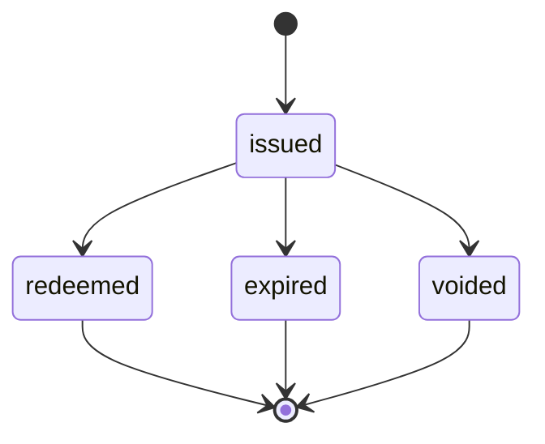

# Gift cards

> Generated from `_registry/business-domains.json`, the code and `docs/source/giftcard.md` — edit those, then run `node scripts/domain-docs.js`.

## Overview

A card bought as an item or issued by staff: a code with a value, sent to its recipient with a message, redeemable into the recipient's gift balance, checked for its balance, voided with a reason and expired after its validity. A card is a node on the kernel; its code is sealed and found by a blind index.

**Foundation domain:** Commerce · **Used by:** Shopper, Store administrator, Platform administrator

## Switches and settings

Each is switched on per store under ⚙️ Capabilities; its parameters are that store's settings.

### Gift cards (`gift_cards`)

Gift cards bought as an item at checkout or issued by staff: a code with a value, sent to its recipient with a message, redeemed into the recipient's gift balance, checked for its balance, voided with a reason, and expired after its validity. The gift balance is spent first at checkout.

| Setting | Meaning | Default |
|---|---|---|
| `wallet_definition` | The wallet definition a redeemed card's value lands in | `"gift"` |
| `fact` | The item fact that makes an item a gift card | `"gift_card"` |
| `validity_days` | Days a card is valid (0: it does not expire) | `365` |
| `min_amount` | Smallest value a card may have | `1` |
| `max_amount` | Largest value a card may have | `2000` |
| `denominations` | Values offered to choose from | `[10,15,20,25,50,100,200,250,500,1000,2000]` |
| `code_length` | Length of a card's code | `16` |

## Architecture

| Module | What it is |
|---|---|
| `lib/giftcards.js` | gift cards (the Offers domain), on the kernel. |
| `lib/routes/giftcard.js` | gift card domain routes (moved from lib/routes/offer.js; _registry/business-domains.json). Each handler answers one route of the gift card domain: the cards a shopper holds, the code they redeem, the balance they check, and the staff surface that issues and voids them. What it needs from the shared HTTP kit (lib/api.js) is passed in as `kit`. |

**Registry lists** (editable in Data Studio): `giftCardStatuses`, `giftCardOccasions`, `giftCardSources`

## API reference

Every call is JSON over HTTPS; store calls carry the store (`?store=`) and the session; mutating calls accept an `Idempotency-Key` header where noted.

| Method and path | Handler | What it does |
|---|---|---|
| `GET /api/gift-cards` | `apiGiftCardsMine` | a shopper's gift cards — bought, given, redeemed, with their codes — the values offered, and the occasions |
| `POST /api/gift-cards/redeem` | `apiGiftCardRedeem` | a shopper redeems a card's code into their gift balance |
| `POST /api/gift-cards/check` | `apiGiftCardCheck` | what a code is worth and whether it can still be redeemed — nothing about who holds it |
| `GET /api/admin/gift-cards` | `apiAdminGiftCards` | staff: every card of the store |
| `POST /api/admin/gift-cards` | `apiAdminGiftCardIssue` | staff issue a card (its code is shown once, here) |
| `POST /api/admin/gift-cards/:id/void` | `apiAdminGiftCardVoid` | staff void a card, with a reason |

## Process flows

Each record's life is a declared state machine (`lib/seed/states.json`): the moves it may make, and the actions that make them.

### A gift card's life (`gift_card`)

Actions: `redeem` → redeemed · `expire` → expired · `void` → voided

## Data flow

## User interface

**Pages:** `gift-cards.html`

**Store console:** 🎁 Gift Cards

## User flows

**Issue or purchase.** A shopper buys a configured gift-card item, or staff issue a card for a recipient. The code is generated once, protected at rest and delivered only through the configured notification path.

**Check and redeem.** Anyone may check whether a code is redeemable and its remaining value without learning its holder. The recipient signs in and redeems it. The platform atomically changes the card state and credits the recipient's gift wallet; the balance is then available at checkout.

**Void and expiry.** Staff may void a redeemable card with a reason. A card past its configured validity enters the expired state. Redeemed, expired and voided cards cannot be redeemed again.

## Manuals

### Shopper

Open **Gift Cards** to buy or check a card. Sign in before redeeming. Enter the code once; after successful redemption the amount appears in your gift balance and is automatically considered at checkout where the store permits wallet payment.

### Store administrator

Open **Gift Cards** to configure the capability, issue a card, provide the recipient details and record the one-time code securely. Use the card list to check state and void compromised or incorrectly issued cards with a reason.

### Platform administrator

Govern gift-card limits, validity, denominations, occasions and sources. Ensure wallet capability and notification transport are enabled before activating gift cards for a tenant.

