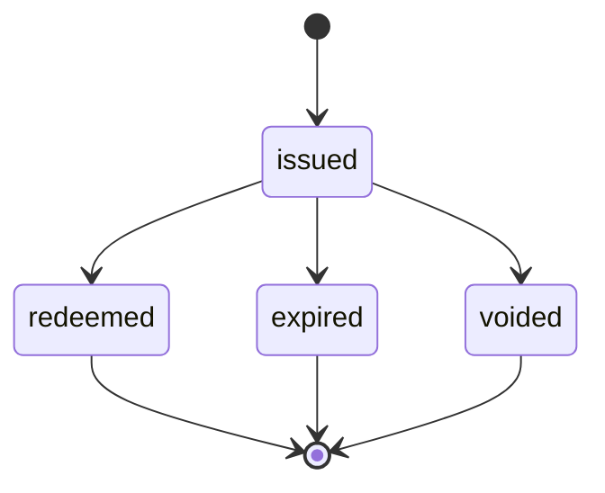
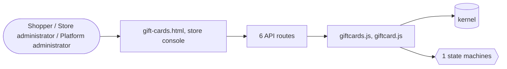

# Gift cards

> Generated from `_registry/business-domains.json`, the code and `docs/source/giftcard.md` — edit those, then run `node scripts/domain-docs.js`.

## Overview

A card bought as an item or issued by staff: a code with a value, sent to its recipient with a message, redeemable into the recipient's gift balance, checked for its balance, voided with a reason and expired after its validity. A card is a node on the kernel; its code is sealed and found by a blind index.

**Foundation domain:** Commerce · **Used by:** Shopper, Store administrator, Platform administrator

## Switches and settings

Each is switched on per store under ⚙️ Capabilities; its parameters are that store's settings.

### Gift cards (`gift_cards`)

Gift cards bought as an item at checkout or issued by staff: a code with a value, sent to its recipient with a message, redeemed into the recipient's gift balance, checked for its balance, voided with a reason, and expired after its validity. The gift balance is spent first at checkout.

| Setting | Meaning | Default |
|---|---|---|
| `wallet_definition` | The wallet definition a redeemed card's value lands in | `"gift"` |
| `fact` | The item fact that makes an item a gift card | `"gift_card"` |
| `validity_days` | Days a card is valid (0: it does not expire) | `365` |
| `min_amount` | Smallest value a card may have | `1` |
| `max_amount` | Largest value a card may have | `2000` |
| `denominations` | Values offered to choose from | `[10,15,20,25,50,100,200,250,500,1000,2000]` |
| `code_length` | Length of a card's code | `16` |

## Architecture

| Module | What it is |
|---|---|
| `lib/giftcards.js` | gift cards (the Offers domain), on the kernel. |
| `lib/routes/giftcard.js` | gift card domain routes (moved from lib/routes/offer.js; _registry/business-domains.json). Each handler answers one route of the gift card domain: the cards a shopper holds, the code they redeem, the balance they check, and the staff surface that issues and voids them. What it needs from the shared HTTP kit (lib/api.js) is passed in as `kit`. |

**Registry lists** (editable in Data Studio): `giftCardStatuses`, `giftCardOccasions`, `giftCardSources`

## API reference

Every call is JSON over HTTPS; store calls carry the store (`?store=`) and the session; mutating calls accept an `Idempotency-Key` header where noted.

| Method and path | Handler | What it does |
|---|---|---|
| `GET /api/gift-cards` | `apiGiftCardsMine` | a shopper's gift cards — bought, given, redeemed, with their codes — the values offered, and the occasions |
| `POST /api/gift-cards/redeem` | `apiGiftCardRedeem` | a shopper redeems a card's code into their gift balance |
| `POST /api/gift-cards/check` | `apiGiftCardCheck` | what a code is worth and whether it can still be redeemed — nothing about who holds it |
| `GET /api/admin/gift-cards` | `apiAdminGiftCards` | staff: every card of the store |
| `POST /api/admin/gift-cards` | `apiAdminGiftCardIssue` | staff issue a card (its code is shown once, here) |
| `POST /api/admin/gift-cards/:id/void` | `apiAdminGiftCardVoid` | staff void a card, with a reason |

## Process flows

Each record's life is a declared state machine (`lib/seed/states.json`): the moves it may make, and the actions that make them.

### A gift card's life (`gift_card`)

Actions: `redeem` → redeemed · `expire` → expired · `void` → voided

## Data flow

## User interface

**Pages:** `gift-cards.html`

**Store console:** 🎁 Gift Cards

## User flows

**Buying a card.** A shopper chooses one of the store's gift-card items, a denomination or any amount
between the store's minimum and maximum, an occasion, the recipient's name and email and a message,
and adds it to the bag. When the order is placed each unit becomes a card for that amount, addressed
to the recipient. The buyer holds the card and sees its code, and is told it is ready.

**Issuing a card.** Staff issue a card directly — a goodwill gesture, a prize, a refund as a card —
with its value, occasion, recipient and message, and optionally the shopper who holds it. The code is
shown once to staff. An offer may also grant a card (`gift_card_issue`); it is issued the same way.

**Redeeming.** A signed-in shopper types a card's code. If the card can still be redeemed, its whole
value moves into the shopper's gift balance (the wallet definition the capability names) as one
ledger movement, the card is marked redeemed, and the shopper holds it too. Checkout spends the gift
balance first.

**Checking.** Anyone may check a code: what it is worth, its state, whether it can be redeemed and
until when.

**Voiding and expiry.** Staff void a card, saying why. A card expires after the store's validity
(none means it never expires). A voided or expired card cannot be redeemed, and the shopper is told
which.

**Security.** A card's code, recipient, message, buyer and redeemer are sealed. A card is found only
by a keyed index of its code, so the code is never stored readable.

## Manuals

### Shopper

1. Open **Gift Cards** from the store's menu.
2. **Give one**: choose the card, an amount (or type any amount within the limits shown), an occasion,
   the recipient's name and email and your message, then **Add to bag** and check out as usual. The
   card's code appears under **Your cards** once the order is placed.
3. **Redeem a card** (signed in): type the code and **Redeem**. The value is added to your gift
   balance, which is used first when you next check out.
4. **Check a card**: type a code to see what it is worth, whether it can still be used and until when.

### Store administrator

1. Gift cards need the **Gift cards** capability (⚙️ Capabilities). Its settings are the smallest and
   largest card, the denominations offered, how long a card is valid and the gift-balance wallet.
2. Open **Offers → 🎁 Gift Cards**. The heading states your limits and validity.
3. **Issue a card**: give its value, occasion, recipient and their email, the holder (an owner key such
   as `t1:u:42`, optional) and a message, then **Issue**. The code is shown once — give it to its
   recipient.
4. The list shows every card by its last four digits, with its value, how it came to be, recipient,
   occasion, validity and state. **Void** cancels a card that can still be redeemed; you are asked why.
5. To sell cards, publish a product whose facts mark it as a gift card; shoppers then find it on the
   **Gift Cards** page.

### Platform administrator

1. The card's life is the `gift_card` state machine; its states, occasions and sources are platform
   registries (`giftCardStatuses`, `giftCardOccasions`, `giftCardSources`).
2. The **Gift cards** capability and its defaults (amounts, validity, code length, the wallet
   definition a redeemed card pays into) are declared by the platform; each store sets its own values.
3. An offer of type `gift_card_issue` issues a card when it applies; the incentive engine asks the
   Gift card domain to write it.

