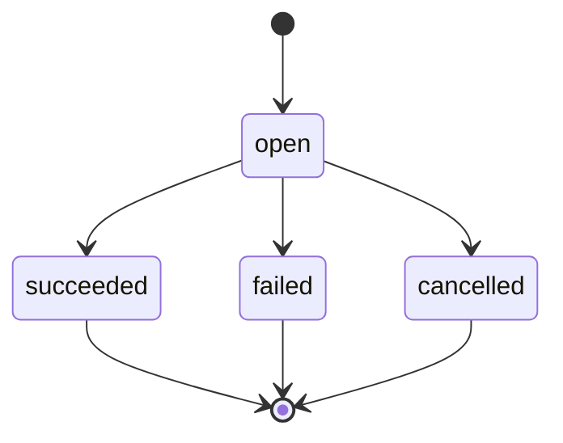
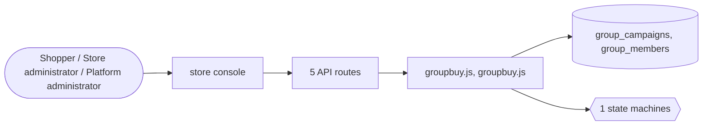

# Group buying

> Generated from `_registry/business-domains.json`, the code and `docs/source/groupbuy.md` — edit those, then run `node scripts/domain-docs.js`.

## Overview

A lower price when enough shoppers join before a deadline: staff open a campaign on a product with a group price, how many members it needs and how many it may take; a shopper joins by buying at the group price. A campaign that reaches its members succeeds and its orders go ahead; one that falls short fails and every member's order is cancelled and refunded.

**Foundation domain:** Commerce · **Used by:** Shopper, Store administrator, Platform administrator

## Switches and settings

Each is switched on per store under ⚙️ Capabilities; its parameters are that store's settings.

### Group buying (`group_buying`)

A lower price that applies when enough shoppers join before a deadline; if the group falls short, every member's order is cancelled and refunded.

| Setting | Meaning | Default |
|---|---|---|
| `max_qty_per_member` | Most one member may buy | `5` |
| `close_when_full` | A campaign closes as soon as it is full | `true` |
| `refund_kind` | Wallet ledger kind used to refund a failed group | `"refund"` |

## Architecture

| Module | What it is |
|---|---|
| `lib/groupbuy.js` | Group buying: a lower price when enough shoppers join. Staff open a campaign on a product: a group price, how many members it needs by a deadline, and how many it may take. A shopper joins by buying at the group price — the campaign rides on the bag line as its `group` term (lib/lineterms.js) — and becomes a member with that order. When the deadline passes, a campaign with enough members has succeeded and its orders go ahead; one that fell short has failed, and every member's order is cancelled and what they paid is refunded to their wallet. A full campaign may close early. The campaign's life is the `group_campaign` state machine, asked by tag (joinable, refunds_members…). Capability: group_buying. |
| `lib/routes/groupbuy.js` | group buying domain routes (moved from lib/routes/offer.js; _registry/business-domains.json). Each handler answers one route of the group-buy domain: the campaigns a shopper has joined, and the staff surface that opens, settles and cancels them. What it needs from the shared HTTP kit (lib/api.js) is passed in as `kit`. |

**Registry lists** (editable in Data Studio): `groupCampaignStatuses`

## Data model

### `group_campaigns`

| Column | Type |
|---|---|
| `id` | INTEGER PRIMARY KEY AUTOINCREMENT |
| `tenant_id` | INTEGER NOT NULL |
| `product_id` | TEXT NOT NULL |
| `title` | TEXT DEFAULT '' |
| `group_price` | REAL NOT NULL |
| `min_members` | INTEGER NOT NULL |
| `max_members` | INTEGER |
| `ends_at` | TEXT NOT NULL |
| `status` | TEXT NOT NULL DEFAULT 'open' |
| `closed_at` | TEXT |
| `created_at` | TEXT NOT NULL DEFAULT (datetime('now')) |

### `group_members`

| Column | Type |
|---|---|
| `id` | INTEGER PRIMARY KEY AUTOINCREMENT |
| `tenant_id` | INTEGER NOT NULL |
| `campaign_id` | INTEGER NOT NULL |
| `owner` | TEXT NOT NULL |
| `order_id` | INTEGER NOT NULL |
| `qty` | INTEGER NOT NULL DEFAULT 1 |
| `paid` | REAL NOT NULL DEFAULT 0 |
| `refunded` | INTEGER NOT NULL DEFAULT 0 |
| `joined_at` | TEXT NOT NULL DEFAULT (datetime('now')) |

## API reference

Every call is JSON over HTTPS; store calls carry the store (`?store=`) and the session; mutating calls accept an `Idempotency-Key` header where noted.

| Method and path | Handler | What it does |
|---|---|---|
| `GET /api/group-buys` | `apiGroupBuysMine` | the campaigns this shopper has joined |
| `GET /api/admin/group-buys` | `apiAdminGroupBuys` | staff: every campaign of the store |
| `POST /api/admin/group-buys` | `apiAdminGroupBuyCreate` | staff open a campaign |
| `POST /api/admin/group-buys/tick` | `apiAdminGroupBuyTick` | staff settle the campaigns whose deadline has passed |
| `POST /api/admin/group-buys/:id/cancel` | `apiAdminGroupBuyCancel` | staff cancel a campaign and refund its members |

## Process flows

Each record's life is a declared state machine (`lib/seed/states.json`): the moves it may make, and the actions that make them.

### Group-buy campaign (`group_campaign`)

Actions: `succeed` → succeeded · `fail` → failed · `cancel` → cancelled

## Data flow

## User interface

**Store console:** 👥 Group Buying

## User flows

**Opening a campaign.** Staff open a campaign on a published product: a group price above zero and
below the product's price, how many members it needs (at least two), the most it may take
(optional) and a deadline in the future. The campaign is joinable from then on.

**Joining.** A shopper sees the group price on the product page with how many have joined, how many
more are needed and the deadline. **Join the group** puts the product in the bag at the group price;
the shopper becomes a member when that order is placed. A shopper joins a campaign once, may buy at
most the capability's limit, and cannot join a campaign that has closed, passed its deadline or is
full.

**Closing.** When the deadline passes — or, where the capability says so, as soon as the campaign is
full — the campaign closes. With enough members it succeeds: every member is told and their orders go
ahead at the group price. Short of members it fails: every member's order is cancelled and what they
paid goes back to their wallet, and each is told. Campaigns are closed by a sweep; staff can also run
it on demand.

**Cancelling.** Staff may cancel a campaign that is still open; its members are refunded the same way
as a failed campaign.

## Manuals

### Shopper

1. On a product with a group offer, the panel shows the group price, how many have joined, how many
   more are needed and until when.
2. **Join the group** adds the product at the group price; check out as usual.
3. If the group fills in time, your order goes ahead at the group price. If it does not, your order is
   cancelled and what you paid is returned to your wallet. You are told either way.
4. Your groups are listed under **Your activity → 👥 Group buys**.

### Store administrator

1. Group buying needs the **Group buying** capability (⚙️ Capabilities). Its settings are the most one
   member may buy, whether a campaign closes as soon as it is full, and the ledger kind used for
   refunds.
2. Open **Offers → 👥 Group Buying**.
3. **New group**: give the product id, the group price, the members needed, the most members (optional)
   and the end, then **Open group**.
4. The list shows each campaign with its price, members against those needed, its end and its state.
   **Cancel & refund** cancels an open campaign and refunds every member.
5. **Settle ended groups now** closes every campaign whose deadline has passed (or that is full),
   without waiting for the sweep.

### Platform administrator

1. A campaign's life is the `group_campaign` state machine, asked by meaning (joinable, refunds
   members); its states are the platform registry `groupCampaignStatuses`.
2. The **Group buying** capability and its defaults are declared by the platform; each store sets its
   own values and decides whether to offer it.
3. Refunds to members are wallet credits of the capability's refund kind, so they appear in each
   member's wallet statement and in the store's ledger check.

