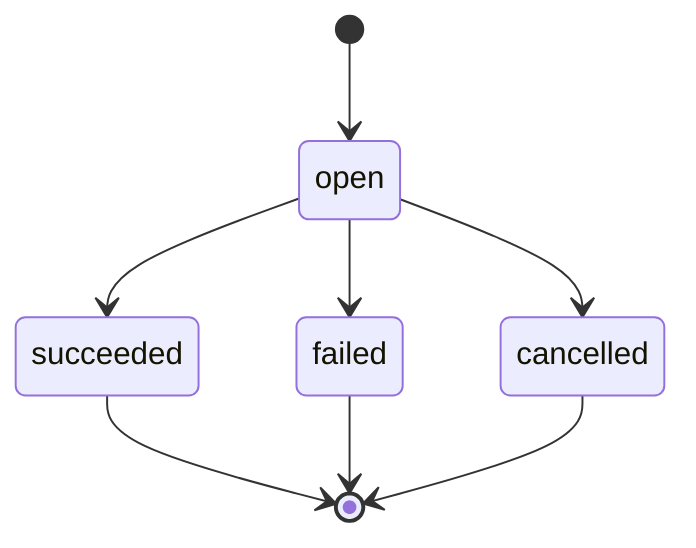
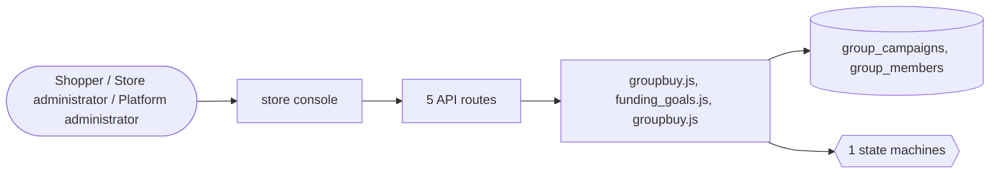

# Group buying

> Generated from `_registry/business-domains.json`, the code and `docs/source/groupbuy.md` — edit those, then run `node scripts/domain-docs.js`.

## Overview

A lower price when enough shoppers join before a deadline: staff open a campaign on a product with a group price, how many members it needs and how many it may take; a shopper joins by buying at the group price. A campaign that reaches its members succeeds and its orders go ahead; one that falls short fails and every member's order is cancelled and refunded.

**Foundation domain:** Commerce · **Used by:** Shopper, Store administrator, Platform administrator

## Switches and settings

Each is switched on per store under ⚙️ Capabilities; its parameters are that store's settings.

### Group buying (`group_buying`)

A lower price that applies when enough shoppers join before a deadline; if the group falls short, every member's order is cancelled and refunded.

| Setting | Meaning | Default |
|---|---|---|
| `max_qty_per_member` | Most one member may buy | `5` |
| `close_when_full` | A campaign closes as soon as it is full | `true` |
| `refund_kind` | Wallet ledger kind used to refund a failed group | `"refund"` |

### Funding goals (`funding_goals`)

An item made only if enough is pledged in time; otherwise every pledge is refunded.

## Architecture

| Module | What it is |
|---|---|
| `lib/groupbuy.js` | Group buying: a lower price when enough shoppers join. Staff open a campaign on a product: a group price, how many members it needs by a deadline, and how many it may take. A shopper joins by buying at the group price — the campaign rides on the bag line as its `group` term (lib/lineterms.js) — and becomes a member with that order. When the deadline passes, a campaign with enough members has succeeded and its orders go ahead; one that fell short has failed, and every member's order is cancelled and what they paid is refunded to their wallet. A full campaign may close early. The campaign's life is the `group_campaign` state machine, asked by tag (joinable, refunds_members…). Capability: group_buying. |
| `lib/features/funding_goals.js` | funding goals: an item made only if enough is pledged in time. An order is a pledge; when the day comes and the goal is not reached, every pledge is cancelled and refunded. |
| `lib/routes/groupbuy.js` | group buying domain routes (moved from lib/routes/offer.js; _registry/business-domains.json). Each handler answers one route of the group-buy domain: the campaigns a shopper has joined, and the staff surface that opens, settles and cancels them. What it needs from the shared HTTP kit (lib/api.js) is passed in as `kit`. |

**Registry lists** (editable in Data Studio): `groupCampaignStatuses`

## Data model

### `group_campaigns`

| Column | Type |
|---|---|
| `id` | INTEGER PRIMARY KEY AUTOINCREMENT |
| `tenant_id` | INTEGER NOT NULL |
| `product_id` | TEXT NOT NULL |
| `title` | TEXT DEFAULT '' |
| `group_price` | REAL NOT NULL |
| `min_members` | INTEGER NOT NULL |
| `max_members` | INTEGER |
| `ends_at` | TEXT NOT NULL |
| `status` | TEXT NOT NULL DEFAULT 'open' |
| `closed_at` | TEXT |
| `created_at` | TEXT NOT NULL DEFAULT (datetime('now')) |

### `group_members`

| Column | Type |
|---|---|
| `id` | INTEGER PRIMARY KEY AUTOINCREMENT |
| `tenant_id` | INTEGER NOT NULL |
| `campaign_id` | INTEGER NOT NULL |
| `owner` | TEXT NOT NULL |
| `order_id` | INTEGER NOT NULL |
| `qty` | INTEGER NOT NULL DEFAULT 1 |
| `paid` | REAL NOT NULL DEFAULT 0 |
| `refunded` | INTEGER NOT NULL DEFAULT 0 |
| `joined_at` | TEXT NOT NULL DEFAULT (datetime('now')) |

## API reference

Every call is JSON over HTTPS; store calls carry the store (`?store=`) and the session; mutating calls accept an `Idempotency-Key` header where noted.

| Method and path | Handler | What it does |
|---|---|---|
| `GET /api/group-buys` | `apiGroupBuysMine` | the campaigns this shopper has joined |
| `GET /api/admin/group-buys` | `apiAdminGroupBuys` | staff: every campaign of the store |
| `POST /api/admin/group-buys` | `apiAdminGroupBuyCreate` | staff open a campaign |
| `POST /api/admin/group-buys/tick` | `apiAdminGroupBuyTick` | staff settle the campaigns whose deadline has passed |
| `POST /api/admin/group-buys/:id/cancel` | `apiAdminGroupBuyCancel` | staff cancel a campaign and refund its members |

## Process flows

Each record's life is a declared state machine (`lib/seed/states.json`): the moves it may make, and the actions that make them.

### Group-buy campaign (`group_campaign`)

Actions: `succeed` → succeeded · `fail` → failed · `cancel` → cancelled

## Data flow

## User interface

**Store console:** 🎟️ Offers · Ω∞ GOIP · 👥 Group Buying

## User flows

**Open.** A store administrator selects a product, group price, minimum members, optional maximum and deadline. The campaign starts in its declared open state.

**Join and settle.** A shopper joins by purchasing the group line. The campaign counts members and closes early when full if configured. At the deadline, a campaign meeting its minimum succeeds; otherwise it fails, cancels member orders and refunds their payments. Staff may cancel an open campaign, which follows the same refund path.

**Failure states.** A closed, full, expired or cancelled campaign cannot accept another member. A member cannot exceed the configured quantity limit.

## Manuals

### Shopper

Open a product with a group offer, review the required member count and deadline, then join through checkout. Track joined groups under your activity. A successful group proceeds normally; a failed or cancelled group returns the paid amount to your wallet.

### Store administrator

Open **Offers → Group Buying**, create the campaign and monitor members. Use **Settle ended groups** after deadlines, or cancel an open campaign when necessary. Verify wallet refunds and order states after a failed campaign.

### Platform administrator

Govern the `group_buying` capability and its parameters: member quantity, close-when-full behavior and refund kind. Review the state machine and tenant activity through platform monitoring.

