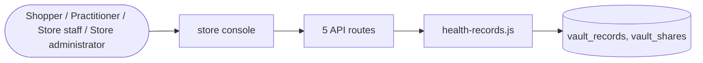

# Health and pharmacy

> Generated from `_registry/business-domains.json`, the code and `docs/source/health.md` — edit those, then run `node scripts/domain-docs.js`.

## Overview

What health commerce needs: prescriptions checked before sale, verified practitioners, lab tests and their reports, and the shopper's own health records shared with consent.

**Foundation domain:** Offering · **Used by:** Shopper, Practitioner, Store staff, Store administrator

## Switches and settings

Each is switched on per store under ⚙️ Capabilities; its parameters are that store's settings.

### Prescriptions (`prescriptions`)

An item whose facts say it needs a prescription is bought only with an approved, still-valid prescription on its line (a caseKinds row that gates).

### Practitioner verification (`practitioner_verification`)

A practitioner (a doctor, a lawyer, a consultant, a teacher) submits a licence or registration; staff verify it for the time the kind declares.

### Lab tests (`lab_tests`)

An ordered lab test awaits its report; staff upload it within the due days and the shopper is told it is ready.

| Setting | Meaning | Default |
|---|---|---|
| `fact` | The item fact that makes it a lab test | `"lab_test"` |
| `due_days` | Days to upload a report before it shows as late | `3` |

### Health records (`health_records`)

The shopper's own vault of records (a prescription, a report, a scan) beside what their orders delivered; private, shared with a party for some days and taken back, every share recorded.

| Setting | Meaning | Default |
|---|---|---|
| `vault_limit` | Most records a shopper keeps | `200` |
| `max_share_days` | Longest a record may be shared for (days) | `90` |

## Architecture

| Module | What it is |
|---|---|
| `lib/health-records.js` | health records: the shopper's own vault. |

## Data model

### `vault_records`

| Column | Type |
|---|---|
| `id` | INTEGER PRIMARY KEY AUTOINCREMENT |
| `tenant_id` | INTEGER NOT NULL |
| `owner` | TEXT NOT NULL |
| `title` | TEXT NOT NULL |
| `url` | TEXT NOT NULL |
| `kind` | TEXT NOT NULL DEFAULT '' |
| `created_at` | TEXT NOT NULL DEFAULT (datetime('now')) |

### `vault_shares`

| Column | Type |
|---|---|
| `id` | INTEGER PRIMARY KEY AUTOINCREMENT |
| `tenant_id` | INTEGER NOT NULL |
| `owner` | TEXT NOT NULL |
| `what` | TEXT NOT NULL |
| `ref` | INTEGER NOT NULL |
| `party` | TEXT NOT NULL |
| `until` | TEXT NOT NULL |
| `created_at` | TEXT NOT NULL DEFAULT (datetime('now')) |

## API reference

Every call is JSON over HTTPS; store calls carry the store (`?store=`) and the session; mutating calls accept an `Idempotency-Key` header where noted.

| Method and path | Handler | What it does |
|---|---|---|
| `GET /api/health-records` | `apiVault` | — |
| `POST /api/health-records` | `apiVaultKeep` | — |
| `POST /api/health-records/shares` | `apiVaultShare` | — |
| `DELETE /api/health-records/shares/:id` | `apiVaultUnshare` | — |
| `GET /api/admin/health-records/shared` | `apiAdminRecordsShared` | what a party has been shown (staff read what shoppers shared with the store) |

## Data flow

## User interface

**Store console:** 📄 Prescriptions · 🪪 Practitioner Verification · 🧫 Lab Tests · 🩺 Health Records

## User flows

_Not yet written — `docs/source/health.md`, section `## Flows`._

## Manuals

### Shopper

_Not yet written — `docs/source/health.md`, section `## Manual: shopper`._

### Practitioner

_Not yet written — `docs/source/health.md`, section `## Manual: practitioner`._

### Store staff

_Not yet written — `docs/source/health.md`, section `## Manual: store_staff`._

### Store administrator

_Not yet written — `docs/source/health.md`, section `## Manual: store_admin`._

