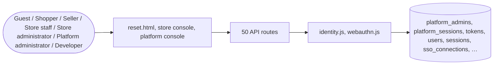

# Identity

> Generated from `_registry/business-domains.json`, the code and `docs/source/identity.md` — edit those, then run `node scripts/domain-docs.js`.

## Overview

Who someone is: accounts, sign-in by every method (password, one-time code, magic link, passkey, single sign-on), sessions, provisioning from directories, and platform administrators' own accounts.

**Foundation domain:** Identity · **Used by:** Guest, Shopper, Seller, Store staff, Store administrator, Platform administrator, Developer

## Architecture

| Module | What it is |
|---|---|
| `lib/identity.js` |  |
| `lib/webauthn.js` | UCOS Ω∞ · WebAuthn — real assertion math, zero dependencies (node:crypto only). -------------------------------------------------------------------------- The identity engine advertises a biometric flow (WebAuthn / passkey). For a long time that was a documented stub: the "verification" checked only that an assertion HAD the two fields a real one has, and accepted anything that did — so a login method was advertised that no cryptography backed. This module is the math. |

## Data model

### `platform_admins`

| Column | Type |
|---|---|
| `id` | INTEGER PRIMARY KEY AUTOINCREMENT |
| `name` | TEXT NOT NULL |
| `email` | TEXT NOT NULL UNIQUE |
| `salt` | TEXT NOT NULL |
| `hash` | TEXT NOT NULL |
| `created_at` | TEXT NOT NULL DEFAULT (datetime('now')) |
| `kdf_version` | TEXT DEFAULT 'v1' |
| `role` | TEXT |
| `perms` | TEXT DEFAULT '{}' |
| `uid` | TEXT |

### `platform_sessions`

| Column | Type |
|---|---|
| `ptid` | TEXT PRIMARY KEY |
| `admin_id` | INTEGER REFERENCES platform_admins(id) |
| `created_at` | TEXT NOT NULL DEFAULT (datetime('now')) |
| `expires_at` | TEXT NOT NULL |
| `uid` | TEXT |

### `tokens`

| Column | Type |
|---|---|
| `token` | TEXT PRIMARY KEY |
| `tenant_id` | INTEGER NOT NULL |
| `user_id` | INTEGER NOT NULL |
| `created_at` | TEXT NOT NULL DEFAULT (datetime('now')) |
| `expires_at` | TEXT NOT NULL |
| `uid` | TEXT |

### `users`

| Column | Type |
|---|---|
| `id` | INTEGER PRIMARY KEY AUTOINCREMENT |
| `tenant_id` | INTEGER NOT NULL DEFAULT 1 |
| `name` | TEXT NOT NULL |
| `email` | TEXT NOT NULL |
| `salt` | TEXT NOT NULL |
| `hash` | TEXT NOT NULL |
| `role` | TEXT NOT NULL DEFAULT 'customer' |
| `created_at` | TEXT NOT NULL DEFAULT (datetime('now')) |
| `kyc_status` | TEXT DEFAULT 'unverified' |
| `bnpl_eligible` | INTEGER DEFAULT 0 |
| `loyalty_points` | INTEGER DEFAULT 0 |
| `kdf_version` | TEXT DEFAULT 'v1' |
| `pwd_history` | TEXT DEFAULT '[]' |
| `staff_role` | TEXT DEFAULT 'owner' |
| `perms` | TEXT DEFAULT '{}' |
| `last_login` | TEXT |
| `disabled` | INTEGER DEFAULT 0 |
| `uid` | TEXT |

### `sessions`

| Column | Type |
|---|---|
| `sid` | TEXT PRIMARY KEY |
| `user_id` | INTEGER REFERENCES users(id) |
| `created_at` | TEXT NOT NULL DEFAULT (datetime('now')) |
| `expires_at` | TEXT NOT NULL |
| `csrf` | TEXT |
| `auth_at` | TEXT |
| `uid` | TEXT |

### `sso_connections`

| Column | Type |
|---|---|
| `tenant_id` | INTEGER PRIMARY KEY |
| `provider` | TEXT DEFAULT 'okta' |
| `entity_id` | TEXT DEFAULT '' |
| `sso_url` | TEXT DEFAULT '' |
| `cert` | TEXT DEFAULT '' |
| `enabled` | INTEGER DEFAULT 0 |
| `domains` | TEXT DEFAULT '[]' |
| `mode` | TEXT DEFAULT 'saml' |
| `issuer` | TEXT DEFAULT '' |
| `client_id` | TEXT DEFAULT '' |
| `client_secret` | TEXT DEFAULT '' |
| `redirect_uri` | TEXT DEFAULT '' |
| `scope` | TEXT DEFAULT 'openid email profile' |
| `auto_provision` | INTEGER DEFAULT 0 |
| `default_role` | TEXT DEFAULT 'manager' |
| `updated_at` | TEXT NOT NULL DEFAULT (datetime('now')) |
| `uid` | TEXT |

### `sso_states`

| Column | Type |
|---|---|
| `state` | TEXT PRIMARY KEY |
| `tenant_id` | INTEGER NOT NULL |
| `nonce` | TEXT DEFAULT '' |
| `created_at` | TEXT NOT NULL DEFAULT (datetime('now')) |

### `scim_tokens`

| Column | Type |
|---|---|
| `id` | INTEGER PRIMARY KEY AUTOINCREMENT |
| `tenant_id` | INTEGER NOT NULL |
| `token_hash` | TEXT NOT NULL |
| `label` | TEXT DEFAULT '' |
| `prefix` | TEXT DEFAULT '' |
| `created_at` | TEXT NOT NULL DEFAULT (datetime('now')) |
| `uid` | TEXT |

### `identity_providers`

| Column | Type |
|---|---|
| `id` | TEXT PRIMARY KEY |
| `tenant_id` | INTEGER NOT NULL |
| `provider_type` | TEXT NOT NULL |
| `name` | TEXT NOT NULL |
| `enabled` | INTEGER DEFAULT 1 |
| `config` | TEXT DEFAULT '{}' |
| `display_order` | INTEGER DEFAULT 0 |
| `created_at` | TEXT DEFAULT (datetime('now')) |
| `updated_at` | TEXT |

### `platform_identity_templates`

| Column | Type |
|---|---|
| `id` | INTEGER PRIMARY KEY AUTOINCREMENT |
| `name` | TEXT NOT NULL |
| `description` | TEXT DEFAULT '' |
| `config` | TEXT DEFAULT '{}' |
| `is_default` | INTEGER DEFAULT 0 |
| `created_at` | TEXT NOT NULL DEFAULT (datetime('now')) |

### `user_identity_methods`

| Column | Type |
|---|---|
| `user_id` | INTEGER NOT NULL |
| `method_id` | TEXT PRIMARY KEY |
| `method_type` | TEXT NOT NULL |
| `identifier` | TEXT NOT NULL |
| `metadata` | TEXT DEFAULT '{}' |
| `is_primary` | INTEGER NOT NULL DEFAULT 0 |
| `created_at` | TEXT NOT NULL DEFAULT (datetime('now')) |
| `updated_at` | TEXT NOT NULL DEFAULT (datetime('now')) |

### `identity_otps`

| Column | Type |
|---|---|
| `id` | INTEGER PRIMARY KEY AUTOINCREMENT |
| `user_id` | INTEGER NOT NULL |
| `identifier` | TEXT NOT NULL |
| `otp` | TEXT NOT NULL |
| `expires_at` | INTEGER NOT NULL |
| `attempts` | INTEGER NOT NULL DEFAULT 0 |
| `verified` | INTEGER NOT NULL DEFAULT 0 |
| `created_at` | TEXT NOT NULL DEFAULT (datetime('now')) |

### `identity_magic_links`

| Column | Type |
|---|---|
| `id` | INTEGER PRIMARY KEY AUTOINCREMENT |
| `user_id` | INTEGER NOT NULL |
| `identifier` | TEXT NOT NULL |
| `token` | TEXT NOT NULL |
| `expires_at` | INTEGER NOT NULL |
| `used_at` | TEXT |
| `created_at` | TEXT NOT NULL DEFAULT (datetime('now')) |

### `identity_biometric_challenges`

| Column | Type |
|---|---|
| `id` | INTEGER PRIMARY KEY AUTOINCREMENT |
| `user_id` | INTEGER NOT NULL |
| `challenge` | TEXT NOT NULL |
| `expires_at` | INTEGER NOT NULL |
| `verified` | INTEGER NOT NULL DEFAULT 0 |
| `created_at` | TEXT NOT NULL DEFAULT (datetime('now')) |

### `identity_login_states`

| Column | Type |
|---|---|
| `state` | TEXT PRIMARY KEY |
| `tenant_id` | INTEGER NOT NULL |
| `provider_id` | TEXT NOT NULL |
| `expires_at` | INTEGER NOT NULL |
| `created_at` | TEXT NOT NULL DEFAULT (datetime('now')) |

### `password_resets`

| Column | Type |
|---|---|
| `id` | INTEGER PRIMARY KEY AUTOINCREMENT |
| `tenant_id` | INTEGER NOT NULL |
| `user_id` | INTEGER NOT NULL |
| `token_hash` | TEXT NOT NULL UNIQUE |
| `expires_at` | INTEGER NOT NULL |
| `used_at` | TEXT |
| `ip` | TEXT |
| `created_at` | TEXT NOT NULL DEFAULT (datetime('now')) |

## API reference

Every call is JSON over HTTPS; store calls carry the store (`?store=`) and the session; mutating calls accept an `Idempotency-Key` header where noted.

| Method and path | Handler | What it does |
|---|---|---|
| `GET /api/session` | `apiSession` | ---------------- session ---------------- |
| `POST /api/auth/register` | `apiRegister` | request-path credential work runs on the thread pool (await …Async): a synchronous scrypt here stalled the whole server for every anonymous registration / login / hint request |
| `POST /api/auth/login` | `apiLogin` | — |
| `POST /api/auth/logout` | `apiLogout` | — |
| `POST /api/auth/token-exchange` | `apiTokenExchange` | — |
| `GET /api/admin/users` | `apiAdminUsers` | — |
| `DELETE /api/admin/users/:id` | `apiAdminUserDelete` | — |
| `PUT /api/admin/account` | `apiAdminAccount` | — |
| `GET /api/platform/identity-templates` | `apiIdentityTemplates` | ========== Identity Templates APIs ========== |
| `POST /api/platform/identity-templates` | `apiIdentityTemplates` | ========== Identity Templates APIs ========== |
| `DELETE /api/platform/identity-templates/:id` | `apiIdentityTemplates` | ========== Identity Templates APIs ========== |
| `GET /api/platform/identity-templates/:id` | `apiIdentityTemplate` | — |
| `PUT /api/platform/identity-templates/:id` | `apiIdentityTemplate` | — |
| `POST /api/platform/identity-templates/:id/apply` | `apiIdentityTemplateApply` | Apply a global identity template to ANY store — the platform console configures every tenant, so the target is a body parameter (validated against the tenants table), never a hardcoded store. Mirrors the provisioning path's apply logic exactly so the two cannot drift. Platform-only: writing another store's identity settings is a platform action. |
| `GET /api/admin/sso` | `apiSsoGet` | — |
| `PUT /api/admin/sso` | `apiSsoSet` | — |
| `POST /api/auth/sso/start` | `apiSsoStart` | SSO always runs against the store this request is addressed to (subdomain / ?store= / cookie) — a body-supplied tenant_id let one store's callback sign a user into another |
| `POST /api/auth/sso/callback` | `apiSsoCallback` | — |
| `GET /api/admin/identity-providers` | `apiIdentityProvidersGet` | ---------------- identity ---------------- |
| `PUT /api/admin/identity-providers` | `apiIdentityProvidersPut` | — |
| `DELETE /api/admin/identity-providers/:id` | `apiIdentityProviderDelete` | — |
| `GET /api/admin/identity-provider-types` | `apiIdentityProviderTypes` | ========== Identity Provider Types (registry vocabulary) ========== |
| `POST /api/admin/identity-provider-types` | `apiIdentityProviderTypeCreate` | a new authentication KIND is platform vocabulary — authoring it is a platform action, and the console's provider-type form is the only writer. Idempotent by key. |
| `GET /api/admin/identity-settings` | `apiIdentitySettingsGet` | — |
| `PUT /api/admin/identity-settings` | `apiIdentitySettingsPut` | — |
| `POST /api/auth/password/forgot` | `apiPasswordForgot` | "forgot password" answers the same whether or not the account exists, so it cannot be used to discover who shops here. At most three links per account per 15 minutes; a new link retires the older ones. |
| `POST /api/auth/password/reset` | `apiPasswordReset` | a reset proves control of the mailbox, so it ends every session the account holds (the reason for a reset is often that someone else is signed in) and clears the lockout |
| `POST /api/auth/login-init` | `apiLoginInit` | — |
| `POST /api/auth/login/otp` | `apiLoginOtpVerify` | — |
| `POST /api/auth/login/magic` | `apiLoginMagicLinkVerify` | — |
| `POST /api/auth/login/biometric` | `apiLoginBiometricVerify` | — |
| `POST /api/auth/biometric/register` | `apiBiometricRegister` | enrol a WebAuthn credential on the signed-in account. Called twice by a console: once with no body to mint the challenge the authenticator signs, then with the attestation + clientDataJSON. The attestation is VERIFIED server-side (challenge, origin and, for packed/u2f, the certificate signature) before any key is bound — an account can never gain a credential by asserting it has one. |
| `POST /api/auth/login/callback` | `apiLoginCallback` | the callback every external authority (SSO/OIDC/OAuth/directory) returns the user to. The state resolves the provider this login belongs to; the id_token is verified by the platform's single verifier, and the account is created when the provider allows it. |
| `GET /api/auth/methods` | `apiAuthMethods` | — |
| `GET /api/user/identity-methods` | `apiIdentityMethodsGet` | — |
| `POST /api/user/identity-methods` | `apiIdentityMethodsLink` | — |
| `DELETE /api/user/identity-methods/:id` | `apiIdentityMethodsUnlink` | — |
| `PUT /api/user/identity-methods/:id/primary` | `apiIdentityMethodsSetPrimary` | — |
| `GET /api/scim/Users` | `apiScimUsersList` | — |
| `POST /api/scim/Users` | `apiScimUserCreate` | — |
| `POST /api/admin/scim/token` | `apiScimToken` | — |
| `POST /api/platform/login` | `apiPlatformLogin` | ================= PLATFORM ================= |
| `POST /api/platform/logout` | `apiPlatformLogout` | — |
| `GET /api/platform/me` | `apiPlatformMe` | — |
| `GET /api/auth/me` | `apiAuthMe` | — |
| `GET /api/platform/admins` | `apiPlatformAdmins` | ──────────────────────────────────────────────────────────────── PLATFORM ADMIN ACCOUNTS — the console's own user base. The seed creates exactly one platform owner, and for the whole history of this build that was the *only* way to get a platform account: newPlatformAdmin() was called solely by the seed. So a second operator — a support admin, a second owner — had to be created by hand in SQLite, which is impossible in practice because the credentials are scrypt(v2) + peppered and the pepper context ("pa:" + email) is baked into the hash. This is the CRUD surface that fixes it. Platform-only, audited on the global hash-chained log, and it reuses the *same* primitives the seed and the login path use — newPlatformAdmin / hashPasswordFor / checkPassword — so a created account signs in at /platform.html with no second code path and no divergent hashing. ──────────────────────────────────────────────────────────────── |
| `POST /api/platform/admins` | `apiPlatformAdmins` | ──────────────────────────────────────────────────────────────── PLATFORM ADMIN ACCOUNTS — the console's own user base. The seed creates exactly one platform owner, and for the whole history of this build that was the *only* way to get a platform account: newPlatformAdmin() was called solely by the seed. So a second operator — a support admin, a second owner — had to be created by hand in SQLite, which is impossible in practice because the credentials are scrypt(v2) + peppered and the pepper context ("pa:" + email) is baked into the hash. This is the CRUD surface that fixes it. Platform-only, audited on the global hash-chained log, and it reuses the *same* primitives the seed and the login path use — newPlatformAdmin / hashPasswordFor / checkPassword — so a created account signs in at /platform.html with no second code path and no divergent hashing. ──────────────────────────────────────────────────────────────── |
| `PUT /api/platform/admins/:id` | `apiPlatformAdminUpdate` | — |
| `DELETE /api/platform/admins/:id` | `apiPlatformAdminDelete` | — |
| `POST /api/platform/users` | `apiPlatformUserCreate` | ---------- user creation ---------- An account belongs to exactly one store (UNIQUE(tenant_id,email)), so the platform console creates one INTO a chosen store — the store picker is the domain the role is scoped against. A store admin's authority is a staff role from the store surface (rbac); a customer carries none. The password runs through the same policy the storefront signup enforces, so a platform-created account is never a weak back door, and an omitted password is generated server-side and shown once. |

## Data flow

## User interface

**Pages:** `reset.html`

**Store console:** 🔐 SSO & Integrations

**Platform console:** 🔐 Identity · Auth · 📋 Identity Templates · 👥 Persons · 🏢 Organizations · 🧭 Platform Setup · 👤 Users · 🔑 Permissions · 🧷 Credentials · 🔓 Authentication · 🛂 Authorization · 🤝 Trust · ✔️ Verification · 📄 KYC · 🏛️ KYB · 🕸️ Identity Graph · 🛡️ Platform Admins

## User flows

_Not yet written — `docs/source/identity.md`, section `## Flows`._

## Manuals

### Guest

_Not yet written — `docs/source/identity.md`, section `## Manual: guest`._

### Shopper

_Not yet written — `docs/source/identity.md`, section `## Manual: shopper`._

### Seller

_Not yet written — `docs/source/identity.md`, section `## Manual: seller`._

### Store staff

_Not yet written — `docs/source/identity.md`, section `## Manual: store_staff`._

### Store administrator

_Not yet written — `docs/source/identity.md`, section `## Manual: store_admin`._

### Platform administrator

_Not yet written — `docs/source/identity.md`, section `## Manual: platform_admin`._

### Developer

_Not yet written — `docs/source/identity.md`, section `## Manual: developer`._

