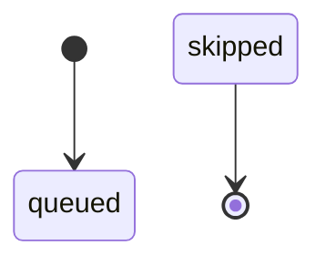
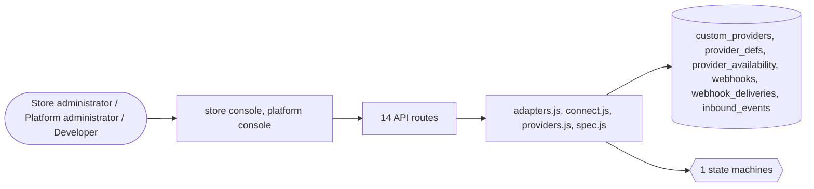

# Integrations and webhooks

> Generated from `_registry/business-domains.json`, the code and `docs/source/integration.md` — edit those, then run `node scripts/domain-docs.js`.

## Overview

Connecting outside systems: connectors and providers registered as data, custom providers, outgoing webhooks and their deliveries, incoming events.

**Foundation domain:** Integration · **Used by:** Store administrator, Platform administrator, Developer

## Architecture

| Module | What it is |
|---|---|
| `lib/adapters.js` | pluggable infra adapters selected by lib/config (no code forks). Dependency-free: Redis via a real RESP client over net.Socket, S3 via SigV4 + fetch, webhooks via fetch, and a Postgres wire client (lib/pg.js). Queue/inline & local-disk / memory are the safe defaults so single-node + CI work with zero services. Every factory is transport-injectable (__setTransport) for deterministic tests. Chosen-but-unreachable or unconfigured backends fall back to the in-process default rather than break a request. |
| `lib/connect.js` | outbound integration dispatcher (zero per-provider code). A provider's protocol now lives in DATA (provider_defs.spec, or a custom provider manifest's `spec`) and is executed by lib/spec.js. connect.js only: checks offline/credentials, loads the spec, renders+executes it, maps the result. Nothing here hard-codes Stripe/Meta/Google/Twilio — adding a provider or changing an endpoint is a data edit. When offline / no credentials / no spec, callers fall back to their simulated path, so the app runs and tests never hit the network. |
| `lib/providers.js` | pluggable provider registry: payments, shipping, notifications, tax, countries. Providers are pure data manifests - add new ones (built-in or custom JSON) with zero code changes. |
| `lib/spec.js` | declarative integration spec engine. A "how to call this API" description is DATA (stored on provider_defs.spec / custom provider manifest), not JavaScript. This module renders a spec against a context and executes it with the injectable fetch — so adding Stripe/Meta/Google/TikTok/a custom gateway is "fill in the blanks", never a code change. A spec supports: optional token/auth exchange, method, url template, auth (basic\|bearer\|apikey header), form\|json body templates, status mapping, and success/error paths. |

## Data model

### `custom_providers`

| Column | Type |
|---|---|
| `id` | INTEGER PRIMARY KEY AUTOINCREMENT |
| `scope` | TEXT NOT NULL DEFAULT 'platform' |
| `tenant_id` | INTEGER |
| `kind` | TEXT NOT NULL |
| `manifest` | TEXT NOT NULL |
| `created_at` | TEXT NOT NULL DEFAULT (datetime('now')) |
| `uid` | TEXT |

### `provider_defs`

| Column | Type |
|---|---|
| `id` | TEXT NOT NULL |
| `kind` | TEXT NOT NULL |
| `name` | TEXT NOT NULL |
| `emoji` | TEXT |
| `description` | TEXT |
| `methods` | TEXT DEFAULT '[]' |
| `fee_pct` | REAL DEFAULT 0 |
| `fee_fixed` | REAL DEFAULT 0 |
| `fields` | TEXT DEFAULT '[]' |
| `base_fee` | REAL DEFAULT 0 |
| `eta_min` | INTEGER |
| `eta_max` | INTEGER |
| `position` | INTEGER DEFAULT 0 |
| `enabled` | INTEGER DEFAULT 1 |
| `spec` | TEXT DEFAULT '{}' |
| `global` | INTEGER DEFAULT 0 |
| `uid` | TEXT |

### `provider_availability`

| Column | Type |
|---|---|
| `provider_id` | TEXT NOT NULL |
| `country_code` | TEXT NOT NULL REFERENCES countries(code) |
| `uid` | TEXT |

### `webhooks`

| Column | Type |
|---|---|
| `id` | INTEGER PRIMARY KEY AUTOINCREMENT |
| `tenant_id` | INTEGER NOT NULL |
| `url` | TEXT NOT NULL |
| `secret` | TEXT DEFAULT '' |
| `events` | TEXT DEFAULT '["*"]' |
| `active` | INTEGER DEFAULT 1 |
| `description` | TEXT DEFAULT '' |
| `created_at` | TEXT NOT NULL DEFAULT (datetime('now')) |
| `updated_at` | TEXT |
| `uid` | TEXT |

### `webhook_deliveries`

| Column | Type |
|---|---|
| `id` | INTEGER PRIMARY KEY AUTOINCREMENT |
| `tenant_id` | INTEGER NOT NULL |
| `webhook_id` | INTEGER |
| `event` | TEXT NOT NULL |
| `subject_uid` | TEXT |
| `payload` | TEXT DEFAULT '{}' |
| `status` | TEXT NOT NULL DEFAULT 'queued' |
| `attempts` | INTEGER DEFAULT 0 |
| `response` | TEXT DEFAULT '' |
| `next_retry_at` | TEXT |
| `created_at` | TEXT NOT NULL DEFAULT (datetime('now')) |
| `uid` | TEXT |

### `inbound_events`

| Column | Type |
|---|---|
| `id` | INTEGER PRIMARY KEY AUTOINCREMENT |
| `tenant_id` | INTEGER |
| `provider` | TEXT |
| `event` | TEXT |
| `payload` | TEXT DEFAULT '{}' |
| `signature_ok` | INTEGER DEFAULT 0 |
| `processed` | INTEGER DEFAULT 0 |
| `created_at` | TEXT NOT NULL DEFAULT (datetime('now')) |
| `uid` | TEXT |

## API reference

Every call is JSON over HTTPS; store calls carry the store (`?store=`) and the session; mutating calls accept an `Idempotency-Key` header where noted.

| Method and path | Handler | What it does |
|---|---|---|
| `GET /api/providers` | `apiProviders` | — |
| `GET /api/admin/custom-providers` | `apiAdminCustomProviders` | — |
| `POST /api/admin/custom-providers` | `apiAdminCustomProviderAdd` | — |
| `DELETE /api/admin/custom-providers/:id` | `apiAdminCustomProviderDelete` | — |
| `POST /api/webhooks/inbound/:provider` | `apiInboundWebhook` | A payment provider's webhook. The store's own gateway signing secret (Console → Payments, "Webhook signing secret") is tried first and confines the event to that store's payments; the platform's inbound secret is the fallback for a platform-operated account. How the signature is checked is the provider spec's `webhook.signature` (an HMAC over the body or URL + body, or the provider's own verify call); a spec that declares none uses the platform's scheme (`sha256=` / Stripe's `t=,v1=`). Only a verified event moves money state, and replays are no-ops. |
| `GET /api/admin/webhooks` | `apiWebhooksList` | ---------- webhooks (outbound events) + universal entity metadata (tags/notes via global uid) ---------- |
| `POST /api/admin/webhooks` | `apiWebhookCreate` | — |
| `PUT /api/admin/webhooks/:id` | `apiWebhookUpdate` | — |
| `DELETE /api/admin/webhooks/:id` | `apiWebhookDelete` | — |
| `POST /api/admin/webhooks/:id/test` | `apiWebhookTest` | — |
| `POST /api/admin/webhooks/drain` | `apiWebhookDrain` | — |
| `GET /api/platform/custom-providers` | `apiPlatformCustomProviders` | — |
| `POST /api/platform/custom-providers` | `apiPlatformCustomProviderAdd` | — |
| `DELETE /api/platform/custom-providers/:id` | `apiPlatformCustomProviderDelete` | — |

## Process flows

Each record's life is a declared state machine (`lib/seed/states.json`): the moves it may make, and the actions that make them.

### Webhook delivery (`webhook_delivery`)

Actions: 

## Data flow

## User interface

**Store console:** 🔗 Webhooks

**Platform console:** 🔌 Provider Registry · 🔌 Connectors · 🔗 Integrations · 🧩 Extensions

## User flows

_Not yet written — `docs/source/integration.md`, section `## Flows`._

## Manuals

### Store administrator

_Not yet written — `docs/source/integration.md`, section `## Manual: store_admin`._

### Platform administrator

_Not yet written — `docs/source/integration.md`, section `## Manual: platform_admin`._

### Developer

_Not yet written — `docs/source/integration.md`, section `## Manual: developer`._

