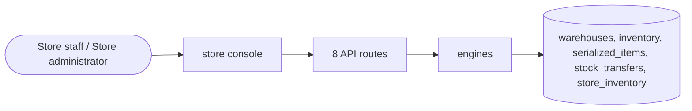

# Inventory

> Generated from `_registry/business-domains.json`, the code and `docs/source/inventory.md` — edit those, then run `node scripts/domain-docs.js`.

## Overview

How much of what is where: stock per SKU and warehouse, store-level stock, transfers between locations and serial-numbered items.

**Foundation domain:** Offering · **Used by:** Store staff, Store administrator

## Switches and settings

Each is switched on per store under ⚙️ Capabilities; its parameters are that store's settings.

### Store-inventory pinning (`store_inventory`)

Per-store stock pinning so a dark store cannot oversell. Safety stock is held back from the sellable count.

| Setting | Meaning | Default |
|---|---|---|
| `reserve_at_pin` | Reserve the units when a cart is pinned to a store | `true` |
| `consume_on_delivery` | Decrement the store's qty when a run is delivered | `true` |

## Architecture

**Registry lists** (editable in Data Studio): `qcInvStatuses`

## Data model

### `warehouses`

| Column | Type |
|---|---|
| `id` | INTEGER PRIMARY KEY AUTOINCREMENT |
| `tenant_id` | INTEGER NOT NULL |
| `name` | TEXT NOT NULL |
| `code` | TEXT |
| `country` | TEXT DEFAULT 'US' |
| `region` | TEXT DEFAULT '' |
| `active` | INTEGER DEFAULT 1 |
| `kind` | TEXT DEFAULT 'warehouse' |
| `lat` | REAL |
| `lng` | REAL |
| `service_radius_km` | REAL |
| `promise_minutes` | INTEGER |
| `pincode` | TEXT |
| `city` | TEXT |
| `deleted_at` | TEXT |
| `uid` | TEXT |

### `inventory`

| Column | Type |
|---|---|
| `id` | INTEGER PRIMARY KEY AUTOINCREMENT |
| `tenant_id` | INTEGER NOT NULL |
| `sku_id` | INTEGER NOT NULL |
| `warehouse_id` | INTEGER |
| `qty` | INTEGER DEFAULT 0 |
| `reserved` | INTEGER DEFAULT 0 |
| `lot` | TEXT DEFAULT '' |
| `batch` | TEXT DEFAULT '' |
| `expiry` | TEXT DEFAULT '' |
| `serial` | TEXT DEFAULT '[]' |
| `uid` | TEXT |

### `serialized_items`

| Column | Type |
|---|---|
| `id` | INTEGER PRIMARY KEY AUTOINCREMENT |
| `tenant_id` | INTEGER NOT NULL |
| `product_id` | TEXT NOT NULL |
| `sku_id` | INTEGER |
| `warehouse_id` | INTEGER |
| `serial` | TEXT NOT NULL |
| `imei` | TEXT |
| `rfid` | TEXT |
| `asset_tag` | TEXT |
| `batch` | TEXT DEFAULT '' |
| `lot` | TEXT DEFAULT '' |
| `expiry` | TEXT |
| `status` | TEXT NOT NULL DEFAULT 'in_stock' |
| `condition` | TEXT DEFAULT 'new' |
| `customer_id` | INTEGER |
| `order_id` | INTEGER |
| `purchase_date` | TEXT |
| `warranty_end` | TEXT |
| `meta` | TEXT DEFAULT '{}' |
| `created_at` | TEXT NOT NULL DEFAULT (datetime('now')) |
| `deleted_at` | TEXT |
| `uid` | TEXT |

### `stock_transfers`

| Column | Type |
|---|---|
| `id` | INTEGER PRIMARY KEY AUTOINCREMENT |
| `tenant_id` | INTEGER NOT NULL |
| `from_warehouse` | INTEGER |
| `to_warehouse` | INTEGER |
| `sku_id` | INTEGER |
| `qty` | INTEGER NOT NULL DEFAULT 1 |
| `status` | TEXT NOT NULL DEFAULT 'draft' |
| `reference` | TEXT DEFAULT '' |
| `note` | TEXT DEFAULT '' |
| `created_at` | TEXT NOT NULL DEFAULT (datetime('now')) |
| `deleted_at` | TEXT |
| `uid` | TEXT |

### `store_inventory`

| Column | Type |
|---|---|
| `id` | INTEGER PRIMARY KEY AUTOINCREMENT |
| `tenant_id` | INTEGER NOT NULL |
| `store_id` | INTEGER NOT NULL |
| `sku_id` | INTEGER |
| `product_id` | TEXT |
| `qty` | INTEGER DEFAULT 0 |
| `reserved` | INTEGER DEFAULT 0 |
| `safety_stock` | INTEGER DEFAULT 0 |
| `status` | TEXT NOT NULL DEFAULT 'active' |
| `deleted_at` | TEXT |
| `created_at` | TEXT NOT NULL DEFAULT (datetime('now')) |

## API reference

Every call is JSON over HTTPS; store calls carry the store (`?store=`) and the session; mutating calls accept an `Idempotency-Key` header where noted.

| Method and path | Handler | What it does |
|---|---|---|
| `POST /api/admin/warehouses/route` | `apiWarehouseRoute` | — |
| `PUT /api/admin/inventory/:id` | `apiAdminInventoryPut` | — |
| `GET /api/admin/warehouses` | `apiAdminWarehouses` | — |
| `POST /api/admin/warehouses` | `apiAdminWarehouseSave` | — |
| `PUT /api/admin/warehouses/:id` | `apiAdminWarehouseSave` | — |
| `POST /api/admin/serialized/bulk` | `apiAdminSerializedBulk` | — |
| `GET /api/admin/transfers` | `apiTransfers` | — |
| `POST /api/admin/transfers` | `apiTransferCreate` | — |

## Data flow

## User interface

**Store console:** 🔢 Serialized Items

## User flows

_Not yet written — `docs/source/inventory.md`, section `## Flows`._

## Manuals

### Store staff

_Not yet written — `docs/source/inventory.md`, section `## Manual: store_staff`._

### Store administrator

_Not yet written — `docs/source/inventory.md`, section `## Manual: store_admin`._

