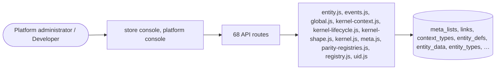

# Kernel and registries

> Generated from `_registry/business-domains.json`, the code and `docs/source/kernel.md` — edit those, then run `node scripts/domain-docs.js`.

## Overview

The foundation every domain is built on: kinds, entities, identifiers, hierarchies, versions in time, settings resolved by context, the event log, and the registries and entity definitions the console edits.

**Foundation domain:** Registry · **Used by:** Platform administrator, Developer

## Architecture

| Module | What it is |
|---|---|
| `lib/entity.js` | Universal Entity Meta Model. Every entity (built-in or custom) is described as data: fields, types, validation, permissions, list/form rendering hints. The generic engine below performs CRUD, validation, tenant scoping and auditing for ALL of them - zero per-entity code. |
| `lib/events.js` | event bus + declarative outbound webhooks. One place emits domain events; matching tenant webhooks get an HMAC-signed POST. Delivery is offline-safe (queued + skipped when no endpoint / LX_OFFLINE / test transport) so nothing blocks a request or hits the network unintentionally. The event catalog is DATA (meta_lists.webhookEvents) so new event types need no code. Retries ride the configured queue/backoff via drain(). |
| `lib/global.js` | Global Configuration Module Central repository for platform-wide definitions (Countries, Currencies, Providers, Plans) that can be configured per-tenant. All global data flows from this module to tenants. |
| `lib/kernel-context.js` | the kernel's context parts: scope (K11) and resolution (K12), owner Context; views (K10), owner Perspective. |
| `lib/kernel-lifecycle.js` | the kernel's change lifecycle (FOUNDATIONS K09; owner Evolution). |
| `lib/kernel-shape.js` | the kernel's shape part (FOUNDATIONS K05; owner Geo). |
| `lib/kernel.js` | the kernel (FOUNDATIONS K01–K12), first slice: kinds, nodes, identifiers, hierarchies, typed attributes, bi-temporal versions and the event log. |
| `lib/meta.js` | Universal Commerce Meta Model registries. Everything here is DATA. Tenants may override/extend via DB (custom registries). |
| `lib/parity-registries.js` | Universal Commerce registries. Every status, kind, type, tier and category the commerce entities reference is a row in meta_lists, editable at runtime from Data Studio. Nothing is an enum in code: add a quick-commerce store kind, a fintech payout status, a B2B document type or a buyer-claim state here (or in the console) and every dropdown, every validation option and every state machine that reads the registry follows on the next request. This is the platform's Knowledge-Once rule applied to the commerce capability set. No vendor name appears in any list — these are the platform's own vocabularies. |
| `lib/registry.js` | runtime registry: geo (countries/currencies), tax modes, provider catalog, availability relationships and list registries. All stored in DB tables (seeded once from providers.js/meta.js constants) and editable at runtime via the entity engine. |
| `lib/uid.js` | Universal Unique IDs: every row in every table gets a UUIDv4 at insert time via SQLite triggers (covers seeds, API, entity engine, manual SQL). |

## Data model

### `meta_lists`

| Column | Type |
|---|---|
| `name` | TEXT PRIMARY KEY |
| `label` | TEXT |
| `items` | TEXT NOT NULL |
| `seeded_from` | TEXT |
| `edited` | INTEGER DEFAULT 0 |
| `uid` | TEXT |

### `links`

| Column | Type |
|---|---|
| `id` | INTEGER PRIMARY KEY AUTOINCREMENT |
| `tenant_id` | INTEGER |
| `type` | TEXT NOT NULL |
| `from_entity` | TEXT NOT NULL |
| `from_uid` | TEXT NOT NULL |
| `to_entity` | TEXT NOT NULL |
| `to_uid` | TEXT NOT NULL |
| `meta` | TEXT DEFAULT '{}' |
| `created_at` | TEXT NOT NULL DEFAULT (datetime('now')) |
| `uid` | TEXT |

### `context_types`

| Column | Type |
|---|---|
| `id` | INTEGER PRIMARY KEY AUTOINCREMENT |
| `grp` | TEXT NOT NULL |
| `key` | TEXT NOT NULL |
| `label` | TEXT NOT NULL |
| `type` | TEXT DEFAULT 'context' |
| `fields` | TEXT DEFAULT '[]' |
| `position` | INTEGER DEFAULT 0 |
| `uid` | TEXT |

### `entity_defs`

| Column | Type |
|---|---|
| `key` | TEXT NOT NULL |
| `scope` | TEXT NOT NULL DEFAULT 'tenant' |
| `tenant_id` | INTEGER NOT NULL DEFAULT 0 |
| `def` | TEXT NOT NULL |
| `created_at` | TEXT NOT NULL DEFAULT (datetime('now')) |
| `uid` | TEXT |

### `entity_data`

| Column | Type |
|---|---|
| `id` | INTEGER PRIMARY KEY AUTOINCREMENT |
| `tenant_id` | INTEGER |
| `entity` | TEXT NOT NULL |
| `data` | TEXT NOT NULL |
| `created_at` | TEXT NOT NULL DEFAULT (datetime('now')) |
| `uid` | TEXT |

### `entity_types`

| Column | Type |
|---|---|
| `id` | INTEGER PRIMARY KEY AUTOINCREMENT |
| `entity` | TEXT NOT NULL |
| `type_key` | TEXT NOT NULL |
| `label` | TEXT NOT NULL |
| `icon` | TEXT DEFAULT '📝' |
| `fields` | TEXT NOT NULL DEFAULT '[]' |
| `config` | TEXT NOT NULL DEFAULT '{}' |
| `created_at` | TEXT NOT NULL DEFAULT (datetime('now')) |

### `entity_attributes`

| Column | Type |
|---|---|
| `id` | INTEGER PRIMARY KEY AUTOINCREMENT |
| `attribute_key` | TEXT NOT NULL |
| `entity` | TEXT NOT NULL |
| `position` | INTEGER NOT NULL DEFAULT 0 |
| `created_at` | TEXT NOT NULL DEFAULT (datetime('now')) |

### `entity_field_config`

| Column | Type |
|---|---|
| `id` | INTEGER PRIMARY KEY AUTOINCREMENT |
| `tenant_id` | INTEGER NOT NULL |
| `entity` | TEXT NOT NULL |
| `field_key` | TEXT NOT NULL |
| `required` | INTEGER NOT NULL DEFAULT 0 |
| `hidden` | INTEGER NOT NULL DEFAULT 0 |
| `config` | TEXT NOT NULL DEFAULT '{}' |
| `updated_at` | TEXT NOT NULL DEFAULT (datetime('now')) |

### `entity_meta`

| Column | Type |
|---|---|
| `id` | INTEGER PRIMARY KEY AUTOINCREMENT |
| `tenant_id` | INTEGER NOT NULL |
| `entity` | TEXT NOT NULL |
| `ref_uid` | TEXT NOT NULL |
| `tags` | TEXT DEFAULT '[]' |
| `meta` | TEXT DEFAULT '{}' |
| `notes` | TEXT DEFAULT '' |
| `created_at` | TEXT NOT NULL DEFAULT (datetime('now')) |
| `updated_at` | TEXT |
| `uid` | TEXT |

### `entity_usage`

| Column | Type |
|---|---|
| `id` | INTEGER PRIMARY KEY AUTOINCREMENT |
| `tenant_id` | INTEGER NOT NULL |
| `entity` | TEXT NOT NULL |
| `action` | TEXT NOT NULL |
| `at` | TEXT NOT NULL DEFAULT (datetime('now')) |

### `knowledge_graph`

| Column | Type |
|---|---|
| `id` | INTEGER PRIMARY KEY AUTOINCREMENT |
| `source_type` | TEXT NOT NULL |
| `source_id` | INTEGER NOT NULL |
| `relationship` | TEXT NOT NULL |
| `target_type` | TEXT NOT NULL |
| `target_id` | INTEGER NOT NULL |
| `weight` | REAL NOT NULL DEFAULT 1.0 |
| `metadata` | TEXT NOT NULL DEFAULT '{}' |
| `created_at` | TEXT NOT NULL DEFAULT (datetime('now')) |

### `composition_ledger`

| Column | Type |
|---|---|
| `id` | INTEGER PRIMARY KEY AUTOINCREMENT |
| `key` | TEXT NOT NULL UNIQUE |
| `/*` | the composed model key (cp_<capability>) — one row per capability */ capability TEXT NOT NULL |
| `/*` | the human label of what was composed */ source TEXT |
| `/*` | provenance: doc:line / catalog / registry */ artifacts TEXT NOT NULL DEFAULT '{}' |
| `/*` | the full manifest (data model, API, workflow, UI, dashboard, security) */ composed_at TEXT NOT NULL |

### `k_events`

| Column | Type |
|---|---|
| `seq` | INTEGER PRIMARY KEY AUTOINCREMENT |
| `at` | TEXT NOT NULL |
| `type` | TEXT NOT NULL |
| `namespace` | TEXT NOT NULL |
| `subject` | TEXT |
| `actor` | TEXT |
| `payload` | TEXT NOT NULL DEFAULT '{}' |
| `prev_hash` | TEXT NOT NULL |
| `hash` | TEXT NOT NULL |

### `k_kinds`

| Column | Type |
|---|---|
| `id` | INTEGER PRIMARY KEY AUTOINCREMENT |
| `namespace` | TEXT NOT NULL |
| `kind` | TEXT NOT NULL |
| `owner` | TEXT NOT NULL |
| `spec` | TEXT NOT NULL |
| `rec_from` | INTEGER NOT NULL |
| `rec_to` | INTEGER |
| `scope` | TEXT |

### `k_nodes`

| Column | Type |
|---|---|
| `uid` | TEXT PRIMARY KEY |
| `namespace` | TEXT NOT NULL |
| `kind` | TEXT NOT NULL |
| `rec_from` | INTEGER NOT NULL |
| `scope` | TEXT |

### `k_identifiers`

| Column | Type |
|---|---|
| `id` | INTEGER PRIMARY KEY AUTOINCREMENT |
| `node` | TEXT NOT NULL |
| `scheme` | TEXT NOT NULL |
| `value` | TEXT NOT NULL |
| `valid_from` | TEXT NOT NULL |
| `valid_to` | TEXT |
| `rec_from` | INTEGER NOT NULL |
| `rec_to` | INTEGER |

### `k_hierarchies`

| Column | Type |
|---|---|
| `id` | INTEGER PRIMARY KEY AUTOINCREMENT |
| `namespace` | TEXT NOT NULL |
| `hierarchy` | TEXT NOT NULL |
| `owner` | TEXT NOT NULL |
| `spec` | TEXT NOT NULL |
| `rec_from` | INTEGER NOT NULL |
| `rec_to` | INTEGER |
| `scope` | TEXT |

### `k_placements`

| Column | Type |
|---|---|
| `id` | INTEGER PRIMARY KEY AUTOINCREMENT |
| `hierarchy` | TEXT NOT NULL |
| `node` | TEXT NOT NULL |
| `parent` | TEXT |
| `valid_from` | TEXT NOT NULL |
| `valid_to` | TEXT |
| `rec_from` | INTEGER NOT NULL |
| `rec_to` | INTEGER |

### `k_versions`

| Column | Type |
|---|---|
| `id` | INTEGER PRIMARY KEY AUTOINCREMENT |
| `node` | TEXT NOT NULL |
| `attrs` | TEXT NOT NULL |
| `valid_from` | TEXT NOT NULL |
| `valid_to` | TEXT |
| `rec_from` | INTEGER NOT NULL |
| `rec_to` | INTEGER |

### `k_node_states`

| Column | Type |
|---|---|
| `id` | INTEGER PRIMARY KEY AUTOINCREMENT |
| `node` | TEXT NOT NULL |
| `state` | TEXT NOT NULL |
| `rec_from` | INTEGER NOT NULL |
| `rec_to` | INTEGER |

### `k_coord_systems`

| Column | Type |
|---|---|
| `id` | INTEGER PRIMARY KEY AUTOINCREMENT |
| `namespace` | TEXT NOT NULL |
| `system` | TEXT NOT NULL |
| `owner` | TEXT NOT NULL |
| `spec` | TEXT NOT NULL |
| `rec_from` | INTEGER NOT NULL |
| `rec_to` | INTEGER |

### `k_shapes`

| Column | Type |
|---|---|
| `id` | INTEGER PRIMARY KEY AUTOINCREMENT |
| `node` | TEXT NOT NULL |
| `system` | TEXT NOT NULL |
| `geom` | TEXT NOT NULL |
| `valid_from` | TEXT NOT NULL |
| `valid_to` | TEXT |
| `rec_from` | INTEGER NOT NULL |
| `rec_to` | INTEGER |

### `k_declarations`

| Column | Type |
|---|---|
| `id` | INTEGER PRIMARY KEY AUTOINCREMENT |
| `family` | TEXT NOT NULL |
| `namespace` | TEXT NOT NULL |
| `name` | TEXT NOT NULL |
| `owner` | TEXT NOT NULL |
| `spec` | TEXT NOT NULL |
| `rec_from` | INTEGER NOT NULL |
| `rec_to` | INTEGER |
| `scope` | TEXT |

### `k_assignments`

| Column | Type |
|---|---|
| `id` | INTEGER PRIMARY KEY AUTOINCREMENT |
| `namespace` | TEXT NOT NULL |
| `setting` | TEXT NOT NULL |
| `scope` | TEXT |
| `value` | TEXT NOT NULL |
| `valid_from` | TEXT NOT NULL |
| `valid_to` | TEXT |
| `rec_from` | INTEGER NOT NULL |
| `rec_to` | INTEGER |

### `k_changes`

| Column | Type |
|---|---|
| `id` | INTEGER PRIMARY KEY AUTOINCREMENT |
| `namespace` | TEXT NOT NULL |
| `title` | TEXT NOT NULL |
| `ops` | TEXT NOT NULL |
| `state` | TEXT NOT NULL |
| `author` | TEXT |
| `approver` | TEXT |
| `publish_at` | TEXT |
| `seq_from` | INTEGER |
| `seq_to` | INTEGER |
| `rolled_back_seq` | INTEGER |
| `result` | TEXT |
| `report` | TEXT |
| `created_at` | TEXT NOT NULL |

## API reference

Every call is JSON over HTTPS; store calls carry the store (`?store=`) and the session; mutating calls accept an `Idempotency-Key` header where noted.

| Method and path | Handler | What it does |
|---|---|---|
| `GET /api/registries` | `apiRegistriesList` | — |
| `POST /api/registries` | `apiRegistryCreate` | — |
| `POST /api/registries/:id/items` | `apiRegistryItem` | — |
| `GET /api/meta` | `apiMeta` | — |
| `GET /api/meta/entities` | `apiEntities` | — |
| `GET /api/meta/entity/:key` | `apiEntityList` | — |
| `POST /api/meta/entity/:key` | `apiEntityCreate` | — |
| `PUT /api/meta/entity/:key/:id` | `apiEntityUpdate` | — |
| `DELETE /api/meta/entity/:key/:id` | `apiEntityDelete` | — |
| `GET /api/meta/entity-def` | `apiEntityDefsList` | — |
| `POST /api/meta/entity-def` | `apiEntityDefSave` | — |
| `DELETE /api/meta/entity-def/:key` | `apiEntityDefDelete` | — |
| `POST /api/meta/entity-def/:key/enable` | `apiEntityDefEnable` | — |
| `POST /api/meta/entity-def/:key/disable` | `apiEntityDefDisable` | — |
| `GET /api/tenant/entity-def` | `apiTenantEntityDefs` | — |
| `GET /api/platform/universe-fields/:key` | `apiUniverseFields` | — |
| `GET /api/platform/entity-types` | `apiEntityTypeList` | ========== Global Entity Configuration API ========== |
| `POST /api/platform/entity-types` | `apiEntityTypeCreate` | — |
| `PUT /api/platform/entity-types/:entity/:type_key` | `apiEntityTypeUpdate` | — |
| `DELETE /api/platform/entity-types/:entity/:type_key` | `apiEntityTypeDelete` | — |
| `GET /api/platform/data` | `apiPlatformDataIndex` | ---------- Global Platform: cross-tenant commerce data ---------- One generic reader serves every entity-backed store capability. The Store Console reads ONE tenant through /api/meta/entity/:key; the Platform Console reads ACROSS stores through /api/platform/data/:key. Both resolve through the same definitions, the same field whitelist and the same parameterized predicates in lib/entity.js, so a capability's data model is defined exactly once — the platform never forks a store's schema, and the store never diverges from the platform. GET /api/platform/data enumerates the served entities so the console builds its Global Operations surface from live metadata rather than a hardcoded menu (zero hard-coding). |
| `GET /api/platform/data/:key` | `apiPlatformDataList` | — |
| `GET /api/platform/data/:key/def` | `apiPlatformDataDef` | — |
| `GET /api/platform/data/:key/export` | `apiPlatformDataExport` | — |
| `GET /api/platform/data/:key/sample` | `apiPlatformDataSample` | — |
| `POST /api/platform/data/:key` | `apiPlatformDataCreate` | — |
| `PUT /api/platform/data/:key/:id` | `apiPlatformDataUpdate` | — |
| `DELETE /api/platform/data/:key/:id` | `apiPlatformDataDelete` | — |
| `POST /api/platform/data/:key/import` | `apiPlatformDataImport` | — |
| `GET /api/platform/entity-attributes` | `apiEntityAttributeList` | — |
| `POST /api/platform/entity-attributes` | `apiEntityAttributeAttach` | — |
| `GET /api/platform/global/countries` | `apiGlobalCountries` | ---------- global console (Countries, Currencies, Providers, Plans) ---------- |
| `GET /api/platform/global/country` | `apiGlobalCountryGet` | — |
| `POST /api/platform/global/country` | `apiGlobalCountryPost` | — |
| `PUT /api/platform/global/country` | `apiGlobalCountryPut` | — |
| `GET /api/platform/global/currencies` | `apiGlobalCurrencies` | — |
| `GET /api/platform/global/currency` | `apiGlobalCurrencyGet` | — |
| `POST /api/platform/global/currency` | `apiGlobalCurrencyPost` | — |
| `PUT /api/platform/global/currency` | `apiGlobalCurrencyPut` | — |
| `GET /api/platform/global/providers` | `apiGlobalProviders` | — |
| `GET /api/platform/global/provider` | `apiGlobalProviderGet` | — |
| `POST /api/platform/global/provider` | `apiGlobalProviderPost` | — |
| `PUT /api/platform/global/provider` | `apiGlobalProviderPut` | — |
| `GET /api/platform/global/provider/availability` | `apiGlobalProviderAvailability` | — |
| `POST /api/platform/global/provider/enable` | `apiGlobalProviderEnableCountry` | — |
| `POST /api/platform/global/provider/disable` | `apiGlobalProviderDisableCountry` | — |
| `GET /api/platform/global/plans` | `apiGlobalPlans` | — |
| `GET /api/platform/global/plan` | `apiGlobalPlanGet` | — |
| `POST /api/platform/global/plan` | `apiGlobalPlanPost` | — |
| `PUT /api/platform/global/plan` | `apiGlobalPlanPut` | — |
| `GET /api/platform/global/tenant` | `apiGlobalTenantConfig` | — |
| `POST /api/platform/global/tenant/country` | `apiGlobalTenantCountry` | — |
| `POST /api/platform/global/tenant/currency` | `apiGlobalTenantCurrency` | — |
| `GET /api/platform/global/tenant/providers` | `apiGlobalTenantProviders` | — |
| `POST /api/platform/global/tenant/provider` | `apiGlobalTenantProviderPost` | — |
| `DELETE /api/platform/global/tenant/provider` | `apiGlobalTenantProviderDelete` | — |
| `POST /api/platform/global/tenant/plan` | `apiGlobalTenantPlan` | — |
| `GET /api/platform/registries` | `apiPlatformRegistries` | ====================================================================== PLATFORM REGISTRY AUTHORING — every `meta_lists` vocabulary, auto-discovered The surface never enumerates list names; lib/registry.js scans the table, so a registry created by any engine (or a future seed) is authorable here as soon as it exists. This is what turns "add a platform mode" into a console action: the registration walk, every gTable select and every engine reads the same rows. ====================================================================== |
| `GET /api/platform/registries/:name` | `apiPlatformRegistry` | — |
| `POST /api/platform/registries/:name` | `apiPlatformRegistry` | — |
| `POST /api/platform/registries/:name/recommend` | `apiPlatformRegistryRecommend` | AUTO-RECOMMEND: a skeleton entry inferred from the list's own live contents, so the authoring form is scaffolded from data instead of a hardcoded schema |
| `DELETE /api/platform/registries/:name/:key` | `apiPlatformRegistryEntryDelete` | — |
| `GET /api/admin/entity-usage` | `apiAdminEntityUsage` | — |
| `GET /api/platform/kinds` | `apiPlatformKinds` | — |
| `POST /api/platform/kinds` | `apiPlatformKindSave` | — |
| `DELETE /api/platform/kinds/:key` | `apiPlatformKindDelete` | — |
| `GET /api/admin/entity-meta` | `apiEntityTags` | — |
| `PUT /api/admin/entity-meta` | `apiEntityTagsSave` | — |

## Data flow

## User interface

**Store console:** 🛠️ Data Studio

**Platform console:** 🕸️ Knowledge Graph · 🧠 Ontology Registry · 🔗 Semantic Registry · 🗄️ Canonical Knowledge Registry · 🔢 Versioning · 🔀 Migration · 🗑️ Deprecation · 📊 Impact Analysis · 🩹 Self Healing · ⚙️ Self Optimization · 🧬 Data Explorer · 🛠️ Data Studio · 📚 Platform Registries · 🧬 Universes

## User flows

_Not yet written — `docs/source/kernel.md`, section `## Flows`._

## Manuals

### Platform administrator

_Not yet written — `docs/source/kernel.md`, section `## Manual: platform_admin`._

### Developer

_Not yet written — `docs/source/kernel.md`, section `## Manual: developer`._

