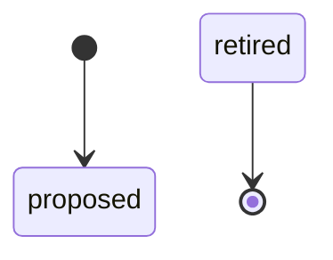
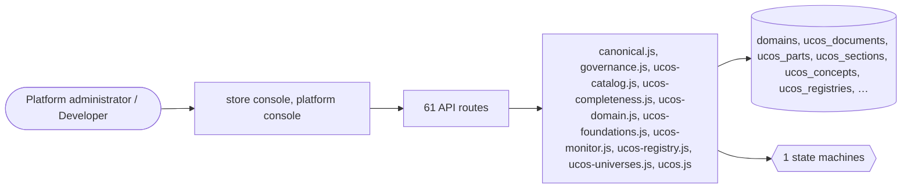

# Platform knowledge

> Generated from `_registry/business-domains.json`, the code and `docs/source/knowledge.md` — edit those, then run `node scripts/domain-docs.js`.

## Overview

The platform describing itself: the constitution, its foundations, universes, catalogue, coverage, traceability and documents.

**Foundation domain:** Guidance · **Used by:** Platform administrator, Developer

## Architecture

| Module | What it is |
|---|---|
| `lib/canonical.js` | UCOS Ω∞ · the canonical registry — one compiled source of truth, sealed. -------------------------------------------------------------------------- The platform's Law 002 (Knowledge Once) is now enforced by construction: the corpora AUTHOR the constitution, this module COMPILES it into one artifact, and the runtime reads ONLY that artifact. Nothing else is a declaration source. |
| `lib/governance.js` | governance: soft-delete (Trash), restore, retention purge. Works across ANY soft-deletable entity via the entity definition registry (table + pk + tenant scoping) — no per-entity code. A `deleted_at` timestamp is the only column added; reads filter it out, the Trash view lists + restores, and retention purges (hard-deletes) tombstoned rows older than a policy (data-driven per tenant + platform default). PII/GDPR: purge is the erasure path. |
| `lib/ucos-catalog.js` | UCOS Ω∞ · catalog bridge — publish universe entities into the live storefront. -------------------------------------------------------------------------- The universe registry (lib/ucos-universes.js) made every declared universe OPERABLE as a data entity. This module makes it TRANSACTABLE: it publishes a universe record into a tenant's product catalog so a shopper can find it, open it, add it to cart and check out — through the exact same code path as a physical product, because the catalog is the platform's universal sellable. |
| `lib/ucos-completeness.js` | UCOS Ω∞ — foundation completeness audit. -------------------------------------------------------------------------- Implements, as executable code, the FOUNDATION FREEZE CRITERIA the corpus defines as prose (Architecture2.txt 17AH.7): |
| `lib/ucos-domain.js` | UCOS Ω∞ · per-domain record engine — every universe gets its own state machine. -------------------------------------------------------------------------- The generic entity engine (lib/entity.js) makes every universe CRUD-able. This module makes every universe a DOMAIN: its records move through a state machine the corpus itself declares, and each transition is authorized by the corpus's own rules — never by code written for one universe (Article 4.2). |
| `lib/ucos-foundations.js` | UCOS Ω∞ · Foundation Registry — Architecture3.txt Articles 2–8, implemented. -------------------------------------------------------------------------- This is the operational half of the constitution. Architecture3 declares the registry's canonical form, its five graphs, its invariants, its lifecycle, its admission rules and its APIs; this module executes them against real state instead of describing them in prose. |
| `lib/ucos-monitor.js` | UCOS Ω∞ — monitoring, health & drift detection for the constitutional registry. -------------------------------------------------------------------------- Three concerns, all derived from the live registry tables (never from constants): |
| `lib/ucos-registry.js` | UCOS Ω∞ · the frozen registry as a first-class corpus source. -------------------------------------------------------------------------- `_registry/*.json` is the platform's constitutional source of truth: the frozen primitives, the canonical terminology, the domain-ownership matrix and the 93-artifact manifest. Before this module it was a PARALLEL source of truth — `_registry/project.js` projected 93 markdown artifacts from it while the runtime derived everything from the corpora, and neither world knew the other existed. That is a Law 002 (Knowledge Once) violation: the same concept was defined twice, in two registries that never met. |
| `lib/ucos-universes.js` | UCOS Ω∞ · Universe instantiation — every declared universe becomes operable. -------------------------------------------------------------------------- The corpus declares 2,500+ universes, domains and capability meta-models (Engineering, Streaming, Cloud, Transportation, Insurance, Advisory, Service Robots, Quantitative Sciences…). Before this module they were REGISTERED — parsed, counted, graphed, health-checked — but not OPERABLE: you could read about "Insurance Product" in the console, but you could not create one. |
| `lib/ucos.js` | UCOS Ω∞ · UPIP / UMQSOCR constitutional registry -------------------------------------------------------------------------- Architecture1.txt (UPIP Ω∞ — 2,884 numbered sections, ~100 parts), Architecture2.txt (UMQSOCR Ω∞ — 529 articles, 26 documents) and Architecture3.txt (UCOS Ω∞ — 65 articles, 11 documents) are treated as the CANONICAL SOURCE OF TRUTH. This module never re-declares a single concept from them in code (Knowledge-Once Principle, Configuration-Over-Code): it parses the documents themselves and registers every part, section, article, concept, registry list and meta-model into the platform's registry tables. |

## Data model

### `domains`

| Column | Type |
|---|---|
| `id` | INTEGER PRIMARY KEY AUTOINCREMENT |
| `key` | TEXT NOT NULL UNIQUE |
| `name` | TEXT NOT NULL |
| `description` | TEXT DEFAULT '' |
| `parent` | TEXT DEFAULT '' |
| `schema` | TEXT NOT NULL DEFAULT '{}' |
| `policies` | TEXT NOT NULL DEFAULT '[]' |
| `status` | TEXT NOT NULL DEFAULT 'active' |
| `created_at` | TEXT NOT NULL DEFAULT (datetime('now')) |

### `ucos_documents`

| Column | Type |
|---|---|
| `doc_id` | TEXT PRIMARY KEY |
| `file` | TEXT NOT NULL |
| `code` | TEXT NOT NULL |
| `name` | TEXT NOT NULL |
| `kind` | TEXT NOT NULL DEFAULT 'architecture' |
| `parts` | INTEGER DEFAULT 0 |
| `sections` | INTEGER DEFAULT 0 |
| `articles` | INTEGER DEFAULT 0 |
| `concepts` | INTEGER DEFAULT 0 |
| `registries` | INTEGER DEFAULT 0 |
| `lines` | INTEGER DEFAULT 0 |
| `chars` | INTEGER DEFAULT 0 |

### `ucos_parts`

| Column | Type |
|---|---|
| `id` | INTEGER PRIMARY KEY AUTOINCREMENT |
| `doc_id` | TEXT NOT NULL |
| `no` | INTEGER |
| `label` | TEXT |
| `title` | TEXT |
| `line` | INTEGER |

### `ucos_sections`

| Column | Type |
|---|---|
| `id` | INTEGER PRIMARY KEY AUTOINCREMENT |
| `doc_id` | TEXT NOT NULL |
| `qkey` | TEXT NOT NULL |
| `no` | INTEGER |
| `key` | TEXT |
| `name` | TEXT |
| `part_no` | INTEGER |
| `line` | INTEGER |
| `concepts` | INTEGER DEFAULT 0 |
| `registries` | INTEGER DEFAULT 0 |
| `meta` | TEXT DEFAULT '{}' |
| `kind` | TEXT DEFAULT 'section' |
| `doc_block` | TEXT |

### `ucos_concepts`

| Column | Type |
|---|---|
| `id` | INTEGER PRIMARY KEY AUTOINCREMENT |
| `doc_id` | TEXT NOT NULL |
| `key` | TEXT NOT NULL |
| `name` | TEXT NOT NULL |
| `container_kind` | TEXT |
| `container_key` | TEXT |
| `container_name` | TEXT |
| `part_no` | INTEGER |
| `line` | INTEGER |

### `ucos_registries`

| Column | Type |
|---|---|
| `id` | INTEGER PRIMARY KEY AUTOINCREMENT |
| `doc_id` | TEXT NOT NULL |
| `key` | TEXT NOT NULL |
| `label` | TEXT |
| `container_kind` | TEXT |
| `container_key` | TEXT |
| `items` | TEXT DEFAULT '[]' |
| `item_count` | INTEGER DEFAULT 0 |
| `line` | INTEGER |

### `ucos_edges`

| Column | Type |
|---|---|
| `id` | INTEGER PRIMARY KEY AUTOINCREMENT |
| `doc_id` | TEXT NOT NULL |
| `source_type` | TEXT NOT NULL |
| `source_id` | TEXT NOT NULL |
| `rel` | TEXT NOT NULL |
| `target_type` | TEXT NOT NULL |
| `target_id` | TEXT NOT NULL |

### `ucos_annotations`

| Column | Type |
|---|---|
| `id` | INTEGER PRIMARY KEY AUTOINCREMENT |
| `doc_id` | TEXT NOT NULL |
| `/*` | which constitution the target belongs to */ target_kind TEXT NOT NULL |
| `/*` | concept \| section \| part */ target_key TEXT NOT NULL |
| `/*` | canonical key from the parse (never a display name) */ note TEXT NOT NULL |
| `/*` | the annotation body */ pin INTEGER DEFAULT 0 |
| `/*` | pinned annotations float to the top of the registry view */ created_by TEXT |
| `/*` | platform admin email */ created_at TEXT DEFAULT (datetime('now')) |
| `updated_at` | TEXT DEFAULT (datetime('now')) |

### `ucos_foundations`

| Column | Type |
|---|---|
| `id` | INTEGER PRIMARY KEY AUTOINCREMENT |
| `key` | TEXT NOT NULL UNIQUE |
| `/*` | canonical identity (Article 8.2: globally unique) */ name TEXT NOT NULL |
| `parent` | TEXT |
| `/*` | parent foundation (derivation, Article 4.1) */ universe TEXT |
| `/*` | the declared universe this foundation belongs to */ lifecycle TEXT NOT NULL DEFAULT 'canonical' |
| `/*` | Article 5.1 states */ governance TEXT NOT NULL DEFAULT 'Foundation Authority' |
| `/*` | Article 6 */ classification TEXT |
| `/*` | universe \| domain \| foundation \| primitive \| capability */ source_doc TEXT |
| `/*` | traceability: which corpus document declares it */ source_line INTEGER |
| `discovery` | TEXT |
| `/*` | Article 2.2 discovery handle */ created_at TEXT |

### `ucos_foundation_deps`

| Column | Type |
|---|---|
| `id` | INTEGER PRIMARY KEY AUTOINCREMENT |
| `foundation` | TEXT NOT NULL |
| `dependency` | TEXT NOT NULL |

### `ucos_foundation_evolution`

| Column | Type |
|---|---|
| `id` | INTEGER PRIMARY KEY AUTOINCREMENT |
| `foundation` | TEXT NOT NULL |
| `predecessor` | TEXT NOT NULL |

### `ucos_foundation_composition`

| Column | Type |
|---|---|
| `id` | INTEGER PRIMARY KEY AUTOINCREMENT |
| `parent` | TEXT NOT NULL |
| `child` | TEXT NOT NULL |

### `ucos_foundation_audit`

| Column | Type |
|---|---|
| `id` | INTEGER PRIMARY KEY AUTOINCREMENT |
| `foundation` | TEXT NOT NULL |
| `event` | TEXT NOT NULL |
| `detail` | TEXT DEFAULT '{}' |
| `at` | TEXT NOT NULL |

### `ucos_universes`

| Column | Type |
|---|---|
| `id` | INTEGER PRIMARY KEY AUTOINCREMENT |
| `key` | TEXT NOT NULL UNIQUE |
| `/*` | universe identity = its foundation key */ name TEXT NOT NULL |
| `source_doc` | TEXT NOT NULL |
| `/*` | which corpus document declares it */ source_line INTEGER |
| `entity_key` | TEXT NOT NULL |
| `/*` | the generic entity_def key it instantiates as */ concepts INTEGER DEFAULT 0 |
| `/*` | corpus concepts this universe governs */ instantiated_at TEXT |

### `ucos_record_transitions`

| Column | Type |
|---|---|
| `id` | INTEGER PRIMARY KEY AUTOINCREMENT |
| `entity_key` | TEXT NOT NULL |
| `/*` | which universe's record transitioned */ record_id INTEGER NOT NULL, from_state TEXT NOT NULL, to_state TEXT NOT NULL, rule TEXT, /* the corpus rule that authorized it (5.2) */ actor TEXT, /* who fired the transition */ detail TEXT DEFAULT '{}', at TEXT NOT NULL DEFAULT (datetime('now')) ); CREATE INDEX ix_ucos_record_tr_entity ON ucos_record_transitions(entity_key, record_id, at); CREATE TABLE theme_presets ( id INTEGER PRIMARY KEY AUTOINCREMENT, key TEXT NOT NULL UNIQUE, /* "quantum-glass", "solar-flare"… */ name TEXT NOT NULL, mood TEXT, /* light \| dark \| futurist \| organic… the registry's own vocabulary */ vars TEXT NOT NULL |
| `/*` | the CSS custom properties |
| `as` | JSON */ preview TEXT |
| `/*` | a small gradient/emoji signature for the picker */ built_in INTEGER DEFAULT 0 |
| `/*` | shipped presets vs operator-created */ position INTEGER DEFAULT 0 |

## API reference

Every call is JSON over HTTPS; store calls carry the store (`?store=`) and the session; mutating calls accept an `Idempotency-Key` header where noted.

| Method and path | Handler | What it does |
|---|---|---|
| `GET /api/ucii/capabilities` | `apiCapabilityList` | — |
| `POST /api/ucii/capabilities` | `apiCapabilityCreate` | — |
| `PUT /api/ucii/capabilities/:key` | `apiCapabilityUpdate` | — |
| `GET /api/ucii/domains` | `apiDomainList` | — |
| `POST /api/ucii/domains` | `apiDomainCreate` | — |
| `GET /api/ucii/policies` | `apiPolicyList` | — |
| `POST /api/ucii/policies` | `apiPolicyCreate` | — |
| `GET /api/ucii/workflows` | `apiWorkflowList` | — |
| `POST /api/ucii/workflows` | `apiWorkflowCreate` | — |
| `DELETE /api/ucii/workflows/:key` | `apiWorkflowDelete` | — |
| `GET /api/ucii/config` | `apiConfigGet` | — |
| `POST /api/ucii/config` | `apiConfigSet` | — |
| `GET /api/ucii/knowledge` | `apiKnowledgeGraphQuery` | — |
| `POST /api/ucii/knowledge` | `apiKnowledgeGraphAdd` | — |
| `POST /api/ucii/usage` | `apiUsageRecord` | S10: this had no auth gate and took the tenant from the request body, so anyone could inject metering rows for any store — the table usage reporting and billing read. The tenant is the session's store, always. A platform operator working a store records against it too, so the gate accepts the platform session as well as the store's own admin. |
| `GET /api/ucii/usage` | `apiUsageReport` | — |
| `GET /api/ucos/manifest` | `apiUcosManifest` | — |
| `GET /api/ucos/coverage` | `apiUcosCoverage` | — |
| `GET /api/ucos/docs` | `apiUcosDocs` | — |
| `GET /api/ucos/:doc/parts` | `apiUcosParts` | — |
| `GET /api/ucos/:doc/sections` | `apiUcosSections` | — |
| `GET /api/ucos/:doc/concepts` | `apiUcosConcepts` | — |
| `GET /api/ucos/:doc/registries` | `apiUcosRegistries` | — |
| `GET /api/ucos/:doc/edges` | `apiUcosEdges` | — |
| `GET /api/ucos/:doc/neighbours` | `apiUcosNeighbours` | — |
| `GET /api/ucos/search` | `apiUcosSearch` | — |
| `POST /api/ucos/reparse` | `apiUcosReparse` | — |
| `GET /api/ucos/health` | `apiUcosHealth` | — |
| `GET /api/ucos/drift` | `apiUcosDrift` | — |
| `GET /api/ucos/completeness` | `apiUcosCompleteness` | ---------- foundation completeness ---------- Executes the corpus's own FOUNDATION FREEZE CRITERIA (17AH.7) and exposes the master index, so "how much is left" is answered by data rather than by prose. The audit is read-only and derives every number from the registry. |
| `GET /api/ucos/index` | `apiUcosIndex` | — |
| `GET /api/ucos/:doc/annotations` | `apiUcosAnnotations` | ---------- annotation CRUD (the write path) ---------- Every mutation requires platform admin and is audit-logged; the canonical documents are never touched. Reads are open to store admins so a team can share context. |
| `POST /api/ucos/:doc/annotations` | `apiUcosAnnotationCreate` | — |
| `PUT /api/ucos/annotations/:id` | `apiUcosAnnotationUpdate` | — |
| `DELETE /api/ucos/annotations/:id` | `apiUcosAnnotationDelete` | — |
| `GET /api/ucos/annotations/orphans` | `apiUcosAnnotationOrphans` | — |
| `GET /api/ucos/foundations/manifest` | `apiUcosFoundationsManifest` | ---------- UCOS Ω∞ Foundation Registry (Architecture3 Articles 2-8) ---------- The operational half of the constitution. Reads are open to administrators so the console can draw the five graphs; the register/certify/deprecate mutations are Foundation Authority actions and require platform admin (Article 6). Every mutation is recorded in the append-only ledger by the module itself. |
| `GET /api/ucos/foundations/verify` | `apiUcosFoundationsVerify` | Article 3.2 / 8.2: the compliance rules are executable — this proves the registry is acyclic, fully resolved, unique and orphan-free at any moment |
| `GET /api/ucos/foundations/ledger` | `apiUcosFoundationsLedger` | — |
| `GET /api/ucos/foundations` | `apiUcosFoundationsList` | — |
| `GET /api/ucos/foundations/:key` | `apiUcosFoundationResolve` | — |
| `GET /api/ucos/foundations/:key/traverse` | `apiUcosFoundationTraverse` | — |
| `POST /api/ucos/foundations` | `apiUcosFoundationRegister` | — |
| `POST /api/ucos/foundations/:key/certify` | `apiUcosFoundationCertify` | — |
| `POST /api/ucos/foundations/:key/deprecate` | `apiUcosFoundationDeprecate` | — |
| `POST /api/ucos/foundations/:key/retire` | `apiUcosFoundationRetire` | — |
| `GET /api/ucos/universes` | `apiUcosUniverses` | ---------- instantiated universes ---------- Each universe the corpus declares is registered as a foundation AND instantiated as a live, data-defined entity, so the constitution is operable rather than merely readable. The instantiation is derived from the corpus (never hand-listed) and idempotent. |
| `POST /api/ucos/universes/instantiate` | `apiUcosUniversesInstantiate` | — |
| `GET /api/ucos/coverage-report` | `apiUcosCoverageReport` | — |
| `GET /api/ucos/catalog` | `apiUcosCatalogList` | — |
| `GET /api/ucos/catalog/stats` | `apiUcosCatalogStats` | ---------- catalog bridge: universe entities become shopper-transactable ---------- Publishing is a platform action (it changes a tenant's live catalog); withdrawal too. Reads are open to store admins so a merchant can see what is on their shelf. |
| `POST /api/ucos/catalog/:key/publish` | `apiUcosCatalogPublish` | — |
| `POST /api/ucos/catalog/:key/withdraw` | `apiUcosCatalogWithdraw` | — |
| `POST /api/ucos/catalog/activate` | `apiUcosCatalogActivate` | ---------- ACTIVATION: every declared universe becomes shopper-transactable ---------- This is the "implement all" primitive: activation materializes a universe's canonical offering (from its own corpus-declared fields) and publishes it into a tenant catalog, so the whole constitution is on the shelf by default. It is a platform action (it writes a tenant's live catalog), bounded and idempotent. |
| `POST /api/ucos/catalog/:key/activate` | `apiUcosCatalogActivate` | ---------- ACTIVATION: every declared universe becomes shopper-transactable ---------- This is the "implement all" primitive: activation materializes a universe's canonical offering (from its own corpus-declared fields) and publishes it into a tenant catalog, so the whole constitution is on the shelf by default. It is a platform action (it writes a tenant's live catalog), bounded and idempotent. |
| `GET /api/ucos/catalog/activation` | `apiUcosActivationStats` | — |
| `GET /api/ucos/trace` | `apiUcosTrace` | — |
| `GET /api/ucos/matrix` | `apiUcosMatrix` | — |
| `GET /api/ucos/domains` | `apiUcosDomains` | — |
| `GET /api/ucos/domain/:key` | `apiUcosDomain` | — |
| `POST /api/ucos/domain/:key/fire` | `apiUcosDomainFire` | — |

## Process flows

Each record's life is a declared state machine (`lib/seed/states.json`): the moves it may make, and the actions that make them.

### UCOS foundation (`foundation`)

Actions: 

## Data flow

## User interface

**Store console:** 📘 User Manual · 🏛️ Architecture

**Platform console:** 🧭 Traceability · 🌀 UCII Ω∞ Registry · ♾️ UCOS Ω∞ Constitution · 🏛️ Foundations · 🔀 Domains · 📦 Canonical Objects · 📐 Canonical Schemas · 🔗 Canonical Relationships · ⚡ Canonical Events · 🔌 Canonical APIs · 🔀 Canonical Workflows · 🕸️ Capability Graph · 🕸️ Knowledge Graph · 🕸️ Dependency Graph · 🕸️ Traceability Graph · 🏛️ Reference Architecture · 🔐 Security Architecture · 🗄️ Data Architecture · 🧠 AI Architecture · 🧬 Evolution Architecture · 📘 User Manual · 🏛️ Architecture

## User flows

_Not yet written — `docs/source/knowledge.md`, section `## Flows`._

## Manuals

### Platform administrator

_Not yet written — `docs/source/knowledge.md`, section `## Manual: platform_admin`._

### Developer

_Not yet written — `docs/source/knowledge.md`, section `## Manual: developer`._

