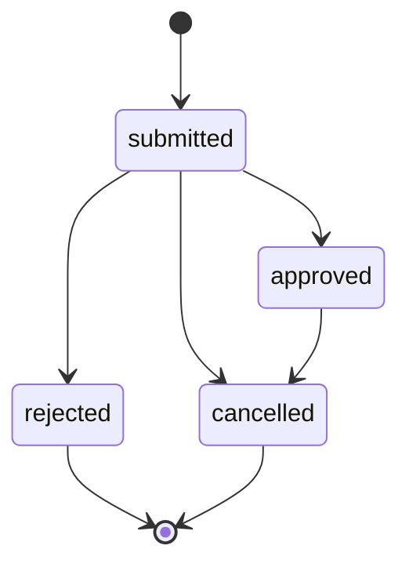
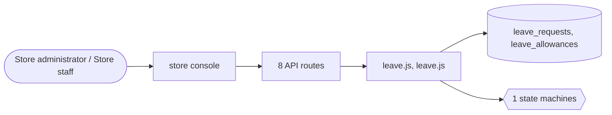

# Leave

> Generated from `_registry/business-domains.json`, the code and `docs/source/leave.md` — edit those, then run `node scripts/domain-docs.js`.

## Overview

Time away a store's people ask for: kinds of leave with yearly allowances and carry-over, requests counted in working days, refused when they overlap or ask for more than is left, approved by someone other than the person, shown in attendance as paid or unpaid for payroll, taken off the resource plan, and cancelled before they start.

**Foundation domain:** Operations · **Used by:** Store administrator, Store staff

## Architecture

| Module | What it is |
|---|---|
| `lib/leave.js` | leave (owner Operations). |
| `lib/routes/leave.js` | leave domain routes (lib/leave.js; _registry/business-domains.json). Leave requests, balances and the calendar, under the store's leave section (the People and Delivery roles hold it): a read grant lists, a write grant asks and decides. |

## Data model

### `leave_requests`

| Column | Type |
|---|---|
| `id` | INTEGER PRIMARY KEY AUTOINCREMENT |
| `tenant_id` | INTEGER NOT NULL |
| `ref` | TEXT NOT NULL |
| `employee_id` | INTEGER NOT NULL |
| `type` | TEXT NOT NULL |
| `from_date` | TEXT NOT NULL |
| `to_date` | TEXT NOT NULL |
| `half_day` | INTEGER NOT NULL DEFAULT 0 |
| `days` | REAL NOT NULL |
| `reason` | TEXT DEFAULT '' |
| `status` | TEXT NOT NULL |
| `submitted_by` | TEXT DEFAULT '' |
| `decided_by` | TEXT DEFAULT '' |
| `decided_at` | TEXT |
| `decision_note` | TEXT DEFAULT '' |
| `cancelled_at` | TEXT |
| `created_at` | TEXT NOT NULL DEFAULT (datetime('now')) |
| `uid` | TEXT |

### `leave_allowances`

| Column | Type |
|---|---|
| `id` | INTEGER PRIMARY KEY AUTOINCREMENT |
| `tenant_id` | INTEGER NOT NULL |
| `employee_id` | INTEGER NOT NULL |
| `year` | INTEGER NOT NULL |
| `type` | TEXT NOT NULL |
| `days` | REAL NOT NULL |

## API reference

Every call is JSON over HTTPS; store calls carry the store (`?store=`) and the session; mutating calls accept an `Idempotency-Key` header where noted.

| Method and path | Handler | What it does |
|---|---|---|
| `GET /api/admin/leave` | `apiLeave` | Leave requests, latest first; `status`, `employee_id` and `from` (still running on or after a day) narrow them; with the kinds of leave and the working days. |
| `POST /api/admin/leave` | `apiLeaveRequest` | Asks for leave: `employee_id`, `type`, `from_date`, `to_date`, `half_day`, `reason`. Refused when it overlaps another request or asks for more than is left. |
| `POST /api/admin/leave/:id/approve` | `apiLeaveApprove` | Approves a request — not by the person it is for or whoever asked: each working day shows in attendance, paid or unpaid. |
| `POST /api/admin/leave/:id/reject` | `apiLeaveReject` | Turns a request down with a `note` saying why. |
| `POST /api/admin/leave/:id/cancel` | `apiLeaveCancel` | Cancels a request not yet decided, or approved leave not yet started: its days come back. |
| `GET /api/admin/leave/people/:id` | `apiLeaveBalance` | A person's leave for a `year`: each kind's entitlement, what is carried in, taken, waiting and left. |
| `PUT /api/admin/leave/people/:id` | `apiLeaveAllowance` | Sets a person's own allowance of a kind for a year: `year`, `type`, `days` (null removes it). |
| `GET /api/admin/leave/calendar` | `apiLeaveCalendar` | Who is away on each working day from `from` to `to`. |

## Process flows

Each record's life is a declared state machine (`lib/seed/states.json`): the moves it may make, and the actions that make them.

### Leave request (`leave_request`)

Actions: 

## Data flow

## User interface

**Store console:** 🌴 Leave

## User flows

**Kinds of leave.** Every store starts with annual leave (20 days a year, up to 5 carried into the
next year), sick leave (10 days), parental leave (60 days) and unpaid leave (no limit). A store can
set its own kinds and working days. A person's own allowance for a year replaces the kind's.

**Asking.** A request names the person, the kind and the days. It counts only working days, so a
week off is five days. Half a day is a single day. A request is refused when it overlaps one already
asked for, or asks for more than is left that year. While it waits, its days already come off what
is left.

**Deciding.** Someone other than the person it is for, or whoever asked, approves it or turns it
down with a reason. Approved, each of its days shows in attendance: paid leave as leave, unpaid leave
as absent, so payroll pays or deducts it. The resource plan takes the days off the person's capacity
for that week.

**Cancelling.** A request not yet decided can be withdrawn. Approved leave can be cancelled until it
starts; its days come back and attendance is cleared.

## Manuals

### Store administrator

Open **Business Operations → 🌴 Leave**. Your role needs the leave section; the People and Delivery
roles have it.

- **Ask for leave**: choose the person, the kind and the dates, then **Ask**. **Show balance** shows
  what they are entitled to, carried in, have taken, are waiting for and have left.
- **Requests**: **approve** or **reject** each one, giving a reason to reject. You cannot approve
  your own. **cancel** withdraws a request, or approved leave that has not started.
- **Who is away**: everyone away on each working day for the next four weeks; a question mark means
  not yet approved.

### Store staff

If your role has the leave section, ask for your own leave under **Business Operations → 🌴 Leave**.
Someone else approves it. You can cancel it until it starts.

