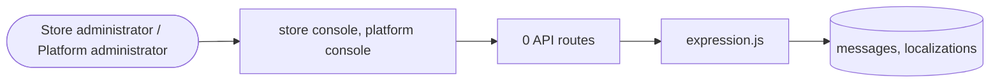

# Languages and localisation

> Generated from `_registry/business-domains.json`, the code and `docs/source/localisation.md` — edit those, then run `node scripts/domain-docs.js`.

## Overview

Speaking the buyer's language: the message catalogues of every language and a store's own wording.

**Foundation domain:** Expression · **Used by:** Store administrator, Platform administrator

## Architecture

| Module | What it is |
|---|---|
| `lib/expression.js` | Expression (P12, owner Expression). |

## Data model

### `messages`

| Column | Type |
|---|---|
| `lang` | TEXT NOT NULL |
| `key` | TEXT NOT NULL |
| `text` | TEXT NOT NULL |

### `localizations`

| Column | Type |
|---|---|
| `id` | INTEGER PRIMARY KEY AUTOINCREMENT |
| `tenant_id` | INTEGER NOT NULL |
| `entity` | TEXT NOT NULL DEFAULT 'product' |
| `ref_id` | TEXT NOT NULL |
| `locale` | TEXT NOT NULL |
| `name` | TEXT DEFAULT '' |
| `description` | TEXT DEFAULT '' |
| `bullets` | TEXT DEFAULT '[]' |
| `attrs` | TEXT DEFAULT '{}' |
| `active` | INTEGER DEFAULT 1 |
| `deleted_at` | TEXT |
| `uid` | TEXT |

## Data flow

## User interface

**Store console:** 🌐 Localizations

**Platform console:** 🗣️ Languages · 🌐 Localization · 🔤 Translation Registry · 🌍 Cultural Context

## User flows

_Not yet written — `docs/source/localisation.md`, section `## Flows`._

## Manuals

### Store administrator

_Not yet written — `docs/source/localisation.md`, section `## Manual: store_admin`._

### Platform administrator

_Not yet written — `docs/source/localisation.md`, section `## Manual: platform_admin`._

