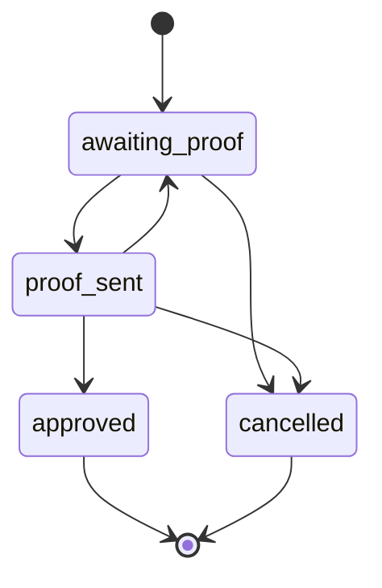
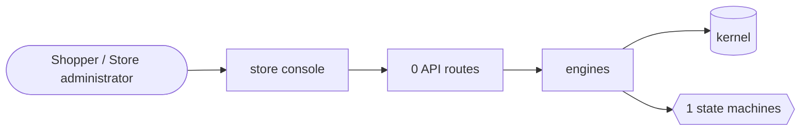

# Made to order

> Generated from `_registry/business-domains.json`, the code and `docs/source/made_to_order.md` — edit those, then run `node scripts/domain-docs.js`.

## Overview

Items made for one buyer: the buyer's own artwork proofed before making, and samples sold at their own price.

**Foundation domain:** Offering · **Used by:** Shopper, Store administrator

## Switches and settings

Each is switched on per store under ⚙️ Capabilities; its parameters are that store's settings.

### Customisation proofs (`customisation_proofs`)

The shopper's own artwork taken as an option; staff send a proof, the shopper approves it or asks for changes, before anything is made.

| Setting | Meaning | Default |
|---|---|---|
| `max_rounds` | Most rounds of changes a shopper may ask for | `3` |

### Sample orders (`sample_orders`)

A sample of an item sold as an option at its own price, with a cap on how many a bag holds.

| Setting | Meaning | Default |
|---|---|---|
| `max_qty` | Most samples of one item a bag may hold | `2` |

## Architecture

**Registry lists** (editable in Data Studio): `artworkProofStatuses`

## Process flows

Each record's life is a declared state machine (`lib/seed/states.json`): the moves it may make, and the actions that make them.

### The shopper's artwork, proofed before making (`artwork_proof`)

Actions: `send_proof` → proof_sent · `approve` → approved · `request_changes` → awaiting_proof · `cancel` → cancelled

## Data flow

## User interface

**Store console:** 🎨 Customisation Proofs · 🧪 Sample Orders

## User flows

_Not yet written — `docs/source/made_to_order.md`, section `## Flows`._

## Manuals

### Shopper

_Not yet written — `docs/source/made_to_order.md`, section `## Manual: shopper`._

### Store administrator

_Not yet written — `docs/source/made_to_order.md`, section `## Manual: store_admin`._

