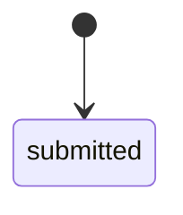
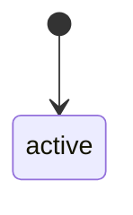
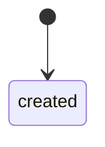
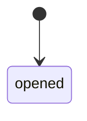
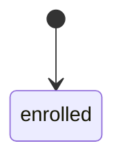
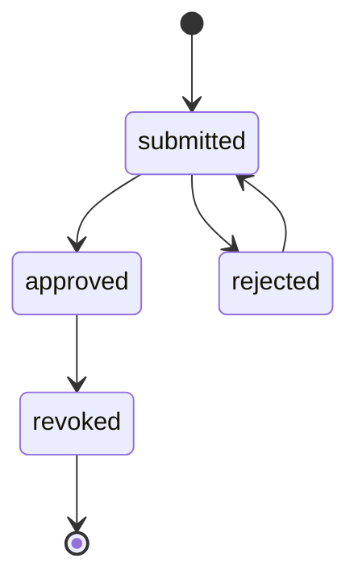
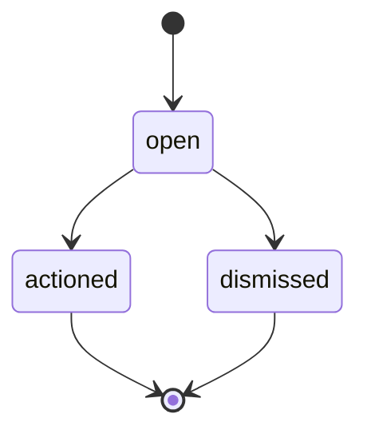
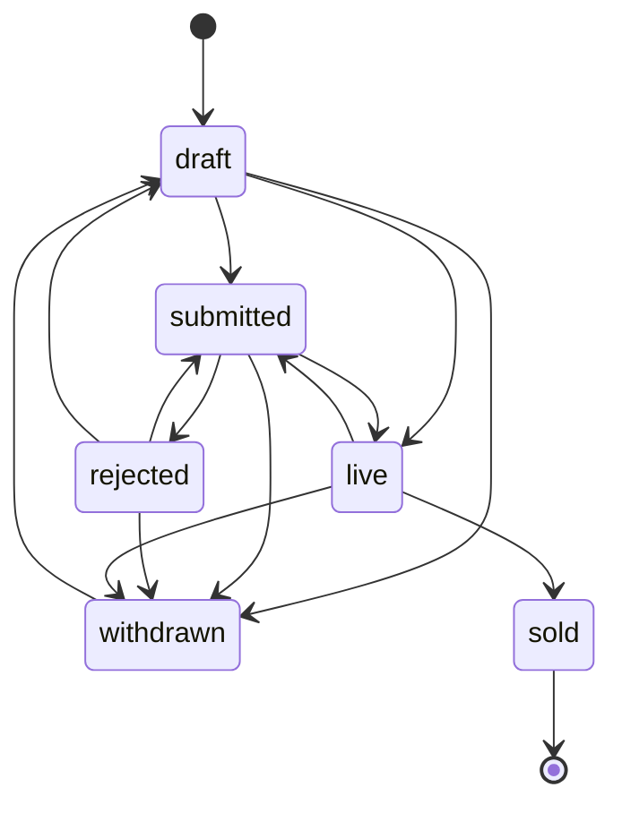
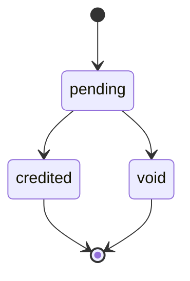
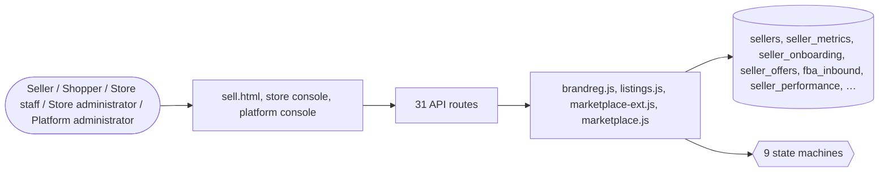

# Marketplace

> Generated from `_registry/business-domains.json`, the code and `docs/source/marketplace.md` — edit those, then run `node scripts/domain-docs.js`.

## Overview

Many sellers in one store: seller onboarding and health, offers competing for the buy box, fulfilment by the store, buyer protection claims, brand protection, and shoppers selling their own items.

**Foundation domain:** Commerce · **Used by:** Seller, Shopper, Store staff, Store administrator, Platform administrator

## Switches and settings

Each is switched on per store under ⚙️ Capabilities; its parameters are that store's settings.

### Buy-box competition (`buy_box`)

Multiple sellers compete for one product's featured offer. The winner is the best composite of price, fulfilment speed and seller trust — each weight is tunable here.

| Setting | Meaning | Default |
|---|---|---|
| `price_weight` | Price weight | `0.6` |
| `speed_weight` | Fulfilment-speed weight | `0.25` |
| `trust_weight` | Seller-trust weight | `0.15` |
| `speed_baseline_days` | Speed baseline (days assumed when unknown) | `3` |
| `handling_baseline_hours` | Handling baseline (hours assumed when unknown) | `12` |
| `recompute_on_change` | Recompute the winner when an offer or health row changes | `true` |

### Seller account health (`seller_health`)

Account health: defect, cancellation and late-shipment rates roll into a score that decides the tier and suspension.

| Setting | Meaning | Default |
|---|---|---|
| `odr_weight` | Order-defect-rate weight | `2` |
| `cancellation_weight` | Cancellation-rate weight | `1.5` |
| `late_weight` | Late-shipment weight | `1` |
| `tier_thresholds` | Tier thresholds (score → tier), highest first | `{"platinum":95,"gold":85,"premium":70,"growth":50}` |
| `suspend_below` | Health score below which a seller's offers are suspended | `40` |
| `late_shipment_days` | A shipment is 'late' after this many days undelivered | `3` |

### Buyer protection (A-to-z) (`buyer_protection`)

A buyer may raise a claim against a seller; a claim resolved in the buyer's favour credits the buyer from the ledger.

| Setting | Meaning | Default |
|---|---|---|
| `auto_dispute_escrow` | Mark an order's escrow hold disputed while a claim is open | `true` |
| `refund_kind` | Wallet ledger kind used for a buyer-favour refund | `"refund"` |

### Smart-fulfilment grading (`smart_fulfilment`)

Fulfilment grading: each grade carries a dispatch SLA in hours.

| Setting | Meaning | Default |
|---|---|---|
| `sla_hours` | Grade → dispatch SLA hours | `{"a_plus":4,"a":8,"b":24,"c":48,"d":72}` |
| `default_sla_hours` | SLA for an unmapped grade | `24` |

### Fulfilment-centre inbound (`fba_inbound`)

Sellers ship units to a fulfilment centre; receiving closes the inbound and adds the units to FC inventory.

| Setting | Meaning | Default |
|---|---|---|
| `default_status` | Initial status of an inbound shipment | `"created"` |

### Brand registry (`brand_registry`)

A seller proves it owns a brand; once approved it may report counterfeit or infringing offers, which staff uphold or dismiss. Upholding moves the offending offer to the offer state named here.

| Setting | Meaning | Default |
|---|---|---|
| `require_trademark` | A claim must carry a trademark number | `true` |
| `one_owner_per_brand` | A brand has at most one approved owner | `true` |
| `offer_state_on_infringement` | Offer state an upheld report moves the offer to | `"suspended"` |
| `badge` | Show a registered-brand badge on product pages | `true` |

### Shopper selling (`peer_listings`)

Any signed-in shopper lists their own items — used, refurbished or new — reviewed before they go on sale; the store keeps a commission and credits the rest after a holding period.

| Setting | Meaning | Default |
|---|---|---|
| `require_review` | Listings are reviewed before they go on sale | `true` |
| `commission_pct` | Store commission on a sale | `10` |
| `hold_days` | Days a sale's proceeds are held before they are credited | `7` |
| `max_live` | Listings one shopper may have on sale | `50` |
| `seller_role` | Seller role a shopper is registered under (a sellerRoles row) | `"individual"` |
| `source_kind` | Product source recorded for a listed item | `"peer"` |
| `earnings_kind` | Wallet ledger kind used to credit proceeds | `"sale_proceeds"` |

## Architecture

| Module | What it is |
|---|---|
| `lib/brandreg.js` | Brand registry. A seller proves it owns a brand (a trademark number and office, and any evidence); staff approve or reject the claim. An approved owner may then report offers that infringe its brand — counterfeits, trademark or copyright misuse, listing abuse (brandReportKinds rows) — and staff uphold or dismiss each report. Upholding moves the offending offer to the offer state the brand_registry capability names, and re-runs that product's buy-box so the offer stops winning. Whether a claim needs a trademark, whether a brand may have more than one owner, and whether product pages show a registered-brand badge are params too. |
| `lib/listings.js` | Shopper selling: resale, classifieds and peer-to-peer marketplaces. Any signed-in shopper may list their own items — new, used, refurbished (the item conditions are the mktConditions registry) — with a price, a quantity, photos and a department. A listing moves through the `listing` state machine: drafted, reviewed by staff where the store says so, then on sale as an ordinary product the whole storefront already sells — search, cart, checkout, offers, auctions, messages. The shopper is registered as a seller under the role the capability names (a sellerRoles row), so seller health, payouts and the buy-box treat them like any seller. |
| `lib/marketplace-ext.js` | Marketplace engine. Seller onboarding & verification, a seller-scoped portal surface, buy-box multi-seller offers, FBA inbound, seller performance / account health, buyer-protection (A-to-z) claims, sponsored brands/display creatives and smart-fulfilment grading. |
| `lib/marketplace.js` | Marketplace & Seller ecosystem. Ad inventory (CPC / CPM / CPA), a simple Generalized-Second-Price ranker, impression/click ledger with last-click and decayed attribution, a seller KPI dashboard (orders, take-rate, ad ROI), and take-rate settlement hooks into the fin/billing ledgers. All configuration lives in meta_lists so new bid models, attribution models, or ad surfaces are added from Data Studio. |

**Registry lists** (editable in Data Studio): `mktBusinessTypes`, `mktOnboardingStatuses`, `mktConditions`, `mktFulfillment`, `mktOfferStatuses`, `mktFbaStatuses`, `mktTiers`, `mktClaimKinds`, `mktClaimStatuses`, `mktSmartGrades`, `mktSmartStatuses`, `brandClaimStatuses`, `brandReportKinds`, `brandReportStatuses`, `listingStatuses`, `earningStatuses`

## Data model

### `sellers`

| Column | Type |
|---|---|
| `id` | INTEGER PRIMARY KEY AUTOINCREMENT |
| `tenant_id` | INTEGER NOT NULL |
| `name` | TEXT NOT NULL |
| `role` | TEXT DEFAULT 'retailer' |
| `email` | TEXT |
| `status` | TEXT DEFAULT 'active' |
| `commission_pct` | REAL DEFAULT 5 |
| `onboarding_status` | TEXT DEFAULT 'pending' |
| `verified` | INTEGER DEFAULT 0 |
| `rating` | REAL DEFAULT 0 |
| `tier` | TEXT DEFAULT 'standard' |
| `health_score` | REAL DEFAULT 0 |
| `deleted_at` | TEXT |
| `owner` | TEXT |

### `seller_metrics`

| Column | Type |
|---|---|
| `id` | INTEGER PRIMARY KEY AUTOINCREMENT |
| `tenant_id` | INTEGER NOT NULL |
| `seller_id` | INTEGER |
| `period` | TEXT |
| `orders` | INTEGER DEFAULT 0 |
| `revenue` | REAL DEFAULT 0 |
| `take_rate` | REAL DEFAULT 0 |
| `commission` | REAL DEFAULT 0 |
| `ads_spend` | REAL DEFAULT 0 |
| `ad_roi` | REAL DEFAULT 0 |
| `note` | TEXT DEFAULT '{}' |
| `created_at` | TEXT NOT NULL DEFAULT (datetime('now')) |

### `seller_onboarding`

| Column | Type |
|---|---|
| `id` | INTEGER PRIMARY KEY AUTOINCREMENT |
| `tenant_id` | INTEGER NOT NULL |
| `seller_id` | INTEGER |
| `ref` | TEXT |
| `business_name` | TEXT NOT NULL |
| `business_type` | TEXT |
| `gstin` | TEXT |
| `pan` | TEXT |
| `tan` | TEXT |
| `bank_name` | TEXT |
| `bank_account` | TEXT |
| `bank_ifsc` | TEXT |
| `docs` | TEXT DEFAULT '[]' |
| `status` | TEXT NOT NULL DEFAULT 'submitted' |
| `submitted_at` | TEXT |
| `reviewed_at` | TEXT |
| `reviewed_by` | TEXT |
| `notes` | TEXT |
| `created_at` | TEXT NOT NULL DEFAULT (datetime('now')) |

### `seller_offers`

| Column | Type |
|---|---|
| `id` | INTEGER PRIMARY KEY AUTOINCREMENT |
| `tenant_id` | INTEGER NOT NULL |
| `product_id` | TEXT NOT NULL |
| `sku_id` | INTEGER |
| `seller_id` | INTEGER NOT NULL |
| `price` | REAL NOT NULL |
| `currency` | TEXT |
| `condition` | TEXT DEFAULT 'new' |
| `fulfillment` | TEXT DEFAULT 'fbm' |
| `handling_hours` | INTEGER |
| `shipping_days` | INTEGER |
| `offer_status` | TEXT NOT NULL DEFAULT 'active' |
| `buybox` | INTEGER DEFAULT 0 |
| `buybox_score` | REAL DEFAULT 0 |
| `deleted_at` | TEXT |
| `created_at` | TEXT NOT NULL DEFAULT (datetime('now')) |

### `fba_inbound`

| Column | Type |
|---|---|
| `id` | INTEGER PRIMARY KEY AUTOINCREMENT |
| `tenant_id` | INTEGER NOT NULL |
| `ref` | TEXT |
| `seller_id` | INTEGER |
| `warehouse_id` | INTEGER |
| `sku_id` | INTEGER |
| `units` | INTEGER |
| `status` | TEXT NOT NULL DEFAULT 'created' |
| `fee` | REAL |
| `tracking_ref` | TEXT |
| `received_at` | TEXT |
| `created_at` | TEXT NOT NULL DEFAULT (datetime('now')) |

### `seller_performance`

| Column | Type |
|---|---|
| `id` | INTEGER PRIMARY KEY AUTOINCREMENT |
| `tenant_id` | INTEGER NOT NULL |
| `seller_id` | INTEGER NOT NULL |
| `period` | TEXT NOT NULL |
| `orders` | INTEGER DEFAULT 0 |
| `odr` | REAL DEFAULT 0 |
| `odr_targets` | INTEGER DEFAULT 0 |
| `late_ship_rate` | REAL DEFAULT 0 |
| `late_shipments` | INTEGER DEFAULT 0 |
| `cancel_rate` | REAL DEFAULT 0 |
| `cancellations` | INTEGER DEFAULT 0 |
| `valid_tracked_rate` | REAL DEFAULT 0 |
| `health_score` | REAL DEFAULT 0 |
| `tier` | TEXT DEFAULT 'standard' |
| `status` | TEXT NOT NULL DEFAULT 'computed' |
| `created_at` | TEXT NOT NULL DEFAULT (datetime('now')) |

### `buyer_claims`

| Column | Type |
|---|---|
| `id` | INTEGER PRIMARY KEY AUTOINCREMENT |
| `tenant_id` | INTEGER NOT NULL |
| `ref` | TEXT |
| `order_id` | INTEGER |
| `buyer` | TEXT |
| `seller_id` | INTEGER |
| `kind` | TEXT NOT NULL DEFAULT 'atoz' |
| `reason` | TEXT |
| `amount` | REAL |
| `currency` | TEXT |
| `evidence` | TEXT DEFAULT '[]' |
| `status` | TEXT NOT NULL DEFAULT 'opened' |
| `resolution` | TEXT |
| `resolved_at` | TEXT |
| `resolved_by` | TEXT |
| `created_at` | TEXT NOT NULL DEFAULT (datetime('now')) |

### `smart_fulfilment`

| Column | Type |
|---|---|
| `id` | INTEGER PRIMARY KEY AUTOINCREMENT |
| `tenant_id` | INTEGER NOT NULL |
| `seller_id` | INTEGER |
| `ref` | TEXT |
| `grade` | TEXT DEFAULT 'b' |
| `sla_hours` | INTEGER |
| `packed_same_day` | INTEGER DEFAULT 0 |
| `score` | REAL DEFAULT 0 |
| `status` | TEXT NOT NULL DEFAULT 'enrolled' |
| `created_at` | TEXT NOT NULL DEFAULT (datetime('now')) |

### `gold_suppliers`

| Column | Type |
|---|---|
| `id` | INTEGER PRIMARY KEY AUTOINCREMENT |
| `tenant_id` | INTEGER NOT NULL |
| `supplier_id` | INTEGER NOT NULL |
| `tier` | TEXT NOT NULL DEFAULT 'gold' |
| `starts_at` | TEXT |
| `ends_at` | TEXT |
| `fee` | REAL |
| `currency` | TEXT |
| `verified` | INTEGER DEFAULT 0 |
| `verification_level` | TEXT |
| `status` | TEXT NOT NULL DEFAULT 'active' |
| `created_at` | TEXT NOT NULL DEFAULT (datetime('now')) |

### `brand_claims`

| Column | Type |
|---|---|
| `id` | INTEGER PRIMARY KEY AUTOINCREMENT |
| `tenant_id` | INTEGER NOT NULL |
| `brand` | TEXT NOT NULL |
| `seller_id` | INTEGER |
| `claimant` | TEXT DEFAULT '' |
| `trademark_number` | TEXT DEFAULT '' |
| `trademark_office` | TEXT DEFAULT '' |
| `evidence` | TEXT DEFAULT '[]' |
| `status` | TEXT NOT NULL DEFAULT 'submitted' |
| `notes` | TEXT DEFAULT '' |
| `reviewed_by` | TEXT |
| `reviewed_at` | TEXT |
| `created_at` | TEXT NOT NULL DEFAULT (datetime('now')) |

### `brand_reports`

| Column | Type |
|---|---|
| `id` | INTEGER PRIMARY KEY AUTOINCREMENT |
| `tenant_id` | INTEGER NOT NULL |
| `brand` | TEXT NOT NULL |
| `claim_id` | INTEGER NOT NULL |
| `kind` | TEXT NOT NULL |
| `product_id` | TEXT |
| `offer_id` | INTEGER |
| `seller_id` | INTEGER |
| `details` | TEXT DEFAULT '' |
| `status` | TEXT NOT NULL DEFAULT 'open' |
| `outcome` | TEXT DEFAULT '' |
| `reviewed_by` | TEXT |
| `reviewed_at` | TEXT |
| `created_at` | TEXT NOT NULL DEFAULT (datetime('now')) |

### `peer_listings`

| Column | Type |
|---|---|
| `id` | INTEGER PRIMARY KEY AUTOINCREMENT |
| `tenant_id` | INTEGER NOT NULL |
| `owner` | TEXT NOT NULL |
| `owner_name` | TEXT DEFAULT '' |
| `seller_id` | INTEGER |
| `product_id` | TEXT |
| `title` | TEXT NOT NULL |
| `description` | TEXT DEFAULT '' |
| `price` | REAL NOT NULL |
| `qty` | INTEGER NOT NULL DEFAULT 1 |
| `sold` | INTEGER NOT NULL DEFAULT 0 |
| `condition` | TEXT |
| `dept` | TEXT |
| `images` | TEXT NOT NULL DEFAULT '[]' |
| `status` | TEXT NOT NULL DEFAULT 'draft' |
| `review_notes` | TEXT DEFAULT '' |
| `published_at` | TEXT |
| `created_at` | TEXT NOT NULL DEFAULT (datetime('now')) |
| `updated_at` | TEXT |

### `peer_earnings`

| Column | Type |
|---|---|
| `id` | INTEGER PRIMARY KEY AUTOINCREMENT |
| `tenant_id` | INTEGER NOT NULL |
| `listing_id` | INTEGER NOT NULL |
| `owner` | TEXT NOT NULL |
| `order_id` | INTEGER NOT NULL |
| `gross` | REAL NOT NULL |
| `commission` | REAL NOT NULL |
| `net` | REAL NOT NULL |
| `currency` | TEXT |
| `status` | TEXT NOT NULL DEFAULT 'pending' |
| `release_at` | TEXT |
| `credited_at` | TEXT |
| `created_at` | TEXT NOT NULL DEFAULT (datetime('now')) |

## API reference

Every call is JSON over HTTPS; store calls carry the store (`?store=`) and the session; mutating calls accept an `Idempotency-Key` header where noted.

| Method and path | Handler | What it does |
|---|---|---|
| `POST /api/marketplace/onboarding` | `apiMktApply` | ---------- Marketplace ---------- |
| `POST /api/marketplace/onboarding/:id/review` | `apiMktReview` | — |
| `GET /api/marketplace/offers/:productId` | `apiMktOffers` | — |
| `POST /api/marketplace/buybox/:productId` | `apiMktBuybox` | — |
| `POST /api/marketplace/fba` | `apiMktFba` | — |
| `POST /api/marketplace/fba/:id/receive` | `apiMktFbaReceive` | — |
| `POST /api/marketplace/performance/:sellerId` | `apiMktPerformance` | — |
| `POST /api/marketplace/claims` | `apiMktClaimOpen` | a buyer opens a claim only on THEIR order, for at most what they paid; staff may open one on any order in the store. It used to accept any order id and any amount — freezing other buyers' escrow and, on a buyer-favourable resolution, crediting the invented amount. |
| `POST /api/marketplace/claims/:id/resolve` | `apiMktClaimResolve` | — |
| `POST /api/marketplace/smart-fulfilment` | `apiMktSmart` | — |
| `GET /api/marketplace/portal/:sellerId` | `apiMktPortal` | — |
| `GET /api/admin/brand-registry` | `apiAdminBrandReg` | the brand registry: claims of ownership, and an owner's infringement reports |
| `POST /api/admin/brand-registry/claims` | `apiAdminBrandClaim` | — |
| `POST /api/admin/brand-registry/claims/:id` | `apiAdminBrandClaimAct` | — |
| `POST /api/admin/brand-registry/reports` | `apiAdminBrandReport` | — |
| `POST /api/admin/brand-registry/reports/:id` | `apiAdminBrandReportAct` | — |
| `GET /api/listings` | `apiListingsMine` | shopper selling |
| `POST /api/listings` | `apiListingCreate` | — |
| `PUT /api/listings/:id` | `apiListingUpdate` | — |
| `POST /api/listings/:id/action` | `apiListingAct` | — |
| `GET /api/admin/listings` | `apiAdminListings` | — |
| `POST /api/admin/listings/:id` | `apiAdminListingReview` | — |
| `POST /api/admin/marketplace/ads` | `apiMktAdCreate` | — |
| `GET /api/marketplace/rank` | `apiMktRank` | — |
| `POST /api/admin/marketplace/attribute` | `apiMktAttribute` | — |
| `GET /api/admin/marketplace/metrics` | `apiMktSellerMetrics` | — |
| `POST /api/admin/marketplace/settle` | `apiMktSettle` | — |
| `GET /api/admin/sellers` | `apiAdminSellers` | ---------------- sellers / rfq / returns / settlements ---------------- |
| `POST /api/admin/sellers` | `apiAdminSellerSave` | — |
| `PUT /api/admin/sellers/:id` | `apiAdminSellerSave` | — |
| `DELETE /api/admin/sellers/:id` | `apiAdminSellerDelete` | — |

## Process flows

Each record's life is a declared state machine (`lib/seed/states.json`): the moves it may make, and the actions that make them.

### Seller application (`seller_onboarding`)

Actions: 

### Seller offer (`seller_offer`)

Actions: 

### Inbound shipment (`fba_inbound`)

Actions: 

### Buyer protection claim (`buyer_claim`)

Actions: 

### Smart fulfilment enrolment (`smart_fulfilment`)

Actions: 

### Brand registry claim (`brand_claim`)

Actions: `approve` → approved · `reject` → rejected · `resubmit` → submitted · `revoke` → revoked

### Brand infringement report (`brand_report`)

Actions: `uphold` → actioned · `dismiss` → dismissed

### Peer listing (`listing`)

Actions: `submit` → submitted · `approve` → live · `publish` → live · `reject` → rejected · `withdraw` → withdrawn · `reopen` → draft · `sell_out` → sold

### Seller earning (`peer_earning`)

Actions: `credit` → credited · `void` → void

## Data flow

## User interface

**Pages:** `sell.html`

**Store console:** ™️ Brand Registry · 📢 Marketplace & Ads · 🏪 Sellers · 🏷️ Shopper Listings · 🏬 Marketplace Ops

**Platform console:** 📣 Ads · Marketplace · 🛒 Marketplace · 📢 Advertising · 📣 Sponsored Creatives

## User flows

_Not yet written — `docs/source/marketplace.md`, section `## Flows`._

## Manuals

### Seller

_Not yet written — `docs/source/marketplace.md`, section `## Manual: seller`._

### Shopper

_Not yet written — `docs/source/marketplace.md`, section `## Manual: shopper`._

### Store staff

_Not yet written — `docs/source/marketplace.md`, section `## Manual: store_staff`._

### Store administrator

_Not yet written — `docs/source/marketplace.md`, section `## Manual: store_admin`._

### Platform administrator

_Not yet written — `docs/source/marketplace.md`, section `## Manual: platform_admin`._

