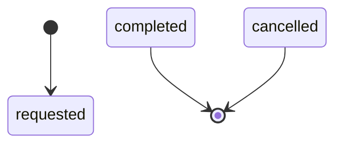
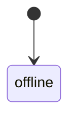
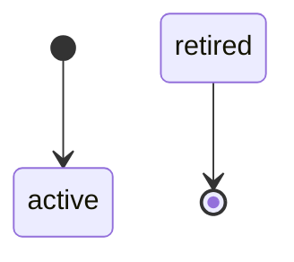
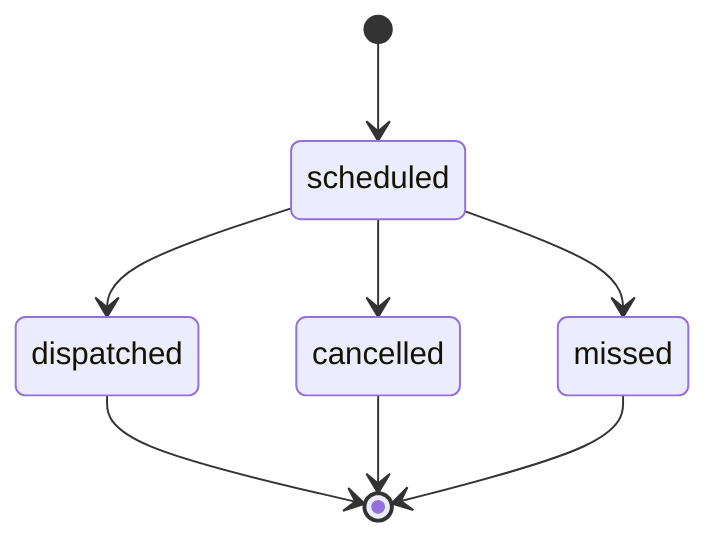
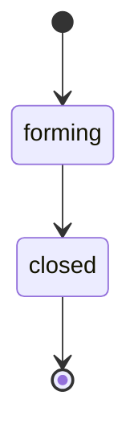
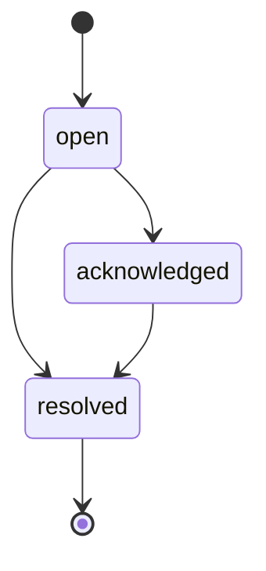
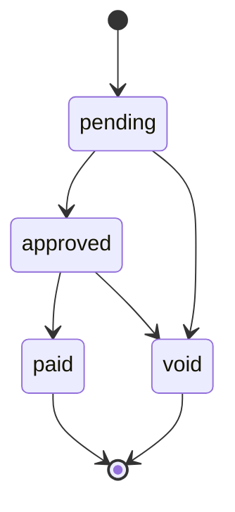
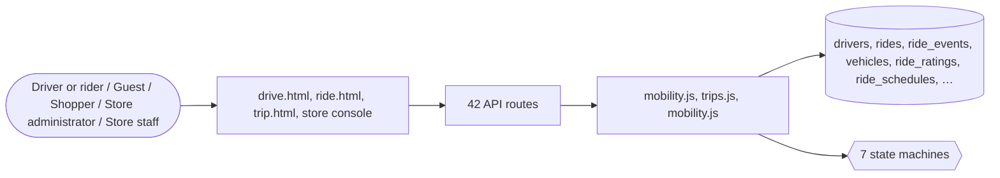

# Mobility

> Generated from `_registry/business-domains.json`, the code and `docs/source/mobility.md` — edit those, then run `node scripts/domain-docs.js`.

## Overview

Moving people: rides asked for now, booked for later or shared, and dispatched to the nearest driver by their live position; drivers and their vehicles; the rating both ways; safety — a trip shared by a private link, the emergency button, incidents handled by the store; and what each driver earns trip by trip and is paid.

**Foundation domain:** Operations · **Used by:** Driver or rider, Guest, Shopper, Store administrator, Store staff

## Switches and settings

Each is switched on per store under ⚙️ Capabilities; its parameters are that store's settings.

### Ride hailing (`ride_hailing`)

The ride lifecycle: request → accept → arrive → trip start → complete/cancel, with fare construction and per-state cancellation fees.

| Setting | Meaning | Default |
|---|---|---|
| `base_fare` | Base fare (pickup charge) | `2.5` |
| `per_km_rate` | Rate per kilometre | `1.2` |
| `per_min_rate` | Rate per minute | `0.35` |
| `min_fare` | Floor below which a completed fare is not charged | `5` |
| `booking_fee` | Fixed platform booking fee added to every fare | `0.5` |
| `platform_take_rate_pct` | Platform commission on a driver's fare | `15` |
| `cancel_fee_accepted` | Cancellation fee once a driver accepted | `1` |
| `cancel_fee_midtrip` | Cancellation fee once the trip started | `5` |

### Dispatch & matching (`dispatch`)

Match a request to the nearest idle driver of the requested kind, with a search radius, ETA construction and auto-dispatch.

| Setting | Meaning | Default |
|---|---|---|
| `auto_dispatch` | Assign a driver automatically on request (off = a manual dispatcher works the queue) | `true` |
| `match_radius_km` | Maximum distance a candidate driver may be | `5` |
| `eta_per_km_minutes` | ETA minutes per km of approach distance | `3` |
| `eta_pickup_buffer_minutes` | Flat minutes added to every ETA | `2` |
| `unknown_position_penalty_km` | Distance assumed for a driver with no last-known position | `2` |
| `city_centre_offset_km` | Subtracted from a driver's stored city distance | `0` |

### Fleet & driver management (`fleet_management`)

Drivers and vehicles: onboarding, online/offline state, vehicle kinds, maintenance state and the health that dispatch ranks on.

| Setting | Meaning | Default |
|---|---|---|
| `driver_kinds` | Vehicle kinds the console offers | `["car","suv","bike","auto","van"]` |
| `min_rating_to_dispatch` | A driver below this rating is held out of dispatch | `4` |

## Architecture

| Module | What it is |
|---|---|
| `lib/mobility.js` | E17 · The Mobility universe. -------------------------------------------------------------------------- Constitution E17: "Through configuration alone this universe yields ride-hailing, taxi, food-delivery and parcel-delivery platforms: ride hailing · dispatch · driver management · routing · fleet · delivery · tracking · dynamic pricing · matching · rating." |
| `lib/trips.js` | trips (owner Operations, the mobility domain). |
| `lib/routes/mobility.js` | mobility domain routes (moved from lib/api.js; _registry/business-domains.json). Each handler answers one route of the mobility domain. What it needs from the shared HTTP kit (lib/api.js) is passed in as `kit`. |

## Data model

### `drivers`

| Column | Type |
|---|---|
| `id` | INTEGER PRIMARY KEY AUTOINCREMENT |
| `tenant_id` | INTEGER NOT NULL |
| `name` | TEXT NOT NULL |
| `email` | TEXT |
| `phone` | TEXT |
| `city` | TEXT DEFAULT '' |
| `vehicle_kind` | TEXT NOT NULL DEFAULT 'car' |
| `/*` | car \| suv \| bike \| auto \| van */ plate TEXT DEFAULT '' |
| `license` | TEXT DEFAULT '' |
| `status` | TEXT NOT NULL DEFAULT 'offline' |
| `/*` | offline \| online \| busy \| suspended */ rating REAL NOT NULL DEFAULT 5.0 |
| `rides_completed` | INTEGER NOT NULL DEFAULT 0 |
| `rides_cancelled` | INTEGER NOT NULL DEFAULT 0 |
| `earnings` | REAL NOT NULL DEFAULT 0 |
| `city_latency` | REAL DEFAULT 0 |
| `/*` | last reported distance from the city centre |
| `km` | */ joined_at TEXT NOT NULL DEFAULT (datetime('now')) |
| `deactivated_at` | TEXT |
| `last_lat` | REAL |
| `last_lng` | REAL |
| `last_at` | TEXT |
| `/*` | lib/trips.js: where the driver last reported being */ rating_count INTEGER NOT NULL DEFAULT 0 |
| `review` | INTEGER NOT NULL DEFAULT 0 |
| `uid` | TEXT |
| `/*` | ratings counted; held for review below the floor */ UNIQUE (tenant_id, email) |

### `rides`

| Column | Type |
|---|---|
| `id` | INTEGER PRIMARY KEY AUTOINCREMENT |
| `tenant_id` | INTEGER NOT NULL |
| `ref` | TEXT NOT NULL UNIQUE |
| `rider` | TEXT |
| `rider_phone` | TEXT |
| `pickup` | TEXT NOT NULL |
| `dropoff` | TEXT NOT NULL |
| `pickup_lat` | REAL |
| `pickup_lng` | REAL |
| `dropoff_lat` | REAL |
| `dropoff_lng` | REAL |
| `vehicle_kind` | TEXT NOT NULL DEFAULT 'car' |
| `driver_id` | INTEGER |
| `status` | TEXT NOT NULL DEFAULT 'requested' |
| `/*` | requested → accepted → arrived → trip_start → completed \| cancelled */ fare REAL DEFAULT 0 |
| `surge` | REAL NOT NULL DEFAULT 1.0 |
| `distance_km` | REAL DEFAULT 0 |
| `duration_min` | REAL DEFAULT 0 |
| `eta_min` | REAL DEFAULT 0 |
| `payment_method` | TEXT DEFAULT 'cash' |
| `/*` | cash \| wallet \| card \| upi */ rating INTEGER |
| `note` | TEXT DEFAULT '' |
| `requested_at` | TEXT NOT NULL DEFAULT (datetime('now')) |
| `accepted_at` | TEXT |
| `arrived_at` | TEXT |
| `started_at` | TEXT |
| `completed_at` | TEXT |
| `cancelled_at` | TEXT |
| `user_id` | INTEGER |
| `seats` | INTEGER NOT NULL DEFAULT 1 |
| `pool_id` | INTEGER |
| `schedule_id` | INTEGER |
| `/*` | lib/trips.js: the signed-in rider |
| `seats` |  |
| `a` | shared ride |
| `a` | booking for later */ tip REAL NOT NULL DEFAULT 0 |
| `take` | REAL NOT NULL DEFAULT 0 |
| `payout_id` | INTEGER |
| `/*` | the tip from the rider |
| `the` | platform share of the fare |
| `the` | payout that paid the driver */ share_token TEXT |
| `share_until` | TEXT /* a trip shared with someone |
| `readable` | until then */ |
| `uid` | TEXT |

### `ride_events`

| Column | Type |
|---|---|
| `id` | INTEGER PRIMARY KEY AUTOINCREMENT |
| `tenant_id` | INTEGER NOT NULL |
| `ride_id` | INTEGER NOT NULL |
| `status` | TEXT NOT NULL |
| `note` | TEXT DEFAULT '' |
| `at` | TEXT NOT NULL DEFAULT (datetime('now')) |
| `uid` | TEXT |

### `vehicles`

| Column | Type |
|---|---|
| `id` | INTEGER PRIMARY KEY AUTOINCREMENT |
| `tenant_id` | INTEGER NOT NULL |
| `plate` | TEXT NOT NULL |
| `kind` | TEXT NOT NULL DEFAULT 'car' |
| `capacity` | INTEGER NOT NULL DEFAULT 4 |
| `status` | TEXT NOT NULL DEFAULT 'active' |
| `/*` | active \| maintenance \| retired */ odometer REAL DEFAULT 0 |
| `insurance_until` | TEXT |
| `driver_id` | INTEGER |
| `created_at` | TEXT NOT NULL DEFAULT (datetime('now')) |
| `uid` | TEXT |

### `ride_ratings`

| Column | Type |
|---|---|
| `id` | INTEGER PRIMARY KEY AUTOINCREMENT |
| `tenant_id` | INTEGER NOT NULL |
| `ride_id` | INTEGER NOT NULL |
| `by_role` | TEXT NOT NULL |
| `/*` | rider (rates the driver) \| driver (rates the rider) */ driver_id INTEGER |
| `user_id` | INTEGER |
| `stars` | INTEGER NOT NULL |
| `tags` | TEXT NOT NULL DEFAULT '[]' |
| `comment` | TEXT DEFAULT '' |
| `at` | TEXT NOT NULL DEFAULT (datetime('now')) |

### `ride_schedules`

| Column | Type |
|---|---|
| `id` | INTEGER PRIMARY KEY AUTOINCREMENT |
| `tenant_id` | INTEGER NOT NULL |
| `ref` | TEXT NOT NULL |
| `user_id` | INTEGER |
| `rider` | TEXT DEFAULT '' |
| `rider_phone` | TEXT DEFAULT '' |
| `pickup` | TEXT NOT NULL |
| `dropoff` | TEXT NOT NULL |
| `pickup_lat` | REAL |
| `pickup_lng` | REAL |
| `dropoff_lat` | REAL |
| `dropoff_lng` | REAL |
| `vehicle_kind` | TEXT NOT NULL |
| `payment_method` | TEXT DEFAULT 'cash' |
| `seats` | INTEGER NOT NULL DEFAULT 1 |
| `pickup_at` | TEXT NOT NULL |
| `estimate` | REAL NOT NULL DEFAULT 0 |
| `status` | TEXT NOT NULL |
| `ride_id` | INTEGER |
| `note` | TEXT DEFAULT '' |
| `created_at` | TEXT NOT NULL DEFAULT (datetime('now')) |
| `dispatched_at` | TEXT |
| `cancelled_at` | TEXT |
| `uid` | TEXT |

### `ride_pools`

| Column | Type |
|---|---|
| `id` | INTEGER PRIMARY KEY AUTOINCREMENT |
| `tenant_id` | INTEGER NOT NULL |
| `vehicle_kind` | TEXT NOT NULL |
| `driver_id` | INTEGER |
| `capacity` | INTEGER NOT NULL |
| `seats_taken` | INTEGER NOT NULL DEFAULT 0 |
| `status` | TEXT NOT NULL |
| `created_at` | TEXT NOT NULL DEFAULT (datetime('now')) |
| `closes_at` | TEXT NOT NULL |
| `closed_at` | TEXT |

### `ride_locations`

| Column | Type |
|---|---|
| `id` | INTEGER PRIMARY KEY AUTOINCREMENT |
| `tenant_id` | INTEGER NOT NULL |
| `driver_id` | INTEGER NOT NULL |
| `ride_id` | INTEGER |
| `lat` | REAL NOT NULL |
| `lng` | REAL NOT NULL |
| `at` | TEXT NOT NULL DEFAULT (datetime('now')) |

### `ride_safety_events`

| Column | Type |
|---|---|
| `id` | INTEGER PRIMARY KEY AUTOINCREMENT |
| `tenant_id` | INTEGER NOT NULL |
| `ref` | TEXT NOT NULL |
| `ride_id` | INTEGER |
| `kind` | TEXT NOT NULL |
| `by_role` | TEXT NOT NULL |
| `by_who` | TEXT DEFAULT '' |
| `lat` | REAL |
| `lng` | REAL |
| `note` | TEXT DEFAULT '' |
| `status` | TEXT NOT NULL |
| `handled_by` | TEXT DEFAULT '' |
| `outcome` | TEXT DEFAULT '' |
| `created_at` | TEXT NOT NULL DEFAULT (datetime('now')) |
| `acknowledged_at` | TEXT |
| `resolved_at` | TEXT |
| `uid` | TEXT |

### `driver_payouts`

| Column | Type |
|---|---|
| `id` | INTEGER PRIMARY KEY AUTOINCREMENT |
| `tenant_id` | INTEGER NOT NULL |
| `ref` | TEXT NOT NULL |
| `driver_id` | INTEGER NOT NULL |
| `currency` | TEXT NOT NULL |
| `through` | TEXT NOT NULL |
| `trips` | INTEGER NOT NULL DEFAULT 0 |
| `fares` | REAL NOT NULL DEFAULT 0 |
| `take` | REAL NOT NULL DEFAULT 0 |
| `tips` | REAL NOT NULL DEFAULT 0 |
| `net` | REAL NOT NULL DEFAULT 0 |
| `status` | TEXT NOT NULL |
| `created_by` | TEXT DEFAULT '' |
| `approved_by` | TEXT DEFAULT '' |
| `approved_at` | TEXT |
| `paid_at` | TEXT |
| `voided_at` | TEXT |
| `pay_ref` | TEXT DEFAULT '' |
| `created_at` | TEXT NOT NULL DEFAULT (datetime('now')) |
| `uid` | TEXT |

## API reference

Every call is JSON over HTTPS; store calls carry the store (`?store=`) and the session; mutating calls accept an `Idempotency-Key` header where noted.

| Method and path | Handler | What it does |
|---|---|---|
| `GET /api/admin/mobility` | `apiMobilityGet` | — |
| `POST /api/admin/mobility/rides` | `apiMobilityRide` | — |
| `PUT /api/admin/mobility/rides/:id` | `apiMobilityRideStatus` | — |
| `POST /api/admin/mobility/rides/:id/rate` | `apiMobilityRate` | — |
| `POST /api/admin/mobility/drivers` | `apiMobilityDriver` | — |
| `POST /api/admin/mobility/drivers/:id/toggle` | `apiMobilityDriverToggle` | — |
| `POST /api/admin/mobility/drivers/:id/deactivate` | `apiMobilityDriverDeactivate` | — |
| `POST /api/admin/mobility/vehicles` | `apiMobilityVehicle` | — |
| `POST /api/admin/mobility/zones` | `apiMobilityZone` | — |
| `GET /api/admin/trips` | `apiTrips` | Safety reports (open emergencies first), rides booked for later and waiting, shared rides forming, drivers held for review and recent ratings, what each driver is owed, payouts, the places riders pick from, the local emergency number and the policy. |
| `POST /api/admin/trips/safety/:id/acknowledge` | `apiTripSafetyAck` | Takes an open emergency or report: whoever acknowledges it is handling it. |
| `POST /api/admin/trips/safety/:id/resolve` | `apiTripSafetyResolve` | Closes a report with its `outcome`. |
| `POST /api/admin/trips/drivers/:id/clear-review` | `apiTripDriverClear` | Lets a driver held for review drive again. |
| `GET /api/admin/trips/drivers/:id/statement` | `apiTripDriverStatement` | A driver's earnings statement: each trip's fare, the platform's share, the tip and what they keep, between `from` and `to` (days). |
| `POST /api/admin/trips/bookings/:id/cancel` | `apiTripBookingCancel` | Cancels a ride a rider booked for later that is still waiting. |
| `POST /api/admin/trips/sweep` | `apiTripSweep` | Dispatches bookings that are due and gives waiting rides a driver, now. |
| `PUT /api/admin/trips/places` | `apiTripPlaces` | Replaces the places riders pick from: `places` `[{ name, lat, lng }]`. |
| `GET /api/admin/trips/payouts` | `apiTripPayouts` | Payouts, newest first; `driver_id` and `status` narrow them. |
| `POST /api/admin/trips/payouts` | `apiTripPayoutCreate` | Makes a payout of everything a driver (`driver_id`) earned up to `through` (a day; yesterday when not given) that no payout has taken. |
| `GET /api/admin/trips/payouts/:id` | `apiTripPayout` | One payout and the trips it pays. |
| `POST /api/admin/trips/payouts/:id/approve` | `apiTripPayoutApprove` | Approves a pending payout — not by whoever made it: the books owe it to the driver. |
| `POST /api/admin/trips/payouts/:id/pay` | `apiTripPayoutPay` | Records an approved payout as paid (`pay_ref`, the bank's reference): the books pay it from the bank. |
| `POST /api/admin/trips/payouts/:id/void` | `apiTripPayoutVoid` | Voids a payout not yet paid: its trips are free to be paid again. |
| `GET /api/rides` | `apiRides` | The rider's rides under way (with the driver's live position), rides booked for later, past rides, their rating, the vehicle kinds, shared-ride kinds and discount, the store's places, rating tags, tips offered and the emergency number. |
| `POST /api/rides/estimate` | `apiRideEstimate` | What a ride would cost: `pickup_lat`, `pickup_lng`, `dropoff_lat`, `dropoff_lng`, `vehicle_kind`, `pool`. |
| `POST /api/rides` | `apiRideRequest` | Asks for a ride now: `pickup`, `dropoff` (words), their `_lat`/`_lng`, `vehicle_kind`, `seats`, `payment_method`, `rider_phone`; `pool: true` shares it with riders going the same way. |
| `POST /api/rides/bookings` | `apiRideBook` | Books a ride for later: as asking for one now, with `pickup_at` (a time). |
| `POST /api/rides/bookings/:id/cancel` | `apiRideBookCancel` | Cancels the rider's booking while it is still waiting. |
| `GET /api/rides/:id` | `apiRideGet` | One of the rider's rides: its state, driver and car, the live position and track, ratings, and what may be done now. |
| `POST /api/rides/:id/cancel` | `apiRideCancel` | Cancels the rider's ride before the trip starts; a cancellation fee applies once a driver has accepted. |
| `POST /api/rides/:id/rate` | `apiRideRate` | Rates the driver of a finished ride: `stars` 1–5, `tags`, `comment`. |
| `POST /api/rides/:id/tip` | `apiRideTip` | Tips the driver of a finished ride: `amount`. |
| `POST /api/rides/:id/share` | `apiRideShare` | A private link to the ride's progress for the rider to send to someone. |
| `POST /api/rides/:id/safety` | `apiRideSafety` | Raises an emergency (`kind: "sos"`) or reports an incident or a lost item (`kind`, `note`) on the rider's ride, with where they are (`lat`, `lng`); an emergency alerts the store at once. |
| `GET /api/drive` | `apiDrive` | The driver's state, rating, rides under way (riders' first names and ratings, the next step), recent rides, today's earnings, rating tags and the emergency number. |
| `POST /api/drive/online` | `apiDriveOnline` | Goes online (`online: true`) — and takes a ride that is waiting — or offline. |
| `POST /api/drive/position` | `apiDrivePosition` | Reports where the driver is: `lat`, `lng`. |
| `POST /api/drive/rides/:id/move` | `apiDriveMove` | Moves the driver's ride to its next step (`to`), or cancels it. |
| `POST /api/drive/rides/:id/rate` | `apiDriveRate` | Rates the rider of a finished ride: `stars`, `tags`, `comment`. |
| `POST /api/drive/rides/:id/safety` | `apiDriveSafety` | Raises an emergency or reports an incident on the driver's ride; an emergency alerts the store at once. |
| `GET /api/drive/earnings` | `apiDriveEarnings` | The driver's earnings statement between `from` and `to` (days), and their payouts. |
| `GET /api/trips/shared` | `apiTripShared` | The ride's progress, the driver's first name, the car and the live position, for whoever the rider sent the link to; closed a while after the ride. |

## Process flows

Each record's life is a declared state machine (`lib/seed/states.json`): the moves it may make, and the actions that make them.

### Ride (`ride`)

Actions: 

### Driver (`driver`)

Actions: 

### Vehicle (`vehicle`)

Actions: 

### Ride booked for later (`ride_schedule`)

Actions: 

### Shared ride (`ride_pool`)

Actions: 

### Safety report (`ride_safety`)

Actions: 

### Driver payout (`driver_payout`)

Actions: 

## Data flow

## User interface

**Pages:** `drive.html`, `ride.html`, `trip.html`

**Store console:** 🚗 Rides & Dispatch · 🚙 Fleet & Drivers · 🛡️ Trips, Safety & Pay

## User flows

**Asking for a ride.** A signed-in rider says where from and where to. A pickup can be the rider's
own position ("Use my location") or one of the places the store names; with both points on the map
the rider sees the price before asking. The nearest free driver of that kind of vehicle is matched,
by the position their phone last reported. A rider has one ride under way at a time.

**Sharing a ride.** A rider who chooses to share pays less. Riders in the same kind of car who are
picked up near each other and dropped near each other share one driver, until someone is on board or
the shared ride's time to form is up. The driver stays busy until the last rider is dropped.

**Booking for later.** A ride can be booked between half an hour and 30 days ahead, with an
estimate. It is cancelled free while it waits. Shortly before the time it becomes the rider's ride
and a driver is matched. A booking the platform could not reach in time is marked missed rather
than sent late.

**On the trip.** The rider follows the driver on a small map, with the time to the pickup and then to
the drop. A finished trip's distance and time come from the driver's track, and the fare from the
store's rates. Rides waiting for a driver are given one as soon as a driver comes free.

**Safety.** The rider can send someone a private link that shows the ride's progress, the driver's
first name and car, and where they are. The link closes a while after the ride. Riders and drivers
have an emergency button: it alerts the store at once with where they are, and shows the local
emergency number. After a trip either side can report an incident or something left in the car.

**Ratings and tips.** After a trip the rider rates the driver and the driver rates the rider, once
each, within a week. A driver whose recent average falls below the store's minimum to dispatch is
held out of dispatch until the store looks into it. A rider can tip once on a finished ride.

**Driver pay.** Each trip earns the driver its fare less the platform's share, plus any tip. A
cancellation fee counts as a trip. A payout takes every unpaid trip up to a day. Someone other than
whoever made it approves it, which puts it on the books as owed to the driver, and it is then marked
paid.

## Manuals

### Driver or rider

Open **Drive** from the footer and sign in with the email the store has for you. **Go online** and
allow the page to use your position; riders see you on their map and you are matched to rides near
you. Each ride shows the next step (arrived, start the trip, drop off). Rate your riders afterwards.
**🚨 Emergency** alerts the store at once. **Earnings** shows each trip's fare, the platform's share,
tips and what you keep, and your payouts.

### Guest

Someone who was sent a ride's link sees its progress, the driver's first name, the car and the map,
without signing in. The link stops working a while after the ride ends.

### Shopper

Open **Rides** from the footer and sign in. Type where from and where to, or use your location or a
named place; **See the price**, then **Ask for a ride**. Tick **Share the ride** to pay less, or
**Book for later** to choose a time. While the ride is under way you see your driver, their car's
plate and the map. **Share my trip** gives you a link to send to someone you trust. **🚨 Emergency**
alerts the store at once; call the number shown if you are in danger. Afterwards, rate your driver,
add a tip, or report a problem.

### Store administrator

Open **Mobility**. Your role needs the rides, fleet or trips section; the Dispatch & Safety role has
all three, and Finance has trips for driver pay.

- **🚗 Rides & Dispatch** and **🚙 Fleet & Drivers**: rides, surge zones, drivers and vehicles. A
  driver signs in to the driver's page with the email you give them here.
- **🛡️ Trips, Safety & Pay**:
  - **Safety reports**: open emergencies are shown first, in red. **I'm on it** takes one;
    **Resolve** closes it with what happened. Call the emergency number shown if anyone is in
    danger.
  - **Booked for later** and **Shared rides forming**: what is coming up. **Dispatch what is due
    now** sends due bookings at once.
  - **Drivers to review**: drivers whose ratings fell below the floor. **Let them drive** clears the
    hold once you have spoken to them.
  - **Driver pay**: **Make payout** for a driver up to a day, **Approve** (not your own), then **Mark
    paid** with the bank's reference. **Void** frees an unpaid payout's trips. **Statement** shows
    each trip.
  - **Places riders pick from**: one per line, `name, latitude, longitude`.

### Store staff

With the Dispatch & Safety role, handle safety reports, bookings and drivers to review as above.
With the Finance role, make, approve and pay driver payouts. You cannot approve a payout you made.

