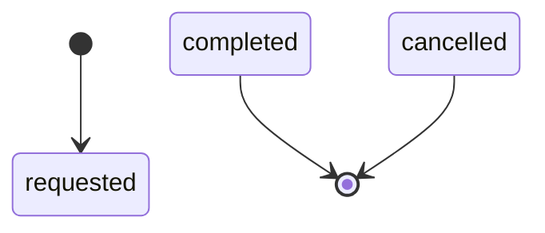
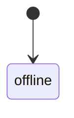
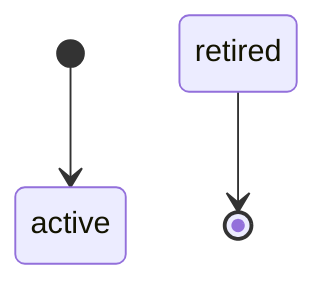
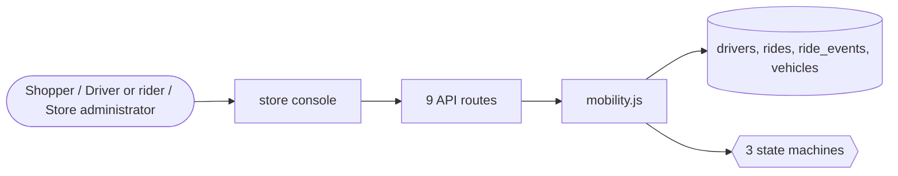

# Mobility

> Generated from `_registry/business-domains.json`, the code and `docs/source/mobility.md` — edit those, then run `node scripts/domain-docs.js`.

## Overview

Moving people: rides requested and dispatched, drivers and their vehicles, and fleets.

**Foundation domain:** Operations · **Used by:** Shopper, Driver or rider, Store administrator

## Switches and settings

Each is switched on per store under ⚙️ Capabilities; its parameters are that store's settings.

### Ride hailing (`ride_hailing`)

The ride lifecycle: request → accept → arrive → trip start → complete/cancel, with fare construction and per-state cancellation fees.

| Setting | Meaning | Default |
|---|---|---|
| `base_fare` | Base fare (pickup charge) | `2.5` |
| `per_km_rate` | Rate per kilometre | `1.2` |
| `per_min_rate` | Rate per minute | `0.35` |
| `min_fare` | Floor below which a completed fare is not charged | `5` |
| `booking_fee` | Fixed platform booking fee added to every fare | `0.5` |
| `platform_take_rate_pct` | Platform commission on a driver's fare | `15` |
| `cancel_fee_accepted` | Cancellation fee once a driver accepted | `1` |
| `cancel_fee_midtrip` | Cancellation fee once the trip started | `5` |

### Dispatch & matching (`dispatch`)

Match a request to the nearest idle driver of the requested kind, with a search radius, ETA construction and auto-dispatch.

| Setting | Meaning | Default |
|---|---|---|
| `auto_dispatch` | Assign a driver automatically on request (off = a manual dispatcher works the queue) | `true` |
| `match_radius_km` | Maximum distance a candidate driver may be | `5` |
| `eta_per_km_minutes` | ETA minutes per km of approach distance | `3` |
| `eta_pickup_buffer_minutes` | Flat minutes added to every ETA | `2` |
| `unknown_position_penalty_km` | Distance assumed for a driver with no last-known position | `2` |
| `city_centre_offset_km` | Subtracted from a driver's stored city distance | `0` |

### Fleet & driver management (`fleet_management`)

Drivers and vehicles: onboarding, online/offline state, vehicle kinds, maintenance state and the health that dispatch ranks on.

| Setting | Meaning | Default |
|---|---|---|
| `driver_kinds` | Vehicle kinds the console offers | `["car","suv","bike","auto","van"]` |
| `min_rating_to_dispatch` | A driver below this rating is held out of dispatch | `4` |

## Architecture

| Module | What it is |
|---|---|
| `lib/mobility.js` | E17 · The Mobility universe. -------------------------------------------------------------------------- Constitution E17: "Through configuration alone this universe yields ride-hailing, taxi, food-delivery and parcel-delivery platforms: ride hailing · dispatch · driver management · routing · fleet · delivery · tracking · dynamic pricing · matching · rating." |

## Data model

### `drivers`

| Column | Type |
|---|---|
| `id` | INTEGER PRIMARY KEY AUTOINCREMENT |
| `tenant_id` | INTEGER NOT NULL |
| `name` | TEXT NOT NULL |
| `email` | TEXT |
| `phone` | TEXT |
| `city` | TEXT DEFAULT '' |
| `vehicle_kind` | TEXT NOT NULL DEFAULT 'car' |
| `/*` | car \| suv \| bike \| auto \| van */ plate TEXT DEFAULT '' |
| `license` | TEXT DEFAULT '' |
| `status` | TEXT NOT NULL DEFAULT 'offline' |
| `/*` | offline \| online \| busy \| suspended */ rating REAL NOT NULL DEFAULT 5.0 |
| `rides_completed` | INTEGER NOT NULL DEFAULT 0 |
| `rides_cancelled` | INTEGER NOT NULL DEFAULT 0 |
| `earnings` | REAL NOT NULL DEFAULT 0 |
| `city_latency` | REAL DEFAULT 0 |
| `/*` | last reported distance from the city centre |
| `km` | */ joined_at TEXT NOT NULL DEFAULT (datetime('now')) |
| `deactivated_at` | TEXT |
| `uid` | TEXT |

### `rides`

| Column | Type |
|---|---|
| `id` | INTEGER PRIMARY KEY AUTOINCREMENT |
| `tenant_id` | INTEGER NOT NULL |
| `ref` | TEXT NOT NULL UNIQUE |
| `rider` | TEXT |
| `rider_phone` | TEXT |
| `pickup` | TEXT NOT NULL |
| `dropoff` | TEXT NOT NULL |
| `pickup_lat` | REAL |
| `pickup_lng` | REAL |
| `dropoff_lat` | REAL |
| `dropoff_lng` | REAL |
| `vehicle_kind` | TEXT NOT NULL DEFAULT 'car' |
| `driver_id` | INTEGER |
| `status` | TEXT NOT NULL DEFAULT 'requested' |
| `/*` | requested → accepted → arrived → trip_start → completed \| cancelled */ fare REAL DEFAULT 0 |
| `surge` | REAL NOT NULL DEFAULT 1.0 |
| `distance_km` | REAL DEFAULT 0 |
| `duration_min` | REAL DEFAULT 0 |
| `eta_min` | REAL DEFAULT 0 |
| `payment_method` | TEXT DEFAULT 'cash' |
| `/*` | cash \| wallet \| card \| upi */ rating INTEGER |
| `note` | TEXT DEFAULT '' |
| `requested_at` | TEXT NOT NULL DEFAULT (datetime('now')) |
| `accepted_at` | TEXT |
| `arrived_at` | TEXT |
| `started_at` | TEXT |
| `completed_at` | TEXT |
| `cancelled_at` | TEXT |
| `uid` | TEXT |

### `ride_events`

| Column | Type |
|---|---|
| `id` | INTEGER PRIMARY KEY AUTOINCREMENT |
| `tenant_id` | INTEGER NOT NULL |
| `ride_id` | INTEGER NOT NULL |
| `status` | TEXT NOT NULL |
| `note` | TEXT DEFAULT '' |
| `at` | TEXT NOT NULL DEFAULT (datetime('now')) |
| `uid` | TEXT |

### `vehicles`

| Column | Type |
|---|---|
| `id` | INTEGER PRIMARY KEY AUTOINCREMENT |
| `tenant_id` | INTEGER NOT NULL |
| `plate` | TEXT NOT NULL |
| `kind` | TEXT NOT NULL DEFAULT 'car' |
| `capacity` | INTEGER NOT NULL DEFAULT 4 |
| `status` | TEXT NOT NULL DEFAULT 'active' |
| `/*` | active \| maintenance \| retired */ odometer REAL DEFAULT 0 |
| `insurance_until` | TEXT |
| `driver_id` | INTEGER |
| `created_at` | TEXT NOT NULL DEFAULT (datetime('now')) |
| `uid` | TEXT |

## API reference

Every call is JSON over HTTPS; store calls carry the store (`?store=`) and the session; mutating calls accept an `Idempotency-Key` header where noted.

| Method and path | Handler | What it does |
|---|---|---|
| `GET /api/admin/mobility` | `apiMobilityGet` | — |
| `POST /api/admin/mobility/rides` | `apiMobilityRide` | — |
| `PUT /api/admin/mobility/rides/:id` | `apiMobilityRideStatus` | — |
| `POST /api/admin/mobility/rides/:id/rate` | `apiMobilityRate` | — |
| `POST /api/admin/mobility/drivers` | `apiMobilityDriver` | — |
| `POST /api/admin/mobility/drivers/:id/toggle` | `apiMobilityDriverToggle` | — |
| `POST /api/admin/mobility/drivers/:id/deactivate` | `apiMobilityDriverDeactivate` | — |
| `POST /api/admin/mobility/vehicles` | `apiMobilityVehicle` | — |
| `POST /api/admin/mobility/zones` | `apiMobilityZone` | — |

## Process flows

Each record's life is a declared state machine (`lib/seed/states.json`): the moves it may make, and the actions that make them.

### Ride (`ride`)

Actions: 

### Driver (`driver`)

Actions: 

### Vehicle (`vehicle`)

Actions: 

## Data flow

## User interface

**Store console:** 🚗 Rides & Dispatch · 🚙 Fleet & Drivers

## User flows

_Not yet written — `docs/source/mobility.md`, section `## Flows`._

## Manuals

### Shopper

_Not yet written — `docs/source/mobility.md`, section `## Manual: shopper`._

### Driver or rider

_Not yet written — `docs/source/mobility.md`, section `## Manual: driver`._

### Store administrator

_Not yet written — `docs/source/mobility.md`, section `## Manual: store_admin`._

