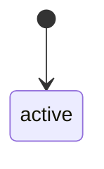
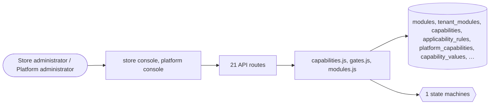

# Modules and capabilities

> Generated from `_registry/business-domains.json`, the code and `docs/source/modules.md` — edit those, then run `node scripts/domain-docs.js`.

## Overview

What a store has switched on: the modules the platform sells to stores, the capabilities inside them, their parameters, presets and availability rules.

**Foundation domain:** Offering · **Used by:** Store administrator, Platform administrator

## Switches and settings

Each is switched on per store under ⚙️ Capabilities; its parameters are that store's settings.

### Admin portal link (`admin_portal`)

The 'Admin Console' link shown to a store's own staff on the storefront.

## Architecture

| Module | What it is |
|---|---|
| `lib/capabilities.js` | The Capability Layer. -------------------------------------------------------------------------- "Configure types, standards, quality, features and functionalities of any platform or service" — this module is that statement made literal. |
| `lib/gates.js` | feature gates: an engine asks a binding point, never another engine's capability by name. Checkout does not ask "is the `wallet` module capability on?"; it asks `checkout.wallet`, and the featureGates registry row says which capability opens that point and where it comes from (`source: "module"` — an installed module's capability, through the rules engine's module.cap gate — or `"capability"` — the capability catalogue). A row may also carry the setting it reads from the providing module's config (`config`) and the message a refusal shows. Moving a feature to another module, or splitting a Pro bundle, is a row edit. An engine naming the capability it *is* (the ride engine's `ride_hailing`) is identity, not a gate, and stays as it is. |
| `lib/modules.js` | Capability Marketplace. EVERYTHING is a product: identity, gid, geo, billing, seo, recommendations, cart, listing, checkout, tax, offers, wallet, logistics, payment rails, catalog packs, themes. Modules are catalog rows with price + manifest; manifests declare capabilities/features/ gateways/catalog actions; the platform auto-applies free baselines at provisioning ("purchase"). |

## Data model

### `modules`

| Column | Type |
|---|---|
| `id` | TEXT PRIMARY KEY |
| `name` | TEXT NOT NULL |
| `category` | TEXT |
| `summary` | TEXT |
| `price_type` | TEXT DEFAULT 'one_time' |
| `price` | REAL DEFAULT 0 |
| `currency` | TEXT DEFAULT 'USD' |
| `version` | TEXT DEFAULT '1.0' |
| `vendor` | TEXT DEFAULT 'LUXORA' |
| `manifest` | TEXT DEFAULT '{}' |
| `status` | TEXT DEFAULT 'active' |
| `position` | INTEGER DEFAULT 0 |
| `uid` | TEXT |

### `tenant_modules`

| Column | Type |
|---|---|
| `tenant_id` | INTEGER NOT NULL |
| `module_id` | TEXT NOT NULL |
| `status` | TEXT DEFAULT 'installed' |
| `config` | TEXT DEFAULT '{}' |
| `installed_at` | TEXT NOT NULL DEFAULT (datetime('now')) |
| `installed_by` | TEXT DEFAULT '' |
| `uid` | TEXT |

### `capabilities`

| Column | Type |
|---|---|
| `id` | INTEGER PRIMARY KEY AUTOINCREMENT |
| `tenant_id` | INTEGER NOT NULL |
| `key` | TEXT NOT NULL |
| `category` | TEXT NOT NULL DEFAULT 'feature' |
| `name` | TEXT NOT NULL |
| `description` | TEXT DEFAULT '' |
| `version` | TEXT DEFAULT '1.0.0' |
| `schema` | TEXT DEFAULT '{}' |
| `config` | TEXT DEFAULT '{}' |
| `dependencies` | TEXT DEFAULT '[]' |
| `status` | TEXT DEFAULT 'active' |
| `enabled` | INTEGER DEFAULT 1 |
| `created_at` | TEXT NOT NULL DEFAULT (datetime('now')) |
| `updated_at` | TEXT |

### `applicability_rules`

| Column | Type |
|---|---|
| `id` | INTEGER PRIMARY KEY AUTOINCREMENT |
| `tenant_id` | INTEGER |
| `subject_type` | TEXT NOT NULL |
| `subject` | TEXT NOT NULL DEFAULT '*' |
| `effect` | TEXT NOT NULL DEFAULT 'allow' |
| `priority` | INTEGER NOT NULL DEFAULT 0 |
| `scope` | TEXT NOT NULL DEFAULT '{}' |
| `params` | TEXT NOT NULL DEFAULT '{}' |
| `note` | TEXT DEFAULT '' |
| `active` | INTEGER NOT NULL DEFAULT 1 |
| `created_by` | TEXT |
| `created_at` | TEXT NOT NULL DEFAULT (datetime('now')) |
| `updated_at` | TEXT |

### `platform_capabilities`

| Column | Type |
|---|---|
| `id` | INTEGER PRIMARY KEY AUTOINCREMENT |
| `key` | TEXT NOT NULL UNIQUE |
| `/*` | buy_box |
| `trade_assurance` |  |
| `qr_pay` | … */ label TEXT NOT NULL |
| `/*` | "Buy-box competition" */ domain TEXT NOT NULL |
| `/*` | marketplace \| fintech \| qc \| trade */ icon TEXT |
| `/*` | for the console */ description TEXT |
| `params` | TEXT NOT NULL DEFAULT '{}' |
| `/*` | the tunables |
| `each` | {type |
| `default` |  |
| `...}` | */ sections TEXT NOT NULL DEFAULT '[]' |
| `/*` | the store console leaves this atom lights */ enabled INTEGER DEFAULT 1 |
| `/*` | platform-level switch */ position INTEGER DEFAULT 0 |
| `seeded_from` | TEXT |
| `/*` | self-heal marker |
| `never` | clobbers an edit */ edited INTEGER DEFAULT 0 |
| `/*` | 1 once an operator owns this row */ created_at TEXT NOT NULL DEFAULT (datetime('now')) |

### `capability_values`

| Column | Type |
|---|---|
| `id` | INTEGER PRIMARY KEY AUTOINCREMENT |
| `tenant_id` | INTEGER NOT NULL |
| `capability` | TEXT NOT NULL |
| `enabled` | INTEGER DEFAULT 1 |
| `params` | TEXT NOT NULL DEFAULT '{}' |
| `/*` | overrides merged onto the defaults */ notes TEXT |

### `capability_presets`

| Column | Type |
|---|---|
| `id` | INTEGER PRIMARY KEY AUTOINCREMENT |
| `key` | TEXT NOT NULL UNIQUE |
| `label` | TEXT NOT NULL |
| `description` | TEXT |
| `capabilities` | TEXT NOT NULL DEFAULT '{}' |
| `/*` | {key: {enabled |
| `params}}` | */ universes TEXT |
| `/*` | JSON [universe key] a new store opens with; NULL = none declared */ created_at TEXT NOT NULL DEFAULT (datetime('now')) |

### `capability_preset_assignments`

| Column | Type |
|---|---|
| `id` | INTEGER PRIMARY KEY AUTOINCREMENT |
| `tenant_id` | INTEGER NOT NULL |
| `preset_key` | TEXT NOT NULL |

## API reference

Every call is JSON over HTTPS; store calls carry the store (`?store=`) and the session; mutating calls accept an `Idempotency-Key` header where noted.

| Method and path | Handler | What it does |
|---|---|---|
| `GET /api/capabilities` | `apiCapabilities` | one read renders the entire console: the catalog (what is configurable), the archetypes, and the selected tenant's live composition |
| `POST /api/capabilities/platform/:key` | `apiCapPlatform` | platform-level: switch a capability off for every store, or retitle it |
| `POST /api/capabilities/enable` | `apiCapEnable` | switch a capability ON for a tenant, with optional param overrides |
| `POST /api/capabilities/disable` | `apiCapDisable` | — |
| `POST /api/capabilities/param` | `apiCapParam` | tune ONE declared parameter — coerced to its declared type, and refused if the capability or parameter is unknown to the catalog |
| `POST /api/capabilities/preset/apply` | `apiCapPresetApply` | apply a named archetype to a tenant |
| `POST /api/capabilities/preset` | `apiCapPresetSave` | author or rewrite an archetype — a platform-owned vocabulary |
| `POST /api/capabilities/preset/delete` | `apiCapPresetDelete` | — |
| `POST /api/capabilities/catalog` | `apiCapDefine` | author a capability the seed never knew about — the open-ended catalog. This is what makes the platform any platform: surge pricing for mobility, creator payouts for video, lead scoring for a CRM, all as typed data |
| `DELETE /api/capabilities/catalog/:key` | `apiCapUndefine` | — |
| `GET /api/platform/flags` | `apiFlags` | — |
| `PUT /api/platform/flags/:name` | `apiFlagSet` | — |
| `DELETE /api/platform/flags/:name` | `apiFlagDelete` | — |
| `GET /api/platform/modules` | `apiPlatformModules` | — |
| `POST /api/platform/modules/:id/install` | `apiModuleInstall` | — |
| `POST /api/platform/modules/:id/uninstall` | `apiModuleUninstall` | — |
| `POST /api/platform/modules/:id/configure` | `apiModuleConfigure` | — |
| `GET /api/modules` | `apiStoreModules` | — |
| `GET /api/market` | `apiMarket` | store-facing marketplace: the store itself purchases modules |
| `POST /api/modules/purchase` | `apiModulePurchase` | — |
| `POST /api/modules/release` | `apiModuleRelease` | — |

## Process flows

Each record's life is a declared state machine (`lib/seed/states.json`): the moves it may make, and the actions that make them.

### Marketplace module (`module`)

Actions: 

## Data flow

## User interface

**Store console:** 🧭 Availability Rules · 🧩 Modules

**Platform console:** ⚙️ Capabilities · 🧭 Availability Rules · 🌳 Capability Tree · 🗄️ Capability Registry · 🧩 Capability Composition · 🧭 Capability Discovery · 🧩 Module Marketplace

## User flows

_Not yet written — `docs/source/modules.md`, section `## Flows`._

## Manuals

### Store administrator

_Not yet written — `docs/source/modules.md`, section `## Manual: store_admin`._

### Platform administrator

_Not yet written — `docs/source/modules.md`, section `## Manual: platform_admin`._

