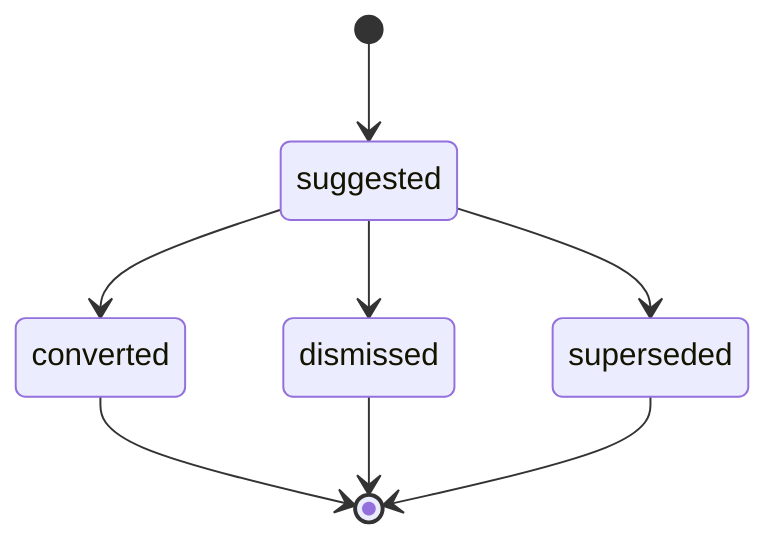
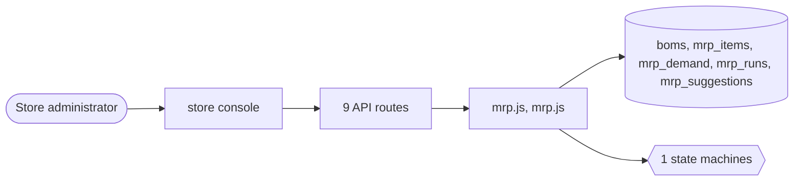

# Material requirements planning

> Generated from `_registry/business-domains.json`, the code and `docs/source/mrp.md` — edit those, then run `node scripts/domain-docs.js`.

## Overview

What to make and buy, and by when: bills of materials to any depth without cycles, a master schedule of what must be ready, netting level by level against stock, open purchase and work orders and safety stock, lead times and lateness, and suggestions turned once into draft purchase orders per supplier and planned work orders.

**Foundation domain:** Commerce · **Used by:** Store administrator

## Architecture

| Module | What it is |
|---|---|
| `lib/mrp.js` | material requirements planning (owner Commerce). |
| `lib/routes/mrp.js` | material requirements planning routes (lib/mrp.js; _registry/business-domains.json). Bills of materials, the master schedule, planning runs and what they suggest, under the store's mrp section (the Planning role holds it). |

## Data model

### `boms`

| Column | Type |
|---|---|
| `id` | INTEGER PRIMARY KEY AUTOINCREMENT |
| `tenant_id` | INTEGER NOT NULL |
| `product_id` | TEXT NOT NULL |
| `component_id` | TEXT NOT NULL |
| `qty` | REAL NOT NULL |
| `scrap_pct` | REAL NOT NULL DEFAULT 0 |

### `mrp_items`

| Column | Type |
|---|---|
| `id` | INTEGER PRIMARY KEY AUTOINCREMENT |
| `tenant_id` | INTEGER NOT NULL |
| `product_id` | TEXT NOT NULL |
| `lead_days` | INTEGER |
| `safety_stock` | INTEGER NOT NULL DEFAULT 0 |
| `min_lot` | INTEGER NOT NULL DEFAULT 1 |

### `mrp_demand`

| Column | Type |
|---|---|
| `id` | INTEGER PRIMARY KEY AUTOINCREMENT |
| `tenant_id` | INTEGER NOT NULL |
| `product_id` | TEXT NOT NULL |
| `qty` | INTEGER NOT NULL |
| `due_date` | TEXT NOT NULL |
| `note` | TEXT DEFAULT '' |
| `created_by` | TEXT DEFAULT '' |
| `created_at` | TEXT NOT NULL DEFAULT (datetime('now')) |

### `mrp_runs`

| Column | Type |
|---|---|
| `id` | INTEGER PRIMARY KEY AUTOINCREMENT |
| `tenant_id` | INTEGER NOT NULL |
| `ref` | TEXT NOT NULL |
| `horizon_days` | INTEGER NOT NULL |
| `through` | TEXT NOT NULL |
| `suggestions` | INTEGER NOT NULL DEFAULT 0 |
| `late` | INTEGER NOT NULL DEFAULT 0 |
| `ran_by` | TEXT DEFAULT '' |
| `ran_at` | TEXT NOT NULL DEFAULT (datetime('now')) |

### `mrp_suggestions`

| Column | Type |
|---|---|
| `id` | INTEGER PRIMARY KEY AUTOINCREMENT |
| `tenant_id` | INTEGER NOT NULL |
| `run_id` | INTEGER NOT NULL |
| `product_id` | TEXT NOT NULL |
| `action` | TEXT NOT NULL |
| `level` | INTEGER NOT NULL DEFAULT 0 |
| `qty` | INTEGER NOT NULL |
| `gross` | INTEGER NOT NULL DEFAULT 0 |
| `available` | INTEGER NOT NULL DEFAULT 0 |
| `incoming` | INTEGER NOT NULL DEFAULT 0 |
| `safety` | INTEGER NOT NULL DEFAULT 0 |
| `need_by` | TEXT |
| `order_by` | TEXT |
| `late` | INTEGER NOT NULL DEFAULT 0 |
| `supplier_id` | INTEGER |
| `unit_cost` | REAL |
| `status` | TEXT NOT NULL |
| `made_ref` | TEXT DEFAULT '' |

## API reference

Every call is JSON over HTTPS; store calls carry the store (`?store=`) and the session; mutating calls accept an `Idempotency-Key` header where noted.

| Method and path | Handler | What it does |
|---|---|---|
| `GET /api/admin/mrp` | `apiMrp` | Planning at a glance: the latest run and its suggestions, the master schedule, and the items with a bill of materials. |
| `GET /api/admin/mrp/boms/:id` | `apiMrpBom` | An item's bill of materials, with each component's own beneath it. |
| `PUT /api/admin/mrp/boms/:id` | `apiMrpBomSet` | Replaces an item's bill of materials: `components` `[{ component_id, qty, scrap_pct }]` (empty removes it). A component is never the item itself, or anything made from it. |
| `PUT /api/admin/mrp/items/:id` | `apiMrpItem` | Sets an item's planning: `lead_days` (null takes its supplier's or the default), `safety_stock`, `min_lot`. |
| `POST /api/admin/mrp/demand` | `apiMrpDemandAdd` | Adds to the master schedule: `product_id`, `qty`, `due_date`, `note`. |
| `DELETE /api/admin/mrp/demand/:id` | `apiMrpDemandRemove` | Removes a line of the master schedule. |
| `POST /api/admin/mrp/run` | `apiMrpRun` | Runs planning over `horizon_days`: what to make and buy, how many, by when, and what is late. Supersedes what the last run suggested and nobody acted on. |
| `POST /api/admin/mrp/convert` | `apiMrpConvert` | Turns suggestions (`ids`, or every open one of the latest run) into draft purchase orders, one per supplier, and planned work orders. Each is acted on once. |
| `POST /api/admin/mrp/suggestions/:id/dismiss` | `apiMrpDismiss` | Dismisses one suggestion. |

## Process flows

Each record's life is a declared state machine (`lib/seed/states.json`): the moves it may make, and the actions that make them.

### Planning suggestion (`mrp_suggestion`)

Actions: 

## Data flow

## User interface

**Store console:** 🏭 Planning (MRP)

## User flows

**Bills of materials.** An item that is made has a bill of materials: the components one unit takes,
and the share lost in making it. A component may be made from its own components, to any depth, but
never from the item itself; such a bill is refused. An item without a bill is bought.

**Planning settings.** Each item may have a lead time in days (otherwise its supplier's for a bought
item, or the default), a safety stock to keep and a smallest lot.

**What must be ready.** The master schedule lists what must be ready by a date. Open work orders add
what they still need of their components.

**A planning run.** A run looks a number of days ahead and takes items level by level, from finished
goods down to raw materials. For each, what is needed plus its safety stock, less what is on the
shelf and what open purchase orders and work orders will bring, is what must still be made or bought,
raised to the smallest lot or the supplier's minimum order. A made item becomes a planned work order,
and its components are needed when that order must start. A bought item is ordered from its primary
supplier. Each suggestion says when it must be ordered or started; one whose date has passed is late.

**Making the orders.** Suggestions become draft purchase orders, one per supplier, and planned work
orders carrying their components. Each suggestion is acted on once. An item with no supplier is not
ordered. The next run counts what those orders will bring; a new run replaces suggestions nobody
acted on.

## Manuals

### Store administrator

Open **Business Operations → 🏭 Planning (MRP)**. Your role needs the mrp section; the Planning role
has it.

- **Bill of materials**: type the item's code and **Show**. Write one component a line as
  `item code | quantity | % lost`, then **Save the bill**.
- **Planning for an item**: its lead time, safety stock and smallest lot.
- **What must be ready**: add what must be ready by when.
- **Plan**: **Run planning**, check what it suggests, dismiss what you will not do, then **Make the
  orders**. Purchase orders are drafts to check and send under Purchasing.

