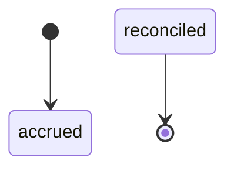
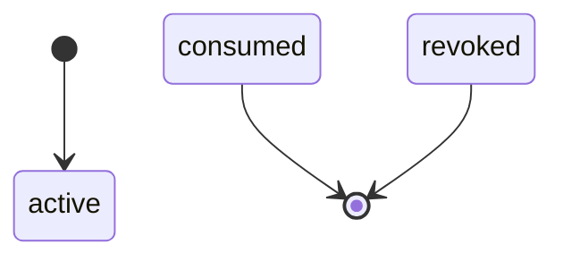
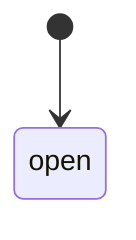
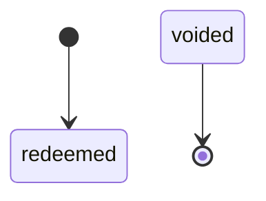
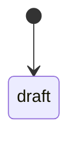
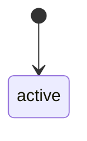
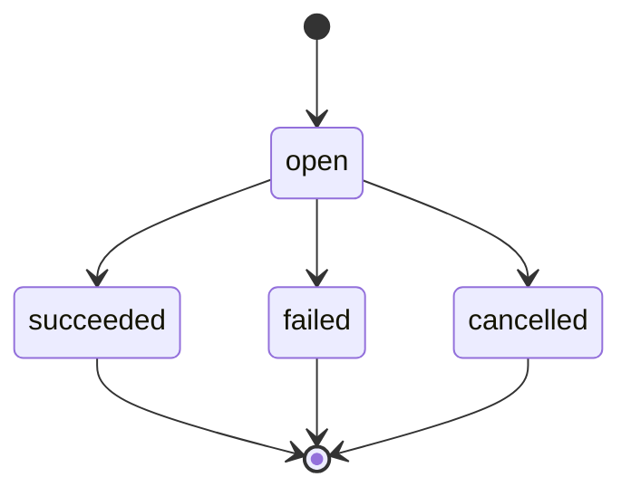
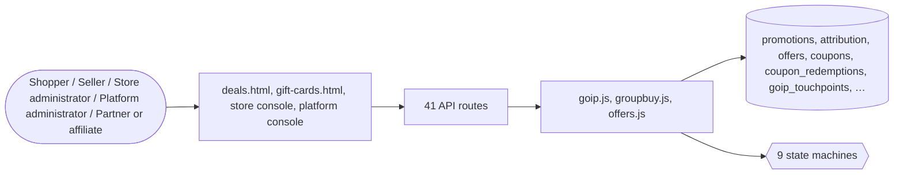

# Offers

> Generated from `_registry/business-domains.json`, the code and `docs/source/offer.md` — edit those, then run `node scripts/domain-docs.js`.

## Overview

Every reason a buyer pays less or gets more: offers and discounts of every type, coupons, cashback, rewards, gift cards and vouchers, deals and countdowns, group buying, price matching and trade-ins, the funding and settlement of each, and their governance.

**Foundation domain:** Commerce · **Used by:** Shopper, Seller, Store administrator, Platform administrator, Partner or affiliate

## Switches and settings

Each is switched on per store under ⚙️ Capabilities; its parameters are that store's settings.

### Gift vouchers (`gift_vouchers`)

Issue a code with a balance; redemption credits the holder's wallet. Expired codes are retired on use.

| Setting | Meaning | Default |
|---|---|---|
| `code_length` | Length of the generated voucher code | `12` |

### Deals page & strip (`deals`)

The /deals page, the header deal link and the storefront offers strip.

### Promo codes (`coupons`)

Shopper-redeemable coupon codes at cart and checkout. Platform policy may refuse this independently.

### Gift cards & balance (`gift_cards`)

The gift-cards page, the gift-balance line in checkout and the wallet top-up path.

### Deal countdown (`countdown`)

A live countdown badge on time-limited offers.

### Group buying (`group_buying`)

A lower price that applies when enough shoppers join before a deadline; if the group falls short, every member's order is cancelled and refunded.

| Setting | Meaning | Default |
|---|---|---|
| `max_qty_per_member` | Most one member may buy | `5` |
| `close_when_full` | A campaign closes as soon as it is full | `true` |
| `refund_kind` | Wallet ledger kind used to refund a failed group | `"refund"` |

### Price match (`price_match`)

A shopper shows the item cheaper elsewhere; staff approve the difference, credited to their wallet (a caseKinds row).

### Trade-in (`exchange_offers`)

A shopper describes what they trade in; staff value it, and the value comes off one item in their bag.

## Architecture

| Module | What it is |
|---|---|
| `lib/goip.js` | GOIP Ω∞ — GLOBAL OFFER INFRASTRUCTURE PLATFORM Universal Incentive · Offer · Reward · Value-Exchange operating system for LUXORA. |
| `lib/groupbuy.js` | Group buying: a lower price when enough shoppers join. Staff open a campaign on a product: a group price, how many members it needs by a deadline, and how many it may take. A shopper joins by buying at the group price — the campaign rides on the bag line as its `group` term (lib/lineterms.js) — and becomes a member with that order. When the deadline passes, a campaign with enough members has succeeded and its orders go ahead; one that fell short has failed, and every member's order is cancelled and what they paid is refunded to their wallet. A full campaign may close early. The campaign's life is the `group_campaign` state machine, asked by tag (joinable, refunds_members…). Capability: group_buying. |
| `lib/offers.js` | Central Offers / Coupons / Discounts / Wallet engine. ONE reusable service (like registry.js / ai.js / modules.js) that any surface — storefront cart, checkout, platform subscription billing, AI metering, or a client API — calls to compute discounts, credits, free-shipping and coupon redemptions. Everything (types, scopes, channels, directions, funders, coupon kinds, limits) is DATA in meta_lists; new offer types/scope rules are added without code. Legacy per-store `promotions` are read too, so nothing that already works regresses. |

**Registry lists** (editable in Data Studio): `finVoucherStatuses`, `groupCampaignStatuses`

## Data model

### `promotions`

| Column | Type |
|---|---|
| `id` | INTEGER PRIMARY KEY AUTOINCREMENT |
| `tenant_id` | INTEGER NOT NULL |
| `name` | TEXT NOT NULL |
| `type` | TEXT NOT NULL |
| `value` | REAL DEFAULT 0 |
| `rules` | TEXT DEFAULT '{}' |
| `scope` | TEXT DEFAULT '{}' |
| `starts` | TEXT |
| `ends` | TEXT |
| `status` | TEXT DEFAULT 'active' |
| `code` | TEXT DEFAULT '' |
| `deleted_at` | TEXT |

### `attribution`

| Column | Type |
|---|---|
| `id` | INTEGER PRIMARY KEY AUTOINCREMENT |
| `tenant_id` | INTEGER NOT NULL |
| `order_id` | INTEGER |
| `ad_id` | INTEGER |
| `seller_id` | INTEGER |
| `model` | TEXT DEFAULT 'last_click' |
| `revenue` | REAL DEFAULT 0 |
| `commission` | REAL DEFAULT 0 |
| `created_at` | TEXT NOT NULL DEFAULT (datetime('now')) |

### `offers`

| Column | Type |
|---|---|
| `id` | INTEGER PRIMARY KEY AUTOINCREMENT |
| `tenant_id` | INTEGER NOT NULL DEFAULT 0 |
| `scope_level` | TEXT NOT NULL DEFAULT 'tenant' |
| `channel` | TEXT NOT NULL DEFAULT 'commerce' |
| `name` | TEXT NOT NULL |
| `code` | TEXT DEFAULT '' |
| `type` | TEXT NOT NULL |
| `direction` | TEXT NOT NULL DEFAULT 'discount' |
| `value` | REAL DEFAULT 0 |
| `currency` | TEXT DEFAULT 'USD' |
| `scope_type` | TEXT NOT NULL DEFAULT 'store' |
| `scope_value` | TEXT DEFAULT '{}' |
| `funder` | TEXT NOT NULL DEFAULT 'self' |
| `funder_ref` | TEXT DEFAULT '' |
| `brand_ref` | TEXT DEFAULT '' |
| `min_amount` | REAL DEFAULT 0 |
| `min_qty` | INTEGER DEFAULT 0 |
| `max_discount` | REAL DEFAULT 0 |
| `usage_limit` | INTEGER DEFAULT 0 |
| `per_owner_limit` | INTEGER DEFAULT 0 |
| `used` | INTEGER DEFAULT 0 |
| `stack_group` | TEXT DEFAULT '' |
| `stack_policy` | TEXT DEFAULT 'stack_with_others' |
| `priority` | INTEGER DEFAULT 0 |
| `starts` | TEXT |
| `ends` | TEXT |
| `status` | TEXT DEFAULT 'active' |
| `rules` | TEXT DEFAULT '{}' |
| `summary` | TEXT DEFAULT '' |
| `source` | TEXT DEFAULT 'offer' |
| `created_at` | TEXT NOT NULL DEFAULT (datetime('now')) |
| `deleted_at` | TEXT |
| `domain` | TEXT DEFAULT 'incentive' |
| `benefit` | TEXT DEFAULT '' |
| `reality` | TEXT DEFAULT 'any' |
| `economic_unit` | TEXT DEFAULT '' |
| `temporal_spec` | TEXT DEFAULT '{}' |
| `spatial_spec` | TEXT DEFAULT '{}' |
| `conditions` | TEXT DEFAULT '{}' |
| `distribution` | TEXT DEFAULT '[]' |
| `attribution_model` | TEXT DEFAULT 'last_touch' |
| `funding` | TEXT DEFAULT '{}' |
| `governance` | TEXT DEFAULT '{}' |
| `campaign` | TEXT DEFAULT '' |
| `version` | INTEGER DEFAULT 1 |
| `parent_id` | INTEGER |
| `uid` | TEXT |

### `coupons`

| Column | Type |
|---|---|
| `id` | INTEGER PRIMARY KEY AUTOINCREMENT |
| `tenant_id` | INTEGER NOT NULL DEFAULT 0 |
| `code` | TEXT NOT NULL |
| `offer_id` | INTEGER |
| `funder` | TEXT DEFAULT 'self' |
| `funder_ref` | TEXT DEFAULT '' |
| `brand_ref` | TEXT DEFAULT '' |
| `kind` | TEXT NOT NULL DEFAULT 'single_use' |
| `value` | REAL DEFAULT 0 |
| `currency` | TEXT DEFAULT 'USD' |
| `max_uses` | INTEGER DEFAULT 1 |
| `per_owner_limit` | INTEGER DEFAULT 1 |
| `used` | INTEGER DEFAULT 0 |
| `issued_to` | TEXT DEFAULT '' |
| `batch` | TEXT DEFAULT '' |
| `starts` | TEXT |
| `ends` | TEXT |
| `status` | TEXT DEFAULT 'active' |
| `note` | TEXT DEFAULT '' |
| `created_at` | TEXT NOT NULL DEFAULT (datetime('now')) |
| `deleted_at` | TEXT |
| `uid` | TEXT |

### `coupon_redemptions`

| Column | Type |
|---|---|
| `id` | INTEGER PRIMARY KEY AUTOINCREMENT |
| `tenant_id` | INTEGER NOT NULL |
| `coupon_id` | INTEGER |
| `offer_id` | INTEGER |
| `code` | TEXT |
| `order_id` | INTEGER |
| `invoice_id` | INTEGER |
| `owner` | TEXT |
| `channel` | TEXT DEFAULT 'commerce' |
| `amount` | REAL DEFAULT 0 |
| `qty` | INTEGER DEFAULT 1 |
| `funder` | TEXT DEFAULT 'self' |
| `funder_ref` | TEXT DEFAULT '' |
| `brand_ref` | TEXT DEFAULT '' |
| `meta` | TEXT DEFAULT '{}' |
| `created_at` | TEXT NOT NULL DEFAULT (datetime('now')) |
| `credits` | REAL DEFAULT 0 |
| `offer_type` | TEXT DEFAULT '' |
| `status` | TEXT DEFAULT 'redeemed' |
| `settlement_id` | INTEGER |
| `unit` | TEXT DEFAULT '' |
| `uid` | TEXT |

### `goip_touchpoints`

| Column | Type |
|---|---|
| `id` | INTEGER PRIMARY KEY AUTOINCREMENT |
| `tenant_id` | INTEGER NOT NULL DEFAULT 0 |
| `subject_uid` | TEXT DEFAULT '' |
| `offer_id` | INTEGER |
| `code` | TEXT DEFAULT '' |
| `kind` | TEXT NOT NULL DEFAULT 'view' |
| `party` | TEXT DEFAULT '' |
| `party_type` | TEXT DEFAULT 'customer' |
| `channel` | TEXT DEFAULT 'commerce' |
| `distribution` | TEXT DEFAULT 'in_app' |
| `device` | TEXT DEFAULT '' |
| `owner` | TEXT DEFAULT '' |
| `session` | TEXT DEFAULT '' |
| `order_id` | INTEGER |
| `value` | REAL DEFAULT 0 |
| `unit` | TEXT DEFAULT 'USD' |
| `context` | TEXT DEFAULT '{}' |
| `created_at` | TEXT NOT NULL DEFAULT (datetime('now')) |
| `uid` | TEXT |

### `goip_budgets`

| Column | Type |
|---|---|
| `id` | INTEGER PRIMARY KEY AUTOINCREMENT |
| `tenant_id` | INTEGER NOT NULL DEFAULT 0 |
| `domain` | TEXT NOT NULL DEFAULT 'incentive' |
| `funder` | TEXT NOT NULL DEFAULT 'self' |
| `funder_ref` | TEXT DEFAULT '' |
| `unit` | TEXT NOT NULL DEFAULT 'USD' |
| `allocated` | REAL DEFAULT 0 |
| `reserved` | REAL DEFAULT 0 |
| `consumed` | REAL DEFAULT 0 |
| `period` | TEXT NOT NULL DEFAULT '' |
| `status` | TEXT NOT NULL DEFAULT 'open' |
| `policy` | TEXT DEFAULT '{}' |
| `created_at` | TEXT NOT NULL DEFAULT (datetime('now')) |
| `updated_at` | TEXT |
| `uid` | TEXT |

### `goip_settlements`

| Column | Type |
|---|---|
| `id` | INTEGER PRIMARY KEY AUTOINCREMENT |
| `tenant_id` | INTEGER NOT NULL DEFAULT 0 |
| `period` | TEXT NOT NULL DEFAULT '' |
| `party` | TEXT NOT NULL DEFAULT '' |
| `party_type` | TEXT NOT NULL DEFAULT 'merchant' |
| `unit` | TEXT NOT NULL DEFAULT 'USD' |
| `gross` | REAL DEFAULT 0 |
| `fees` | REAL DEFAULT 0 |
| `net` | REAL DEFAULT 0 |
| `redemptions` | REAL DEFAULT 0 |
| `status` | TEXT NOT NULL DEFAULT 'accrued' |
| `reference` | TEXT DEFAULT '' |
| `paid_at` | TEXT |
| `meta` | TEXT DEFAULT '{}' |
| `created_at` | TEXT NOT NULL DEFAULT (datetime('now')) |
| `updated_at` | TEXT |
| `uid` | TEXT |

### `goip_entitlements`

| Column | Type |
|---|---|
| `id` | INTEGER PRIMARY KEY AUTOINCREMENT |
| `tenant_id` | INTEGER NOT NULL DEFAULT 0 |
| `owner` | TEXT NOT NULL DEFAULT '' |
| `benefit` | TEXT NOT NULL DEFAULT '' |
| `unit` | TEXT DEFAULT '' |
| `qty` | REAL DEFAULT 0 |
| `tier` | TEXT DEFAULT '' |
| `scope` | TEXT DEFAULT '{}' |
| `starts` | TEXT |
| `ends` | TEXT |
| `status` | TEXT NOT NULL DEFAULT 'active' |
| `source_offer` | INTEGER |
| `source_redemption` | INTEGER |
| `meta` | TEXT DEFAULT '{}' |
| `created_at` | TEXT NOT NULL DEFAULT (datetime('now')) |
| `uid` | TEXT |

### `gift_vouchers`

| Column | Type |
|---|---|
| `id` | INTEGER PRIMARY KEY AUTOINCREMENT |
| `tenant_id` | INTEGER NOT NULL |
| `code` | TEXT NOT NULL |
| `amount` | REAL NOT NULL |
| `currency` | TEXT |
| `buyer` | TEXT |
| `recipient` | TEXT |
| `recipient_email` | TEXT |
| `message` | TEXT |
| `expires_at` | TEXT |
| `redeemed_at` | TEXT |
| `redeemed_by` | TEXT |
| `status` | TEXT NOT NULL DEFAULT 'issued' |
| `created_at` | TEXT NOT NULL DEFAULT (datetime('now')) |

### `group_campaigns`

| Column | Type |
|---|---|
| `id` | INTEGER PRIMARY KEY AUTOINCREMENT |
| `tenant_id` | INTEGER NOT NULL |
| `product_id` | TEXT NOT NULL |
| `title` | TEXT DEFAULT '' |
| `group_price` | REAL NOT NULL |
| `min_members` | INTEGER NOT NULL |
| `max_members` | INTEGER |
| `ends_at` | TEXT NOT NULL |
| `status` | TEXT NOT NULL DEFAULT 'open' |
| `closed_at` | TEXT |
| `created_at` | TEXT NOT NULL DEFAULT (datetime('now')) |

### `group_members`

| Column | Type |
|---|---|
| `id` | INTEGER PRIMARY KEY AUTOINCREMENT |
| `tenant_id` | INTEGER NOT NULL |
| `campaign_id` | INTEGER NOT NULL |
| `owner` | TEXT NOT NULL |
| `order_id` | INTEGER NOT NULL |
| `qty` | INTEGER NOT NULL DEFAULT 1 |
| `paid` | REAL NOT NULL DEFAULT 0 |
| `refunded` | INTEGER NOT NULL DEFAULT 0 |
| `joined_at` | TEXT NOT NULL DEFAULT (datetime('now')) |

## API reference

Every call is JSON over HTTPS; store calls carry the store (`?store=`) and the session; mutating calls accept an `Idempotency-Key` header where noted.

| Method and path | Handler | What it does |
|---|---|---|
| `POST /api/fintech/vouchers` | `apiFinVoucherIssue` | S2: issuing a voucher mints spendable wallet credit (redeemVoucher credits a real balance), so it is an operator action — never an anonymous one. Redeem stays owner-scoped: a shopper redeems a code they hold, validated against the issued row. The console's own gift_voucher entity is admin/platform-write with no module requirement (lib/entity.js), so this route matches it — the module gate belongs on the balance path (apiGiftAdd), not on the code-issuing one. |
| `POST /api/fintech/vouchers/redeem` | `apiFinVoucherRedeem` | — |
| `GET /api/group-buys` | `apiGroupBuysMine` | group buying |
| `GET /api/admin/group-buys` | `apiAdminGroupBuys` | — |
| `POST /api/admin/group-buys` | `apiAdminGroupBuyCreate` | — |
| `POST /api/admin/group-buys/tick` | `apiAdminGroupBuyTick` | — |
| `POST /api/admin/group-buys/:id/cancel` | `apiAdminGroupBuyCancel` | — |
| `GET /api/promos` | `apiPromos` | — |
| `POST /api/coupon` | `apiCoupon` | — |
| `POST /api/giftcard` | `apiGiftAdd` | S4: this used to credit body.amount without ever looking at a code — a customer could top up their own wallet indefinitely. Redeem goes through the same validation the fintech voucher path uses: the code must resolve to an issued row for this tenant, and marking it redeemed is what authorises the credit. |
| `GET /api/admin/promotions` | `apiAdminPromotions` | — |
| `POST /api/admin/promotions` | `apiAdminPromoSave` | — |
| `PUT /api/admin/promotions/:id` | `apiAdminPromoSave` | — |
| `DELETE /api/admin/promotions/:id` | `apiAdminPromoDelete` | — |
| `GET /api/offers` | `apiOffersList` | — |
| `POST /api/offers` | `apiOfferSave` | — |
| `PUT /api/offers/:id` | `apiOfferSave` | — |
| `DELETE /api/offers/:id` | `apiOfferDelete` | — |
| `POST /api/offers/preview` | `apiOffersPreview` | — |
| `GET /api/offers/analytics` | `apiOffersAnalytics` | — |
| `GET /api/offers/coupons` | `apiCouponsList` | — |
| `POST /api/offers/coupons` | `apiCouponCreate` | — |
| `POST /api/offers/coupons/generate` | `apiCouponGenerate` | — |
| `DELETE /api/offers/coupons/:id` | `apiCouponVoid` | — |
| `GET /api/platform/offers` | `apiPlatformOffers` | — |
| `GET /api/goip` | `apiGoipManifest` | — |
| `GET /api/goip/exchanges` | `apiGoipExchanges` | — |
| `GET /api/goip/exchanges/:id` | `apiGoipExchange` | — |
| `GET /api/goip/context` | `apiGoipContext` | — |
| `GET /api/goip/treasury` | `apiGoipTreasury` | — |
| `GET /api/goip/settlements` | `apiGoipSettlements` | — |
| `GET /api/goip/entitlements` | `apiGoipEntitlements` | — |
| `GET /api/goip/touchpoints` | `apiGoipTouchpoints` | — |
| `GET /api/goip/widget` | `apiGoipWidget` | — |
| `GET /api/goip/registry/:name` | `apiGoipRegistry` | — |
| `GET /api/goip/intelligence/:key` | `apiGoipIntelligence` | — |
| `GET /api/goip/feed/:channel` | `apiGoipFeed` | — |
| `POST /api/goip/:capability` | `apiGoipCapability` | — |
| `GET /api/marketing/providers` | `apiMarketingProviders` | — |
| `POST /api/marketing/save` | `apiMarketingSave` | — |
| `POST /api/marketing/send` | `apiMarketingSend` | — |

## Process flows

Each record's life is a declared state machine (`lib/seed/states.json`): the moves it may make, and the actions that make them.

### Gift voucher (`gift_voucher`)

Actions: 

### Offer settlement (`goip_settlement`)

Actions: 

### Entitlement (`entitlement`)

Actions: 

### Offer budget (`goip_budget`)

Actions: 

### Coupon redemption (`redemption`)

Actions: 

### Offer (`offer`)

Actions: 

### Offer governance (`offer_governance`)

Actions: `submit` → submitted · `approve` → approved · `reject` → rejected · `certify` → certified · `publish` → published · `suspend` → suspended · `retire` → retired · `reopen` → draft

### Promotion (`promotion`)

Actions: 

### Group-buy campaign (`group_campaign`)

Actions: `succeed` → succeeded · `fail` → failed · `cancel` → cancelled

## Data flow

## User interface

**Pages:** `deals.html`, `gift-cards.html`

**Store console:** 🏷️ Price Match · ♻️ Trade-ins · 🎟️ Offers & Coupons · Ω∞ GOIP · 👥 Group Buying

**Platform console:** 🏷️ Offers · Affiliates · ⭐ Loyalty · 🎁 Rewards · 🔗 Referrals · 🏷️ Offers · Affiliates · Ω∞ GOIP · Value Exchange

## User flows

_Not yet written — `docs/source/offer.md`, section `## Flows`._

## Manuals

### Shopper

_Not yet written — `docs/source/offer.md`, section `## Manual: shopper`._

### Seller

_Not yet written — `docs/source/offer.md`, section `## Manual: seller`._

### Store administrator

_Not yet written — `docs/source/offer.md`, section `## Manual: store_admin`._

### Platform administrator

_Not yet written — `docs/source/offer.md`, section `## Manual: platform_admin`._

### Partner or affiliate

_Not yet written — `docs/source/offer.md`, section `## Manual: partner`._

