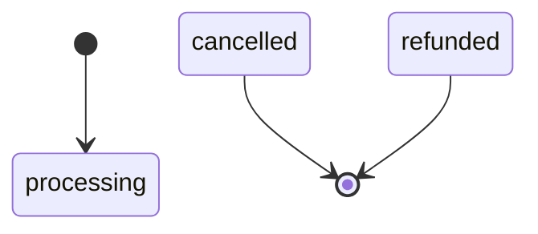
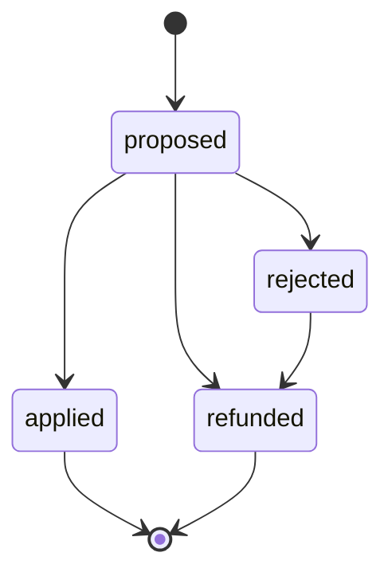
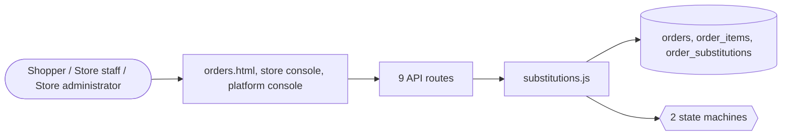

# Orders

> Generated from `_registry/business-domains.json`, the code and `docs/source/order.md` — edit those, then run `node scripts/domain-docs.js`.

## Overview

What was bought and what happens to it: orders and their lines, their life from placement to delivery, and substitutions proposed when an item is out.

**Foundation domain:** Commerce · **Used by:** Shopper, Store staff, Store administrator

## Switches and settings

Each is switched on per store under ⚙️ Capabilities; its parameters are that store's settings.

### Substitutions (`substitutions`)

When an item is unavailable at picking: the shopper's own choice per line — refund, best match, ask me, or a named item — and the picker's proposal; a cheaper substitute refunds the difference. Policies are substitutionPolicies rows.

| Setting | Meaning | Default |
|---|---|---|
| `charge_more` | Charge the shopper when a substitute costs more | `false` |
| `refund_kind` | Wallet ledger kind used for a refunded difference | `"refund"` |

## Architecture

| Module | What it is |
|---|---|
| `lib/substitutions.js` | Substitutions: what happens when an item is unavailable at picking. For each line, the shopper chooses a policy — a substitutionPolicies row declaring whether it allows a substitute at all, whether one is applied without asking, and whether the shopper names the item — and it rides on the bag line as its `substitute` term (lib/lineterms.js). At picking, staff either propose a substitute or mark the line unavailable. A proposal the policy accepts on its own is applied at once; otherwise the shopper accepts or rejects it. A cheaper substitute refunds the difference to the shopper's wallet; a dearer one is charged only where the store allows it; a rejected substitute or an unavailable line is refunded. Every decision is the `substitution` state machine. Capability: substitutions. |

**Registry lists** (editable in Data Studio): `shopEvents`, `shopDocKinds`, `shopDocStatuses`, `substitutionPolicies`, `substitutionStatuses`

## Data model

### `orders`

| Column | Type |
|---|---|
| `id` | INTEGER PRIMARY KEY AUTOINCREMENT |
| `tenant_id` | INTEGER NOT NULL DEFAULT 1 |
| `owner` | TEXT NOT NULL |
| `num` | TEXT NOT NULL UNIQUE |
| `name` | TEXT |
| `address` | TEXT |
| `city` | TEXT |
| `state` | TEXT |
| `zip` | TEXT |
| `ship_option` | TEXT |
| `pay_method` | TEXT |
| `sub` | REAL |
| `ship_fee` | REAL |
| `gift_used` | REAL |
| `tax` | REAL |
| `total` | REAL |
| `eta_days` | INTEGER DEFAULT 5 |
| `status` | TEXT DEFAULT 'processing' |
| `created_at` | TEXT NOT NULL DEFAULT (datetime('now')) |
| `store_id` | INTEGER |
| `slot_id` | INTEGER |
| `promise_minutes` | INTEGER |
| `delivery_kind` | TEXT DEFAULT 'standard' |
| `cancel_reason` | TEXT |
| `seller_id` | INTEGER |
| `escrow_ref` | TEXT |
| `invoice_ref` | TEXT |
| `gift_wrap` | INTEGER DEFAULT 0 |
| `gift_message` | TEXT |
| `contexts` | TEXT DEFAULT '{}' |
| `currency` | TEXT DEFAULT '' |
| `fx` | REAL DEFAULT 1 |
| `trace_id` | TEXT |
| `charges` | TEXT NOT NULL DEFAULT '[]' |
| `deleted_at` | TEXT |
| `uid` | TEXT |

### `order_items`

| Column | Type |
|---|---|
| `order_id` | INTEGER NOT NULL |
| `product_id` | TEXT NOT NULL |
| `qty` | INTEGER NOT NULL |
| `price` | REAL NOT NULL |
| `sku_id` | INTEGER |
| `terms` | TEXT DEFAULT '{}' |
| `uid` | TEXT |

### `order_substitutions`

| Column | Type |
|---|---|
| `id` | INTEGER PRIMARY KEY AUTOINCREMENT |
| `tenant_id` | INTEGER NOT NULL |
| `order_id` | INTEGER NOT NULL |
| `product_id` | TEXT NOT NULL |
| `substitute_id` | TEXT |
| `qty` | INTEGER NOT NULL DEFAULT 1 |
| `original_unit` | REAL NOT NULL DEFAULT 0 |
| `substitute_unit` | REAL |
| `refund` | REAL NOT NULL DEFAULT 0 |
| `status` | TEXT NOT NULL DEFAULT 'proposed' |
| `decided_at` | TEXT |
| `created_at` | TEXT NOT NULL DEFAULT (datetime('now')) |

## API reference

Every call is JSON over HTTPS; store calls carry the store (`?store=`) and the session; mutating calls accept an `Idempotency-Key` header where noted.

| Method and path | Handler | What it does |
|---|---|---|
| `GET /api/substitutions` | `apiSubstitutionsMine` | substitutions |
| `POST /api/substitutions/:id` | `apiSubstitutionDecide` | — |
| `GET /api/admin/substitutions/:orderId` | `apiAdminSubstitutions` | — |
| `POST /api/admin/substitutions/:orderId` | `apiAdminSubstitutionAct` | — |
| `POST /api/orders/:id/cancel` | `apiOrderCancel` | — |
| `POST /api/orders/:id/invoice` | `apiOrderInvoice` | — |
| `GET /api/orders` | `apiOrders` | — |
| `GET /api/admin/orders` | `apiAdminOrders` | — |
| `PUT /api/admin/orders/:id/status` | `apiAdminOrderStatus` | — |

## Process flows

Each record's life is a declared state machine (`lib/seed/states.json`): the moves it may make, and the actions that make them.

### Order (`order`)

Actions: 

### Substitution (`substitution`)

Actions: `apply` → applied · `reject` → rejected · `refund` → refunded

## Data flow

## User interface

**Pages:** `orders.html`

**Store console:** 🧾 Orders · 🔄 Substitutions

**Platform console:** 🛒 Cart · 💳 Checkout · 🧾 Orders · Fulfilment · ↩️ Returns · Exchanges · ⭐ Reviews · UGC

## User flows

_Not yet written — `docs/source/order.md`, section `## Flows`._

## Manuals

### Shopper

_Not yet written — `docs/source/order.md`, section `## Manual: shopper`._

### Store staff

_Not yet written — `docs/source/order.md`, section `## Manual: store_staff`._

### Store administrator

_Not yet written — `docs/source/order.md`, section `## Manual: store_admin`._

