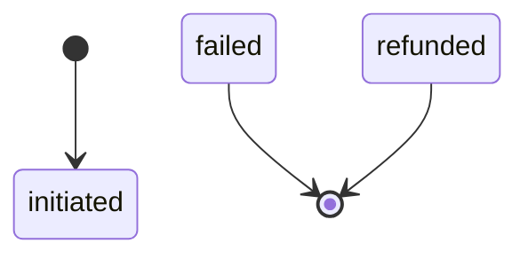
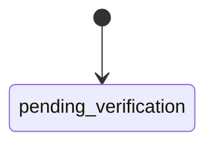
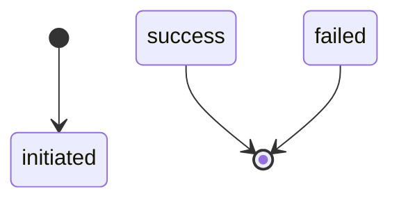
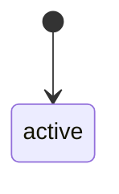
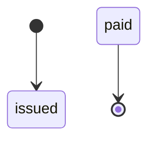
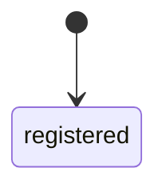
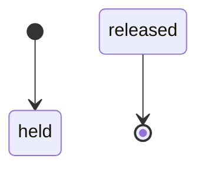
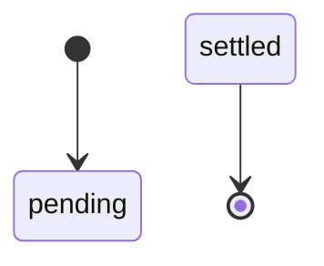
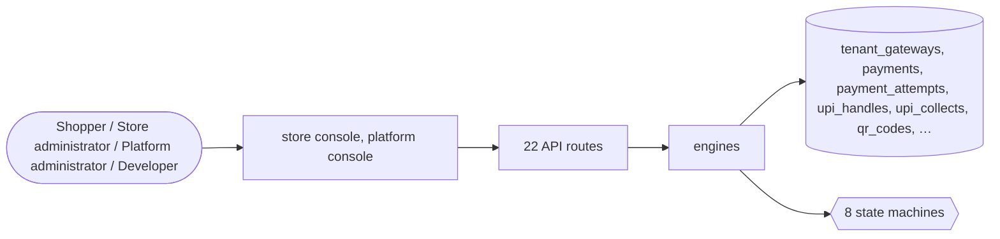

# Payment gateways

> Generated from `_registry/business-domains.json`, the code and `docs/source/payments.md` — edit those, then run `node scripts/domain-docs.js`.

## Overview

Taking money: the gateways a store accepts and their methods, payment attempts and captures, gateway callbacks, payment links, QR and instant-bank collection, mandates, escrow and split payments.

**Foundation domain:** Integration · **Used by:** Shopper, Store administrator, Platform administrator, Developer

## Switches and settings

Each is switched on per store under ⚙️ Capabilities; its parameters are that store's settings.

### UPI collect (`upi_collect`)

Raise a collect request against a payer VPA; settlement credits the single wallet ledger.

| Setting | Meaning | Default |
|---|---|---|
| `new_handle_status` | Status of a freshly added VPA | `"pending_verification"` |
| `collect_expiry_hours` | A collect request expires after this many hours | `1` |
| `min_amount` | Lowest collectable amount (0 disables the floor) | `0.01` |

### QR scan-pay (`qr_pay`)

Issue QR records from the registry's kinds; a scan is counted and (optionally) a payment completed.

| Setting | Meaning | Default |
|---|---|---|
| `default_kind` | QR kind when none is supplied | `"upi"` |

### Payment links (`payment_links`)

Issue a tokenised link that credits the owner's wallet when paid. Single-use by default.

| Setting | Meaning | Default |
|---|---|---|
| `expiry_days` | A link is payable for this many days | `7` |
| `single_use` | A paid link cannot be paid again | `true` |

### Mandates / auto-debit (`mandates`)

Register an auto-debit mandate and charge it up to its cap. Subscriptions ride on this.

| Setting | Meaning | Default |
|---|---|---|
| `default_frequency` | Frequency when none is supplied | `"monthly"` |
| `recharge_window_days` | Days added to the next-charge-at on each charge | `30` |

### Escrow hold & release (`escrow`)

Hold funds at order time and release to the seller only on confirmation. Trade assurance composes this capability.

| Setting | Meaning | Default |
|---|---|---|
| `dispute_freezes` | A dispute prevents release until resolved | `true` |
| `release_kind` | Wallet ledger kind used for a seller release | `"deposit"` |

### Split payments (`split_payments`)

Divide a payment across parties at order time. The parts must sum to the total, or the ledger would drift.

| Setting | Meaning | Default |
|---|---|---|
| `tolerance` | Rounding tolerance when comparing the split sum with the total | `0.01` |
| `settle_immediately` | Settle the parts when the payment lands | `true` |

## Architecture

**Registry lists** (editable in Data Studio): `finUpiStatuses`, `finCollectStatuses`, `finQrKinds`, `finQrStatuses`, `finLinkStatuses`, `finMandateFrequencies`, `finMandateStatuses`, `finEscrowStatuses`, `finSplitStatuses`

## Data model

### `tenant_gateways`

| Column | Type |
|---|---|
| `tenant_id` | INTEGER NOT NULL |
| `provider_id` | TEXT NOT NULL |
| `enabled` | INTEGER NOT NULL DEFAULT 1 |
| `is_primary` | INTEGER NOT NULL DEFAULT 0 |
| `mode` | TEXT NOT NULL DEFAULT 'sandbox' |
| `config` | TEXT DEFAULT '{}' |
| `position` | INTEGER DEFAULT 0 |
| `uid` | TEXT |

### `payments`

| Column | Type |
|---|---|
| `id` | INTEGER PRIMARY KEY AUTOINCREMENT |
| `tenant_id` | INTEGER NOT NULL |
| `kind` | TEXT NOT NULL DEFAULT 'order' |
| `order_id` | INTEGER |
| `invoice_id` | INTEGER |
| `gateway` | TEXT NOT NULL |
| `method` | TEXT |
| `amount` | REAL NOT NULL |
| `currency` | TEXT |
| `fee` | REAL DEFAULT 0 |
| `status` | TEXT NOT NULL DEFAULT 'initiated' |
| `txn_ref` | TEXT |
| `created_at` | TEXT NOT NULL DEFAULT (datetime('now')) |
| `provider_payment_id` | TEXT |
| `live` | INTEGER DEFAULT 0 |
| `uid` | TEXT |

### `payment_attempts`

| Column | Type |
|---|---|
| `id` | INTEGER PRIMARY KEY AUTOINCREMENT |
| `tenant_id` | INTEGER NOT NULL |
| `payment_id` | INTEGER NOT NULL |
| `gateway` | TEXT |
| `attempt` | INTEGER DEFAULT 1 |
| `status` | TEXT NOT NULL DEFAULT 'pending' |
| `txn_ref` | TEXT |
| `error` | TEXT |
| `at` | TEXT NOT NULL DEFAULT (datetime('now')) |

### `upi_handles`

| Column | Type |
|---|---|
| `id` | INTEGER PRIMARY KEY AUTOINCREMENT |
| `tenant_id` | INTEGER NOT NULL |
| `owner` | TEXT NOT NULL |
| `vpa` | TEXT NOT NULL |
| `name` | TEXT |
| `verified` | INTEGER DEFAULT 0 |
| `is_default` | INTEGER DEFAULT 0 |
| `status` | TEXT NOT NULL DEFAULT 'active' |
| `created_at` | TEXT NOT NULL DEFAULT (datetime('now')) |

### `upi_collects`

| Column | Type |
|---|---|
| `id` | INTEGER PRIMARY KEY AUTOINCREMENT |
| `tenant_id` | INTEGER NOT NULL |
| `ref` | TEXT |
| `owner` | TEXT |
| `payer_vpa` | TEXT |
| `amount` | REAL NOT NULL |
| `currency` | TEXT |
| `note` | TEXT |
| `status` | TEXT NOT NULL DEFAULT 'initiated' |
| `txn_ref` | TEXT |
| `expires_at` | TEXT |
| `created_at` | TEXT NOT NULL DEFAULT (datetime('now')) |

### `qr_codes`

| Column | Type |
|---|---|
| `id` | INTEGER PRIMARY KEY AUTOINCREMENT |
| `tenant_id` | INTEGER NOT NULL |
| `ref` | TEXT |
| `kind` | TEXT NOT NULL DEFAULT 'upi' |
| `payload` | TEXT NOT NULL |
| `label` | TEXT |
| `amount` | REAL |
| `owner` | TEXT |
| `svg` | TEXT |
| `scans` | INTEGER DEFAULT 0 |
| `status` | TEXT NOT NULL DEFAULT 'active' |
| `created_at` | TEXT NOT NULL DEFAULT (datetime('now')) |

### `payment_links`

| Column | Type |
|---|---|
| `id` | INTEGER PRIMARY KEY AUTOINCREMENT |
| `tenant_id` | INTEGER NOT NULL |
| `ref` | TEXT |
| `token` | TEXT NOT NULL |
| `title` | TEXT |
| `amount` | REAL NOT NULL |
| `currency` | TEXT |
| `owner` | TEXT |
| `gateway` | TEXT |
| `purpose` | TEXT |
| `expires_at` | TEXT |
| `paid_at` | TEXT |
| `status` | TEXT NOT NULL DEFAULT 'issued' |
| `txn_ref` | TEXT |
| `created_at` | TEXT NOT NULL DEFAULT (datetime('now')) |

### `mandates`

| Column | Type |
|---|---|
| `id` | INTEGER PRIMARY KEY AUTOINCREMENT |
| `tenant_id` | INTEGER NOT NULL |
| `ref` | TEXT |
| `owner` | TEXT NOT NULL |
| `mandate_id` | TEXT |
| `gateway` | TEXT |
| `max_amount` | REAL |
| `frequency` | TEXT |
| `purpose` | TEXT |
| `status` | TEXT NOT NULL DEFAULT 'registered' |
| `next_charge_at` | TEXT |
| `charged_amount` | REAL DEFAULT 0 |
| `charges_done` | INTEGER DEFAULT 0 |
| `created_at` | TEXT NOT NULL DEFAULT (datetime('now')) |

### `escrow_holds`

| Column | Type |
|---|---|
| `id` | INTEGER PRIMARY KEY AUTOINCREMENT |
| `tenant_id` | INTEGER NOT NULL |
| `ref` | TEXT |
| `order_id` | INTEGER |
| `buyer` | TEXT |
| `seller` | TEXT |
| `amount` | REAL NOT NULL |
| `currency` | TEXT |
| `held` | INTEGER DEFAULT 1 |
| `released_at` | TEXT |
| `dispute_opened` | INTEGER DEFAULT 0 |
| `status` | TEXT NOT NULL DEFAULT 'held' |
| `meta` | TEXT DEFAULT '{}' |
| `created_at` | TEXT NOT NULL DEFAULT (datetime('now')) |

### `split_payments`

| Column | Type |
|---|---|
| `id` | INTEGER PRIMARY KEY AUTOINCREMENT |
| `tenant_id` | INTEGER NOT NULL |
| `ref` | TEXT |
| `payment_id` | INTEGER |
| `order_id` | INTEGER |
| `splits` | TEXT NOT NULL DEFAULT '[]' |
| `status` | TEXT NOT NULL DEFAULT 'pending' |
| `settled_at` | TEXT |
| `created_at` | TEXT NOT NULL DEFAULT (datetime('now')) |

## API reference

Every call is JSON over HTTPS; store calls carry the store (`?store=`) and the session; mutating calls accept an `Idempotency-Key` header where noted.

| Method and path | Handler | What it does |
|---|---|---|
| `GET /api/fintech/upi` | `apiFinUpi` | ---------- Fintech ---------- |
| `POST /api/fintech/upi` | `apiFinUpiAdd` | — |
| `POST /api/fintech/upi/collect` | `apiFinUpiCollect` | — |
| `POST /api/fintech/upi/collect/:id` | `apiFinUpiSettle` | — |
| `POST /api/fintech/qr` | `apiFinQrCreate` | — |
| `POST /api/fintech/qr/:id/scan` | `apiFinQrScan` | — |
| `POST /api/fintech/links` | `apiFinLinkCreate` | — |
| `POST /api/fintech/links/:token/pay` | `apiFinLinkPay` | — |
| `POST /api/fintech/mandates` | `apiFinMandateRegister` | — |
| `POST /api/fintech/mandates/:id/charge` | `apiFinMandateCharge` | — |
| `POST /api/fintech/escrow` | `apiFinEscrowHold` | — |
| `POST /api/fintech/escrow/:id/release` | `apiFinEscrowRelease` | — |
| `POST /api/fintech/escrow/:id/dispute` | `apiFinEscrowDispute` | — |
| `POST /api/fintech/splits` | `apiFinSplit` | — |
| `GET /api/admin/gateways` | `apiAdminGateways` | — |
| `PUT /api/admin/gateways` | `apiAdminGatewaysPut` | — |
| `POST /api/admin/gateways/:id/test` | `apiAdminGatewayTest` | — |
| `GET /api/admin/payments` | `apiAdminPayments` | — |
| `POST /api/admin/payments/:id/refund` | `apiAdminPaymentRefund` | — |
| `POST /api/admin/payments/:id/reconcile` | `apiAdminPaymentReconcile` | staff: ask the gateway now (live), or record money received offline (cash, a transfer) |
| `POST /api/admin/payments/:id/received` | `apiAdminPaymentReceived` | — |
| `POST /api/admin/gateway/preview/:id` | `apiGatewayPreview` | — |

## Process flows

Each record's life is a declared state machine (`lib/seed/states.json`): the moves it may make, and the actions that make them.

### Payment (`payment`)

Actions: 

### UPI handle (`upi_handle`)

Actions: 

### UPI collect request (`upi_collect`)

Actions: 

### QR code (`qr_code`)

Actions: 

### Payment link (`payment_link`)

Actions: 

### Recurring mandate (`mandate`)

Actions: 

### Escrow hold (`escrow`)

Actions: 

### Split payment (`split_payment`)

Actions: 

## Data flow

## User interface

**Store console:** 💳 Payment Gateways

**Platform console:** 🔁 Subscriptions · 💳 Payments · 🧮 Settlements · 🔒 Escrow

## User flows

_Not yet written — `docs/source/payments.md`, section `## Flows`._

## Manuals

### Shopper

_Not yet written — `docs/source/payments.md`, section `## Manual: shopper`._

### Store administrator

_Not yet written — `docs/source/payments.md`, section `## Manual: store_admin`._

### Platform administrator

_Not yet written — `docs/source/payments.md`, section `## Manual: platform_admin`._

### Developer

_Not yet written — `docs/source/payments.md`, section `## Manual: developer`._

