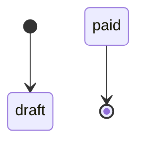
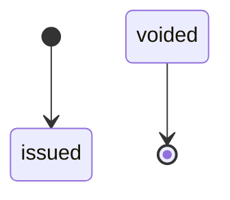
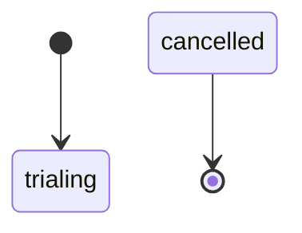
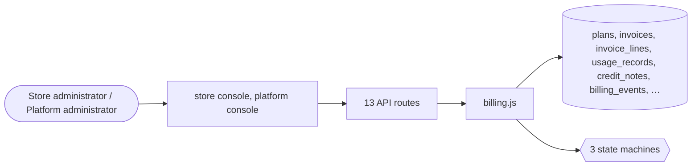

# Platform billing

> Generated from `_registry/business-domains.json`, the code and `docs/source/platform_billing.md` — edit those, then run `node scripts/domain-docs.js`.

## Overview

What the platform charges its stores: plans, subscriptions to plans, usage metering, invoices and credit notes.

**Foundation domain:** Value · **Used by:** Store administrator, Platform administrator

## Architecture

| Module | What it is |
|---|---|
| `lib/billing.js` | first-class Billing engine (line items + tax + usage metering + credit notes + dunning + aging). Used for subscription invoices, plan-change proration, metered usage (AI units, orders over plan cap, storage), refunds-to-wallet, and platform revenue. All amounts in a single currency (platform billing currency, default USD); taxes flow through the Tax engine. Complements offers.js (discounts on invoices) + connect.js (gateway payment). |

## Data model

### `plans`

| Column | Type |
|---|---|
| `id` | INTEGER PRIMARY KEY AUTOINCREMENT |
| `name` | TEXT NOT NULL |
| `price_month` | REAL NOT NULL DEFAULT 0 |
| `currency` | TEXT DEFAULT 'USD' |
| `max_products` | INTEGER NOT NULL DEFAULT 100 |
| `max_orders_month` | INTEGER NOT NULL DEFAULT 100 |
| `features` | TEXT DEFAULT '{}' |
| `position` | INTEGER DEFAULT 0 |
| `uid` | TEXT |

### `invoices`

| Column | Type |
|---|---|
| `id` | INTEGER PRIMARY KEY AUTOINCREMENT |
| `tenant_id` | INTEGER NOT NULL REFERENCES tenants(id) |
| `number` | TEXT NOT NULL UNIQUE |
| `period_start` | TEXT |
| `period_end` | TEXT |
| `amount` | REAL NOT NULL |
| `currency` | TEXT DEFAULT 'USD' |
| `status` | TEXT NOT NULL DEFAULT 'draft' |
| `issued_at` | TEXT NOT NULL DEFAULT (datetime('now')) |
| `paid_at` | TEXT |
| `note` | TEXT DEFAULT '' |
| `trace_id` | TEXT |
| `uid` | TEXT |

### `invoice_lines`

| Column | Type |
|---|---|
| `id` | INTEGER PRIMARY KEY AUTOINCREMENT |
| `invoice_id` | INTEGER NOT NULL |
| `tenant_id` | INTEGER NOT NULL |
| `kind` | TEXT NOT NULL DEFAULT 'plan' |
| `description` | TEXT NOT NULL |
| `qty` | REAL DEFAULT 1 |
| `unit_amount` | REAL DEFAULT 0 |
| `amount` | REAL DEFAULT 0 |
| `tax` | REAL DEFAULT 0 |
| `tax_class` | TEXT DEFAULT 'standard' |
| `ref` | TEXT DEFAULT '' |
| `created_at` | TEXT NOT NULL DEFAULT (datetime('now')) |
| `uid` | TEXT |

### `usage_records`

| Column | Type |
|---|---|
| `id` | INTEGER PRIMARY KEY AUTOINCREMENT |
| `tenant_id` | INTEGER NOT NULL |
| `kind` | TEXT NOT NULL |
| `ref` | TEXT DEFAULT '' |
| `description` | TEXT NOT NULL DEFAULT '' |
| `qty` | REAL DEFAULT 1 |
| `unit_amount` | REAL DEFAULT 0 |
| `amount` | REAL DEFAULT 0 |
| `currency` | TEXT DEFAULT 'USD' |
| `period` | TEXT NOT NULL DEFAULT '' |
| `billed` | INTEGER DEFAULT 0 |
| `created_at` | TEXT NOT NULL DEFAULT (datetime('now')) |
| `uid` | TEXT |

### `credit_notes`

| Column | Type |
|---|---|
| `id` | INTEGER PRIMARY KEY AUTOINCREMENT |
| `tenant_id` | INTEGER NOT NULL |
| `number` | TEXT NOT NULL UNIQUE |
| `invoice_id` | INTEGER |
| `amount` | REAL NOT NULL |
| `currency` | TEXT DEFAULT 'USD' |
| `reason` | TEXT DEFAULT '' |
| `status` | TEXT NOT NULL DEFAULT 'issued' |
| `to_wallet` | INTEGER DEFAULT 0 |
| `created_at` | TEXT NOT NULL DEFAULT (datetime('now')) |
| `uid` | TEXT |

### `billing_events`

| Column | Type |
|---|---|
| `id` | INTEGER PRIMARY KEY AUTOINCREMENT |
| `tenant_id` | INTEGER NOT NULL |
| `invoice_id` | INTEGER |
| `kind` | TEXT NOT NULL |
| `detail` | TEXT DEFAULT '{}' |
| `created_at` | TEXT NOT NULL DEFAULT (datetime('now')) |
| `uid` | TEXT |

### `usage_events`

| Column | Type |
|---|---|
| `id` | INTEGER PRIMARY KEY AUTOINCREMENT |
| `tenant_id` | INTEGER |
| `entity` | TEXT NOT NULL |
| `entity_id` | INTEGER |
| `event_type` | TEXT NOT NULL |
| `quantity` | REAL NOT NULL DEFAULT 1 |
| `unit` | TEXT NOT NULL DEFAULT 'count' |
| `metadata` | TEXT NOT NULL DEFAULT '{}' |
| `created_at` | TEXT NOT NULL DEFAULT (datetime('now')) |

### `invoice_documents`

| Column | Type |
|---|---|
| `id` | INTEGER PRIMARY KEY AUTOINCREMENT |
| `tenant_id` | INTEGER NOT NULL |
| `ref` | TEXT |
| `order_id` | INTEGER |
| `owner` | TEXT |
| `doc_kind` | TEXT NOT NULL |
| `invoice_number` | TEXT |
| `place_of_supply` | TEXT |
| `gstin` | TEXT |
| `pan` | TEXT |
| `taxable` | REAL |
| `tax` | REAL |
| `total` | REAL |
| `currency` | TEXT |
| `body` | TEXT |
| `rendered` | TEXT |
| `status` | TEXT NOT NULL DEFAULT 'generated' |
| `created_at` | TEXT NOT NULL DEFAULT (datetime('now')) |

## API reference

Every call is JSON over HTTPS; store calls carry the store (`?store=`) and the session; mutating calls accept an `Idempotency-Key` header where noted.

| Method and path | Handler | What it does |
|---|---|---|
| `GET /api/admin/billing` | `apiAdminBilling` | — |
| `POST /api/billing/invoices/:id/pay` | `apiBillingPay` | — |
| `GET /api/platform/plans` | `apiPlatformPlans` | — |
| `POST /api/platform/plans` | `apiPlatformPlanSave` | — |
| `PUT /api/platform/plans/:id` | `apiPlatformPlanSave` | — |
| `GET /api/platform/invoices` | `apiPlatformInvoices` | — |
| `POST /api/platform/invoices/:id/refund` | `apiPlatformInvoiceRefund` | — |
| `POST /api/platform/billing/dunning` | `apiPlatformDunning` | — |
| `GET /api/platform/billing/aging` | `apiPlatformAging` | — |
| `POST /api/platform/usage` | `apiPlatformUsage` | — |
| `GET /api/admin/billing/detail` | `apiAdminBillingDetail` | — |
| `POST /api/platform/invoices/:id/pay` | `apiPlatformInvoicePay` | — |
| `GET /api/platform/revenue` | `apiPlatformRevenue` | — |

## Process flows

Each record's life is a declared state machine (`lib/seed/states.json`): the moves it may make, and the actions that make them.

### Invoice (`invoice`)

Actions: 

### Credit note (`credit_note`)

Actions: 

### Platform plan subscription (`plan_subscription`)

Actions: 

## Data flow

## User interface

**Store console:** 🧮 Billing

**Platform console:** 🔁 Subscriptions · 💼 Plans · 🧾 Invoices · 💳 Billing Ops

## User flows

_Not yet written — `docs/source/platform_billing.md`, section `## Flows`._

## Manuals

### Store administrator

_Not yet written — `docs/source/platform_billing.md`, section `## Manual: store_admin`._

### Platform administrator

_Not yet written — `docs/source/platform_billing.md`, section `## Manual: platform_admin`._

