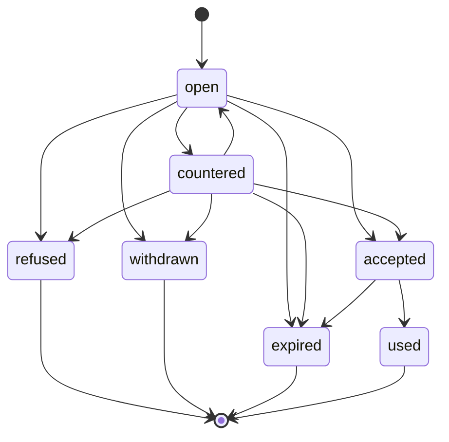
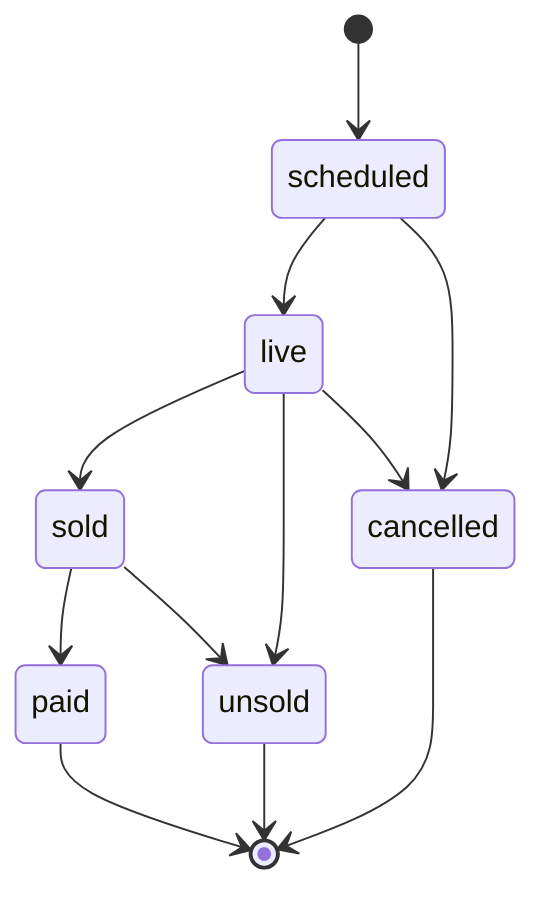
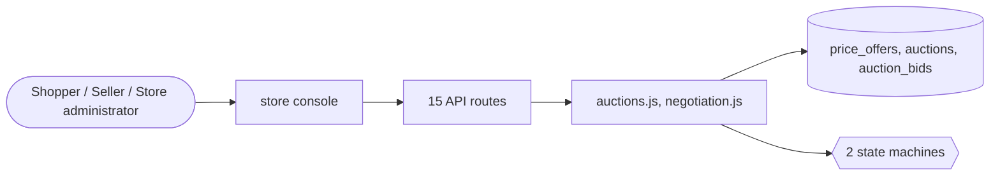

# Negotiation and auctions

> Generated from `_registry/business-domains.json`, the code and `docs/source/price_discovery.md` — edit those, then run `node scripts/domain-docs.js`.

## Overview

Prices agreed rather than listed: offers and counter-offers between a buyer and a seller, and timed auctions with proxy bidding.

**Foundation domain:** Commerce · **Used by:** Shopper, Seller, Store administrator

## Switches and settings

Each is switched on per store under ⚙️ Capabilities; its parameters are that store's settings.

### Make an offer (`price_negotiation`)

A shopper offers a price; the seller accepts, counters or declines; an agreed price is bought within a window. Thresholds can accept or decline automatically.

| Setting | Meaning | Default |
|---|---|---|
| `min_offer_pct` | Lowest offer, as a share of the list price | `50` |
| `auto_accept_pct` | Offers at or above this share are accepted at once (0 = never) | `0` |
| `auto_decline_pct` | Offers below this share are declined at once (0 = never) | `0` |
| `expiry_hours` | Hours an offer or counter stays open | `48` |
| `buy_within_hours` | Hours to buy at an agreed price | `24` |
| `max_open_per_shopper` | Open offers one shopper may have | `20` |

### Auctions (`auctions`)

Timed auctions with automatic (proxy) bidding, a reserve, a buy-it-now price and protection against last-second bids; the winner pays within a window.

| Setting | Meaning | Default |
|---|---|---|
| `increments` | Bid increments: [from price, step] pairs | `[[0,0.5],[20,1],[100,2.5],[500,5],[1000,10],[5000,25]]` |
| `anti_snipe_minutes` | A bid this close to the end extends the auction | `2` |
| `extend_minutes` | Minutes an auction is extended by | `2` |
| `payment_window_hours` | Hours the winner has to pay | `48` |
| `buy_now_until_first_bid` | Buy-it-now disappears once anyone bids | `true` |
| `max_duration_days` | Longest an auction may run | `30` |

## Architecture

| Module | What it is |
|---|---|
| `lib/auctions.js` | Auctions: timed, ascending, with automatic (proxy) bidding. The store, or a shopper who listed the item (lib/listings.js), puts a product up between a start and an end, from a starting price, with an optional reserve (the lowest price it will sell at) and buy-it-now price. A bidder states the most they will pay; the auction bids for them one increment at a time — the price is always one increment above the runner-up's most, never above the leader's own. A bid in the last minutes extends the end, so nobody wins by bidding at the last second. The increment ladder and every window are the auctions capability's params. |
| `lib/negotiation.js` | Make an offer: price negotiation between a shopper and a seller. A shopper offers a price for a quantity; whoever sells the product — the store, or the shopper who listed it (lib/listings.js) — accepts, counters or refuses; the shopper may accept a counter or answer it with a new price. Whose move it is, is what the offer's state MEANS (awaiting_seller, awaiting_buyer, agreed…) in the `price_offer` state machine. Store thresholds can accept or refuse at once. An agreed price rides on the bag line as its `offer` term (lib/lineterms.js) — it replaces the list price for that quantity — and is used up when the order is placed. Capability: price_negotiation. |

**Registry lists** (editable in Data Studio): `priceOfferStatuses`, `auctionStatuses`

## Data model

### `price_offers`

| Column | Type |
|---|---|
| `id` | INTEGER PRIMARY KEY AUTOINCREMENT |
| `tenant_id` | INTEGER NOT NULL |
| `product_id` | TEXT NOT NULL |
| `owner` | TEXT NOT NULL |
| `seller` | TEXT NOT NULL DEFAULT '' |
| `qty` | INTEGER NOT NULL DEFAULT 1 |
| `amount` | REAL NOT NULL |
| `counter_amount` | REAL |
| `note` | TEXT DEFAULT '' |
| `status` | TEXT NOT NULL DEFAULT 'open' |
| `history` | TEXT NOT NULL DEFAULT '[]' |
| `expires_at` | TEXT |
| `decided_at` | TEXT |
| `order_id` | INTEGER |
| `created_at` | TEXT NOT NULL DEFAULT (datetime('now')) |

### `auctions`

| Column | Type |
|---|---|
| `id` | INTEGER PRIMARY KEY AUTOINCREMENT |
| `tenant_id` | INTEGER NOT NULL |
| `product_id` | TEXT NOT NULL |
| `seller` | TEXT NOT NULL DEFAULT '' |
| `start_price` | REAL NOT NULL |
| `reserve_price` | REAL |
| `buy_now_price` | REAL |
| `current_price` | REAL |
| `leader` | TEXT |
| `leader_max` | REAL |
| `bids` | INTEGER NOT NULL DEFAULT 0 |
| `starts_at` | TEXT NOT NULL |
| `ends_at` | TEXT NOT NULL |
| `status` | TEXT NOT NULL DEFAULT 'scheduled' |
| `winner` | TEXT |
| `final_price` | REAL |
| `pay_by` | TEXT |
| `order_id` | INTEGER |
| `closed_at` | TEXT |
| `created_at` | TEXT NOT NULL DEFAULT (datetime('now')) |

### `auction_bids`

| Column | Type |
|---|---|
| `id` | INTEGER PRIMARY KEY AUTOINCREMENT |
| `tenant_id` | INTEGER NOT NULL |
| `auction_id` | INTEGER NOT NULL |
| `owner` | TEXT NOT NULL |
| `max_amount` | REAL NOT NULL |
| `at` | TEXT NOT NULL DEFAULT (datetime('now')) |

## API reference

Every call is JSON over HTTPS; store calls carry the store (`?store=`) and the session; mutating calls accept an `Idempotency-Key` header where noted.

| Method and path | Handler | What it does |
|---|---|---|
| `GET /api/price-offers` | `apiOffersMine` | price offers |
| `POST /api/price-offers` | `apiOfferMake` | — |
| `POST /api/price-offers/:id` | `apiOfferRespond` | — |
| `GET /api/auctions` | `apiAuctions` | auctions |
| `GET /api/auctions/mine` | `apiAuctionsMine` | — |
| `POST /api/auctions` | `apiAuctionCreate` | — |
| `POST /api/auctions/:id/bid` | `apiAuctionBid` | — |
| `POST /api/auctions/:id/buy-now` | `apiAuctionBuyNow` | — |
| `POST /api/auctions/:id/cancel` | `apiAuctionCancel` | — |
| `GET /api/admin/price-offers` | `apiAdminOffers` | — |
| `POST /api/admin/price-offers/:id` | `apiAdminOfferRespond` | — |
| `GET /api/admin/auctions` | `apiAdminAuctions` | — |
| `POST /api/admin/auctions` | `apiAdminAuctionCreate` | — |
| `POST /api/admin/auctions/tick` | `apiAdminAuctionTick` | — |
| `POST /api/admin/auctions/:id/cancel` | `apiAdminAuctionCancel` | — |

## Process flows

Each record's life is a declared state machine (`lib/seed/states.json`): the moves it may make, and the actions that make them.

### Price offer (`price_offer`)

Actions: `counter` → countered · `rebid` → open · `accept` → accepted · `refuse` → refused · `withdraw` → withdrawn · `expire` → expired · `use` → used

### Auction (`auction`)

Actions: `open` → live · `sell` → sold · `close_unsold` → unsold · `cancel` → cancelled · `pay` → paid

## Data flow

## User interface

**Store console:** 🔨 Auctions · 🤝 Offers

## User flows

_Not yet written — `docs/source/price_discovery.md`, section `## Flows`._

## Manuals

### Shopper

_Not yet written — `docs/source/price_discovery.md`, section `## Manual: shopper`._

### Seller

_Not yet written — `docs/source/price_discovery.md`, section `## Manual: seller`._

### Store administrator

_Not yet written — `docs/source/price_discovery.md`, section `## Manual: store_admin`._

