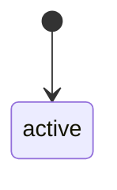
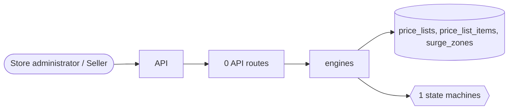

# Pricing

> Generated from `_registry/business-domains.json`, the code and `docs/source/pricing.md` — edit those, then run `node scripts/domain-docs.js`.

## Overview

The price a buyer pays before any offer: price lists per segment with quantity tiers, and demand-based surge pricing.

**Foundation domain:** Value · **Used by:** Store administrator, Seller

## Switches and settings

Each is switched on per store under ⚙️ Capabilities; its parameters are that store's settings.

### Segment price lists (`segment_pricing`)

Per-segment prices with quantity tiers; the storefront resolves the buyer's segment and reads the override.

| Setting | Meaning | Default |
|---|---|---|
| `best_price_wins` | When several tiers fit, the lowest price wins | `true` |

### Surge / dynamic pricing (`dynamic_pricing`)

A multiplier raised by active surge zones and by the live demand/supply ratio, capped by configuration.

| Setting | Meaning | Default |
|---|---|---|
| `surge_cap_multiplier` | The multiplier is never raised above this ceiling | `3` |
| `demand_supply_enabled` | Raise the multiplier from the live open-rides / idle-drivers ratio | `true` |
| `demand_supply_step` | Each whole step of ratio above 1 adds one increment | `1` |
| `demand_supply_bps` | Points added per step (15 = +0.15%) | `15` |
| `demand_supply_max_ratio` | The ratio assumed when no driver is idle | `3` |

## Architecture

**Registry lists** (editable in Data Studio): `b2bSegments`

## Data model

### `price_lists`

| Column | Type |
|---|---|
| `id` | INTEGER PRIMARY KEY AUTOINCREMENT |
| `tenant_id` | INTEGER NOT NULL |
| `name` | TEXT NOT NULL |
| `currency` | TEXT |
| `segment` | TEXT |
| `starts_at` | TEXT |
| `ends_at` | TEXT |
| `status` | TEXT NOT NULL DEFAULT 'active' |
| `created_at` | TEXT NOT NULL DEFAULT (datetime('now')) |

### `price_list_items`

| Column | Type |
|---|---|
| `id` | INTEGER PRIMARY KEY AUTOINCREMENT |
| `tenant_id` | INTEGER NOT NULL |
| `price_list_id` | INTEGER NOT NULL |
| `product_id` | TEXT |
| `sku_id` | INTEGER |
| `price` | REAL NOT NULL |
| `min_qty` | INTEGER DEFAULT 1 |
| `max_qty` | INTEGER |
| `status` | TEXT NOT NULL DEFAULT 'active' |
| `created_at` | TEXT NOT NULL DEFAULT (datetime('now')) |

### `surge_zones`

| Column | Type |
|---|---|
| `id` | INTEGER PRIMARY KEY AUTOINCREMENT |
| `tenant_id` | INTEGER NOT NULL |
| `name` | TEXT NOT NULL |
| `kind` | TEXT NOT NULL DEFAULT 'geofence' |
| `/*` | geofence \| event \| weather */ multiplier REAL NOT NULL DEFAULT 1.0 |
| `center_lat` | REAL |
| `center_lng` | REAL |
| `radius_km` | REAL DEFAULT 3 |
| `active` | INTEGER NOT NULL DEFAULT 1 |
| `starts_at` | TEXT |
| `ends_at` | TEXT |
| `created_at` | TEXT NOT NULL DEFAULT (datetime('now')) |
| `uid` | TEXT |

## Process flows

Each record's life is a declared state machine (`lib/seed/states.json`): the moves it may make, and the actions that make them.

### Price list (`price_list`)

Actions: 

## Data flow

## User interface

## User flows

_Not yet written — `docs/source/pricing.md`, section `## Flows`._

## Manuals

### Store administrator

_Not yet written — `docs/source/pricing.md`, section `## Manual: store_admin`._

### Seller

_Not yet written — `docs/source/pricing.md`, section `## Manual: seller`._

