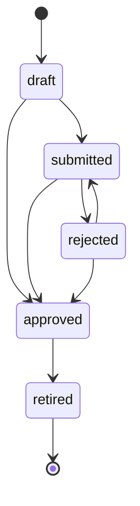
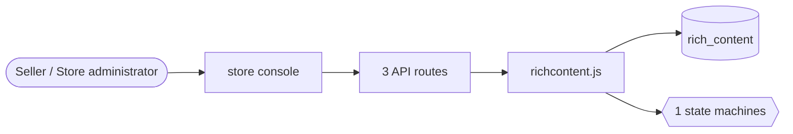

# Product content

> Generated from `_registry/business-domains.json`, the code and `docs/source/product_content.md` — edit those, then run `node scripts/domain-docs.js`.

## Overview

How a product is presented beyond its facts: rich content modules, images and comparison blocks, reviewed before they show.

**Foundation domain:** Content · **Used by:** Seller, Store administrator

## Switches and settings

Each is switched on per store under ⚙️ Capabilities; its parameters are that store's settings.

### Rich product content (`rich_content`)

Brand-authored modules (banners, image-and-text, feature lists, comparison tables, Q&A) below the product details. Module kinds and their fields are contentModules rows; content can be reviewed before it goes live.

| Setting | Meaning | Default |
|---|---|---|
| `require_approval` | Content is reviewed before it goes live | `true` |
| `max_modules` | Modules on one product | `7` |
| `brand_owner_only` | Only the brand's registered owner may publish | `false` |

## Architecture

| Module | What it is |
|---|---|
| `lib/richcontent.js` | Rich product content (brand-authored modules below a product's details). A product may carry a stack of modules — a banner, image-and-text, a feature list, a comparison table, questions and answers. Which modules exist and which fields each holds are contentModules registry rows: a field declares only its TYPE (text, textarea, image, list, table) and its limits, so a new module — a size guide, a "what's in the box" — is a row, and both this engine's validation and the storefront's renderer follow it. |

**Registry lists** (editable in Data Studio): `contentModules`, `richContentStatuses`

## Data model

### `rich_content`

| Column | Type |
|---|---|
| `id` | INTEGER PRIMARY KEY AUTOINCREMENT |
| `tenant_id` | INTEGER NOT NULL |
| `product_id` | TEXT NOT NULL |
| `seller_id` | INTEGER |
| `author` | TEXT DEFAULT '' |
| `modules` | TEXT NOT NULL DEFAULT '[]' |
| `status` | TEXT NOT NULL DEFAULT 'draft' |
| `version` | INTEGER NOT NULL DEFAULT 1 |
| `review_notes` | TEXT DEFAULT '' |
| `submitted_at` | TEXT |
| `reviewed_at` | TEXT |
| `reviewed_by` | TEXT |
| `created_at` | TEXT NOT NULL DEFAULT (datetime('now')) |
| `updated_at` | TEXT |

## API reference

Every call is JSON over HTTPS; store calls carry the store (`?store=`) and the session; mutating calls accept an `Idempotency-Key` header where noted.

| Method and path | Handler | What it does |
|---|---|---|
| `GET /api/admin/rich-content` | `apiAdminRich` | rich product content (staff author on a brand's behalf, and review) |
| `POST /api/admin/rich-content` | `apiAdminRichSave` | — |
| `POST /api/admin/rich-content/:id` | `apiAdminRichAct` | — |

## Process flows

Each record's life is a declared state machine (`lib/seed/states.json`): the moves it may make, and the actions that make them.

### Rich product content (`rich_content`)

Actions: `submit` → submitted · `approve` → approved · `reject` → rejected · `retire` → retired

## Data flow

## User interface

**Store console:** ✨ Rich Content

## User flows

_Not yet written — `docs/source/product_content.md`, section `## Flows`._

## Manuals

### Seller

_Not yet written — `docs/source/product_content.md`, section `## Manual: seller`._

### Store administrator

_Not yet written — `docs/source/product_content.md`, section `## Manual: store_admin`._

