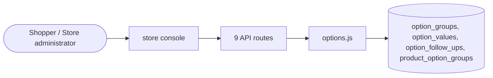

# Product options

> Generated from `_registry/business-domains.json`, the code and `docs/source/product_options.md` — edit those, then run `node scripts/domain-docs.js`.

## Overview

Choices on one product instead of a product per combination: option groups (sizes, toppings, engravings) with their values and price changes, attached to any product.

**Foundation domain:** Offering · **Used by:** Shopper, Store administrator

## Switches and settings

Each is switched on per store under ⚙️ Capabilities; its parameters are that store's settings.

### Product options (`product_options`)

Modifiers, add-ons and personalisation: option groups defined once, attached to any product, each value with its own price change. What a kind of group does is an optionKinds row. Kinds of group also cover services done for the item (installation, assembly), plans that run for months (warranty, protection), the shopper’s own artwork proofed before making, and samples at their own price.

| Setting | Meaning | Default |
|---|---|---|
| `max_text_length` | Longest personal text a shopper may enter | `60` |

## Architecture

| Module | What it is |
|---|---|
| `lib/options.js` | Product options: modifiers, add-ons and personalisation. An option group (a size, a crust, extra toppings, an engraving) is defined once and attached to any number of products. A group either offers values to choose from — each with its own price change — or takes the shopper's own text; what a kind of group does is its optionKinds registry row (`takes_text`). How many values a shopper must or may choose are the group's min and max. The shopper's choice rides on the bag line as its `options` term (lib/lineterms.js), adds its price changes to the line, and is kept on the order line, so a meal, a made-to-order item or a personalised gift is one product with options — not a product per combination. |

**Registry lists** (editable in Data Studio): `optionKinds`

## Data model

### `option_groups`

| Column | Type |
|---|---|
| `id` | INTEGER PRIMARY KEY AUTOINCREMENT |
| `tenant_id` | INTEGER NOT NULL |
| `code` | TEXT NOT NULL |
| `name` | TEXT NOT NULL |
| `kind` | TEXT NOT NULL |
| `min_select` | INTEGER NOT NULL DEFAULT 0 |
| `max_select` | INTEGER NOT NULL DEFAULT 1 |
| `max_length` | INTEGER |
| `position` | INTEGER NOT NULL DEFAULT 0 |
| `active` | INTEGER NOT NULL DEFAULT 1 |
| `created_at` | TEXT NOT NULL DEFAULT (datetime('now')) |

### `option_values`

| Column | Type |
|---|---|
| `id` | INTEGER PRIMARY KEY AUTOINCREMENT |
| `tenant_id` | INTEGER NOT NULL |
| `group_id` | INTEGER NOT NULL |
| `code` | TEXT NOT NULL |
| `name` | TEXT NOT NULL |
| `price_delta` | REAL NOT NULL DEFAULT 0 |
| `position` | INTEGER NOT NULL DEFAULT 0 |
| `active` | INTEGER NOT NULL DEFAULT 1 |
| `extra` | TEXT NOT NULL DEFAULT '{}' |

### `option_follow_ups`

| Column | Type |
|---|---|
| `id` | INTEGER PRIMARY KEY AUTOINCREMENT |
| `tenant_id` | INTEGER NOT NULL |
| `order_id` | INTEGER NOT NULL |
| `product_id` | TEXT NOT NULL |
| `owner` | TEXT NOT NULL |
| `group_code` | TEXT NOT NULL |
| `value_code` | TEXT NOT NULL DEFAULT '' |
| `kind` | TEXT NOT NULL |
| `detail` | TEXT NOT NULL DEFAULT '' |
| `scheduled_for` | TEXT |
| `ends_at` | TEXT |
| `proof_url` | TEXT NOT NULL DEFAULT '' |
| `note` | TEXT NOT NULL DEFAULT '' |
| `rounds` | INTEGER NOT NULL DEFAULT 0 |
| `status` | TEXT NOT NULL |
| `created_at` | TEXT NOT NULL DEFAULT (datetime('now')) |
| `decided_at` | TEXT |

### `product_option_groups`

| Column | Type |
|---|---|
| `tenant_id` | INTEGER NOT NULL |
| `product_id` | TEXT NOT NULL |
| `group_id` | INTEGER NOT NULL |
| `position` | INTEGER NOT NULL DEFAULT 0 |

## API reference

Every call is JSON over HTTPS; store calls carry the store (`?store=`) and the session; mutating calls accept an `Idempotency-Key` header where noted.

| Method and path | Handler | What it does |
|---|---|---|
| `GET /api/admin/options` | `apiAdminOptions` | options |
| `POST /api/admin/options` | `apiAdminOptionSave` | — |
| `DELETE /api/admin/options/:id` | `apiAdminOptionDelete` | — |
| `PUT /api/admin/options/products/:pid` | `apiAdminOptionAttach` | — |
| `GET /api/admin/options/follow-ups` | `apiAdminOptionFollowUps` | what chosen options leave to be done: visits to schedule, plans in force, proofs to send |
| `POST /api/admin/options/follow-ups/:id` | `apiAdminOptionFollowUpMove` | — |
| `GET /api/options/follow-ups` | `apiOptionFollowUpsMine` | — |
| `GET /api/options/kinds` | `apiOptionKinds` | every kind of option group, each its own feature with its own section |
| `POST /api/options/follow-ups/:id` | `apiOptionFollowUpAnswer` | — |

## Data flow

## User interface

**Store console:** 🧩 Product Options

## User flows

_Not yet written — `docs/source/product_options.md`, section `## Flows`._

## Manuals

### Shopper

_Not yet written — `docs/source/product_options.md`, section `## Manual: shopper`._

### Store administrator

_Not yet written — `docs/source/product_options.md`, section `## Manual: store_admin`._

