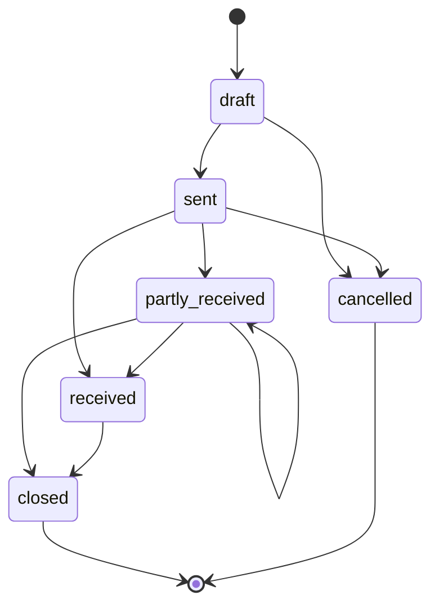
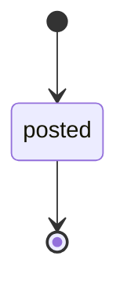
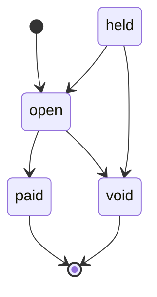
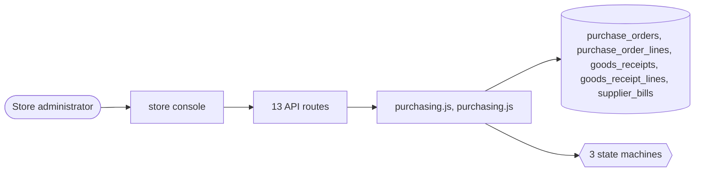

# Purchasing

> Generated from `_registry/business-domains.json`, the code and `docs/source/purchasing.md` — edit those, then run `node scripts/domain-docs.js`.

## Overview

Buying from suppliers: purchase orders (from an approved purchase request or on their own), the goods received against them into a warehouse batch, and suppliers' bills matched against what was received — held beyond the tolerance, approved, paid or voided — each posting to the store's books.

**Foundation domain:** Commerce · **Used by:** Store administrator

## Architecture

| Module | What it is |
|---|---|
| `lib/purchasing.js` | purchasing (owner Commerce). |
| `lib/routes/purchasing.js` | purchasing domain routes (lib/purchasing.js; _registry/business-domains.json). Orders to suppliers, goods received against them and suppliers' bills. Every route belongs to the store's purchasing section (the Finance role holds it): a read grant lists, a write grant acts. |

## Data model

### `purchase_orders`

| Column | Type |
|---|---|
| `id` | INTEGER PRIMARY KEY AUTOINCREMENT |
| `tenant_id` | INTEGER NOT NULL |
| `ref` | TEXT NOT NULL |
| `supplier_id` | INTEGER NOT NULL |
| `warehouse_id` | INTEGER |
| `request_id` | INTEGER |
| `currency` | TEXT NOT NULL |
| `status` | TEXT NOT NULL DEFAULT 'draft' |
| `total` | REAL NOT NULL DEFAULT 0 |
| `expected_at` | TEXT |
| `note` | TEXT DEFAULT '' |
| `created_by` | TEXT DEFAULT '' |
| `created_at` | TEXT NOT NULL DEFAULT (datetime('now')) |
| `sent_at` | TEXT |
| `closed_at` | TEXT |
| `uid` | TEXT |

### `purchase_order_lines`

| Column | Type |
|---|---|
| `id` | INTEGER PRIMARY KEY AUTOINCREMENT |
| `tenant_id` | INTEGER NOT NULL |
| `po_id` | INTEGER NOT NULL |
| `product_id` | TEXT NOT NULL |
| `sku_id` | INTEGER |
| `qty` | INTEGER NOT NULL |
| `unit_cost` | REAL NOT NULL |
| `received` | INTEGER NOT NULL DEFAULT 0 |
| `billed` | REAL NOT NULL DEFAULT 0 |

### `goods_receipts`

| Column | Type |
|---|---|
| `id` | INTEGER PRIMARY KEY AUTOINCREMENT |
| `tenant_id` | INTEGER NOT NULL |
| `ref` | TEXT NOT NULL |
| `po_id` | INTEGER NOT NULL |
| `warehouse_id` | INTEGER |
| `currency` | TEXT NOT NULL |
| `value` | REAL NOT NULL DEFAULT 0 |
| `status` | TEXT NOT NULL DEFAULT 'posted' |
| `note` | TEXT DEFAULT '' |
| `received_by` | TEXT DEFAULT '' |
| `created_at` | TEXT NOT NULL DEFAULT (datetime('now')) |
| `uid` | TEXT |

### `goods_receipt_lines`

| Column | Type |
|---|---|
| `id` | INTEGER PRIMARY KEY AUTOINCREMENT |
| `tenant_id` | INTEGER NOT NULL |
| `receipt_id` | INTEGER NOT NULL |
| `po_line_id` | INTEGER NOT NULL |
| `product_id` | TEXT NOT NULL |
| `sku_id` | INTEGER |
| `qty` | INTEGER NOT NULL |
| `unit_cost` | REAL NOT NULL |
| `lot` | TEXT DEFAULT '' |
| `batch` | TEXT DEFAULT '' |
| `expiry` | TEXT DEFAULT '' |

### `supplier_bills`

| Column | Type |
|---|---|
| `id` | INTEGER PRIMARY KEY AUTOINCREMENT |
| `tenant_id` | INTEGER NOT NULL |
| `ref` | TEXT NOT NULL |
| `supplier_id` | INTEGER NOT NULL |
| `po_id` | INTEGER |
| `supplier_ref` | TEXT DEFAULT '' |
| `currency` | TEXT NOT NULL |
| `net` | REAL NOT NULL |
| `tax` | REAL NOT NULL DEFAULT 0 |
| `gross` | REAL NOT NULL |
| `matched` | REAL NOT NULL DEFAULT 0 |
| `variance` | REAL NOT NULL DEFAULT 0 |
| `status` | TEXT NOT NULL |
| `hold_reason` | TEXT DEFAULT '' |
| `due_at` | TEXT |
| `paid_at` | TEXT |
| `released_by` | TEXT DEFAULT '' |
| `created_at` | TEXT NOT NULL DEFAULT (datetime('now')) |
| `uid` | TEXT |

## API reference

Every call is JSON over HTTPS; store calls carry the store (`?store=`) and the session; mutating calls accept an `Idempotency-Key` header where noted.

| Method and path | Handler | What it does |
|---|---|---|
| `GET /api/admin/purchasing/orders` | `apiPurchaseOrders` | The store's purchase orders, newest first, each with its supplier; `status` and `supplier_id` narrow them. |
| `POST /api/admin/purchasing/orders` | `apiPurchaseOrderCreate` | Drafts a purchase order: `supplier_id`, `warehouse_id`, an approved `request_id` if it fills one, `currency` (the supplier's by default) and `lines` of `{ product_id, sku_id, qty, unit_cost }`. |
| `GET /api/admin/purchasing/orders/:id` | `apiPurchaseOrder` | One purchase order: its lines (ordered, received, still to come), its receipts, its bills, and the value received and not yet billed. |
| `POST /api/admin/purchasing/orders/:id/send` | `apiPurchaseOrderSend` | Sends a drafted order to the supplier; a purchase request it fills becomes ordered. |
| `POST /api/admin/purchasing/orders/:id/cancel` | `apiPurchaseOrderCancel` | Cancels an order nothing has been received against. |
| `POST /api/admin/purchasing/orders/:id/close` | `apiPurchaseOrderClose` | Closes an order: what has not arrived will not be received. |
| `POST /api/admin/purchasing/orders/:id/receive` | `apiPurchaseReceive` | Records goods received against an order: `warehouse_id` and `lines` of `{ line_id, qty, lot, batch, expiry }`. The stock counts and the warehouse batch go up, and the books record the stock as received and not yet billed. |
| `GET /api/admin/purchasing/bills` | `apiSupplierBills` | The store's supplier bills, newest first; `status` narrows them. |
| `POST /api/admin/purchasing/bills` | `apiSupplierBillCreate` | Records a supplier's bill against an order: `po_id`, `supplier_ref` (their invoice number, once per supplier), `net`, `tax`, `due_at`. Matched against what was received and not yet billed: within the tolerance it is approved and owed; beyond it, held. |
| `POST /api/admin/purchasing/bills/:id/release` | `apiSupplierBillRelease` | Releases a held bill with a `reason`: it is approved and owed, its difference a purchase price difference. |
| `POST /api/admin/purchasing/bills/:id/pay` | `apiSupplierBillPay` | Marks an approved bill paid: the books clear what is owed from the bank. |
| `POST /api/admin/purchasing/bills/:id/void` | `apiSupplierBillVoid` | Voids a bill; an approved one's entry is undone in the books. |
| `GET /api/admin/purchasing/payables` | `apiPayables` | What is owed to each supplier, by how overdue it is. |

## Process flows

Each record's life is a declared state machine (`lib/seed/states.json`): the moves it may make, and the actions that make them.

### Purchase order (`purchase_order`)

Actions: 

### Goods receipt (`goods_receipt`)

Actions: 

### Supplier bill (`supplier_bill`)

Actions: 

## Data flow

## User interface

**Store console:** 🧾 Purchasing

## User flows

**Ordering.** A buyer drafts a purchase order to a supplier — from an approved purchase request,
or on its own — with each item, quantity and unit cost, in the supplier's currency unless another
is chosen. Sending it to the supplier stamps it; a request it fills becomes *ordered*.

**Goods arriving.** When a delivery arrives, the warehouse records what came in, line by line, into
the warehouse it reached, with its lot, batch and expiry. No more can be received than was ordered.
The product's and variant's stock and the warehouse's batch go up at once, and the books record the
stock (*Inventory*) against *Received, not yet billed*. When everything has arrived the order is
*received*, and so is the request behind it.

**The supplier's bill.** The bill is recorded with the supplier's own invoice number — once per
supplier — and matched against what was received and not yet billed. Within the tolerance it is
approved and owed: the books clear *Received, not yet billed*, add *Tax to reclaim*, and owe the
supplier the gross. A bill further apart than the tolerance is *held*, with the reason, and is
neither owed nor payable until someone releases it, saying why; the difference becomes a
*Purchase price difference*.

**Paying and voiding.** Marking a bill paid clears what is owed from the bank. Voiding an approved
bill undoes its entry, so the goods are again received and not yet billed.

**Finishing.** An order nothing has arrived against may be cancelled; one with deliveries is
closed instead, when the rest will not come.

## Manuals

### Store administrator

Open **Payments & Finance → 🧾 Purchasing**. Your role needs the purchasing section; the Finance
role has it.

- **New purchase order**: choose the supplier and the warehouse, the item, the quantity and the
  unit cost, then **Draft the order**. Open it and **Send to supplier**.
- **Record goods received**: open the order, set how many of each line arrived (the rest is
  pre-filled), the warehouse, lot and expiry, and record it. Stock goes up immediately.
- **Record the bill**: enter the supplier's invoice number, the net and the tax. If it differs from
  what was received by more than the tolerance it is held: check it, then **Release** it with the
  reason, or **Void** it.
- **Mark paid** when the supplier has been paid. **Owed to suppliers** shows what is due and how
  late, per supplier.
- Your purchasing or ERP system can do the same through `/api/admin/purchasing/…` with a store API
  key with the Finance role — see `docs/api/README.md`.

