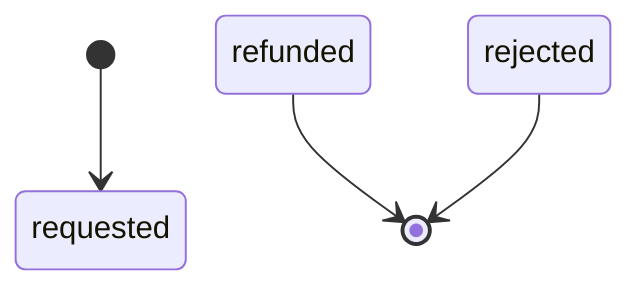
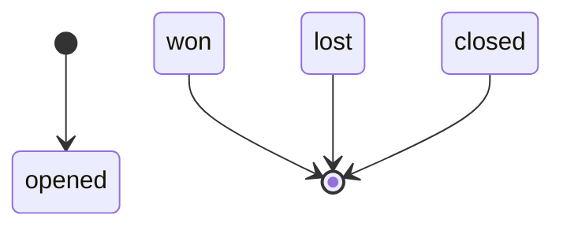
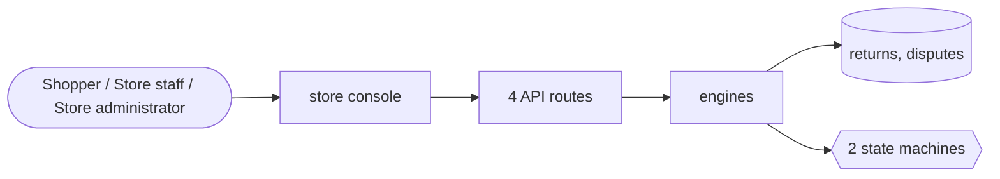

# Returns and refunds

> Generated from `_registry/business-domains.json`, the code and `docs/source/returns.md` — edit those, then run `node scripts/domain-docs.js`.

## Overview

Sending something back: return requests, their inspection and refund, and payment disputes.

**Foundation domain:** Commerce · **Used by:** Shopper, Store staff, Store administrator

## Architecture

## Data model

### `returns`

| Column | Type |
|---|---|
| `id` | INTEGER PRIMARY KEY AUTOINCREMENT |
| `tenant_id` | INTEGER NOT NULL |
| `ref` | TEXT NOT NULL UNIQUE |
| `order_id` | INTEGER |
| `product_id` | TEXT |
| `qty` | INTEGER DEFAULT 1 |
| `reason` | TEXT |
| `status` | TEXT DEFAULT 'requested' |
| `created_at` | TEXT NOT NULL DEFAULT (datetime('now')) |
| `deleted_at` | TEXT |

### `disputes`

| Column | Type |
|---|---|
| `id` | INTEGER PRIMARY KEY AUTOINCREMENT |
| `tenant_id` | INTEGER NOT NULL |
| `payment_id` | INTEGER |
| `order_id` | INTEGER |
| `ref` | TEXT NOT NULL UNIQUE |
| `reason` | TEXT |
| `amount` | REAL |
| `currency` | TEXT |
| `state` | TEXT NOT NULL DEFAULT 'opened' |
| `resolution` | TEXT |
| `closed_at` | TEXT |
| `created_at` | TEXT NOT NULL DEFAULT (datetime('now')) |

## API reference

Every call is JSON over HTTPS; store calls carry the store (`?store=`) and the session; mutating calls accept an `Idempotency-Key` header where noted.

| Method and path | Handler | What it does |
|---|---|---|
| `POST /api/returns` | `apiReturnCreate` | — |
| `PUT /api/admin/returns/:id/disposition` | `apiReturnDisposition` | — |
| `GET /api/admin/returns` | `apiAdminReturns` | — |
| `PUT /api/admin/returns/:id` | `apiAdminReturnUpdate` | — |

## Process flows

Each record's life is a declared state machine (`lib/seed/states.json`): the moves it may make, and the actions that make them.

### Return (`return`)

Actions: 

### Payment dispute (`dispute`)

Actions: 

## Data flow

## User interface

**Store console:** ↩️ Returns

## User flows

_Not yet written — `docs/source/returns.md`, section `## Flows`._

## Manuals

### Shopper

_Not yet written — `docs/source/returns.md`, section `## Manual: shopper`._

### Store staff

_Not yet written — `docs/source/returns.md`, section `## Manual: store_staff`._

### Store administrator

_Not yet written — `docs/source/returns.md`, section `## Manual: store_admin`._

