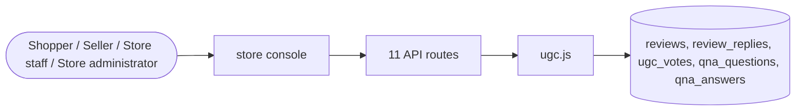

# Reviews and questions

> Generated from `_registry/business-domains.json`, the code and `docs/source/reviews.md` — edit those, then run `node scripts/domain-docs.js`.

## Overview

What buyers say: ratings and reviews with replies and votes, and questions with answers.

**Foundation domain:** Experience · **Used by:** Shopper, Seller, Store staff, Store administrator

## Switches and settings

Each is switched on per store under ⚙️ Capabilities; its parameters are that store's settings.

### Product reviews (`reviews`)

Shopper-written product reviews with ratings, replies and moderation.

| Setting | Meaning | Default |
|---|---|---|
| `moderation` | A review is published only after a moderator approves it | `false` |

### Questions & Answers (`qna`)

Shoppers ask and answer questions on a product page.

| Setting | Meaning | Default |
|---|---|---|
| `buyer_answers` | Other shoppers may answer a question, not only staff | `true` |

## Architecture

| Module | What it is |
|---|---|
| `lib/ugc.js` | Customer Trust & Commerce Content (UGC). Rich reviews (helpfulness votes, seller reply threads, photo media, moderation states) and product Q&A (questions, answers, votes, moderation). One vote per owner per target is enforced by the ugc_votes primary key; moderation states and author roles live in meta_lists (ugcStates, ugcRoles) so they are editable from Data Studio. |

## Data model

### `reviews`

| Column | Type |
|---|---|
| `id` | INTEGER PRIMARY KEY AUTOINCREMENT |
| `tenant_id` | INTEGER NOT NULL DEFAULT 1 |
| `product_id` | TEXT NOT NULL |
| `user_id` | INTEGER |
| `name` | TEXT NOT NULL |
| `rating` | INTEGER NOT NULL |
| `title` | TEXT NOT NULL |
| `body` | TEXT NOT NULL |
| `verified` | INTEGER DEFAULT 0 |
| `created_at` | TEXT NOT NULL DEFAULT (datetime('now')) |
| `votes_helpful` | INTEGER DEFAULT 0 |
| `votes_total` | INTEGER DEFAULT 0 |
| `state` | TEXT DEFAULT 'approved' |
| `media` | TEXT DEFAULT '[]' |
| `deleted_at` | TEXT |
| `uid` | TEXT |

### `review_replies`

| Column | Type |
|---|---|
| `id` | INTEGER PRIMARY KEY AUTOINCREMENT |
| `tenant_id` | INTEGER NOT NULL |
| `review_id` | INTEGER NOT NULL |
| `author` | TEXT NOT NULL |
| `role` | TEXT NOT NULL DEFAULT 'seller' |
| `body` | TEXT NOT NULL |
| `created_at` | TEXT NOT NULL DEFAULT (datetime('now')) |
| `uid` | TEXT |

### `ugc_votes`

| Column | Type |
|---|---|
| `entity` | TEXT NOT NULL |
| `entity_id` | INTEGER NOT NULL |
| `tenant_id` | INTEGER NOT NULL |
| `owner` | TEXT NOT NULL |
| `dir` | TEXT NOT NULL DEFAULT 'up' |
| `at` | TEXT NOT NULL DEFAULT (datetime('now')) |
| `uid` | TEXT |

### `qna_questions`

| Column | Type |
|---|---|
| `id` | INTEGER PRIMARY KEY AUTOINCREMENT |
| `tenant_id` | INTEGER NOT NULL |
| `product_id` | TEXT NOT NULL |
| `owner` | TEXT |
| `name` | TEXT NOT NULL |
| `body` | TEXT NOT NULL |
| `state` | TEXT NOT NULL DEFAULT 'approved' |
| `votes_helpful` | INTEGER DEFAULT 0 |
| `votes_total` | INTEGER DEFAULT 0 |
| `answered_at` | TEXT |
| `created_at` | TEXT NOT NULL DEFAULT (datetime('now')) |
| `uid` | TEXT |

### `qna_answers`

| Column | Type |
|---|---|
| `id` | INTEGER PRIMARY KEY AUTOINCREMENT |
| `tenant_id` | INTEGER NOT NULL |
| `question_id` | INTEGER NOT NULL |
| `owner` | TEXT |
| `name` | TEXT NOT NULL |
| `role` | TEXT NOT NULL DEFAULT 'customer' |
| `body` | TEXT NOT NULL |
| `state` | TEXT NOT NULL DEFAULT 'approved' |
| `votes_helpful` | INTEGER DEFAULT 0 |
| `votes_total` | INTEGER DEFAULT 0 |
| `created_at` | TEXT NOT NULL DEFAULT (datetime('now')) |
| `uid` | TEXT |

## API reference

Every call is JSON over HTTPS; store calls carry the store (`?store=`) and the session; mutating calls accept an `Idempotency-Key` header where noted.

| Method and path | Handler | What it does |
|---|---|---|
| `POST /api/reviews/:id` | `apiReviewAdd` | ---------------- reviews / gifts / viewed ---------------- |
| `POST /api/reviews/:id/vote` | `apiReviewVote` | — |
| `POST /api/reviews/:id/reply` | `apiReviewReply` | — |
| `PUT /api/admin/reviews/:id/moderate` | `apiReviewModerate` | — |
| `GET /api/admin/ugc/queue` | `apiAdminUgcQueue` | — |
| `POST /api/qna/:id/question` | `apiQnaAsk` | ---------------- Q&A ---------------- |
| `POST /api/qna/question/:id/answer` | `apiQnaAnswer` | — |
| `POST /api/qna/:id/vote` | `apiQnaVote` | — |
| `PUT /api/admin/qna/:id/moderate` | `apiQnaModerate` | — |
| `GET /api/admin/reviews` | `apiAdminReviews` | — |
| `DELETE /api/admin/reviews/:id` | `apiAdminReviewDelete` | — |

## Data flow

## User interface

**Store console:** ⭐ Reviews & Q&A

## User flows

_Not yet written — `docs/source/reviews.md`, section `## Flows`._

## Manuals

### Shopper

_Not yet written — `docs/source/reviews.md`, section `## Manual: shopper`._

### Seller

_Not yet written — `docs/source/reviews.md`, section `## Manual: seller`._

### Store staff

_Not yet written — `docs/source/reviews.md`, section `## Manual: store_staff`._

### Store administrator

_Not yet written — `docs/source/reviews.md`, section `## Manual: store_admin`._

