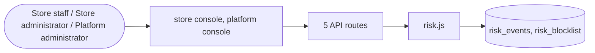

# Risk and fraud

> Generated from `_registry/business-domains.json`, the code and `docs/source/risk.md` — edit those, then run `node scripts/domain-docs.js`.

## Overview

Stopping abuse: fraud screening of orders and payments, risk events and the block list.

**Foundation domain:** Security · **Used by:** Store staff, Store administrator, Platform administrator

## Switches and settings

Each is switched on per store under ⚙️ Capabilities; its parameters are that store's settings.

### Risk screening (`fraud_screen`)

Order-time risk screening that may flag or block a suspicious order.

| Setting | Meaning | Default |
|---|---|---|
| `block_above` | A risk score above this blocks the order | `90` |

## Architecture

| Module | What it is |
|---|---|
| `lib/risk.js` | Order fraud screening & risk. Screened at checkout: velocity (attempts per owner/IP/window), blocklists (email, card fingerprint, address, IP), an AVS/CVV-signal proxy and a composite 0–100 risk score producing a decision — approve / hold for manual review / block. Holds land in a review queue the admin can release or decline. Block reasons and thresholds are meta_lists registries (riskSignals, riskActions) — editable in Data Studio. Feature-gated by settings.features.fraudScreen. |

## Data model

### `risk_events`

| Column | Type |
|---|---|
| `id` | INTEGER PRIMARY KEY AUTOINCREMENT |
| `tenant_id` | INTEGER NOT NULL |
| `owner` | TEXT DEFAULT '' |
| `ip` | TEXT DEFAULT '' |
| `card_fp` | TEXT DEFAULT '' |
| `addr_fp` | TEXT DEFAULT '' |
| `amount` | REAL DEFAULT 0 |
| `score` | INTEGER DEFAULT 0 |
| `action` | TEXT NOT NULL DEFAULT 'approve' |
| `signals` | TEXT DEFAULT '{}' |
| `ref` | TEXT DEFAULT '' |
| `resolved` | INTEGER DEFAULT 0 |
| `resolution` | TEXT DEFAULT '' |
| `note` | TEXT DEFAULT '' |
| `resolved_at` | TEXT |
| `created_at` | TEXT NOT NULL DEFAULT (datetime('now')) |
| `uid` | TEXT |

### `risk_blocklist`

| Column | Type |
|---|---|
| `id` | INTEGER PRIMARY KEY AUTOINCREMENT |
| `tenant_id` | INTEGER NOT NULL |
| `kind` | TEXT NOT NULL |
| `value` | TEXT NOT NULL |
| `note` | TEXT DEFAULT '' |
| `created_at` | TEXT NOT NULL DEFAULT (datetime('now')) |
| `uid` | TEXT |

## API reference

Every call is JSON over HTTPS; store calls carry the store (`?store=`) and the session; mutating calls accept an `Idempotency-Key` header where noted.

| Method and path | Handler | What it does |
|---|---|---|
| `POST /api/admin/risk/screen` | `apiRiskScreen` | ---------------- risk / fraud screening ---------------- |
| `GET /api/admin/risk/blocklist` | `apiRiskBlocklist` | — |
| `POST /api/admin/risk/blocklist` | `apiRiskBlockAdd` | — |
| `GET /api/admin/risk/queue` | `apiRiskQueue` | — |
| `PUT /api/admin/risk/:id/resolve` | `apiRiskResolve` | — |

## Data flow

## User interface

**Store console:** 🛡️ Risk & Fraud

**Platform console:** 🕵️ Fraud Detection · ⚠️ Risk Engine · 🧠 Knowledge Intelligence · ⚠️ Risk · ⛔ Risk Blocks · 🔐 Security · 🎛️ Controls · 🧾 Evidence · 🛡️ Risk · Compliance · Trash

## User flows

_Not yet written — `docs/source/risk.md`, section `## Flows`._

## Manuals

### Store staff

_Not yet written — `docs/source/risk.md`, section `## Manual: store_staff`._

### Store administrator

_Not yet written — `docs/source/risk.md`, section `## Manual: store_admin`._

### Platform administrator

_Not yet written — `docs/source/risk.md`, section `## Manual: platform_admin`._

