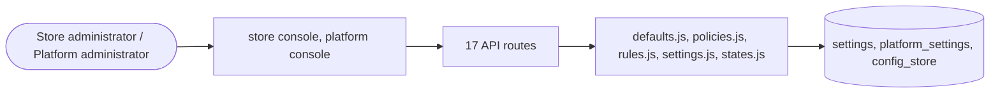

# Rules, states and settings

> Generated from `_registry/business-domains.json`, the code and `docs/source/rules.md` — edit those, then run `node scripts/domain-docs.js`.

## Overview

How behaviour is configured: applicability rules, state machines, settings and their defaults, and platform policy.

**Foundation domain:** Rule · **Used by:** Store administrator, Platform administrator

## Architecture

| Module | What it is |
|---|---|
| `lib/defaults.js` | defaults are data. An engine that needs a value the caller did not give asks here instead of writing `\|\| "USD"` or `\|\| "commerce"`: currency(tenantId) the store's chosen currency, else its country's, else the currency of the platform's default country (security policy → countries master) of(list) the row the registry flags `default: true`, else the row the seed declares, else the list's first row lib/seed/defaults.json declares which row is each list's default; seed() stamps that flag onto an install whose list flags none, so changing a default is a registry edit. |
| `lib/policies.js` | Dynamic Policy Management |
| `lib/rules.js` | applicability rules: WHERE, FOR WHOM and FOR WHAT anything applies. |
| `lib/settings.js` | per-tenant settings engine (DB-backed, env-overridable, deep-merged) |
| `lib/states.js` | the state-machine kernel: what a state MEANS and what entering it DOES. |

## Data model

### `settings`

| Column | Type |
|---|---|
| `tenant_id` | INTEGER NOT NULL DEFAULT 1 |
| `key` | TEXT NOT NULL |
| `value` | TEXT NOT NULL |
| `uid` | TEXT |

### `platform_settings`

| Column | Type |
|---|---|
| `key` | TEXT PRIMARY KEY |
| `value` | TEXT NOT NULL |
| `uid` | TEXT |

### `config_store`

| Column | Type |
|---|---|
| `id` | INTEGER PRIMARY KEY AUTOINCREMENT |
| `key` | TEXT NOT NULL |
| `scope` | TEXT NOT NULL DEFAULT 'platform' |
| `tenant_id` | INTEGER |
| `version` | INTEGER DEFAULT 1 |
| `value` | TEXT DEFAULT '{}' |
| `active` | INTEGER DEFAULT 1 |
| `created_at` | TEXT NOT NULL DEFAULT (datetime('now')) |
| `updated_at` | TEXT |

## API reference

Every call is JSON over HTTPS; store calls carry the store (`?store=`) and the session; mutating calls accept an `Idempotency-Key` header where noted.

| Method and path | Handler | What it does |
|---|---|---|
| `PUT /api/admin/mode` | `apiAdminModePut` | — |
| `GET /api/admin/settings` | `apiAdminSettingsGet` | — |
| `PUT /api/admin/settings` | `apiAdminSettingsPut` | — |
| `POST /api/admin/settings/reset` | `apiAdminSettingsReset` | — |
| `GET /api/platform/config` | `apiPlatformConfigGet` | — |
| `PUT /api/platform/config` | `apiPlatformConfigPut` | — |
| `GET /api/platform/rules` | `apiPlatformRules` | ---------------- applicability rules (lib/rules.js) ---------------- the platform owner's layer bounds every platform; each platform narrows its own. The vocabularies (subject types, dimensions, services, segments, channels, banks, country groups) are registry rows — the console offers whatever they hold. |
| `POST /api/platform/rules` | `apiPlatformRuleSave` | — |
| `POST /api/platform/rules/explain` | `apiPlatformRuleExplain` | — |
| `DELETE /api/platform/rules/:id` | `apiPlatformRuleDelete` | — |
| `GET /api/admin/rules` | `apiAdminRules` | — |
| `GET /api/admin/rules/subjects` | `apiAdminRuleSubjects` | — |
| `GET /api/platform/rules/subjects` | `apiPlatformRuleSubjects` | what a rule can name, per subject type — enumerated by the type's registered source |
| `POST /api/admin/rules` | `apiAdminRuleSave` | — |
| `POST /api/admin/rules/explain` | `apiAdminRuleExplain` | — |
| `DELETE /api/admin/rules/:id` | `apiAdminRuleDelete` | — |
| `POST /api/rules/check` | `apiRulesCheck` | the one question any engine, integration or page — today's or tomorrow's — can ask: may <type>/<id> be used in this request's context (plus anything the caller adds)? A shopper learns the verdict; console callers also see the reasons. |

## Data flow

## User interface

**Store console:** ⚙️ Settings

**Platform console:** 📏 Standards · 📜 Regulations · 📏 Rules · ⚖️ Decisions · ⚙️ Configurations · 🗝️ Secrets · ⚙️ Settings · 🚩 Feature Flags

## User flows

_Not yet written — `docs/source/rules.md`, section `## Flows`._

## Manuals

### Store administrator

_Not yet written — `docs/source/rules.md`, section `## Manual: store_admin`._

### Platform administrator

_Not yet written — `docs/source/rules.md`, section `## Manual: platform_admin`._

