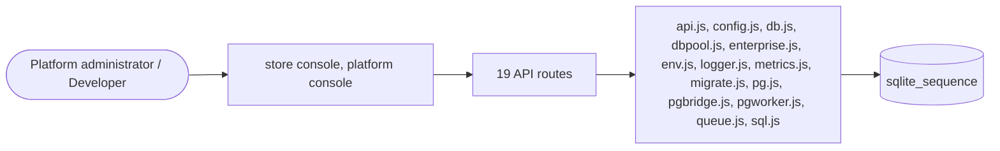

# Runtime and operations

> Generated from `_registry/business-domains.json`, the code and `docs/source/runtime.md` — edit those, then run `node scripts/domain-docs.js`.

## Overview

Running the platform: environments, configuration, the database and its migrations, queues, monitoring, metrics, logs, backup and restore.

**Foundation domain:** Operations · **Used by:** Platform administrator, Developer

## Architecture

| Module | What it is |
|---|---|
| `lib/api.js` | REST API: multi-tenant, pluggable providers, billing, audit, monitoring |
| `lib/config.js` | runtime configuration spine. Every infra choice (cache, queue, storage, rate-limit backend, session, outbound mode) is resolved here from DATA ONLY: safe in-process defaults → editable `platform_settings.runtime` (Platform → Runtime) → env override. lib/adapters.js implements the selectable backends, so switching a concern to Redis/S3/a worker/HTTP hook is a config change, not a code change. The DB is intentionally kept as the SQLite default with an interface-isolated seam (see db.js run/all/get); `db` is exposed here as a configured concern so the shape is uniform, but only the sqlite driver is wired (selecting postgres reports "not provisioned" rather than lying). |
| `lib/db.js` | multi-tenant SQLite layer (node:sqlite, zero deps) |
| `lib/dbpool.js` | async dual-engine data pool (B-full foundation). One async facade over the data layer, driver-selected by config (`db`: sqlite\|postgres): - sqlite: the existing synchronous DB (lib/db.js), wrapped as promises (default; no behavior change) - postgres: SQL is dialect-translated (lib/sql.js) and executed via the wire client (lib/pg.js) The synchronous request path still uses lib/db.js directly today; this pool is the target all data access converges onto during the cutover (see the runbook). Not wired into routes yet — it is the mechanism, tested in isolation, that makes B-full mechanical rather than a rewrite-by-hand. |
| `lib/enterprise.js` | enterprise ops layer (everything OFF-by-default, all config/placeholders). This module wires the seven "production" capabilities as pure DATA + endpoints. Nothing is enabled unless you write its platform_settings row (or env), so SQLite/single-node installs are unaffected: |
| `lib/env.js` | Environment & Feature-Flag registry (all configuration, no code). An "environment" is a named bundle of runtime driver choices + connection params + feature flags + tenant routing (dev, staging, eu-west-prod, ...). Operators can define UNLIMITED environments, activate one (applies its drivers to the live runtime), and import/export them as JSON — a machine or a human sets the whole runtime topology by data. Feature flags are a second data registry resolved per tenant with percentage rollout, consumed by surfaces. |
| `lib/logger.js` | Structured logger (JSON in prod, plain in dev) |
| `lib/metrics.js` | request metrics. |
| `lib/migrate.js` | SQLite → PostgreSQL migration (B-full foundation). `plan()` reads the live SQLite schema + rows and emits a deterministic list of translated DDL + parameterized INSERT statements (unit-testable, no server). `apply()` runs them through the async Postgres wire client. uid columns become native `gen_random_uuid()` defaults (the SQLite triggers are engine-specific). This is the copy/mirror step of a cutover; the request path then runs on the synchronous Postgres bridge (LX_DB_DRIVER=postgres — see lib/pgbridge.js / lib/db.js). |
| `lib/pg.js` | minimal Postgres wire client (zero dependencies). Frontend/backend protocol: StartupMessage + (trust \| cleartext \| MD5) auth + simple Query, parsing RowDescription/DataRow/CommandComplete/ReadyForQuery/ErrorResponse. Selected via config `db=postgres`; the app's synchronous data layer (lib/db.js) stays SQLite by design, so this powers the async surfaces (workers, exports, reporting, future async handlers) — a full sync→async app migration on Postgres is the remaining, separately-scoped step (see README). TLS is negotiated when the URL asks for it (sslmode=require/prefer/allow) so managed Postgres (RDS/Cloud SQL/Neon/Supabase) connects instead of failing plaintext. SCRAM-SHA-256 is intentionally NOT half-implemented: if a server demands it, ping() reports "auth unsupported" — set the role to md5/trust for the migration, then SCRAM for app traffic. Pure encode/parse helpers are exported and unit-tested without a live server. |
| `lib/pgbridge.js` |  |
| `lib/pgworker.js` |  |
| `lib/queue.js` | Job queue (inline by default, Bull/Redis when configured) |
| `lib/sql.js` | SQLite→PostgreSQL SQL dialect translator (B-full foundation). The app emits a bounded, known set of SQLite idioms. This converts them to PostgreSQL so the same SQL runs on either engine; `?` placeholders become `$n`. It is pure + unit-tested — the one part of the async migration that can be validated without a live server. PRAGMA / randomblob-uuid triggers are SQLite-only and not translated (Postgres uses gen_random_uuid(); see migrate.js). |

## Data model

### `sqlite_sequence`

| Column | Type |
|---|---|
| `name` |  |
| `seq` |  |

## API reference

Every call is JSON over HTTPS; store calls carry the store (`?store=`) and the session; mutating calls accept an `Idempotency-Key` header where noted.

| Method and path | Handler | What it does |
|---|---|---|
| `GET /api/admin/monitor` | `apiAdminMonitor` | — |
| `GET /api/platform/db` | `apiPlatformDb` | ---------- B (async dual-engine) observability ---------- |
| `POST /api/platform/db/ping` | `apiDbPing` | — |
| `POST /api/platform/db/apply` | `apiDbApply` | — |
| `POST /api/platform/db/switch` | `apiDbSwitch` | — |
| `GET /api/platform/runtime` | `apiPlatformRuntime` | — |
| `PUT /api/platform/runtime` | `apiPlatformRuntimePut` | — |
| `POST /api/platform/runtime/test` | `apiPlatformRuntimeTest` | — |
| `POST /api/platform/queue/drain` | `apiPlatformQueueDrain` | — |
| `GET /api/platform/environments` | `apiEnvList` | — |
| `POST /api/platform/environments` | `apiEnvUpsert` | — |
| `GET /api/platform/environments/:name` | `apiEnvGet` | — |
| `PUT /api/platform/environments/:name` | `apiEnvUpsert` | — |
| `DELETE /api/platform/environments/:name` | `apiEnvDelete` | — |
| `POST /api/platform/environments/:name/activate` | `apiEnvActivate` | — |
| `GET /api/platform/environments-export` | `apiEnvExport` | — |
| `POST /api/platform/environments-import` | `apiEnvImport` | — |
| `GET /api/env/tenant` | `apiEnvTenant` | — |
| `GET /api/platform/monitor` | `apiPlatformMonitor` | — |

## Data flow

## User interface

**Store console:** 📈 Monitor

**Platform console:** 🧩 Runtime · Infra · 🗄️ Runtime Registry · 🚀 Deployment · 🏗️ Infrastructure · 🔌 APIs · ⚡ Events · 🔀 Workflows · 📈 Monitoring · 📊 Metrics · 🪵 Logs · 🧵 Traces · 🚨 Alerting · 🛡️ Reliability · 🟢 Availability · 📦 Capacity · ⚡ Performance · 💚 Health

## User flows

_Not yet written — `docs/source/runtime.md`, section `## Flows`._

## Manuals

### Platform administrator

_Not yet written — `docs/source/runtime.md`, section `## Manual: platform_admin`._

### Developer

_Not yet written — `docs/source/runtime.md`, section `## Manual: developer`._

