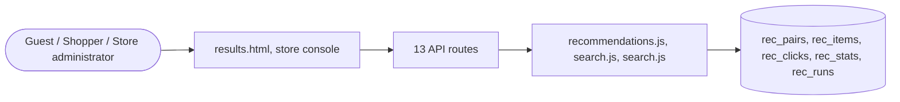

# Search and discovery

> Generated from `_registry/business-domains.json`, the code and `docs/source/search.md` — edit those, then run `node scripts/domain-docs.js`.

## Overview

Finding things: search, suggestions and facets, and recommendations learnt from what shoppers view and buy together — bought together, viewed with this and like this on a product page, picks for each shopper with the reason for each, viewed recently and popular now on the home page, what goes with the cart — with a shopper's past orders used only on the store's basis, products blocked or lifted, and every shelf counted shown, clicked and bought.

**Foundation domain:** Search · **Used by:** Guest, Shopper, Store administrator

## Switches and settings

Each is switched on per store under ⚙️ Capabilities; its parameters are that store's settings.

### Search suggestions (`suggestions`)

Type-ahead suggestions on the storefront search box.

| Setting | Meaning | Default |
|---|---|---|
| `max` | Suggestions shown | `8` |

## Architecture

| Module | What it is |
|---|---|
| `lib/recommendations.js` | recommendations (owner Search & Discovery). |
| `lib/search.js` | Search & Discovery at scale. In-memory inverted index over `products` per tenant, rebuilt lazily and invalidated on catalog write. Faceted query, synonym expansion (registry-driven), boost rules (registry-driven), and a co-occurrence recommendation engine backed by the orders + view_history graph. All configuration lives in meta_lists so new facets / boosts / synonyms are added from Data Studio. |
| `lib/routes/search.js` | search domain routes (moved from lib/api.js; _registry/business-domains.json). Each handler answers one route of the search domain. What it needs from the shared HTTP kit (lib/api.js) is passed in as `kit`. |

## Data model

### `rec_pairs`

| Column | Type |
|---|---|
| `tenant_id` | INTEGER NOT NULL |
| `kind` | TEXT NOT NULL |
| `a` | TEXT NOT NULL |
| `b` | TEXT NOT NULL |
| `weight` | REAL NOT NULL DEFAULT 0 |
| `n` | INTEGER NOT NULL DEFAULT 0 |
| `at` | TEXT NOT NULL |

### `rec_items`

| Column | Type |
|---|---|
| `tenant_id` | INTEGER NOT NULL |
| `kind` | TEXT NOT NULL |
| `product_id` | TEXT NOT NULL |
| `weight` | REAL NOT NULL DEFAULT 0 |
| `at` | TEXT NOT NULL |

### `rec_clicks`

| Column | Type |
|---|---|
| `tenant_id` | INTEGER NOT NULL |
| `owner` | TEXT NOT NULL |
| `product_id` | TEXT NOT NULL |
| `slot` | TEXT NOT NULL |
| `at` | TEXT NOT NULL |

### `rec_stats`

| Column | Type |
|---|---|
| `tenant_id` | INTEGER NOT NULL |
| `day` | TEXT NOT NULL |
| `slot` | TEXT NOT NULL |
| `shown` | INTEGER NOT NULL DEFAULT 0 |
| `clicked` | INTEGER NOT NULL DEFAULT 0 |
| `bought` | INTEGER NOT NULL DEFAULT 0 |
| `revenue` | REAL NOT NULL DEFAULT 0 |

### `rec_runs`

| Column | Type |
|---|---|
| `id` | INTEGER PRIMARY KEY AUTOINCREMENT |
| `tenant_id` | INTEGER NOT NULL |
| `at` | TEXT NOT NULL |
| `orders` | INTEGER NOT NULL DEFAULT 0 |
| `pairs` | INTEGER NOT NULL DEFAULT 0 |
| `products` | INTEGER NOT NULL DEFAULT 0 |
| `ms` | INTEGER NOT NULL DEFAULT 0 |

## API reference

Every call is JSON over HTTPS; store calls carry the store (`?store=`) and the session; mutating calls accept an `Idempotency-Key` header where noted.

| Method and path | Handler | What it does |
|---|---|---|
| `GET /api/platform/hint` | `apiPlatformHint` | — |
| `GET /api/hint` | `apiHint` | — |
| `GET /api/search` | `apiSearch` | ---- Search & Discovery (faceted + typo-tolerant + recommendation) ---- |
| `GET /api/suggest` | `apiSuggest` | — |
| `GET /api/recommend` | `apiRecommend` | Products to show with `anchor` (bought together, then viewed with it, then like it) or, with no anchor, the signed-in shopper's picks — each with its learnt weight. |
| `GET /api/recs` | `apiRecs` | The shelves of a storefront page: `page=product&id=` gives bought_together, also_viewed and similar; `page=home` the shopper's for_you (each with its reason), recent and trending, and whether their past orders shape the picks; `page=cart` goes_with. |
| `POST /api/recs/shown` | `apiRecsShown` | What a page showed, as `{ slot: count }`; counted per shelf and day. |
| `GET /api/admin/recommendations` | `apiRecAdmin` | The learnt model (pairs bought and viewed together, products covered, the last rebuilds), each shelf's last 30 days (shown, clicked, bought, revenue) and the store's settings. |
| `PUT /api/admin/recommendations` | `apiRecSettings` | Changes the settings: `basis` (consent or optout, for past orders), `halfLifeDays`, `perDept`, `shelfSize`, `attributionDays`, `shelves` `{ slot: on }`, and `block` and `boost` lists of product ids. |
| `POST /api/admin/recommendations/train` | `apiRecTrain` | Rebuilds the purchase pairs from the orders now, rather than on the nightly sweep. |
| `GET /api/admin/recommendations/preview` | `apiRecPreview` | What a customer (`email`) or a product page (`product`) would be shown now, with each pick's score and reason. |
| `GET /api/reco/:id` | `apiReco` | — |
| `GET /api/facets` | `apiFacets` | — |

## Data flow

## User interface

**Pages:** `results.html`

**Store console:** 🔎 Search & Discovery · 🎯 Recommendations

## User flows

**Learning what goes together.** When a shopper opens a product, it is paired with the other products
they opened in the past day. Opening the same product again does not count twice. When an order is
placed, its products are paired with each other. Every night the purchase pairs are rebuilt from the
last year of orders. That rebuild also pairs products a customer bought in orders up to 30 days apart,
at half weight. Every pair fades, halving every 60 days, so what sells together this season counts more
than last year. A pair names products only, never a person.

**Scoring.** A pair is used once it has been seen enough times: twice for views, once for purchases.
Each pair is measured against how popular each of its products is alone, so a best-seller that turns
up in every order does not crowd out a product that is truly bought with this one.

**The shelves.**
- **A product page** shows:
  - what is bought together, as a set to add in one click (unless the store set a bundle of its own);
  - what was viewed with it;
  - what is like it, by category, brand and price. A new product has suggestions from its first day.
- **The home page** shows, in order:
  - picks for the shopper, each with its reason: "Because you viewed…", "Because you bought…" or
    "Goes with … in your cart". The picks are spread over several departments, and topped up with
    what is popular in the departments the shopper looks at;
  - what they viewed recently;
  - what is popular now.
- **The cart** shows what goes with what is in it.

Out-of-stock and blocked products are never shown.

**Whose history is used.**
- **Always:** what the shopper views in this visit and has in the cart. That is what they are looking
  at now.
- **Past orders of a signed-in shopper:** only with their grant for analytics and personalisation. A
  store can instead use them unless the shopper withdraws it.
- **Asking:** the home page asks a signed-in shopper whether their orders may shape the picks. The
  privacy page turns it off again.

**Measuring.** Each shelf counts:
- **shown:** how many products it showed;
- **clicked:** a product opened from it;
- **bought:** that product ordered within 7 days of the click, with the revenue.

A guest who signs in keeps the clicks of their visit. Clicks older than the window are forgotten.

## Manuals

### Guest

Product pages show what is often bought together, what others viewed with it and what is like it.
The home page suggests products from what you are looking at in this visit.

### Shopper

Your picks on the home page say why each was chosen. If you are signed in, the home page asks whether
your past orders may shape them. **Yes, use my orders** turns that on. You can turn it off on the
privacy page under **Analytics & personalization**. What you view in a visit always shapes the picks.

### Store administrator

Open **Storefront → 🎯 Recommendations**. Your role needs the recommendations section; the Catalog and
Growth roles have it.

- **What has been learnt** shows the pairs bought and viewed together, and how many products have
  partners. It also lists the last rebuilds. **Rebuild from orders now** rebuilds without waiting for
  the night.
- **Shelves** lists each shelf's last 30 days: shown, clicked, click rate, bought, the share of clicks
  that became orders, and revenue. Untick a shelf to switch it off.
- **Settings**:
  - whether past orders shape picks only with the shopper's grant (the default) or unless they
    withdraw it;
  - how fast a signal fades;
  - the most products from one department;
  - the products on a shelf;
  - how many days a click counts toward an order;
  - products never to recommend, and products to lift, as product ids.
- **Preview**: enter a customer's email to see their picks with the reason and score for each, or a
  product id to see that page's shelves.

