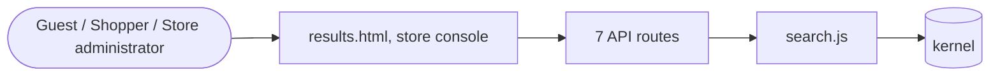

# Search and discovery

> Generated from `_registry/business-domains.json`, the code and `docs/source/search.md` — edit those, then run `node scripts/domain-docs.js`.

## Overview

Finding things: search, suggestions and facets, and recommendations.

**Foundation domain:** Search · **Used by:** Guest, Shopper, Store administrator

## Switches and settings

Each is switched on per store under ⚙️ Capabilities; its parameters are that store's settings.

### Search suggestions (`suggestions`)

Type-ahead suggestions on the storefront search box.

| Setting | Meaning | Default |
|---|---|---|
| `max` | Suggestions shown | `8` |

## Architecture

| Module | What it is |
|---|---|
| `lib/search.js` | Search & Discovery at scale. In-memory inverted index over `products` per tenant, rebuilt lazily and invalidated on catalog write. Faceted query, synonym expansion (registry-driven), boost rules (registry-driven), and a co-occurrence recommendation engine backed by the orders + view_history graph. All configuration lives in meta_lists so new facets / boosts / synonyms are added from Data Studio. |

## API reference

Every call is JSON over HTTPS; store calls carry the store (`?store=`) and the session; mutating calls accept an `Idempotency-Key` header where noted.

| Method and path | Handler | What it does |
|---|---|---|
| `GET /api/platform/hint` | `apiPlatformHint` | — |
| `GET /api/hint` | `apiHint` | — |
| `GET /api/search` | `apiSearch` | ---- Search & Discovery (faceted + typo-tolerant + recommendation) ---- |
| `GET /api/suggest` | `apiSuggest` | — |
| `GET /api/recommend` | `apiRecommend` | — |
| `GET /api/reco/:id` | `apiReco` | — |
| `GET /api/facets` | `apiFacets` | — |

## Data flow

## User interface

**Pages:** `results.html`

**Store console:** 🔎 Search & Discovery

## User flows

_Not yet written — `docs/source/search.md`, section `## Flows`._

## Manuals

### Guest

_Not yet written — `docs/source/search.md`, section `## Manual: guest`._

### Shopper

_Not yet written — `docs/source/search.md`, section `## Manual: shopper`._

### Store administrator

_Not yet written — `docs/source/search.md`, section `## Manual: store_admin`._

