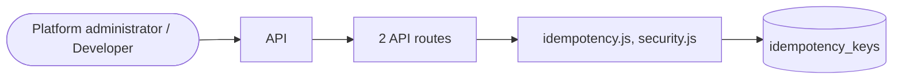

# Security

> Generated from `_registry/business-domains.json`, the code and `docs/source/security.md` — edit those, then run `node scripts/domain-docs.js`.

## Overview

Protecting the platform: encryption and key rotation, the security policy and scorecard, idempotency and request protection.

**Foundation domain:** Security · **Used by:** Platform administrator, Developer

## Architecture

| Module | What it is |
|---|---|
| `lib/idempotency.js` | idempotency for mutations (safe client retries). A client may send `Idempotency-Key` on POST/PUT/DELETE /api. The first request runs and its response is stored (key → status+body, TTL). Replays short-circuit with the stored response so a retried "place order" / "capture payment" never double-executes. |
| `lib/security.js` | security core: defense-in-depth layers with real cryptography. L1 transport headers+TLS · L2 session CSRF · L3 credential KDF (scrypt+pepper) · L4 password policy L5 at-rest envelope encryption (AES-256-GCM) · L6 key hierarchy+rotation · L7 hash-chained audit L8 rate limiting+lockout (durable) · L9 SRI+input hardening · L10 least-privilege/tenant isolation |

## Data model

### `idempotency_keys`

| Column | Type |
|---|---|
| `key` | TEXT PRIMARY KEY |
| `tenant_id` | INTEGER |
| `method` | TEXT |
| `path` | TEXT |
| `request_hash` | TEXT |
| `status` | INTEGER |
| `response` | TEXT |
| `created_at` | TEXT NOT NULL DEFAULT (datetime('now')) |
| `expires_at` | TEXT NOT NULL |
| `uid` | TEXT |

## API reference

Every call is JSON over HTTPS; store calls carry the store (`?store=`) and the session; mutating calls accept an `Idempotency-Key` header where noted.

| Method and path | Handler | What it does |
|---|---|---|
| `GET /api/platform/security` | `apiPlatformSecurity` | — |
| `POST /api/platform/keys/rotate` | `apiPlatformKeyRotate` | — |

## Data flow

## User interface

## User flows

_Not yet written — `docs/source/security.md`, section `## Flows`._

## Manuals

### Platform administrator

_Not yet written — `docs/source/security.md`, section `## Manual: platform_admin`._

### Developer

_Not yet written — `docs/source/security.md`, section `## Manual: developer`._

