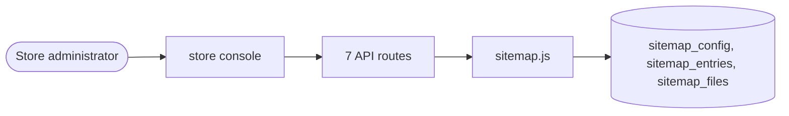

# Search engine optimisation

> Generated from `_registry/business-domains.json`, the code and `docs/source/seo.md` — edit those, then run `node scripts/domain-docs.js`.

## Overview

Being found from outside: the sitemap and its files, page metadata and product feeds.

**Foundation domain:** Experience · **Used by:** Store administrator

## Architecture

| Module | What it is |
|---|---|
| `lib/sitemap.js` | Auto-Sitemap Generator for SEO Generates dynamic XML/JSON sitemaps with automatic updates Supports multi-tenant, multi-currency, and localized content Registry-driven: schedule and rules are configurable |

## Data model

### `sitemap_config`

| Column | Type |
|---|---|
| `id` | INTEGER PRIMARY KEY AUTOINCREMENT |
| `tenant_id` | INTEGER DEFAULT 1 |
| `hostname` | TEXT |
| `max_per_file` | INTEGER DEFAULT 50000 |
| `enabled` | INTEGER DEFAULT 1 |
| `last_generated` | TEXT |
| `next_run` | TEXT |
| `created_at` | TEXT DEFAULT (datetime('now')) |
| `updated_at` | TEXT DEFAULT (datetime('now')) |

### `sitemap_entries`

| Column | Type |
|---|---|
| `id` | INTEGER PRIMARY KEY AUTOINCREMENT |
| `tenant_id` | INTEGER DEFAULT 1 |
| `loc` | TEXT UNIQUE |
| `sitemap_type` | TEXT DEFAULT 'pages' |
| `priority` | REAL DEFAULT 0.5 |
| `changefreq` | TEXT DEFAULT 'monthly' |
| `lastmod` | TEXT |
| `images` | TEXT DEFAULT '[]' |
| `languages` | TEXT DEFAULT '[]' |
| `created_at` | TEXT DEFAULT (datetime('now')) |
| `updated_at` | TEXT DEFAULT (datetime('now')) |

### `sitemap_files`

| Column | Type |
|---|---|
| `id` | INTEGER PRIMARY KEY AUTOINCREMENT |
| `tenant_id` | INTEGER DEFAULT 1 |
| `filename` | TEXT UNIQUE |
| `sitemap_type` | TEXT DEFAULT 'pages' |
| `entry_count` | INTEGER DEFAULT 0 |
| `file_size` | INTEGER DEFAULT 0 |
| `generated_at` | TEXT |
| `status` | TEXT DEFAULT 'pending' |
| `created_at` | TEXT DEFAULT (datetime('now')) |
| `updated_at` | TEXT DEFAULT (datetime('now')) |

## API reference

Every call is JSON over HTTPS; store calls carry the store (`?store=`) and the session; mutating calls accept an `Idempotency-Key` header where noted.

| Method and path | Handler | What it does |
|---|---|---|
| `GET /api/feeds/:slug` | `apiFeeds` | — |
| `GET /api/seo/sitemap.xml` | `apiSeoSitemap` | — |
| `GET /api/sitemap` | `apiSitemap` | — |
| `GET /api/sitemap.xml` | `apiSitemapXML` | — |
| `POST /api/sitemap/generate` | `apiSitemapGenerate` | — |
| `GET /api/sitemap/config` | `apiSitemapConfig` | — |
| `PUT /api/sitemap/config` | `apiSitemapConfigUpdate` | — |

## Data flow

## User interface

**Store console:** 🗺️ Sitemap & SEO

## User flows

_Not yet written — `docs/source/seo.md`, section `## Flows`._

## Manuals

### Store administrator

_Not yet written — `docs/source/seo.md`, section `## Manual: store_admin`._

