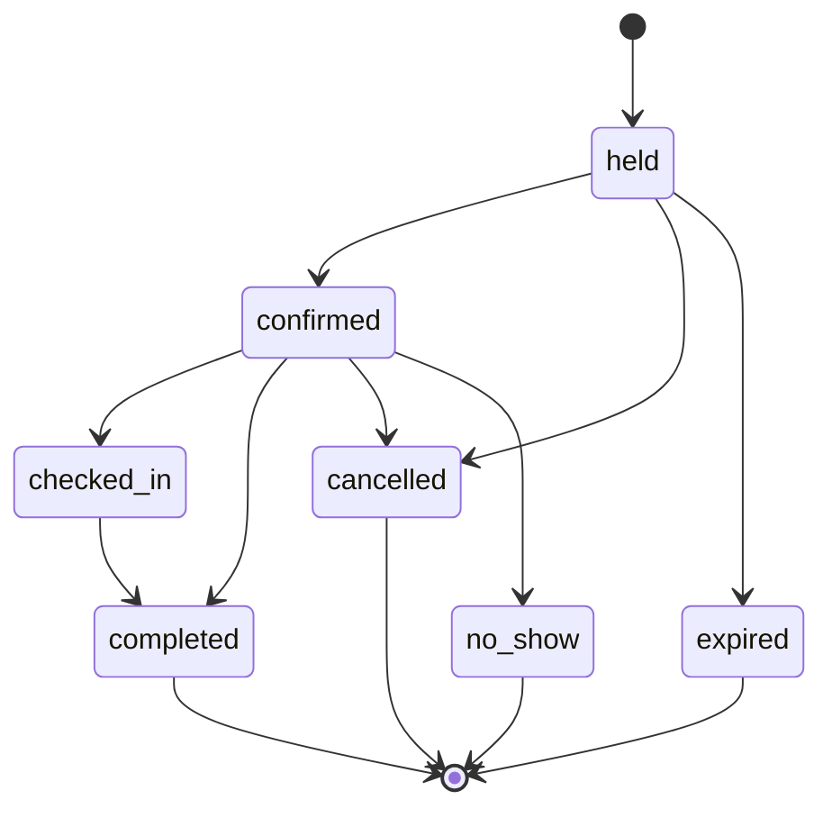
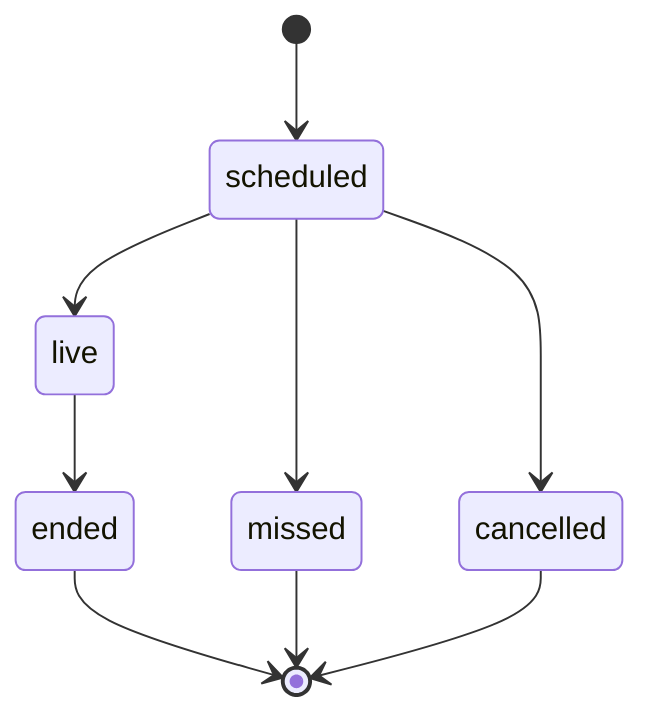
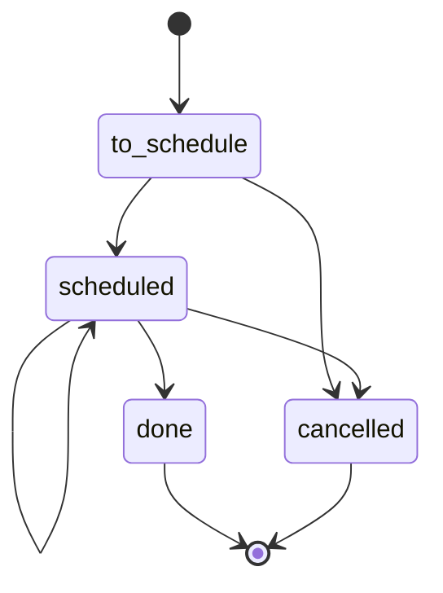
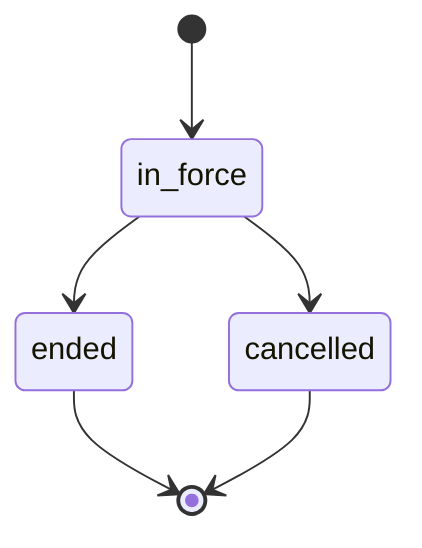
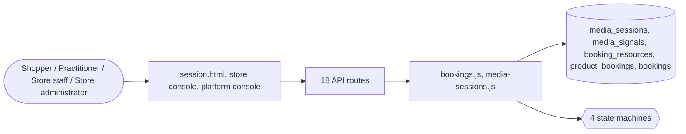

# Services and appointments

> Generated from `_registry/business-domains.json`, the code and `docs/source/services.md` — edit those, then run `node scripts/domain-docs.js`.

## Overview

Selling time and work: bookings of resources and slots, live audio and video sessions and charging them by the minute, and services attached to an item — installation, assembly and extended warranties.

**Foundation domain:** Offering · **Used by:** Shopper, Practitioner, Store staff, Store administrator

## Switches and settings

Each is switched on per store under ⚙️ Capabilities; its parameters are that store's settings.

### Bookings (`bookings`)

Appointments, stays, rentals and experiences: resources with weekly hours in their own time zone and a capacity; a shopper holds a time, pays for it, and staff check them in. Modes and resource kinds are registry rows.

| Setting | Meaning | Default |
|---|---|---|
| `hold_minutes` | Minutes a chosen time is held while the shopper checks out | `15` |
| `cancel_cutoff_hours` | Hours before the start a shopper may still cancel | `24` |
| `max_horizon_days` | Furthest ahead anything may be booked | `365` |

### Live audio and video (`media_sessions`)

A booked consultation, class or call held live, by audio or video: carried by the platform itself (the two browsers connect directly, the platform relaying only the handshake) or by a media connector from the Provider Registry.

| Setting | Meaning | Default |
|---|---|---|
| `subject` | What a session belongs to | `"booking"` |
| `default_mode` | The fulfilment mode a session takes when its booking names none | `"video_call"` |
| `transport` | The connector that carries sessions (empty: the platform's own) | `""` |
| `room_url` | A connector's room link, with {room} for the session's room | `""` |
| `provider_kind` | The Provider Registry kind media connectors are registered under | `"media"` |
| `page` | The page that holds a session on the platform's own transport | `"session.html"` |
| `ice_servers` | Network relay servers the browsers may use (STUN/TURN) | `[]` |
| `signal_types` | What the two sides may hand each other | `"offer,answer,candidate,bye"` |
| `rate_basis_attr` | The item fact that says how it is charged | `"price_basis"` |
| `rate_basis_value` | The value of that fact for a price per minute | `"per_minute"` |
| `offering_side` | Which side makes the connection offer | `"guest"` |

### Charged by the minute (`per_minute_billing`)

A live session charged by the minute to the guest's wallet, at the item's price per minute or a default rate, in increments with a minimum — how communication itself is sold. Works on live sessions.

| Setting | Meaning | Default |
|---|---|---|
| `default_rate` | Rate per minute when the item names none | `1` |
| `minimum_minutes` | Minutes always charged | `1` |
| `increment_seconds` | Charged in steps of | `60` |
| `ledger_kind` | Wallet ledger kind for the charge | `"redeem"` |

### Installation booking (`installation_booking`)

Installation offered as an option on an item: chosen at the bag, it leaves a visit for staff to book and complete.

| Setting | Meaning | Default |
|---|---|---|
| `earliest_days` | Soonest a installation visit may be booked (days after the order) | `1` |

### Assembly booking (`assembly_booking`)

Assembly offered as an option on an item: chosen at the bag, it leaves a visit for staff to book and complete.

| Setting | Meaning | Default |
|---|---|---|
| `earliest_days` | Soonest a assembly visit may be booked (days after the order) | `1` |

### Extended warranties (`extended_warranty`)

A plan covering an item for months (an extended warranty, a protection plan), sold as an option; in force from the order until its months run out.

| Setting | Meaning | Default |
|---|---|---|
| `default_months` | Months a plan runs when its value names none | `12` |
| `max_months` | Longest a plan may run (months) | `60` |

## Architecture

| Module | What it is |
|---|---|
| `lib/bookings.js` | Bookings: appointments, rentals, stays and experiences. A bookable product names the resources that deliver it (a stylist, a room, a vehicle, a venue — bookingResourceKinds rows) and how it is booked: a bookingModes row names the engine it runs — `slots` (fixed-length appointments on a step) or `days` (a range of days or nights). Each resource keeps weekly hours in its own time zone (the store's by default, resolved by the Time domain) and a capacity. |
| `lib/media-sessions.js` | media sessions: live audio or video between a shopper and whoever serves them (a practitioner, a consultant, a tutor, a seller), and metering them by the minute. |

**Registry lists** (editable in Data Studio): `bookingResourceKinds`, `bookingModes`, `bookingStatuses`, `mediaSessionStatuses`, `serviceVisitStatuses`, `coverPlanStatuses`

## Data model

### `media_sessions`

| Column | Type |
|---|---|
| `id` | INTEGER PRIMARY KEY AUTOINCREMENT |
| `tenant_id` | INTEGER NOT NULL |
| `subject_type` | TEXT NOT NULL |
| `subject_id` | TEXT NOT NULL |
| `guest` | TEXT NOT NULL |
| `host` | TEXT NOT NULL DEFAULT '' |
| `mode` | TEXT NOT NULL DEFAULT '' |
| `transport` | TEXT NOT NULL DEFAULT '' |
| `room` | TEXT NOT NULL |
| `rate` | REAL NOT NULL DEFAULT 0 |
| `status` | TEXT NOT NULL |
| `started_at` | TEXT |
| `ended_at` | TEXT |
| `seconds` | INTEGER NOT NULL DEFAULT 0 |
| `charged` | REAL NOT NULL DEFAULT 0 |
| `shortfall` | REAL NOT NULL DEFAULT 0 |
| `created_at` | TEXT NOT NULL DEFAULT (datetime('now')) |

### `media_signals`

| Column | Type |
|---|---|
| `id` | INTEGER PRIMARY KEY AUTOINCREMENT |
| `session_id` | INTEGER NOT NULL |
| `side` | TEXT NOT NULL |
| `type` | TEXT NOT NULL |
| `data` | TEXT NOT NULL |
| `created_at` | TEXT NOT NULL DEFAULT (datetime('now')) |

### `booking_resources`

| Column | Type |
|---|---|
| `id` | INTEGER PRIMARY KEY AUTOINCREMENT |
| `tenant_id` | INTEGER NOT NULL |
| `code` | TEXT NOT NULL |
| `name` | TEXT NOT NULL |
| `kind` | TEXT NOT NULL |
| `capacity` | INTEGER NOT NULL DEFAULT 1 |
| `tz` | TEXT |
| `hours` | TEXT NOT NULL DEFAULT '{}' |
| `active` | INTEGER NOT NULL DEFAULT 1 |
| `created_at` | TEXT NOT NULL DEFAULT (datetime('now')) |

### `product_bookings`

| Column | Type |
|---|---|
| `tenant_id` | INTEGER NOT NULL |
| `product_id` | TEXT NOT NULL |
| `mode` | TEXT NOT NULL |
| `resource_ids` | TEXT NOT NULL DEFAULT '[]' |
| `duration_min` | INTEGER NOT NULL DEFAULT 60 |
| `step_min` | INTEGER NOT NULL DEFAULT 60 |
| `buffer_min` | INTEGER NOT NULL DEFAULT 0 |
| `lead_hours` | INTEGER NOT NULL DEFAULT 0 |
| `horizon_days` | INTEGER NOT NULL DEFAULT 365 |
| `min_units` | INTEGER NOT NULL DEFAULT 1 |
| `max_units` | INTEGER NOT NULL DEFAULT 30 |

### `bookings`

| Column | Type |
|---|---|
| `id` | INTEGER PRIMARY KEY AUTOINCREMENT |
| `tenant_id` | INTEGER NOT NULL |
| `ref` | TEXT NOT NULL |
| `product_id` | TEXT NOT NULL |
| `resource_id` | INTEGER NOT NULL |
| `owner` | TEXT NOT NULL |
| `starts_at` | TEXT NOT NULL |
| `ends_at` | TEXT NOT NULL |
| `units` | INTEGER NOT NULL DEFAULT 1 |
| `qty` | INTEGER NOT NULL DEFAULT 1 |
| `status` | TEXT NOT NULL DEFAULT 'held' |
| `hold_until` | TEXT |
| `order_id` | INTEGER |
| `confirmed_at` | TEXT |
| `closed_at` | TEXT |
| `created_at` | TEXT NOT NULL DEFAULT (datetime('now')) |

## API reference

Every call is JSON over HTTPS; store calls carry the store (`?store=`) and the session; mutating calls accept an `Idempotency-Key` header where noted.

| Method and path | Handler | What it does |
|---|---|---|
| `GET /api/bookings/availability` | `apiBookingAvailability` | bookings |
| `POST /api/bookings/hold` | `apiBookingHold` | — |
| `GET /api/bookings` | `apiBookingsMine` | — |
| `POST /api/bookings/:id/cancel` | `apiBookingCancel` | — |
| `GET /api/admin/per-minute` | `apiAdminPerMinute` | charged by the minute (lib/media-sessions.js, capability per_minute_billing) |
| `GET /api/sessions` | `apiSessionsMine` | — |
| `POST /api/sessions` | `apiSessionOpen` | — |
| `POST /api/sessions/:id/join` | `apiSessionJoin` | — |
| `POST /api/sessions/:id/signal` | `apiSessionSignal` | — |
| `GET /api/sessions/:id/signals` | `apiSessionSignals` | — |
| `POST /api/sessions/:id/end` | `apiSessionEnd` | — |
| `GET /api/admin/bookings` | `apiAdminBookings` | — |
| `POST /api/admin/bookings/resources` | `apiAdminBookingResource` | — |
| `GET /api/admin/bookings/products/:pid` | `apiAdminBookingProductGet` | — |
| `PUT /api/admin/bookings/products/:pid` | `apiAdminBookingProduct` | — |
| `DELETE /api/admin/bookings/products/:pid` | `apiAdminBookingProduct` | — |
| `POST /api/admin/bookings/sweep` | `apiAdminBookingSweep` | — |
| `POST /api/admin/bookings/:id` | `apiAdminBookingAct` | — |

## Process flows

Each record's life is a declared state machine (`lib/seed/states.json`): the moves it may make, and the actions that make them.

### Booking (`booking`)

Actions: `confirm` → confirmed · `check_in` → checked_in · `complete` → completed · `cancel` → cancelled · `no_show` → no_show · `expire` → expired

### A live audio or video session (`media_session`)

Actions: `start` → live · `end` → ended · `miss` → missed · `cancel` → cancelled

### A visit a chosen service leaves to book (installation, assembly) (`service_visit`)

Actions: `schedule` → scheduled · `complete` → done · `cancel` → cancelled

### A plan in force for the months its value declares (an extended warranty) (`cover_plan`)

Actions: `end` → ended · `cancel` → cancelled

## Data flow

## User interface

**Pages:** `session.html`

**Store console:** 📅 Bookings · 🎥 Live Sessions · ⏱️ Per-minute Charges · 🔧 Installations · 🪛 Assembly · 🛡️ Extended Warranties

**Platform console:** 🌐 Global Services · 🛠️ Service Types · 📜 Service Plans · ✅ Entitlements · 🗄️ Service Registry · 🧰 Field Operations · 🔧 Work Orders · 🛠️ Maintenance · 🏬 Dark Stores · ⚡ Dispatch Runs · 🛵 Riders

## User flows

_Not yet written — `docs/source/services.md`, section `## Flows`._

## Manuals

### Shopper

_Not yet written — `docs/source/services.md`, section `## Manual: shopper`._

### Practitioner

_Not yet written — `docs/source/services.md`, section `## Manual: practitioner`._

### Store staff

_Not yet written — `docs/source/services.md`, section `## Manual: store_staff`._

### Store administrator

_Not yet written — `docs/source/services.md`, section `## Manual: store_admin`._

