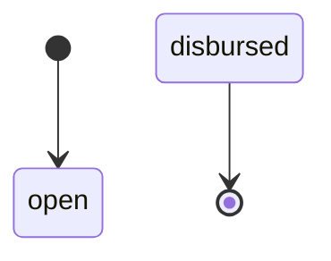
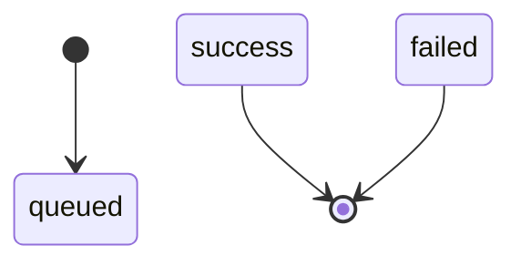
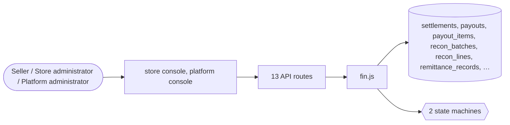

# Settlements and payouts

> Generated from `_registry/business-domains.json`, the code and `docs/source/settlement.md` — edit those, then run `node scripts/domain-docs.js`.

## Overview

Paying those who are owed: seller settlements, payout batches, bank payouts, reconciliation of what the bank says against what the ledger says, and remittances.

**Foundation domain:** Value · **Used by:** Seller, Store administrator, Platform administrator

## Switches and settings

Each is switched on per store under ⚙️ Capabilities; its parameters are that store's settings.

### Bank payouts (`bank_payouts`)

Queue a payout to a bank account or VPA and process it through the configured gateway.

| Setting | Meaning | Default |
|---|---|---|
| `default_status` | Initial status of a queued payout | `"queued"` |

## Architecture

| Module | What it is |
|---|---|
| `lib/fin.js` | Payments & Financial services. Multi-gateway payment retry, chargeback / dispute lifecycle, batch payout runs to sellers, bank-feed reconciliation, and FX-aware ledger reads. Built on the existing payments / settlements / wallet_entries ledger so every financial movement is a single source of truth. All configuration (dispute states, payout kinds, recon sources, billing meters) lives in meta_lists — add new states or meter kinds from Data Studio with zero code. |

**Registry lists** (editable in Data Studio): `finPayoutStatuses`

## Data model

### `settlements`

| Column | Type |
|---|---|
| `id` | INTEGER PRIMARY KEY AUTOINCREMENT |
| `tenant_id` | INTEGER NOT NULL |
| `ref` | TEXT NOT NULL UNIQUE |
| `seller_id` | INTEGER |
| `order_id` | INTEGER |
| `gross` | REAL |
| `commission` | REAL |
| `net` | REAL |
| `status` | TEXT DEFAULT 'pending' |
| `period` | TEXT |

### `payouts`

| Column | Type |
|---|---|
| `id` | INTEGER PRIMARY KEY AUTOINCREMENT |
| `tenant_id` | INTEGER NOT NULL |
| `seller_id` | INTEGER |
| `kind` | TEXT NOT NULL DEFAULT 'seller' |
| `ref` | TEXT |
| `period` | TEXT |
| `gross` | REAL NOT NULL DEFAULT 0 |
| `fee` | REAL NOT NULL DEFAULT 0 |
| `net` | REAL NOT NULL DEFAULT 0 |
| `currency` | TEXT DEFAULT 'USD' |
| `status` | TEXT NOT NULL DEFAULT 'open' |
| `disbursed_at` | TEXT |
| `note` | TEXT DEFAULT '' |
| `created_at` | TEXT NOT NULL DEFAULT (datetime('now')) |

### `payout_items`

| Column | Type |
|---|---|
| `id` | INTEGER PRIMARY KEY AUTOINCREMENT |
| `payout_id` | INTEGER NOT NULL |
| `tenant_id` | INTEGER NOT NULL |
| `ref` | TEXT NOT NULL |
| `kind` | TEXT |
| `description` | TEXT |
| `amount` | REAL |
| `currency` | TEXT |
| `settled` | INTEGER DEFAULT 0 |

### `recon_batches`

| Column | Type |
|---|---|
| `id` | INTEGER PRIMARY KEY AUTOINCREMENT |
| `tenant_id` | INTEGER NOT NULL |
| `period` | TEXT |
| `gateway` | TEXT |
| `source` | TEXT |
| `lines` | INTEGER DEFAULT 0 |
| `matched` | INTEGER DEFAULT 0 |
| `unmatched` | INTEGER DEFAULT 0 |
| `total` | REAL DEFAULT 0 |
| `status` | TEXT NOT NULL DEFAULT 'open' |
| `created_at` | TEXT NOT NULL DEFAULT (datetime('now')) |

### `recon_lines`

| Column | Type |
|---|---|
| `id` | INTEGER PRIMARY KEY AUTOINCREMENT |
| `batch_id` | INTEGER NOT NULL |
| `tenant_id` | INTEGER NOT NULL |
| `ref` | TEXT |
| `source` | TEXT |
| `amount` | REAL |
| `status` | TEXT NOT NULL DEFAULT 'matched' |
| `note` | TEXT |
| `created_at` | TEXT NOT NULL DEFAULT (datetime('now')) |

### `remittance_records`

| Column | Type |
|---|---|
| `id` | INTEGER PRIMARY KEY AUTOINCREMENT |
| `tenant_id` | INTEGER NOT NULL |
| `period` | TEXT NOT NULL |
| `jurisdiction` | TEXT NOT NULL |
| `tax_type` | TEXT DEFAULT 'vat' |
| `taxable` | REAL DEFAULT 0 |
| `tax_collected` | REAL DEFAULT 0 |
| `currency` | TEXT DEFAULT 'USD' |
| `status` | TEXT NOT NULL DEFAULT 'pending' |
| `filed_at` | TEXT |
| `reference` | TEXT DEFAULT '' |
| `created_at` | TEXT NOT NULL DEFAULT (datetime('now')) |
| `deleted_at` | TEXT |
| `uid` | TEXT |

### `bank_payouts`

| Column | Type |
|---|---|
| `id` | INTEGER PRIMARY KEY AUTOINCREMENT |
| `tenant_id` | INTEGER NOT NULL |
| `ref` | TEXT |
| `payee` | TEXT |
| `amount` | REAL NOT NULL |
| `currency` | TEXT |
| `account_name` | TEXT |
| `account_number` | TEXT |
| `ifsc` | TEXT |
| `upi_vpa` | TEXT |
| `gateway` | TEXT |
| `status` | TEXT NOT NULL DEFAULT 'queued' |
| `txn_ref` | TEXT |
| `failure_reason` | TEXT |
| `created_at` | TEXT NOT NULL DEFAULT (datetime('now')) |

## API reference

Every call is JSON over HTTPS; store calls carry the store (`?store=`) and the session; mutating calls accept an `Idempotency-Key` header where noted.

| Method and path | Handler | What it does |
|---|---|---|
| `POST /api/fintech/payouts` | `apiFinPayoutQueue` | — |
| `POST /api/fintech/payouts/:id/process` | `apiFinPayoutProcess` | — |
| `GET /api/admin/fin/disputes` | `apiFinDisputes` | ---- Payments & Financial services (disputes · retries · payouts · reconciliation · FX ledger) ---- |
| `POST /api/admin/fin/disputes` | `apiFinDisputeOpen` | — |
| `PUT /api/admin/fin/disputes/:id` | `apiFinDisputeStatus` | — |
| `POST /api/admin/fin/payments/:id/retry` | `apiFinRetry` | — |
| `GET /api/admin/fin/payouts` | `apiFinPayouts` | — |
| `POST /api/admin/fin/payouts` | `apiFinPayoutOpen` | — |
| `POST /api/admin/fin/payouts/:id/disburse` | `apiFinPayoutDisburse` | — |
| `POST /api/admin/fin/reconcile` | `apiFinReconcile` | — |
| `GET /api/admin/fin/ledger` | `apiFinLedger` | a caller reads their OWN ledger; naming another owner (?owner=) is a staff action — a guest could read any customer's or seller's wallet history |
| `GET /api/admin/settlements` | `apiAdminSettlements` | — |
| `POST /api/admin/settlements/generate` | `apiAdminSettlementGenerate` | — |

## Process flows

Each record's life is a declared state machine (`lib/seed/states.json`): the moves it may make, and the actions that make them.

### Seller payout run (`seller_payout`)

Actions: 

### Bank payout (`bank_payout`)

Actions: 

## Data flow

## User interface

**Store console:** 🤝 Settlements · 💰 Disputes & Payouts · 💸 Fintech Ops

**Platform console:** 💸 Finance · Payments

## User flows

_Not yet written — `docs/source/settlement.md`, section `## Flows`._

## Manuals

### Seller

_Not yet written — `docs/source/settlement.md`, section `## Manual: seller`._

### Store administrator

_Not yet written — `docs/source/settlement.md`, section `## Manual: store_admin`._

### Platform administrator

_Not yet written — `docs/source/settlement.md`, section `## Manual: platform_admin`._

