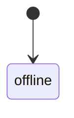
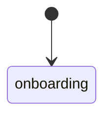
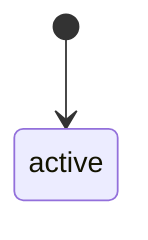
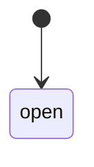
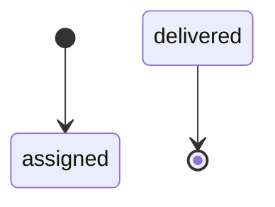
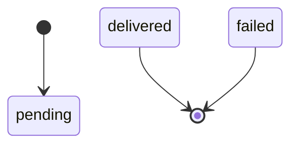
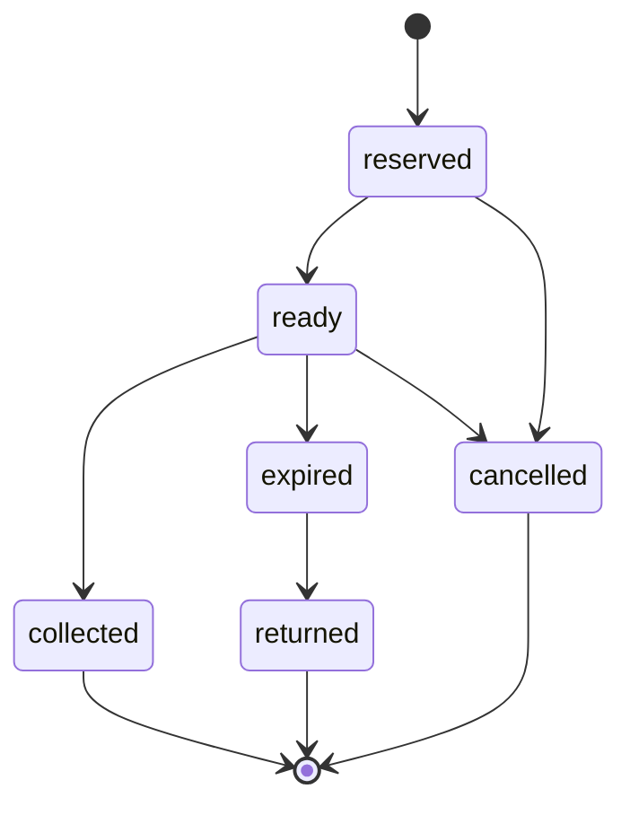
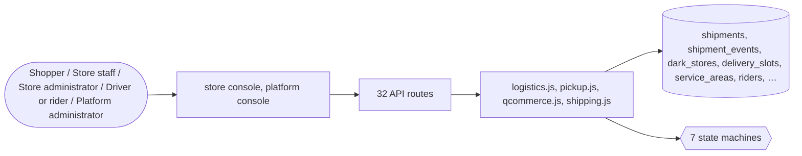

# Shipping and delivery

> Generated from `_registry/business-domains.json`, the code and `docs/source/shipping.md` — edit those, then run `node scripts/domain-docs.js`.

## Overview

Getting goods to the buyer: carriers and rates, shipments and tracking, pickup points and lockers, and fast local delivery from dark stores with slots, riders and dispatch runs.

**Foundation domain:** Commerce · **Used by:** Shopper, Store staff, Store administrator, Driver or rider, Platform administrator

## Switches and settings

Each is switched on per store under ⚙️ Capabilities; its parameters are that store's settings.

### Instant / quick-commerce delivery (`instant_delivery`)

Dark stores, serviceability, delivery slots and proof-of-delivery OTP. The promise is the store's own advertised minutes plus prep time.

| Setting | Meaning | Default |
|---|---|---|
| `default_promise_minutes` | Promise minutes a store advertises when unset | `10` |
| `default_prep_minutes` | Prep minutes added to every promise | `4` |
| `default_radius_km` | Service radius for geo resolution when unset | `3` |
| `promise_includes_prep` | The shown promise is store minutes + prep | `true` |
| `otp_length` | Digits in a proof-of-delivery OTP | `6` |

### Dispatch batching & PoD (`dispatch_batching`)

Batch orders onto one rider for one slot and close delivery with an OTP handshake.

| Setting | Meaning | Default |
|---|---|---|
| `release_slot_on_delivery` | Return the slot seat when the run closes | `true` |
| `rider_goes_online_after` | A rider returns to online after delivering | `true` |

### Pickup points & lockers (`pickup_points`)

Shoppers choose a locker, counter or store at checkout instead of a home address and collect with a one-time code. The kinds of point are pickupKinds rows; holding time, fee and code length are tuned here.

| Setting | Meaning | Default |
|---|---|---|
| `fee` | Pickup fee (store base currency) | `0` |
| `free_shipping_applies` | Free-shipping rules also waive the pickup fee | `true` |
| `hold_days` | Days a parcel waits once it is ready | `7` |
| `code_length` | Digits in a pickup code | `6` |
| `max_attempts` | Wrong codes before a parcel locks | `5` |
| `default_eta_days` | Days to reach a point that sets none | `3` |
| `email_on_ready` | Email the shopper when the parcel is ready | `true` |
| `notify_kind` | Notification kind sent when a parcel is ready | `"pickup_ready"` |

## Architecture

| Module | What it is |
|---|---|
| `lib/logistics.js` | Logistics & Supply-Chain. Fulfilment state machine, shipment tracking events, 3PL carrier abstraction (reuses the declarative provider_defs.kind=shipping specs + lib/connect.js, no per-carrier code), multi-warehouse routing, and return disposition. All configuration lives in meta_lists so new 3PLs, fulfilment states, or SLA tiers are added from Data Studio with zero code. |
| `lib/pickup.js` | Pickup points & lockers. A store runs any number of pickup points — lockers, staffed counters, its own shops; the kinds are pickupKinds registry rows. At checkout a shopper may choose a point instead of a home address: the order is reserved a place there and given a one-time code. Staff mark the parcel arrived (the shopper is told), the shopper collects with the code, and a parcel left past its holding time expires and goes back. Every step is the pickup state machine, asked by tag (holding, collectable, expirable…) and never by a state's name; the fee, holding days, code length and lock-out are the pickup_points capability's params. |
| `lib/qcommerce.js` | Quick-commerce engine. Dark stores, delivery slots, pincode serviceability, store-inventory pinning, a delivery-promise engine, rider dispatch batching and proof-of-delivery. |
| `lib/shipping.js` | Shipping: live carrier rates, labels and tracking. A per-store parcel ledger (package_tracking) plus one live carrier integration through EasyPost, which fronts USPS, UPS, FedEx, DHL and ~100 others with one API: rate a parcel, buy the chosen rate's label, and receive signed tracker webhooks. Credentials live sealed on the platform's shipping_providers row (configured by a platform admin); with no active provider, quote/label still say so (501) rather than inventing data. |

**Registry lists** (editable in Data Studio): `qcStoreKinds`, `qcStoreStatuses`, `qcSlotStatuses`, `qcAreaStatuses`, `qcVehicles`, `qcRiderStatuses`, `qcDispatchStatuses`, `qcDeliveryKinds`, `pickupKinds`, `pickupStatuses`

## Data model

### `shipments`

| Column | Type |
|---|---|
| `id` | INTEGER PRIMARY KEY AUTOINCREMENT |
| `tenant_id` | INTEGER NOT NULL |
| `order_id` | INTEGER |
| `tracking_ref` | TEXT UNIQUE |
| `carrier` | TEXT |
| `warehouse_id` | INTEGER |
| `status` | TEXT NOT NULL DEFAULT 'pending' |
| `sla_due` | TEXT |
| `dispatched_at` | TEXT |
| `delivered_at` | TEXT |
| `meta` | TEXT DEFAULT '{}' |
| `created_at` | TEXT NOT NULL DEFAULT (datetime('now')) |

### `shipment_events`

| Column | Type |
|---|---|
| `id` | INTEGER PRIMARY KEY AUTOINCREMENT |
| `shipment_id` | INTEGER NOT NULL |
| `tenant_id` | INTEGER NOT NULL |
| `status` | TEXT NOT NULL |
| `location` | TEXT |
| `note` | TEXT |
| `ref` | TEXT |
| `actor` | TEXT |
| `at` | TEXT NOT NULL DEFAULT (datetime('now')) |

### `dark_stores`

| Column | Type |
|---|---|
| `id` | INTEGER PRIMARY KEY AUTOINCREMENT |
| `tenant_id` | INTEGER NOT NULL |
| `uid` | TEXT |
| `code` | TEXT |
| `name` | TEXT NOT NULL |
| `kind` | TEXT NOT NULL DEFAULT 'dark_store' |
| `address` | TEXT |
| `city` | TEXT |
| `region` | TEXT |
| `pincode` | TEXT |
| `country` | TEXT |
| `lat` | REAL |
| `lng` | REAL |
| `service_radius_km` | REAL DEFAULT 3.0 |
| `promise_minutes` | INTEGER DEFAULT 10 |
| `prep_minutes` | INTEGER DEFAULT 4 |
| `min_order` | REAL DEFAULT 0 |
| `delivery_fee` | REAL DEFAULT 0 |
| `service_pincodes` | TEXT DEFAULT '[]' |
| `service_days` | TEXT DEFAULT '[]' |
| `status` | TEXT NOT NULL DEFAULT 'active' |
| `deleted_at` | TEXT |
| `created_at` | TEXT NOT NULL DEFAULT (datetime('now')) |

### `delivery_slots`

| Column | Type |
|---|---|
| `id` | INTEGER PRIMARY KEY AUTOINCREMENT |
| `tenant_id` | INTEGER NOT NULL |
| `store_id` | INTEGER |
| `day_offset` | INTEGER DEFAULT 0 |
| `window_start` | TEXT NOT NULL |
| `window_end` | TEXT NOT NULL |
| `capacity` | INTEGER DEFAULT 20 |
| `booked` | INTEGER DEFAULT 0 |
| `cutoff_minutes` | INTEGER DEFAULT 0 |
| `fee` | REAL DEFAULT 0 |
| `promise_minutes` | INTEGER |
| `status` | TEXT NOT NULL DEFAULT 'open' |
| `deleted_at` | TEXT |
| `created_at` | TEXT NOT NULL DEFAULT (datetime('now')) |

### `service_areas`

| Column | Type |
|---|---|
| `id` | INTEGER PRIMARY KEY AUTOINCREMENT |
| `tenant_id` | INTEGER NOT NULL |
| `store_id` | INTEGER |
| `pincode` | TEXT NOT NULL |
| `area_name` | TEXT |
| `serviceable` | INTEGER DEFAULT 1 |
| `eta_minutes` | INTEGER DEFAULT 10 |
| `fee` | REAL DEFAULT 0 |
| `min_order` | REAL DEFAULT 0 |
| `cod_available` | INTEGER DEFAULT 1 |
| `status` | TEXT NOT NULL DEFAULT 'active' |
| `deleted_at` | TEXT |
| `created_at` | TEXT NOT NULL DEFAULT (datetime('now')) |

### `riders`

| Column | Type |
|---|---|
| `id` | INTEGER PRIMARY KEY AUTOINCREMENT |
| `tenant_id` | INTEGER NOT NULL |
| `uid` | TEXT |
| `name` | TEXT NOT NULL |
| `phone` | TEXT |
| `vehicle` | TEXT |
| `store_id` | INTEGER |
| `city` | TEXT |
| `status` | TEXT NOT NULL DEFAULT 'offline' |
| `shift_start` | TEXT |
| `shift_end` | TEXT |
| `rating` | REAL |
| `deliveries` | INTEGER DEFAULT 0 |
| `deleted_at` | TEXT |
| `created_at` | TEXT NOT NULL DEFAULT (datetime('now')) |

### `dispatch_runs`

| Column | Type |
|---|---|
| `id` | INTEGER PRIMARY KEY AUTOINCREMENT |
| `tenant_id` | INTEGER NOT NULL |
| `ref` | TEXT |
| `store_id` | INTEGER |
| `slot_id` | INTEGER |
| `rider_id` | INTEGER |
| `order_ids` | TEXT DEFAULT '[]' |
| `status` | TEXT NOT NULL DEFAULT 'assigned' |
| `batch_count` | INTEGER DEFAULT 0 |
| `pod_otp` | TEXT |
| `pod_at` | TEXT |
| `notes` | TEXT |
| `created_at` | TEXT NOT NULL DEFAULT (datetime('now')) |

### `pickup_points`

| Column | Type |
|---|---|
| `id` | INTEGER PRIMARY KEY AUTOINCREMENT |
| `tenant_id` | INTEGER NOT NULL |
| `code` | TEXT NOT NULL |
| `name` | TEXT NOT NULL |
| `kind` | TEXT NOT NULL |
| `address` | TEXT NOT NULL |
| `city` | TEXT DEFAULT '' |
| `region` | TEXT DEFAULT '' |
| `postcode` | TEXT DEFAULT '' |
| `lat` | REAL |
| `lng` | REAL |
| `capacity` | INTEGER NOT NULL DEFAULT 0 |
| `hours` | TEXT DEFAULT '' |
| `eta_days` | INTEGER |
| `active` | INTEGER NOT NULL DEFAULT 1 |
| `created_at` | TEXT NOT NULL DEFAULT (datetime('now')) |

### `pickup_reservations`

| Column | Type |
|---|---|
| `id` | INTEGER PRIMARY KEY AUTOINCREMENT |
| `tenant_id` | INTEGER NOT NULL |
| `point_id` | INTEGER NOT NULL |
| `order_id` | INTEGER NOT NULL |
| `owner` | TEXT NOT NULL |
| `code` | TEXT NOT NULL |
| `status` | TEXT NOT NULL DEFAULT 'reserved' |
| `hold_until` | TEXT |
| `ready_at` | TEXT |
| `collected_at` | TEXT |
| `closed_at` | TEXT |
| `attempts` | INTEGER NOT NULL DEFAULT 0 |
| `created_at` | TEXT NOT NULL DEFAULT (datetime('now')) |

### `shipping_providers`

| Column | Type |
|---|---|
| `id` | INTEGER PRIMARY KEY AUTOINCREMENT |
| `provider_id` | TEXT UNIQUE |
| `name` | TEXT |
| `carrier_type` | TEXT DEFAULT 'api' |
| `status` | TEXT DEFAULT 'inactive' |
| `config` | TEXT DEFAULT '{}' |
| `enabled_countries` | TEXT DEFAULT '[]' |
| `services` | TEXT DEFAULT '[]' |
| `created_at` | TEXT DEFAULT (datetime('now')) |
| `uid` | TEXT |

### `package_tracking`

| Column | Type |
|---|---|
| `id` | INTEGER PRIMARY KEY AUTOINCREMENT |
| `order_id` | INTEGER REFERENCES orders(id) |
| `order_num` | TEXT |
| `tracking_number` | TEXT UNIQUE |
| `provider_id` | TEXT |
| `carrier_type` | TEXT DEFAULT 'api' |
| `status` | TEXT DEFAULT 'pending' |
| `origin_address` | TEXT DEFAULT '{}' |
| `destination_address` | TEXT DEFAULT '{}' |
| `package_weight` | REAL |
| `package_dimensions` | TEXT DEFAULT '{}' |
| `service_type` | TEXT |
| `estimated_delivery` | TEXT |
| `events` | TEXT DEFAULT '[]' |
| `current_location` | TEXT DEFAULT '{}' |
| `created_at` | TEXT DEFAULT (datetime('now')) |
| `updated_at` | TEXT DEFAULT (datetime('now')) |
| `uid` | TEXT |
| `tenant_id` | INTEGER |
| `label_url` | TEXT |

### `shipping_quotes`

| Column | Type |
|---|---|
| `id` | INTEGER PRIMARY KEY AUTOINCREMENT |
| `order_id` | INTEGER REFERENCES orders(id) |
| `tracking_id` | INTEGER REFERENCES package_tracking(id) |
| `provider_id` | TEXT |
| `service_type` | TEXT |
| `price` | REAL |
| `currency` | TEXT DEFAULT 'USD' |
| `transit_days` | INTEGER |
| `guaranteed_delivery` | TEXT |
| `status` | TEXT DEFAULT 'pending' |
| `created_at` | TEXT DEFAULT (datetime('now')) |
| `uid` | TEXT |
| `tenant_id` | INTEGER |
| `shipment_ref` | TEXT |
| `rate_ref` | TEXT |
| `carrier` | TEXT |

## API reference

Every call is JSON over HTTPS; store calls carry the store (`?store=`) and the session; mutating calls accept an `Idempotency-Key` header where noted.

| Method and path | Handler | What it does |
|---|---|---|
| `GET /api/qc/promise` | `apiQcPromise` | ---------- Quick-commerce ---------- |
| `GET /api/qc/stores` | `apiQcStores` | — |
| `GET /api/qc/slots` | `apiQcSlots` | — |
| `POST /api/qc/pin` | `apiQcPin` | pinning reserves dark-store stock, so it only ever reserves what is in the CALLER'S cart, in whole positive quantities within the cart limit — it used to reserve any product, any quantity (including negative), for an anonymous caller, as often as it was called |
| `POST /api/qc/reserve` | `apiQcReserve` | — |
| `GET /api/qc/runs` | `apiQcRuns` | dispatch runs carry the proof-of-delivery OTP — the code the rider collects from the customer. Listing them publicly let anyone read the code and mark any run delivered. |
| `POST /api/qc/runs` | `apiQcRunCreate` | — |
| `POST /api/qc/runs/:id` | `apiQcRunTransition` | — |
| `POST /api/qc/runs/:id/pod` | `apiQcPod` | — |
| `GET /api/qc/riders` | `apiQcRiders` | — |
| `GET /api/pickup/points` | `apiPickupPoints` | pickup points the shopper may choose at checkout, with what choosing one costs |
| `GET /api/admin/pickup` | `apiAdminPickup` | — |
| `POST /api/admin/pickup/points` | `apiAdminPickupSave` | — |
| `DELETE /api/admin/pickup/points/:id` | `apiAdminPickupDelete` | — |
| `POST /api/admin/pickup/reservations/:id` | `apiAdminPickupAct` | — |
| `POST /api/admin/pickup/sweep` | `apiAdminPickupSweep` | — |
| `POST /api/zip` | `apiZip` | — |
| `GET /api/shipments` | `apiShipments` | ---- Logistics & Supply-chain (fulfilment · tracking · 3PL · returns) ---- |
| `GET /api/shipments/:id` | `apiShipment` | — |
| `POST /api/admin/shipments` | `apiShipmentCreate` | — |
| `PUT /api/admin/shipments/:id/status` | `apiShipmentStatus` | — |
| `GET /api/carriers` | `apiCarriers` | — |
| `GET /api/shipping/providers` | `apiShippingProviders` | carrier provider rows are platform-wide and hold credentials: listing is staff-only and never returns the config; configuring is a platform write. Tracking is per store. |
| `POST /api/shipping/providers/config` | `apiShippingProviderConfig` | — |
| `GET /api/platform/shipping/providers` | `apiPlatformShippingProviders` | the platform console's carrier accounts: every row, which keys are on file, and the public webhook address when one is configured (the console falls back to its own origin) |
| `POST /api/platform/shipping/providers/:id/disconnect` | `apiPlatformShippingDisconnect` | — |
| `POST /api/shipping/track` | `apiShippingTrack` | — |
| `GET /api/shipping/track/:trackingNumber` | `apiShippingTrackGet` | staff, or the customer whose order the parcel ships |
| `POST /api/shipping/quote` | `apiShippingQuote` | staff rate a parcel: origin is the store's ship-from address (settings commerce.shipFrom) unless the request names one; the destination is the order's own shipping address when an order is given |
| `POST /api/shipping/label` | `apiShippingLabel` | — |
| `GET /api/shipping/orders/:id/labels` | `apiShippingOrderLabels` | the labels already bought for an order, so the console offers them instead of a second purchase |
| `POST /api/shipping/webhook/:provider` | `apiShippingWebhook` | carrier tracking webhooks: signature first, then the parcel advances |

## Process flows

Each record's life is a declared state machine (`lib/seed/states.json`): the moves it may make, and the actions that make them.

### Delivery rider (`rider`)

Actions: 

### Dark store (`dark_store`)

Actions: 

### Service area (`service_area`)

Actions: 

### Delivery slot (`delivery_slot`)

Actions: 

### Quick-commerce dispatch (`dispatch_run`)

Actions: 

### Shipment (`shipment`)

Actions: 

### Pickup reservation (`pickup`)

Actions: `arrive` → ready · `collect` → collected · `expire` → expired · `return` → returned · `cancel` → cancelled

## Data flow

## User interface

**Store console:** 📮 Shipping & Tracking · 📍 Pickup Points · 🚚 Logistics & Fulfilment · ⚡ Quick-commerce

**Platform console:** 📦 Fulfilment · 📦 FBA Inbound · 🚚 Logistics · 🚛 Transportation · 📮 Shipping · 📍 Tracking · ↩️ Reverse Logistics

## User flows

_Not yet written — `docs/source/shipping.md`, section `## Flows`._

## Manuals

### Shopper

_Not yet written — `docs/source/shipping.md`, section `## Manual: shopper`._

### Store staff

_Not yet written — `docs/source/shipping.md`, section `## Manual: store_staff`._

### Store administrator

_Not yet written — `docs/source/shipping.md`, section `## Manual: store_admin`._

### Driver or rider

_Not yet written — `docs/source/shipping.md`, section `## Manual: driver`._

### Platform administrator

_Not yet written — `docs/source/shipping.md`, section `## Manual: platform_admin`._

