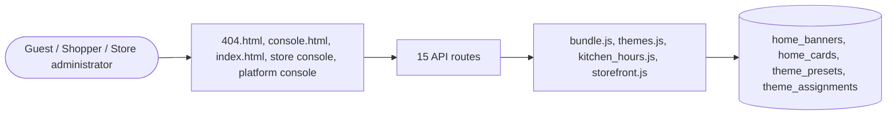

# Storefront and content

> Generated from `_registry/business-domains.json`, the code and `docs/source/storefront.md` — edit those, then run `node scripts/domain-docs.js`.

## Overview

What a shopper sees: the home page's banners and cards, themes and their assignment, and the pages and their layout.

**Foundation domain:** Experience · **Used by:** Guest, Shopper, Store administrator

## Switches and settings

Each is switched on per store under ⚙️ Capabilities; its parameters are that store's settings.

### Kitchen hours (`kitchen_hours`)

When food can be ordered, by the store's own clock.

## Architecture

| Module | What it is |
|---|---|
| `lib/bundle.js` | console bundles, served pre-wrapped. The unified console (public/js/console.js) drives the store and platform consoles' views without letting either bundle's top-level globals reach window. It used to fetch the bundle's source and compile it with new Function — which needs CSP 'unsafe-eval', so a real browser refused it. The server now does the wrapping: the bundle is served as an ordinary same-origin script that registers one factory on window.__lxBundle; the console calls it with its capture object as `this`. |
| `lib/themes.js` | LUXORA · universal theme engine — every skin the storefront can wear. -------------------------------------------------------------------------- Themes are DATA. A theme is a set of CSS custom properties stored in `theme_presets`; an operator creates one with a single INSERT and it is live — no code, no deploy, no limit. That is the "infinitely expandable" part, and it is the only honest way to do it: a hardcoded theme gallery is finite by construction, a registry is not. |
| `lib/features/kitchen_hours.js` | kitchen hours: when food can be ordered, by the store's own clock; outside them it cannot |
| `lib/routes/storefront.js` | storefront domain routes (moved from lib/api.js; _registry/business-domains.json). Each handler answers one route of the storefront domain. What it needs from the shared HTTP kit (lib/api.js) is passed in as `kit`. |

## Data model

### `home_banners`

| Column | Type |
|---|---|
| `id` | INTEGER PRIMARY KEY AUTOINCREMENT |
| `tenant_id` | INTEGER NOT NULL DEFAULT 1 |
| `title` | TEXT NOT NULL |
| `subtitle` | TEXT |
| `cta` | TEXT |
| `hue` | INTEGER DEFAULT 210 |
| `dept` | TEXT DEFAULT '' |
| `active` | INTEGER NOT NULL DEFAULT 1 |
| `position` | INTEGER NOT NULL DEFAULT 0 |
| `deleted_at` | TEXT |
| `uid` | TEXT |

### `home_cards`

| Column | Type |
|---|---|
| `id` | INTEGER PRIMARY KEY AUTOINCREMENT |
| `tenant_id` | INTEGER NOT NULL DEFAULT 1 |
| `title` | TEXT NOT NULL |
| `dept` | TEXT NOT NULL |
| `tiles` | TEXT DEFAULT '[]' |
| `active` | INTEGER NOT NULL DEFAULT 1 |
| `position` | INTEGER NOT NULL DEFAULT 0 |
| `deleted_at` | TEXT |
| `uid` | TEXT |

### `theme_presets`

| Column | Type |
|---|---|
| `id` | INTEGER PRIMARY KEY AUTOINCREMENT |
| `key` | TEXT NOT NULL UNIQUE |
| `/*` | "quantum-glass" |
| `solar-flare…` | */ name TEXT NOT NULL |
| `mood` | TEXT |
| `/*` | light \| dark \| futurist \| organic… the registry's own vocabulary */ vars TEXT NOT NULL, /* the CSS custom properties, as JSON */ preview TEXT, /* a small gradient/emoji signature for the picker */ built_in INTEGER DEFAULT 0, /* shipped presets vs operator-created */ position INTEGER DEFAULT 0 ); CREATE TABLE theme_assignments ( id INTEGER PRIMARY KEY AUTOINCREMENT, scope TEXT NOT NULL, /* platform \| tenant \| dept \| product */ scope_key TEXT NOT NULL, /* tenant id / dept key / product id ("*" = any) */ theme_key TEXT NOT NULL, UNIQUE(scope, scope_key) ); CREATE INDEX ix_theme_assign_lookup ON theme_assignments(scope, scope_key); CREATE UNIQUE INDEX ux_home_banners_uid ON home_banners(uid); CREATE TRIGGER trg_home_banners_uid AFTER INSERT ON home_banners BEGIN UPDATE home_banners SET uid = lower(hex(randomblob(4))\|\|'-'\|\|hex(randomblob(2))\|\|'-4'\|\|substr(hex(randomblob(2)),2)\|\|'-'\|\|substr('89ab',abs(random())%4+1,1)\|\|substr(hex(randomblob(2)),2)\|\|'-'\|\|hex(randomblob(6))) WHERE rowid = NEW.rowid; END; CREATE UNIQUE INDEX ux_home_cards_uid ON home_cards(uid); CREATE TRIGGER trg_home_cards_uid AFTER INSERT ON home_cards BEGIN UPDATE home_cards SET uid = lower(hex(randomblob(4))\|\|'-'\|\|hex(randomblob(2))\|\|'-4'\|\|substr(hex(randomblob(2)),2)\|\|'-'\|\|substr('89ab',abs(random())%4+1,1)\|\|substr(hex(randomblob(2)),2)\|\|'-'\|\|hex(randomblob(6))) WHERE rowid = NEW.rowid; END; -- ── search · Search and discovery ──────────────────────────────────────────────────────────────── CREATE TABLE rec_pairs ( tenant_id INTEGER NOT NULL, kind TEXT NOT NULL, a TEXT NOT NULL, b TEXT NOT NULL, weight REAL NOT NULL DEFAULT 0, n INTEGER NOT NULL DEFAULT 0, at TEXT NOT NULL, PRIMARY KEY (tenant_id, kind, a, b) ); CREATE INDEX ix_rec_pairs ON rec_pairs(tenant_id, kind, a, weight); CREATE TABLE rec_items ( tenant_id INTEGER NOT NULL, kind TEXT NOT NULL, product_id TEXT NOT NULL, weight REAL NOT NULL DEFAULT 0, at TEXT NOT NULL, PRIMARY KEY (tenant_id, kind, product_id) ); CREATE INDEX ix_rec_items ON rec_items(tenant_id, kind, weight); CREATE TABLE rec_clicks ( tenant_id INTEGER NOT NULL, owner TEXT NOT NULL, product_id TEXT NOT NULL, slot TEXT NOT NULL, at TEXT NOT NULL, PRIMARY KEY (tenant_id, owner, product_id) ); CREATE TABLE rec_stats ( tenant_id INTEGER NOT NULL, day TEXT NOT NULL, slot TEXT NOT NULL, shown INTEGER NOT NULL DEFAULT 0, clicked INTEGER NOT NULL DEFAULT 0, bought INTEGER NOT NULL DEFAULT 0, revenue REAL NOT NULL DEFAULT 0, PRIMARY KEY (tenant_id, day, slot) ); CREATE TABLE rec_runs ( id INTEGER PRIMARY KEY AUTOINCREMENT, tenant_id INTEGER NOT NULL, at TEXT NOT NULL, orders INTEGER NOT NULL DEFAULT 0, pairs INTEGER NOT NULL DEFAULT 0, products INTEGER NOT NULL DEFAULT 0, ms INTEGER NOT NULL DEFAULT 0 ); CREATE INDEX ix_rec_runs ON rec_runs(tenant_id, id); -- ── seo · Search engine optimisation ───────────────────────────────────────────────────────────── CREATE TABLE sitemap_config ( id INTEGER PRIMARY KEY AUTOINCREMENT, tenant_id INTEGER DEFAULT 1, hostname TEXT, max_per_file INTEGER DEFAULT 50000, enabled INTEGER DEFAULT 1, last_generated TEXT, next_run TEXT, created_at TEXT DEFAULT (datetime('now')), updated_at TEXT DEFAULT (datetime('now')) ); CREATE TABLE sitemap_entries ( id INTEGER PRIMARY KEY AUTOINCREMENT, tenant_id INTEGER DEFAULT 1, loc TEXT UNIQUE, sitemap_type TEXT DEFAULT 'pages', priority REAL DEFAULT 0.5, changefreq TEXT DEFAULT 'monthly', lastmod TEXT, images TEXT DEFAULT '[]', languages TEXT DEFAULT '[]', created_at TEXT DEFAULT (datetime('now')), updated_at TEXT DEFAULT (datetime('now')) ); CREATE TABLE sitemap_files ( id INTEGER PRIMARY KEY AUTOINCREMENT, tenant_id INTEGER DEFAULT 1, filename TEXT UNIQUE, sitemap_type TEXT DEFAULT 'pages', entry_count INTEGER DEFAULT 0, file_size INTEGER DEFAULT 0, generated_at TEXT, status TEXT DEFAULT 'pending', created_at TEXT DEFAULT (datetime('now')), updated_at TEXT DEFAULT (datetime('now')) ); -- ── localisation · Languages and localisation ──────────────────────────────────────────────────── CREATE TABLE messages ( lang TEXT NOT NULL, key TEXT NOT NULL, text TEXT NOT NULL, PRIMARY KEY (lang, key) ); CREATE TABLE localizations ( id INTEGER PRIMARY KEY AUTOINCREMENT, tenant_id INTEGER NOT NULL, entity TEXT NOT NULL DEFAULT 'product', ref_id TEXT NOT NULL, locale TEXT NOT NULL, name TEXT DEFAULT '', description TEXT DEFAULT '', bullets TEXT DEFAULT '[]', attrs TEXT DEFAULT '{}', active INTEGER DEFAULT 1, deleted_at TEXT, uid TEXT, UNIQUE (tenant_id, entity, ref_id, locale) ); CREATE UNIQUE INDEX ux_localizations_uid ON localizations(uid); CREATE TRIGGER trg_localizations_uid AFTER INSERT ON localizations BEGIN UPDATE localizations SET uid = lower(hex(randomblob(4))\|\|'-'\|\|hex(randomblob(2))\|\|'-4'\|\|substr(hex(randomblob(2)),2)\|\|'-'\|\|substr('89ab',abs(random())%4+1,1)\|\|substr(hex(randomblob(2)),2)\|\|'-'\|\|hex(randomblob(6))) WHERE rowid = NEW.rowid; END; -- ── consoles · Consoles ────────────────────────────────────────────────────────────────────────── CREATE TABLE console_screens ( id INTEGER PRIMARY KEY AUTOINCREMENT, console TEXT NOT NULL, key TEXT NOT NULL, section TEXT, grp TEXT NOT NULL, label TEXT NOT NULL, position REAL NOT NULL DEFAULT 0, shows TEXT, access TEXT NOT NULL, fit TEXT, edited INTEGER DEFAULT 0, UNIQUE(console, key)); -- ── analytics · Analytics and reports ──────────────────────────────────────────────────────────── CREATE TABLE dashboards ( id INTEGER PRIMARY KEY AUTOINCREMENT, tenant_id INTEGER, /* NULL = platform canonical template */ key TEXT NOT NULL, name TEXT NOT NULL, type TEXT, /* §394 dashboard categories */ audience TEXT DEFAULT 'admin', /* admin \| platform \| all */ description TEXT, active INTEGER DEFAULT 1, position INTEGER DEFAULT 0, UNIQUE(tenant_id, key) ); CREATE INDEX ix_dash_lookup ON dashboards(tenant_id, active, position); CREATE TABLE dashboard_widgets ( id INTEGER PRIMARY KEY AUTOINCREMENT, dashboard_id INTEGER NOT NULL, kind TEXT, /* kpi \| table \| bar \| line \| donut \| text */ label TEXT, entity TEXT, /* any entity key the engine knows */ metric TEXT, /* count \| sum \| avg \| min \| max \| distinct */ column TEXT, /* column for sum/avg/min/max/distinct */ dimension TEXT, /* group-by column (table/bar/line/donut) */ ord TEXT DEFAULT 'desc', /* asc \| desc — ordering of the aggregate */ lim INTEGER DEFAULT 10, filter TEXT DEFAULT '{}', /* JSON {field: value} equality predicates */ position INTEGER DEFAULT 0, span INTEGER DEFAULT 3 /* grid width 1..6 (of 6) */ ); CREATE INDEX ix_widgets_dash ON dashboard_widgets(dashboard_id, position); CREATE TABLE dashboard_prefs ( id INTEGER PRIMARY KEY AUTOINCREMENT, tenant_id INTEGER, user_id INTEGER NOT NULL, dashboard_id INTEGER NOT NULL, widget_id INTEGER, hidden INTEGER DEFAULT 0, position INTEGER, UNIQUE(user_id, dashboard_id, widget_id) ); CREATE TABLE reports ( id INTEGER PRIMARY KEY AUTOINCREMENT, tenant_id INTEGER, /* NULL = platform canonical template */ key TEXT NOT NULL, name TEXT NOT NULL, kind TEXT, /* §395: scheduled \| event \| regulatory \| operational \| executive \| ai */ entity TEXT NOT NULL, metrics TEXT DEFAULT '[]', /* JSON [{metric,column,alias}] */ dimensions TEXT DEFAULT '[]', /* JSON [column] */ filter TEXT DEFAULT '{}', schedule TEXT DEFAULT 'manual', /* manual \| daily \| weekly \| monthly */ format TEXT DEFAULT 'table', /* table \| csv \| json */ active INTEGER DEFAULT 1, last_run TEXT, position INTEGER DEFAULT 0, UNIQUE(tenant_id, key) ); CREATE INDEX ix_reports_lookup ON reports(tenant_id, active, position); CREATE UNIQUE INDEX ux_reports_platform_key ON reports(key, ifnull(tenant_id, 0)); -- ── experiments · Experiments ──────────────────────────────────────────────────────────────────── CREATE TABLE experiments ( id INTEGER PRIMARY KEY AUTOINCREMENT, tenant_id INTEGER NOT NULL, key TEXT NOT NULL, name TEXT NOT NULL, variants TEXT NOT NULL DEFAULT '[]', status TEXT NOT NULL DEFAULT 'draft', metric TEXT DEFAULT 'conversion', started_at TEXT, ended_at TEXT, created_at TEXT NOT NULL DEFAULT (datetime('now')), uid TEXT, UNIQUE (tenant_id, key) ); CREATE TABLE exp_assignments ( id INTEGER PRIMARY KEY AUTOINCREMENT, experiment_id INTEGER NOT NULL, tenant_id INTEGER NOT NULL, subject TEXT NOT NULL, variant TEXT NOT NULL, at TEXT NOT NULL DEFAULT (datetime('now')), uid TEXT, UNIQUE (experiment_id, subject) ); CREATE INDEX ix_exp_assign ON exp_assignments(experiment_id, variant); CREATE TABLE exp_conversions ( id INTEGER PRIMARY KEY AUTOINCREMENT, experiment_id INTEGER NOT NULL, tenant_id INTEGER NOT NULL, variant TEXT NOT NULL, subject TEXT NOT NULL, value REAL DEFAULT 1, at TEXT NOT NULL DEFAULT (datetime('now')) , uid TEXT); CREATE INDEX ix_exp_conv ON exp_conversions(experiment_id, variant); CREATE UNIQUE INDEX ux_experiments_uid ON experiments(uid); CREATE TRIGGER trg_experiments_uid AFTER INSERT ON experiments BEGIN UPDATE experiments SET uid = lower(hex(randomblob(4))\|\|'-'\|\|hex(randomblob(2))\|\|'-4'\|\|substr(hex(randomblob(2)),2)\|\|'-'\|\|substr('89ab',abs(random())%4+1,1)\|\|substr(hex(randomblob(2)),2)\|\|'-'\|\|hex(randomblob(6))) WHERE rowid = NEW.rowid; END; CREATE UNIQUE INDEX ux_exp_assignments_uid ON exp_assignments(uid); CREATE TRIGGER trg_exp_assignments_uid AFTER INSERT ON exp_assignments BEGIN UPDATE exp_assignments SET uid = lower(hex(randomblob(4))\|\|'-'\|\|hex(randomblob(2))\|\|'-4'\|\|substr(hex(randomblob(2)),2)\|\|'-'\|\|substr('89ab',abs(random())%4+1,1)\|\|substr(hex(randomblob(2)),2)\|\|'-'\|\|hex(randomblob(6))) WHERE rowid = NEW.rowid; END; CREATE UNIQUE INDEX ux_exp_conversions_uid ON exp_conversions(uid); CREATE TRIGGER trg_exp_conversions_uid AFTER INSERT ON exp_conversions BEGIN UPDATE exp_conversions SET uid = lower(hex(randomblob(4))\|\|'-'\|\|hex(randomblob(2))\|\|'-4'\|\|substr(hex(randomblob(2)),2)\|\|'-'\|\|substr('89ab',abs(random())%4+1,1)\|\|substr(hex(randomblob(2)),2)\|\|'-'\|\|hex(randomblob(6))) WHERE rowid = NEW.rowid; END; -- ── risk · Risk and fraud ──────────────────────────────────────────────────────────────────────── CREATE TABLE risk_events ( id INTEGER PRIMARY KEY AUTOINCREMENT, tenant_id INTEGER NOT NULL, owner TEXT DEFAULT '', ip TEXT DEFAULT '', card_fp TEXT DEFAULT '', addr_fp TEXT DEFAULT '', amount REAL DEFAULT 0, score INTEGER DEFAULT 0, action TEXT NOT NULL DEFAULT 'approve', signals TEXT DEFAULT '{}', ref TEXT DEFAULT '', resolved INTEGER DEFAULT 0, resolution TEXT DEFAULT '', note TEXT DEFAULT '', resolved_at TEXT, created_at TEXT NOT NULL DEFAULT (datetime('now')) , uid TEXT); CREATE INDEX ix_risk_events ON risk_events(tenant_id, action, resolved, created_at); CREATE INDEX ix_risk_velocity ON risk_events(tenant_id, owner, created_at); CREATE TABLE risk_blocklist ( id INTEGER PRIMARY KEY AUTOINCREMENT, tenant_id INTEGER NOT NULL, kind TEXT NOT NULL, value TEXT NOT NULL, note TEXT DEFAULT '', created_at TEXT NOT NULL DEFAULT (datetime('now')), uid TEXT, UNIQUE (tenant_id, kind, value) ); CREATE UNIQUE INDEX ux_risk_events_uid ON risk_events(uid); CREATE TRIGGER trg_risk_events_uid AFTER INSERT ON risk_events BEGIN UPDATE risk_events SET uid = lower(hex(randomblob(4))\|\|'-'\|\|hex(randomblob(2))\|\|'-4'\|\|substr(hex(randomblob(2)),2)\|\|'-'\|\|substr('89ab',abs(random())%4+1,1)\|\|substr(hex(randomblob(2)),2)\|\|'-'\|\|hex(randomblob(6))) WHERE rowid = NEW.rowid; END; CREATE UNIQUE INDEX ux_risk_blocklist_uid ON risk_blocklist(uid); CREATE TRIGGER trg_risk_blocklist_uid AFTER INSERT ON risk_blocklist BEGIN UPDATE risk_blocklist SET uid = lower(hex(randomblob(4))\|\|'-'\|\|hex(randomblob(2))\|\|'-4'\|\|substr(hex(randomblob(2)),2)\|\|'-'\|\|substr('89ab',abs(random())%4+1,1)\|\|substr(hex(randomblob(2)),2)\|\|'-'\|\|hex(randomblob(6))) WHERE rowid = NEW.rowid; END; -- ── compliance · Compliance and privacy ────────────────────────────────────────────────────────── CREATE TABLE compliance_records ( id INTEGER PRIMARY KEY AUTOINCREMENT, tenant_id INTEGER NOT NULL, scope TEXT NOT NULL DEFAULT 'product', ref_id TEXT NOT NULL DEFAULT '', kind TEXT NOT NULL DEFAULT 'certificate', code TEXT DEFAULT '', issuer TEXT DEFAULT '', jurisdiction TEXT DEFAULT '', status TEXT NOT NULL DEFAULT 'valid', valid_from TEXT, valid_to TEXT, doc_media TEXT DEFAULT '', notes TEXT DEFAULT '', created_at TEXT NOT NULL DEFAULT (datetime('now')) , deleted_at TEXT, uid TEXT); CREATE TABLE compliance_controls ( id INTEGER PRIMARY KEY AUTOINCREMENT, tenant_id INTEGER, /* NULL = platform control template */ regulation TEXT NOT NULL, /* gdpr · pci-dss · … (registry key) */ control_id TEXT NOT NULL, /* the regulation's own control number */ name TEXT NOT NULL |
| `evidence` | TEXT DEFAULT '' |
| `/*` | what proves it (engine + artifact) */ status TEXT NOT NULL DEFAULT 'pending_evidence' |
| `updated_at` | TEXT |

### `theme_assignments`

| Column | Type |
|---|---|
| `id` | INTEGER PRIMARY KEY AUTOINCREMENT |
| `scope` | TEXT NOT NULL |
| `/*` | platform \| tenant \| dept \| product */ scope_key TEXT NOT NULL |
| `/*` | tenant id / dept key / product id ("*" = any) */ theme_key TEXT NOT NULL |

## API reference

Every call is JSON over HTTPS; store calls carry the store (`?store=`) and the session; mutating calls accept an `Idempotency-Key` header where noted.

| Method and path | Handler | What it does |
|---|---|---|
| `GET /api/config` | `apiConfig` | — |
| `GET /api/themes` | `apiThemes` | ---------- universal theming API ---------- Themes are data: presets are read, assigned at any scope, and created from any hue. Reads are open to a logged-in merchant (they need to see their own skin); writes to presets and assignments are platform-owned, because a theme dresses the store. |
| `GET /api/themes/resolve` | `apiThemeResolve` | — |
| `GET /api/themes/preview` | `apiThemePreview` | explore the generative space: any hue → a complete theme, without committing. This is the "unlimited" primitive — the gallery is finite, the hue space is not |
| `POST /api/themes/assign` | `apiThemeAssign` | — |
| `POST /api/themes/unassign` | `apiThemeUnassign` | — |
| `POST /api/themes` | `apiThemeCreate` | name a hue-generated theme and keep it forever — the registry's growth path |
| `GET /api/admin/banners` | `apiAdminBanners` | — |
| `POST /api/admin/banners` | `apiAdminBannerSave` | — |
| `PUT /api/admin/banners/:id` | `apiAdminBannerSave` | — |
| `DELETE /api/admin/banners/:id` | `apiAdminBannerDelete` | — |
| `GET /api/admin/cards` | `apiAdminCards` | — |
| `POST /api/admin/cards` | `apiAdminCardSave` | — |
| `PUT /api/admin/cards/:id` | `apiAdminCardSave` | — |
| `DELETE /api/admin/cards/:id` | `apiAdminCardDelete` | — |

## Data flow

## User interface

**Pages:** `404.html`, `console.html`, `index.html`

**Store console:** ◈ Dashboard · 🖼️ Home Content

**Platform console:** 📚 Catalogs · 💲 Pricing · 📊 Dynamic Pricing · 📋 Price Lists · 🛍️ Merchandising · 🌐 Websites · 📱 Mobile Apps · 🛎️ Kiosks · POS · 🚪 Portals · 🖼️ Content · UGC · 🎨 Themes · 🖌️ Branding · 🎯 Personalization · ♿ Accessibility · 🧩 UI Components · 📡 Channels · 🔔 Notifications · ✉️ Email · 📱 Social

## User flows

_Not yet written — `docs/source/storefront.md`, section `## Flows`._

## Manuals

### Guest

_Not yet written — `docs/source/storefront.md`, section `## Manual: guest`._

### Shopper

_Not yet written — `docs/source/storefront.md`, section `## Manual: shopper`._

### Store administrator

_Not yet written — `docs/source/storefront.md`, section `## Manual: store_admin`._

