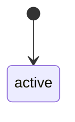
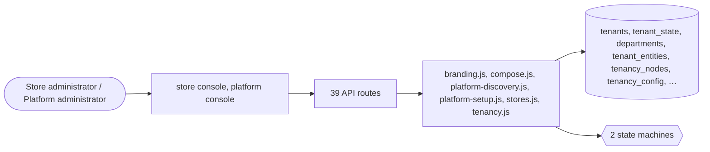

# Stores and organisation

> Generated from `_registry/business-domains.json`, the code and `docs/source/stores.md` — edit those, then run `node scripts/domain-docs.js`.

## Overview

The stores on the platform and how each is organised: creating and configuring a store from its setup answers, its departments and org units, its tenancy tree and its look.

**Foundation domain:** Party · **Used by:** Store administrator, Platform administrator

## Architecture

| Module | What it is |
|---|---|
| `lib/branding.js` | Branding System - Platform & Store Hierarchy |
| `lib/compose.js` | ════════════════════════════════════════════════════════════════════════════ UCOS Ω∞ — THE COMPOSITION ENGINE Application = Capability Composition. NOT Application = Custom Code. ════════════════════════════════════════════════════════════════════════════ |
| `lib/platform-discovery.js` | discovery: the capabilities a platform needs, derived from what it answered at setup (GLOBAL_MASTER.md §4, roadmap P29; owner Package). |
| `lib/platform-setup.js` | configuring a platform by its setup steps (GLOBAL_MASTER.md §4, roadmap P29; owner Package). |
| `lib/stores.js` | stores on the kernel (P09, owners Party and Relationship). |
| `lib/tenancy.js` | universal tenancy hierarchy Platform → Tenant → Organization → Business Unit → Brand → Store → Channel. Every node is one row; the materialized `path` makes subtree queries a LIKE away, mirroring GOIP's hierarchy paths (earth.in.bihar.patna) so operators think one way. The hierarchy is also the *config cascade*: a setting resolved at a Store inherits from Store → Brand → Business Unit → Organization → Tenant → Platform, deepest wins. |

## Data model

### `tenants`

| Column | Type |
|---|---|
| `id` | INTEGER PRIMARY KEY AUTOINCREMENT |
| `slug` | TEXT NOT NULL UNIQUE |
| `name` | TEXT NOT NULL |
| `domain` | TEXT DEFAULT '' |
| `status` | TEXT NOT NULL DEFAULT 'active' |
| `created_at` | TEXT NOT NULL DEFAULT (datetime('now')) |
| `mode` | TEXT NOT NULL DEFAULT 'marketplace' |
| `industries` | TEXT DEFAULT '[]' |
| `profile` | TEXT DEFAULT '{}' |
| `region` | TEXT DEFAULT 'global' |
| `sso_provider` | TEXT DEFAULT '' |
| `cdn` | TEXT DEFAULT '' |
| `uid` | TEXT |

### `tenant_state`

| Column | Type |
|---|---|
| `sid` | TEXT NOT NULL |
| `tenant_id` | INTEGER NOT NULL |
| `zip` | TEXT NOT NULL DEFAULT '98109' |
| `gift_balance` | REAL NOT NULL DEFAULT 0 |
| `coupon` | TEXT DEFAULT '' |
| `uid` | TEXT |

### `departments`

| Column | Type |
|---|---|
| `tenant_id` | INTEGER NOT NULL DEFAULT 1 |
| `key` | TEXT NOT NULL |
| `label` | TEXT NOT NULL |
| `icon` | TEXT DEFAULT '🏷️' |
| `active` | INTEGER NOT NULL DEFAULT 1 |
| `position` | INTEGER NOT NULL DEFAULT 0 |
| `deleted_at` | TEXT |
| `uid` | TEXT |

### `tenant_entities`

| Column | Type |
|---|---|
| `id` | INTEGER PRIMARY KEY AUTOINCREMENT |
| `tenant_id` | INTEGER NOT NULL |
| `entity` | TEXT NOT NULL |
| `enabled` | INTEGER NOT NULL DEFAULT 1 |
| `requirement` | TEXT NOT NULL DEFAULT 'optional' |
| `custom_name` | TEXT |
| `config` | TEXT NOT NULL DEFAULT '{}' |
| `created_at` | TEXT NOT NULL DEFAULT (datetime('now')) |

### `tenancy_nodes`

| Column | Type |
|---|---|
| `id` | INTEGER PRIMARY KEY AUTOINCREMENT |
| `tenant_id` | INTEGER NOT NULL |
| `kind` | TEXT NOT NULL |
| `/*` | organization · business_unit · brand · store · channel · … */ parent_id INTEGER |
| `/*` | NULL = the tenant root |
| `which` | is created once and immortal */ slug TEXT NOT NULL |
| `name` | TEXT NOT NULL |
| `path` | TEXT NOT NULL |
| `/*` | root.child.grandchild — UNIQUE within a tenant */ status TEXT NOT NULL DEFAULT 'active' |
| `/*` | active · suspended (a suspended node blocks creates beneath it) */ profile TEXT DEFAULT '{}' |
| `/*` | free-form JSON: addresses |
| `contacts` |  |
| `legal` | entity facts */ config TEXT DEFAULT '{}' |
| `/*` | inline config; tenancy_config rows are the typed overrides */ uid TEXT |
| `created_at` | TEXT NOT NULL DEFAULT (datetime('now')) |

### `tenancy_config`

| Column | Type |
|---|---|
| `id` | INTEGER PRIMARY KEY AUTOINCREMENT |
| `tenant_id` | INTEGER NOT NULL |
| `node_id` | INTEGER NOT NULL |
| `key` | TEXT NOT NULL |
| `value` | TEXT DEFAULT '{}' |
| `updated_at` | TEXT NOT NULL DEFAULT (datetime('now')) |

### `platform_branding`

| Column | Type |
|---|---|
| `id` | INTEGER PRIMARY KEY |
| `name` | TEXT |
| `logo` | TEXT |
| `tagline` | TEXT |
| `colors` | TEXT NOT NULL DEFAULT '{}' |
| `fonts` | TEXT NOT NULL DEFAULT '{}' |
| `updated_at` | TEXT NOT NULL DEFAULT (datetime('now')) |

### `store_branding`

| Column | Type |
|---|---|
| `tenant_id` | INTEGER PRIMARY KEY |
| `name` | TEXT |
| `logo` | TEXT |
| `tagline` | TEXT |
| `colors` | TEXT NOT NULL DEFAULT '{}' |
| `fonts` | TEXT NOT NULL DEFAULT '{}' |
| `updated_at` | TEXT NOT NULL DEFAULT (datetime('now')) |

### `store_branding_perms`

| Column | Type |
|---|---|
| `tenant_id` | INTEGER PRIMARY KEY |
| `can_change_name` | INTEGER NOT NULL DEFAULT 0 |
| `can_change_logo` | INTEGER NOT NULL DEFAULT 0 |
| `can_change_colors` | INTEGER NOT NULL DEFAULT 0 |
| `can_change_fonts` | INTEGER NOT NULL DEFAULT 0 |
| `can_change_footer` | INTEGER NOT NULL DEFAULT 0 |
| `can_change_nav` | INTEGER NOT NULL DEFAULT 0 |

## API reference

Every call is JSON over HTTPS; store calls carry the store (`?store=`) and the session; mutating calls accept an `Idempotency-Key` header where noted.

| Method and path | Handler | What it does |
|---|---|---|
| `GET /api/stores` | `apiStores` | ---------------- public config & providers ---------------- |
| `GET /api/platform/tenant-entities` | `apiTenantEntityList` | — |
| `POST /api/platform/tenant-entities` | `apiTenantEntityConfig` | — |
| `POST /api/platform/tenant-fields` | `apiTenantFieldConfig` | — |
| `GET /api/platform/fanout` | `apiPlatformFanout` | — |
| `GET /api/tenancy/tree` | `apiTenancyTree` | ---------------- tenancy hierarchy (org → BU → brand → store → channel) ---------------- Every node is data; the materialized path makes a subtree one LIKE away and the tree is the config cascade. Reads + writes are store-admin scoped to the session's own tenant, so an operator reorganises their own business and the platform sees the same shape via the generic cross-store reader. |
| `GET /api/tenancy/nodes` | `apiTenancyList` | — |
| `POST /api/tenancy/node` | `apiTenancyCreate` | — |
| `PUT /api/tenancy/node/:id` | `apiTenancyUpdate` | — |
| `DELETE /api/tenancy/node/:id` | `apiTenancyDelete` | — |
| `GET /api/tenancy/resolve/:id` | `apiTenancyResolve` | resolve one config key up the cascade (Store → Brand → BU → Org → Tenant, deepest wins); the console's inspector shows an operator exactly which node a value came from |
| `POST /api/tenancy/config/:id/:key` | `apiTenancyConfigSet` | — |
| `GET /api/compose/candidates` | `apiComposeCandidates` | ---------------- the composition engine (Application = Capability Composition) ---------------- The constitution's central claim made mechanical: compose() takes ANY declared capability and materializes its full application surface — data model, API, workflow, UI, dashboard, security — with no per-capability code. This surface is the platform's build tool: reads are open to a platform operator, and only a platform operator composes, because a composed capability becomes platform-wide machinery the moment it exists. |
| `GET /api/compose/ledger` | `apiComposeLedger` | — |
| `GET /api/compose/:key` | `apiComposeManifest` | — |
| `POST /api/compose/:key` | `apiCompose` | — |
| `POST /api/compose/:key/recompose` | `apiRecompose` | — |
| `GET /api/admin/departments` | `apiAdminDepartments` | — |
| `POST /api/admin/departments` | `apiAdminDeptSave` | — |
| `DELETE /api/admin/departments/:key` | `apiAdminDeptDelete` | — |
| `GET /api/branding` | `apiStoreBranding` | — |
| `PUT /api/branding` | `apiStoreBranding` | — |
| `GET /api/platform/branding` | `apiPlatformBranding` | ========== Branding System APIs ========== |
| `PUT /api/platform/branding` | `apiPlatformBranding` | ========== Branding System APIs ========== |
| `GET /api/platform/regions` | `apiRegionsGet` | — |
| `PUT /api/platform/regions` | `apiRegionsSet` | — |
| `GET /api/platform/tenants` | `apiPlatformTenants` | — |
| `GET /api/platform/tenants/:id/setup` | `apiPlatformTenantSetup` | Setup-wizard progress: one store, every step marked done or pending. Powers the "what's left" checklist after (or during) launch. |
| `POST /api/platform/tenants` | `apiPlatformTenantCreate` | — |
| `GET /api/platform/setup/steps` | `apiSetupSteps` | — |
| `POST /api/platform/setup/discover` | `apiSetupDiscover` | — |
| `GET /api/platform/tenants/:id/blueprint` | `apiTenantBlueprint` | — |
| `POST /api/platform/tenants/:id/blueprint` | `apiTenantBlueprint` | — |
| `POST /api/platform/tenants/:id/requests` | `apiTenantRequests` | — |
| `PUT /api/platform/tenants/:id` | `apiPlatformTenantUpdate` | — |
| `DELETE /api/platform/tenants/:id` | `apiPlatformTenantDelete` | — |
| `POST /api/platform/tenants/:id/impersonate` | `apiPlatformImpersonate` | — |
| `POST /api/platform/tenants/:id/subscribe` | `apiPlatformSubscribe` | — |
| `POST /api/platform/tenants/:id/invoice` | `apiPlatformInvoiceGenerate` | — |

## Process flows

Each record's life is a declared state machine (`lib/seed/states.json`): the moves it may make, and the actions that make them.

### Platform (tenant) (`tenant`)

Actions: 

### Org unit (`org_unit`)

Actions: 

## Data flow

## User interface

**Store console:** 🏢 Org Structure

**Platform console:** 🏬 Tenants · 🏷️ Brands · Manufacturers · 🧬 Composition Engine · 🏬 Platforms & Kinds · 🏢 Companies · 🗂️ Workspaces · 🌍 Environments · 🛡️ Provisioning

## User flows

_Not yet written — `docs/source/stores.md`, section `## Flows`._

## Manuals

### Store administrator

_Not yet written — `docs/source/stores.md`, section `## Manual: store_admin`._

### Platform administrator

_Not yet written — `docs/source/stores.md`, section `## Manual: platform_admin`._

