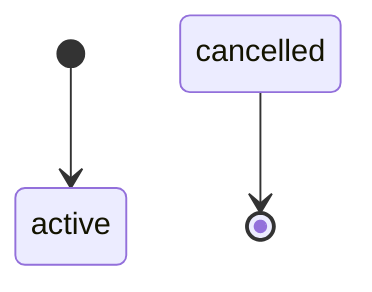
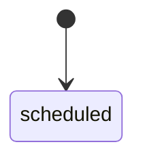
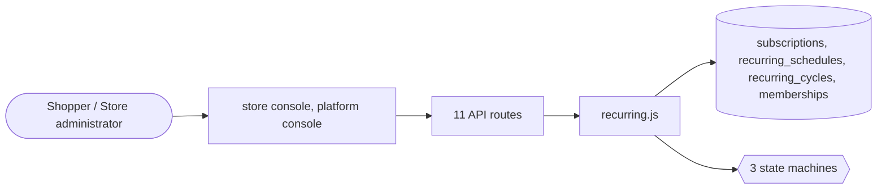

# Subscriptions and memberships

> Generated from `_registry/business-domains.json`, the code and `docs/source/subscriptions.md` — edit those, then run `node scripts/domain-docs.js`.

## Overview

Buying again on a schedule and belonging to a programme: subscribe-and-save schedules and their cycles, and membership tiers with their perks.

**Foundation domain:** Commerce · **Used by:** Shopper, Store administrator

## Switches and settings

Each is switched on per store under ⚙️ Capabilities; its parameters are that store's settings.

### Subscribe & Save (`subscribe_save`)

Recurring purchase schedules with a discount and a cadence.

| Setting | Meaning | Default |
|---|---|---|
| `discount_pct` | Default discount for a scheduled purchase | `5` |

### Membership program (`membership`)

Paid or free tiers with perks applied at checkout (free shipping, bonus credit).

| Setting | Meaning | Default |
|---|---|---|
| `bonus_pct` | Checkout bonus credit a member earns | `0` |

## Architecture

| Module | What it is |
|---|---|
| `lib/recurring.js` | Retention & recurring revenue. Subscribe & Save: customer recurring delivery schedules (frequency, next shipment, pause/skip/cancel, per-cycle ledger that mints a real order each cycle) with a subscriber discount. Membership program: paid tiers whose benefits (free shipping, early access, bonus rewards, priority support) are data in meta_lists and apply at checkout. Renewals charge through the existing payments ledger. Feature flags: settings.features.subscribeSave / membership. |

## Data model

### `subscriptions`

| Column | Type |
|---|---|
| `id` | INTEGER PRIMARY KEY AUTOINCREMENT |
| `tenant_id` | INTEGER NOT NULL REFERENCES tenants(id) |
| `plan_id` | INTEGER NOT NULL REFERENCES plans(id) |
| `status` | TEXT NOT NULL DEFAULT 'active' |
| `started_at` | TEXT NOT NULL DEFAULT (datetime('now')) |
| `renews_at` | TEXT NOT NULL DEFAULT (datetime('now','+1 month')) |
| `uid` | TEXT |

### `recurring_schedules`

| Column | Type |
|---|---|
| `id` | INTEGER PRIMARY KEY AUTOINCREMENT |
| `tenant_id` | INTEGER NOT NULL |
| `owner` | TEXT NOT NULL |
| `product_id` | TEXT NOT NULL |
| `sku_id` | INTEGER |
| `qty` | INTEGER DEFAULT 1 |
| `frequency_days` | INTEGER NOT NULL DEFAULT 30 |
| `discount_pct` | REAL DEFAULT 0 |
| `next_ship_at` | TEXT NOT NULL |
| `status` | TEXT NOT NULL DEFAULT 'active' |
| `cycles_completed` | INTEGER DEFAULT 0 |
| `created_at` | TEXT NOT NULL DEFAULT (datetime('now')) |
| `uid` | TEXT |

### `recurring_cycles`

| Column | Type |
|---|---|
| `id` | INTEGER PRIMARY KEY AUTOINCREMENT |
| `schedule_id` | INTEGER NOT NULL |
| `tenant_id` | INTEGER NOT NULL |
| `order_ref` | TEXT DEFAULT '' |
| `status` | TEXT NOT NULL DEFAULT 'scheduled' |
| `at` | TEXT NOT NULL |
| `uid` | TEXT |

### `memberships`

| Column | Type |
|---|---|
| `id` | INTEGER PRIMARY KEY AUTOINCREMENT |
| `tenant_id` | INTEGER NOT NULL |
| `owner` | TEXT NOT NULL |
| `tier` | TEXT NOT NULL |
| `status` | TEXT NOT NULL DEFAULT 'active' |
| `started_at` | TEXT NOT NULL DEFAULT (datetime('now')) |
| `renews_at` | TEXT |
| `cancelled_at` | TEXT |
| `uid` | TEXT |

## API reference

Every call is JSON over HTTPS; store calls carry the store (`?store=`) and the session; mutating calls accept an `Idempotency-Key` header where noted.

| Method and path | Handler | What it does |
|---|---|---|
| `GET /api/admin/retention` | `apiRetentionGet` | — |
| `PUT /api/admin/retention` | `apiRetentionPut` | — |
| `POST /api/subscriptions` | `apiSubCreate` | ---------------- Subscribe & Save ---------------- |
| `GET /api/subscriptions` | `apiSubList` | — |
| `PUT /api/subscriptions/:id` | `apiSubControl` | — |
| `GET /api/admin/recurring` | `apiAdminRecurring` | — |
| `POST /api/admin/recurring/process` | `apiAdminRecurringProcess` | — |
| `GET /api/membership` | `apiMembershipGet` | ---------------- membership ---------------- |
| `POST /api/membership/subscribe` | `apiMembershipSubscribe` | — |
| `POST /api/membership/cancel` | `apiMembershipCancel` | — |
| `GET /api/admin/memberships` | `apiAdminMemberships` | — |

## Process flows

Each record's life is a declared state machine (`lib/seed/states.json`): the moves it may make, and the actions that make them.

### Subscribe & Save schedule (`subscription_schedule`)

Actions: `pause` → paused · `resume` → active · `cancel` → cancelled

### Subscription cycle (`subscription_cycle`)

Actions: 

### Membership (`membership`)

Actions: 

## Data flow

## User interface

**Store console:** 🔁 Subscriptions & Members

**Platform console:** 🎟️ Memberships · ♻️ Recurring Billing

## User flows

_Not yet written — `docs/source/subscriptions.md`, section `## Flows`._

## Manuals

### Shopper

_Not yet written — `docs/source/subscriptions.md`, section `## Manual: shopper`._

### Store administrator

_Not yet written — `docs/source/subscriptions.md`, section `## Manual: store_admin`._

