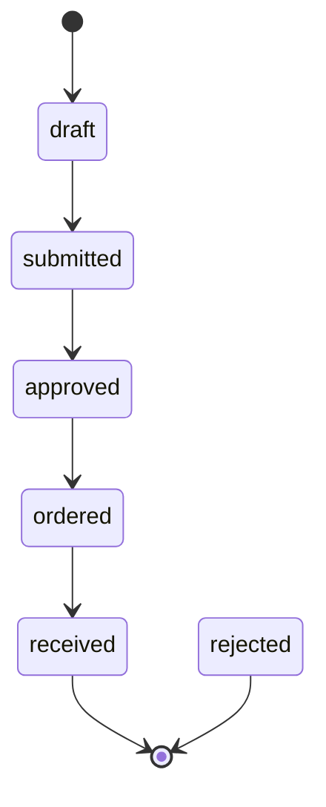
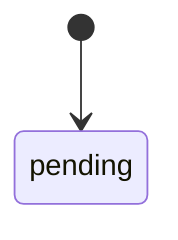
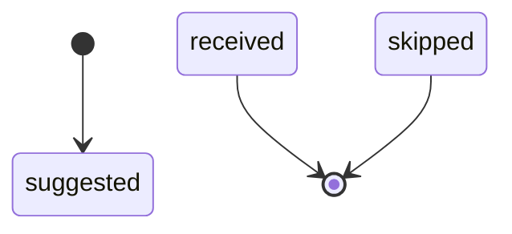
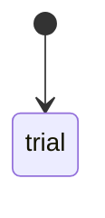
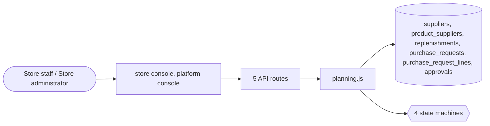

# Supply and planning

> Generated from `_registry/business-domains.json`, the code and `docs/source/supply.md` — edit those, then run `node scripts/domain-docs.js`.

## Overview

Keeping shelves full: suppliers, which supplier provides what, purchase requests and their approval, and replenishment plans.

**Foundation domain:** Operations · **Used by:** Store staff, Store administrator

## Switches and settings

Each is switched on per store under ⚙️ Capabilities; its parameters are that store's settings.

### Supply-chain planning (`planning`)

Purchase suggestions, replenishment and demand planning for the store's buyers.

### Procurement & SCM (`procurement`)

Purchase requests with lines and an approval gate: below the threshold a request self-approves, above it a sign-off is required before the status can advance.

| Setting | Meaning | Default |
|---|---|---|
| `approval_threshold` | A request costing more than this needs an approval row (0 = no gate) | `0` |
| `default_currency` | Currency a purchase request is estimated in | `"USD"` |

## Architecture

| Module | What it is |
|---|---|
| `lib/planning.js` | Supply-chain planning (Roadmap II · domain E). Per-SKU demand forecasting from real order history (moving average + trend), reorder point / safety-stock / min-max computation with lead-time awareness from product_suppliers, and suggested purchase orders to the primary supplier. Reads existing skus/inventory/order_items/ product_suppliers — writes replenishments. Statuses & priorities are meta_lists registries (planStatuses, planPriorities) so they are editable from Data Studio. Feature-gated by settings.features.planning. |

## Data model

### `suppliers`

| Column | Type |
|---|---|
| `id` | INTEGER PRIMARY KEY AUTOINCREMENT |
| `tenant_id` | INTEGER NOT NULL |
| `name` | TEXT NOT NULL |
| `party_role` | TEXT DEFAULT 'manufacturer' |
| `tax_id` | TEXT DEFAULT '' |
| `country` | TEXT DEFAULT 'US' |
| `region` | TEXT DEFAULT '' |
| `address` | TEXT DEFAULT '' |
| `email` | TEXT DEFAULT '' |
| `phone` | TEXT DEFAULT '' |
| `lead_time_days` | INTEGER DEFAULT 7 |
| `moq` | INTEGER DEFAULT 1 |
| `currency` | TEXT DEFAULT 'USD' |
| `payment_terms` | TEXT DEFAULT 'net30' |
| `on_time_pct` | REAL DEFAULT 0 |
| `status` | TEXT DEFAULT 'active' |
| `certifications` | TEXT DEFAULT '[]' |
| `price_list` | TEXT DEFAULT '{}' |
| `created_at` | TEXT NOT NULL DEFAULT (datetime('now')) |
| `deleted_at` | TEXT |
| `uid` | TEXT |

### `product_suppliers`

| Column | Type |
|---|---|
| `id` | INTEGER PRIMARY KEY AUTOINCREMENT |
| `tenant_id` | INTEGER NOT NULL |
| `product_id` | TEXT NOT NULL |
| `supplier_id` | INTEGER NOT NULL |
| `supplier_sku` | TEXT DEFAULT '' |
| `price` | REAL |
| `lead_days` | INTEGER DEFAULT 7 |
| `moq` | INTEGER DEFAULT 1 |
| `is_primary` | INTEGER DEFAULT 0 |
| `status` | TEXT DEFAULT 'active' |
| `deleted_at` | TEXT |
| `uid` | TEXT |

### `replenishments`

| Column | Type |
|---|---|
| `id` | INTEGER PRIMARY KEY AUTOINCREMENT |
| `tenant_id` | INTEGER NOT NULL |
| `sku_id` | INTEGER NOT NULL |
| `product_id` | TEXT NOT NULL |
| `on_hand` | INTEGER DEFAULT 0 |
| `reserved` | INTEGER DEFAULT 0 |
| `available` | INTEGER DEFAULT 0 |
| `avg_daily` | REAL DEFAULT 0 |
| `forecast_30d` | INTEGER DEFAULT 0 |
| `trend` | REAL DEFAULT 0 |
| `lead_days` | INTEGER DEFAULT 7 |
| `safety_stock` | INTEGER DEFAULT 0 |
| `reorder_point` | INTEGER DEFAULT 0 |
| `reorder_qty` | INTEGER DEFAULT 0 |
| `min_qty` | INTEGER DEFAULT 1 |
| `max_qty` | INTEGER DEFAULT 0 |
| `supplier_id` | INTEGER |
| `supplier_name` | TEXT DEFAULT '' |
| `unit_cost` | REAL DEFAULT 0 |
| `status` | TEXT NOT NULL DEFAULT 'suggested' |
| `priority` | TEXT DEFAULT 'normal' |
| `po_ref` | TEXT DEFAULT '' |
| `po_status` | TEXT DEFAULT '' |
| `generated_at` | TEXT NOT NULL DEFAULT (datetime('now')) |
| `updated_at` | TEXT |
| `closed_at` | TEXT |

### `purchase_requests`

| Column | Type |
|---|---|
| `id` | INTEGER PRIMARY KEY AUTOINCREMENT |
| `tenant_id` | INTEGER NOT NULL |
| `ref` | TEXT NOT NULL UNIQUE |
| `requested_by` | TEXT |
| `department` | TEXT DEFAULT '' |
| `status` | TEXT NOT NULL DEFAULT 'draft' |
| `/*` | draft → submitted → approved → ordered → received \| rejected */ note TEXT DEFAULT '' |
| `required_by` | TEXT |
| `approved_by` | TEXT |
| `created_at` | TEXT NOT NULL DEFAULT (datetime('now')) |
| `approved_at` | TEXT |
| `uid` | TEXT |

### `purchase_request_lines`

| Column | Type |
|---|---|
| `id` | INTEGER PRIMARY KEY AUTOINCREMENT |
| `tenant_id` | INTEGER NOT NULL |
| `request_id` | INTEGER NOT NULL |
| `item` | TEXT NOT NULL |
| `qty` | INTEGER NOT NULL DEFAULT 1 |
| `unit` | TEXT DEFAULT 'ea' |
| `est_unit_cost` | REAL NOT NULL DEFAULT 0 |
| `note` | TEXT DEFAULT '' |
| `uid` | TEXT |

### `approvals`

| Column | Type |
|---|---|
| `id` | INTEGER PRIMARY KEY AUTOINCREMENT |
| `tenant_id` | INTEGER NOT NULL |
| `kind` | TEXT NOT NULL |
| `/*` | purchase_request \| work_order \| payroll \| custom */ ref_id INTEGER NOT NULL |
| `ref` | TEXT DEFAULT '' |
| `requester` | TEXT |
| `approver` | TEXT |
| `status` | TEXT NOT NULL DEFAULT 'pending' |
| `/*` | pending \| approved \| rejected */ level INTEGER NOT NULL DEFAULT 1 |
| `note` | TEXT DEFAULT '' |
| `decided_at` | TEXT |
| `created_at` | TEXT NOT NULL DEFAULT (datetime('now')) |
| `uid` | TEXT |

## API reference

Every call is JSON over HTTPS; store calls carry the store (`?store=`) and the session; mutating calls accept an `Idempotency-Key` header where noted.

| Method and path | Handler | What it does |
|---|---|---|
| `GET /api/admin/planning` | `apiAdminPlanList` | ---------------- supply-chain planning ---------------- |
| `POST /api/admin/planning/run` | `apiAdminPlanRun` | — |
| `PUT /api/admin/planning/:id` | `apiAdminPlanStatus` | — |
| `POST /api/admin/planning/approve-all` | `apiAdminPlanApproveAll` | — |
| `GET /api/admin/planning/pos` | `apiAdminPlanPos` | — |

## Process flows

Each record's life is a declared state machine (`lib/seed/states.json`): the moves it may make, and the actions that make them.

### Purchase request (`purchase_request`)

Actions: 

### Approval (`approval`)

Actions: 

### Replenishment (`replenishment`)

Actions: 

### Supplier (`supplier`)

Actions: 

## Data flow

## User interface

**Store console:** 🏭 Suppliers · 🛒 Purchase Requests · 📈 Planning & Replenishment

**Platform console:** 📦 Inventory · 🏬 Warehousing · 🛒 Procurement · 🔀 Stock Transfers · 🔄 Replenishment

## User flows

_Not yet written — `docs/source/supply.md`, section `## Flows`._

## Manuals

### Store staff

_Not yet written — `docs/source/supply.md`, section `## Manual: store_staff`._

### Store administrator

_Not yet written — `docs/source/supply.md`, section `## Manual: store_admin`._

