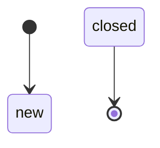
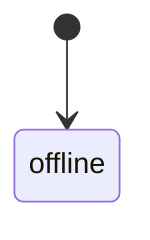
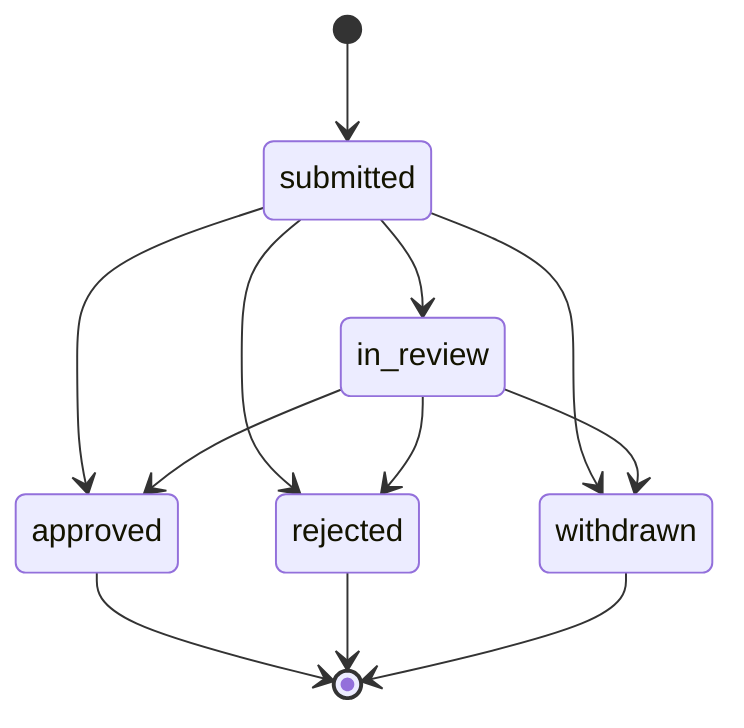
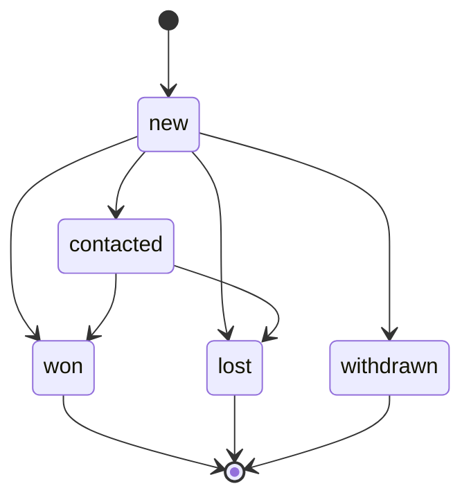
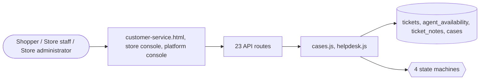

# Customer support

> Generated from `_registry/business-domains.json`, the code and `docs/source/support.md` — edit those, then run `node scripts/domain-docs.js`.

## Overview

Helping people: tickets with service levels and agents, and requests a store decides — price matches, prescriptions, credentials, enquiries, trade-ins — as cases of declared kinds.

**Foundation domain:** Communication · **Used by:** Shopper, Store staff, Store administrator

## Switches and settings

Each is switched on per store under ⚙️ Capabilities; its parameters are that store's settings.

### Client care (`customer_service`)

The customer-service page and the shopper-facing contact channel.

### Enquiries (`lead_capture`)

A shopper asks about an item (a vehicle, a property, a service); the seller follows the enquiry up to won or lost.

## Architecture

| Module | What it is |
|---|---|
| `lib/cases.js` | cases: anything someone asks a store to look at and decide. |
| `lib/helpdesk.js` | Customer Service helpdesk with live chat & SMS support. Tickets raised by customers (storefront, inbound email/webhook, live chat, SMS), an agent queue with assignment, priorities and statuses, SLA timers (first-response + resolution targets), internal notes vs public replies, and CSAT ratings collected on close. Priorities, statuses and reasons are meta_lists registries (hdPriorities, hdStatuses, hdReasons) — editable from Data Studio, no code. Feature-gated by settings.features.helpdesk. Live chat and SMS threads are converted to tickets automatically. |

**Registry lists** (editable in Data Studio): `caseKinds`, `caseStatuses`, `leadStatuses`, `caseSubjects`

## Data model

### `tickets`

| Column | Type |
|---|---|
| `id` | INTEGER PRIMARY KEY AUTOINCREMENT |
| `tenant_id` | INTEGER NOT NULL |
| `ref` | TEXT NOT NULL UNIQUE |
| `subject` | TEXT NOT NULL |
| `reason` | TEXT NOT NULL DEFAULT 'other' |
| `priority` | TEXT NOT NULL DEFAULT 'normal' |
| `status` | TEXT NOT NULL DEFAULT 'new' |
| `assignee` | TEXT |
| `owner` | TEXT |
| `owner_name` | TEXT NOT NULL |
| `owner_email` | TEXT |
| `order_ref` | TEXT DEFAULT '' |
| `product_id` | TEXT DEFAULT '' |
| `body` | TEXT NOT NULL |
| `channel` | TEXT DEFAULT 'email' |
| `sla_response` | TEXT |
| `sla_resolution` | TEXT |
| `first_response_at` | TEXT |
| `resolved_at` | TEXT |
| `csat` | INTEGER |
| `csat_comment` | TEXT DEFAULT '' |
| `created_at` | TEXT NOT NULL DEFAULT (datetime('now')) |
| `uid` | TEXT |

### `agent_availability`

| Column | Type |
|---|---|
| `id` | INTEGER PRIMARY KEY AUTOINCREMENT |
| `tenant_id` | INTEGER NOT NULL |
| `agent_id` | TEXT NOT NULL |
| `status` | TEXT NOT NULL DEFAULT 'offline' |
| `updated_at` | TEXT NOT NULL DEFAULT (datetime('now')) |

### `ticket_notes`

| Column | Type |
|---|---|
| `id` | INTEGER PRIMARY KEY AUTOINCREMENT |
| `tenant_id` | INTEGER NOT NULL |
| `ticket_id` | INTEGER NOT NULL |
| `role` | TEXT NOT NULL DEFAULT 'agent' |
| `author` | TEXT NOT NULL |
| `body` | TEXT NOT NULL |
| `visibility` | TEXT NOT NULL DEFAULT 'public' |
| `created_at` | TEXT NOT NULL DEFAULT (datetime('now')) |
| `uid` | TEXT |

### `cases`

| Column | Type |
|---|---|
| `id` | INTEGER PRIMARY KEY AUTOINCREMENT |
| `tenant_id` | INTEGER NOT NULL |
| `kind` | TEXT NOT NULL |
| `subject_type` | TEXT NOT NULL DEFAULT '' |
| `subject_id` | TEXT |
| `owner` | TEXT NOT NULL |
| `fields` | TEXT NOT NULL DEFAULT '{}' |
| `docs` | TEXT NOT NULL DEFAULT '[]' |
| `status` | TEXT NOT NULL |
| `amount` | REAL |
| `valid_until` | TEXT |
| `used_order` | INTEGER |
| `decided_by` | TEXT NOT NULL DEFAULT '' |
| `reason` | TEXT NOT NULL DEFAULT '' |
| `created_at` | TEXT NOT NULL DEFAULT (datetime('now')) |
| `decided_at` | TEXT |

## API reference

Every call is JSON over HTTPS; store calls carry the store (`?store=`) and the session; mutating calls accept an `Idempotency-Key` header where noted.

| Method and path | Handler | What it does |
|---|---|---|
| `GET /api/cases` | `apiCasesMine` | — |
| `GET /api/case-kinds` | `apiCaseKinds` | every kind of case, with the section its own screen lives in |
| `POST /api/cases` | `apiCaseOpen` | — |
| `POST /api/cases/:id/withdraw` | `apiCaseWithdraw` | — |
| `GET /api/admin/cases` | `apiAdminCases` | — |
| `POST /api/admin/cases/:id` | `apiAdminCaseMove` | — |
| `GET /api/admin/sla` | `apiSlaBreaches` | — |
| `POST /api/support/tickets` | `apiSupportCreate` | ---------------- support helpdesk ---------------- |
| `GET /api/support/tickets` | `apiSupportList` | — |
| `GET /api/support/tickets/:id` | `apiSupportGet` | — |
| `POST /api/support/tickets/:id/reply` | `apiSupportReply` | — |
| `POST /api/support/tickets/:id/csat` | `apiSupportCsat` | — |
| `GET /api/admin/helpdesk/tickets` | `apiAdminHdList` | — |
| `GET /api/admin/helpdesk/tickets/:id` | `apiAdminHdGet` | — |
| `PUT /api/admin/helpdesk/tickets/:id` | `apiAdminHdUpdate` | — |
| `POST /api/admin/helpdesk/tickets/:id/reply` | `apiAdminHdReply` | — |
| `GET /api/admin/helpdesk/sla` | `apiAdminHdSla` | — |
| `GET /api/helpdesk/channels` | `apiHelpdeskChannels` | chat/SMS intake are customer channels (public, owned by the caller's session so the customer can follow the case under /api/support/tickets); replying on a case and agent presence are staff actions, scoped to this store. |
| `POST /api/helpdesk/chat` | `apiHelpdeskChat` | — |
| `POST /api/helpdesk/sms` | `apiHelpdeskSMS` | — |
| `POST /api/helpdesk/:ticketId/message` | `apiHelpdeskMessage` | — |
| `GET /api/helpdesk/agents/status` | `apiHelpdeskAgentStatus` | — |
| `POST /api/helpdesk/agents/status` | `apiHelpdeskAgentStatusUpdate` | — |

## Process flows

Each record's life is a declared state machine (`lib/seed/states.json`): the moves it may make, and the actions that make them.

### Support ticket (`ticket`)

Actions: 

### Support agent (`agent`)

Actions: 

### A case a store decides (`case`)

Actions: `review` → in_review · `approve` → approved · `reject` → rejected · `withdraw` → withdrawn

### An enquiry a seller follows up (`enquiry`)

Actions: `contact` → contacted · `win` → won · `lose` → lost · `withdraw` → withdrawn

## Data flow

## User interface

**Pages:** `customer-service.html`

**Store console:** 📨 Enquiries · 🎧 Support Helpdesk

**Platform console:** 🎧 Support · SLA · 🎫 Tickets · 📋 Cases · 🚨 Incidents · ❓ Q&A

## User flows

_Not yet written — `docs/source/support.md`, section `## Flows`._

## Manuals

### Shopper

_Not yet written — `docs/source/support.md`, section `## Manual: shopper`._

### Store staff

_Not yet written — `docs/source/support.md`, section `## Manual: store_staff`._

### Store administrator

_Not yet written — `docs/source/support.md`, section `## Manual: store_admin`._

