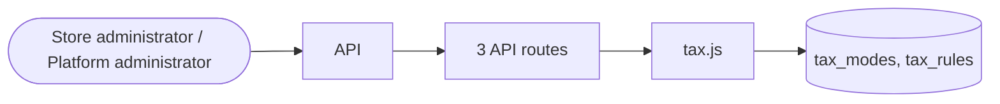

# Tax

> Generated from `_registry/business-domains.json`, the code and `docs/source/tax.md` — edit those, then run `node scripts/domain-docs.js`.

## Overview

What tax applies and how much: tax modes, rules by place and product, and how tax is shown and charged.

**Foundation domain:** Rule · **Used by:** Store administrator, Platform administrator

## Architecture

| Module | What it is |
|---|---|
| `lib/tax.js` | first-class Tax engine (all configuration, single source of truth for checkout + invoicing + reports). Rates are DATA: a jurisdiction rate registry (taxRules) with classes, plus per-product tax_rule overrides and compliance-based exemptions. Supports inclusive vs exclusive pricing, VAT/GST number validation, nexus, and digital-goods rules — so a store in any market/configures tax by data, not code. |

## Data model

### `tax_modes`

| Column | Type |
|---|---|
| `key` | TEXT PRIMARY KEY |
| `label` | TEXT NOT NULL |
| `description` | TEXT |
| `fields` | TEXT DEFAULT '[]' |
| `position` | INTEGER DEFAULT 0 |
| `uid` | TEXT |

### `tax_rules`

| Column | Type |
|---|---|
| `country` | TEXT PRIMARY KEY REFERENCES countries(code) |
| `mode` | TEXT NOT NULL DEFAULT 'manual' |
| `standard` | REAL NOT NULL DEFAULT 0 |
| `reduced` | REAL |
| `digital` | REAL |
| `zero` | REAL |
| `note` | TEXT |

## API reference

Every call is JSON over HTTPS; store calls carry the store (`?store=`) and the session; mutating calls accept an `Idempotency-Key` header where noted.

| Method and path | Handler | What it does |
|---|---|---|
| `GET /api/admin/tax/report` | `apiTaxReport` | — |
| `GET /api/admin/tax` | `apiAdminTaxConfig` | — |
| `POST /api/admin/tax/quote` | `apiAdminTaxQuote` | — |

## Data flow

## User interface

## User flows

_Not yet written — `docs/source/tax.md`, section `## Flows`._

## Manuals

### Store administrator

_Not yet written — `docs/source/tax.md`, section `## Manual: store_admin`._

### Platform administrator

_Not yet written — `docs/source/tax.md`, section `## Manual: platform_admin`._

