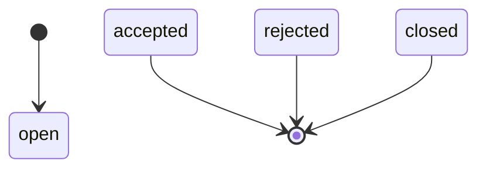
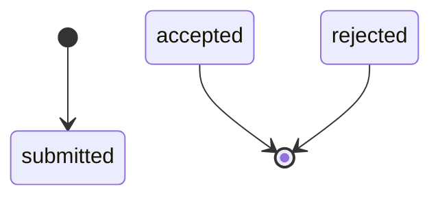
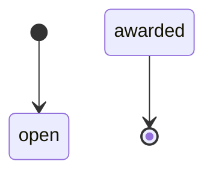
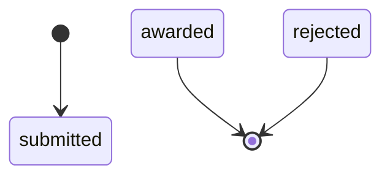
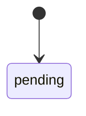
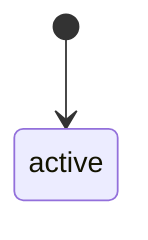
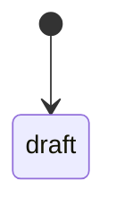
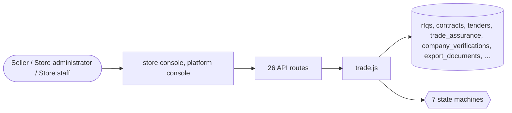

# Business-to-business trade

> Generated from `_registry/business-domains.json`, the code and `docs/source/trade.md` — edit those, then run `node scripts/domain-docs.js`.

## Overview

Buying between businesses: requests for quotation and quotes, tenders and bids, contracts, trade assurance, supplier verification and membership tiers, export documents, letters of credit and minimum order quantities.

**Foundation domain:** Commerce · **Used by:** Seller, Store administrator, Store staff

## Switches and settings

Each is switched on per store under ⚙️ Capabilities; its parameters are that store's settings.

### Trade assurance (`trade_assurance`)

Order-level escrow with milestones: funds release to the seller only when the buyer confirms receipt.

| Setting | Meaning | Default |
|---|---|---|
| `assurance_fee_pct` | Assurance fee as a fraction of the order (0.02 = 2%) | `0.02` |
| `default_milestones` | Milestone sequence when none is supplied | `["paid","production","shipped","delivered"]` |

### Gold-supplier membership (`gold_supplier`)

Paid supplier memberships with a verification level that drives storefront badges.

| Setting | Meaning | Default |
|---|---|---|
| `default_tier` | Tier when none is supplied | `"gold"` |

### Company verification audit (`company_verification`)

An audit of a supplier's identity and export record; approval stamps badges and activates the membership.

| Setting | Meaning | Default |
|---|---|---|
| `approval_activates_membership` | An approved audit marks the supplier's gold membership verified | `true` |

### Export / customs documents (`export_documents`)

Generate commercial invoices, packing lists, bills of lading and certificates deterministically from the order's own fields.

| Setting | Meaning | Default |
|---|---|---|
| `default_doc_kind` | Document kind when none is supplied | `"commercial_invoice"` |
| `default_incoterms` | Incoterms when none is supplied | `"EXW"` |
| `default_origin` | Origin country when none is supplied | `"US"` |

### Letters of credit (`letters_of_credit`)

Issue, present and settle an LC. A clean presentation pays; a discrepant one is recorded, not thrown.

| Setting | Meaning | Default |
|---|---|---|
| `presentable_statuses` | LC statuses from which a presentation is allowed | `["issued","advised","confirmed"]` |

### RFQ multi-seller bidding (`rfq_bidding`)

Suppliers quote against a buyer's RFQ; quotes rank by unit price then lead time. Accepting one closes the rest.

| Setting | Meaning | Default |
|---|---|---|
| `rank_by` | Columns the ranking orders by, ascending | `["unit_price","lead_days"]` |
| `default_validity_days` | Quote validity when none is supplied | `30` |

### Tender reverse auction (`reverse_auction`)

Open tenders take sealed bids and rank them lowest-first; awarding rejects every other bid.

| Setting | Meaning | Default |
|---|---|---|
| `mirror_to_tender_column` | Keep the legacy tenders.bids column in sync for the existing console | `true` |

### MOQ enforcement (`moq_enforcement`)

The cart must respect each line's minimum order quantity — from the product, the supplier link or the price list.

| Setting | Meaning | Default |
|---|---|---|
| `default_moq` | MOQ when no source declares one | `1` |

## Architecture

| Module | What it is |
|---|---|
| `lib/trade.js` | B2B trust & trade engine. Trade-assurance escrow, gold-supplier memberships, company verification audits, export/customs document generation, letters of credit, multi-seller RFQ bidding, reverse-auction tender bids, segment price lists and MOQ enforcement. |

**Registry lists** (editable in Data Studio): `b2bAssuranceStatuses`, `b2bGoldTiers`, `b2bVerificationLevels`, `b2bVerificationStatuses`, `b2bDocKinds`, `b2bDocStatuses`, `b2bLcStatuses`, `b2bQuoteStatuses`, `b2bBidStatuses`

## Data model

### `rfqs`

| Column | Type |
|---|---|
| `id` | INTEGER PRIMARY KEY AUTOINCREMENT |
| `tenant_id` | INTEGER NOT NULL |
| `ref` | TEXT NOT NULL UNIQUE |
| `product_id` | TEXT |
| `buyer_name` | TEXT |
| `buyer_email` | TEXT |
| `qty` | REAL |
| `target_price` | REAL |
| `currency` | TEXT |
| `status` | TEXT DEFAULT 'open' |
| `quotes` | TEXT DEFAULT '[]' |
| `created_at` | TEXT NOT NULL DEFAULT (datetime('now')) |

### `contracts`

| Column | Type |
|---|---|
| `id` | INTEGER PRIMARY KEY AUTOINCREMENT |
| `tenant_id` | INTEGER NOT NULL |
| `ref` | TEXT NOT NULL |
| `buyer_name` | TEXT NOT NULL |
| `buyer_email` | TEXT NOT NULL |
| `buyer_org` | TEXT DEFAULT '' |
| `supplier_id` | INTEGER |
| `product_ids` | TEXT DEFAULT '[]' |
| `currency` | TEXT DEFAULT 'USD' |
| `pricing` | TEXT DEFAULT '{}' |
| `min_qty` | INTEGER DEFAULT 1 |
| `incoterms` | TEXT DEFAULT 'EXW' |
| `payment_terms` | TEXT DEFAULT 'net30' |
| `valid_from` | TEXT |
| `valid_to` | TEXT |
| `status` | TEXT NOT NULL DEFAULT 'draft' |
| `notes` | TEXT DEFAULT '' |
| `created_at` | TEXT NOT NULL DEFAULT (datetime('now')) |
| `deleted_at` | TEXT |
| `uid` | TEXT |

### `tenders`

| Column | Type |
|---|---|
| `id` | INTEGER PRIMARY KEY AUTOINCREMENT |
| `tenant_id` | INTEGER NOT NULL |
| `ref` | TEXT NOT NULL |
| `title` | TEXT NOT NULL |
| `buyer_org` | TEXT DEFAULT '' |
| `buyer_email` | TEXT DEFAULT '' |
| `description` | TEXT DEFAULT '' |
| `currency` | TEXT DEFAULT 'USD' |
| `budget` | REAL DEFAULT 0 |
| `open_at` | TEXT |
| `close_at` | TEXT |
| `status` | TEXT NOT NULL DEFAULT 'open' |
| `awarded_seller_id` | INTEGER |
| `awarded_contract_id` | INTEGER |
| `items` | TEXT DEFAULT '[]' |
| `bids` | TEXT DEFAULT '[]' |
| `created_at` | TEXT NOT NULL DEFAULT (datetime('now')) |
| `deleted_at` | TEXT |
| `uid` | TEXT |

### `trade_assurance`

| Column | Type |
|---|---|
| `id` | INTEGER PRIMARY KEY AUTOINCREMENT |
| `tenant_id` | INTEGER NOT NULL |
| `ref` | TEXT |
| `order_id` | INTEGER |
| `buyer` | TEXT |
| `seller` | TEXT |
| `amount` | REAL NOT NULL |
| `currency` | TEXT |
| `fee` | REAL |
| `milestones` | TEXT DEFAULT '[]' |
| `current_milestone` | TEXT |
| `held` | INTEGER DEFAULT 1 |
| `released_at` | TEXT |
| `status` | TEXT NOT NULL DEFAULT 'holding' |
| `created_at` | TEXT NOT NULL DEFAULT (datetime('now')) |

### `company_verifications`

| Column | Type |
|---|---|
| `id` | INTEGER PRIMARY KEY AUTOINCREMENT |
| `tenant_id` | INTEGER NOT NULL |
| `supplier_id` | INTEGER |
| `ref` | TEXT |
| `company_name` | TEXT NOT NULL |
| `country` | TEXT |
| `registration_no` | TEXT |
| `year_established` | TEXT |
| `employees` | TEXT |
| `revenue` | TEXT |
| `export_share` | TEXT |
| `audit_docs` | TEXT DEFAULT '[]' |
| `audit_by` | TEXT |
| `audit_at` | TEXT |
| `verification_status` | TEXT NOT NULL DEFAULT 'pending' |
| `badges` | TEXT DEFAULT '[]' |
| `notes` | TEXT |
| `created_at` | TEXT NOT NULL DEFAULT (datetime('now')) |

### `export_documents`

| Column | Type |
|---|---|
| `id` | INTEGER PRIMARY KEY AUTOINCREMENT |
| `tenant_id` | INTEGER NOT NULL |
| `ref` | TEXT |
| `order_id` | INTEGER |
| `doc_kind` | TEXT NOT NULL |
| `buyer` | TEXT |
| `consignee` | TEXT |
| `shipper` | TEXT |
| `origin_country` | TEXT |
| `dest_country` | TEXT |
| `port_loading` | TEXT |
| `port_discharge` | TEXT |
| `incoterms` | TEXT |
| `currency` | TEXT |
| `total_value` | REAL |
| `hs_codes` | TEXT |
| `packages` | INTEGER |
| `gross_weight` | REAL |
| `net_weight` | REAL |
| `marks` | TEXT |
| `body` | TEXT |
| `rendered` | TEXT |
| `status` | TEXT NOT NULL DEFAULT 'draft' |
| `created_at` | TEXT NOT NULL DEFAULT (datetime('now')) |

### `letters_of_credit`

| Column | Type |
|---|---|
| `id` | INTEGER PRIMARY KEY AUTOINCREMENT |
| `tenant_id` | INTEGER NOT NULL |
| `ref` | TEXT |
| `order_id` | INTEGER |
| `buyer` | TEXT |
| `seller` | TEXT |
| `issuing_bank` | TEXT |
| `advising_bank` | TEXT |
| `lc_number` | TEXT |
| `amount` | REAL NOT NULL |
| `currency` | TEXT |
| `issue_date` | TEXT |
| `expiry_date` | TEXT |
| `port_loading` | TEXT |
| `port_discharge` | TEXT |
| `latest_shipment` | TEXT |
| `docs_required` | TEXT DEFAULT '[]' |
| `status` | TEXT NOT NULL DEFAULT 'issued' |
| `created_at` | TEXT NOT NULL DEFAULT (datetime('now')) |

### `rfq_quotes`

| Column | Type |
|---|---|
| `id` | INTEGER PRIMARY KEY AUTOINCREMENT |
| `tenant_id` | INTEGER NOT NULL |
| `rfq_id` | INTEGER NOT NULL |
| `supplier_id` | INTEGER |
| `seller_id` | INTEGER |
| `unit_price` | REAL NOT NULL |
| `currency` | TEXT |
| `moq` | INTEGER |
| `lead_days` | INTEGER |
| `payment_terms` | TEXT |
| `validity_days` | INTEGER |
| `quote_ref` | TEXT |
| `attachments` | TEXT DEFAULT '[]' |
| `status` | TEXT NOT NULL DEFAULT 'submitted' |
| `rank` | INTEGER |
| `created_at` | TEXT NOT NULL DEFAULT (datetime('now')) |

### `tender_bids`

| Column | Type |
|---|---|
| `id` | INTEGER PRIMARY KEY AUTOINCREMENT |
| `tenant_id` | INTEGER NOT NULL |
| `tender_id` | INTEGER NOT NULL |
| `bidder` | TEXT NOT NULL |
| `amount` | REAL NOT NULL |
| `currency` | TEXT |
| `terms` | TEXT |
| `bid_ref` | TEXT |
| `attachments` | TEXT DEFAULT '[]' |
| `status` | TEXT NOT NULL DEFAULT 'submitted' |
| `rank` | INTEGER |
| `submitted_at` | TEXT NOT NULL DEFAULT (datetime('now')) |

## API reference

Every call is JSON over HTTPS; store calls carry the store (`?store=`) and the session; mutating calls accept an `Idempotency-Key` header where noted.

| Method and path | Handler | What it does |
|---|---|---|
| `POST /api/trade/assurance` | `apiTradeAssure` | ---------- B2B trust & trade ---------- |
| `POST /api/trade/assurance/:id/milestone` | `apiTradeMilestone` | — |
| `POST /api/trade/assurance/:id/confirm` | `apiTradeConfirm` | confirming delivery releases the escrow to the seller, so only the BUYER (the owner the assurance — or its order — was opened for) or store staff may do it. It used to be open to anyone, and assurance ids are sequential. |
| `POST /api/trade/assurance/:id/dispute` | `apiTradeDispute` | — |
| `POST /api/trade/gold` | `apiTradeGold` | — |
| `POST /api/trade/verification` | `apiTradeVerifySubmit` | — |
| `POST /api/trade/verification/:id/complete` | `apiTradeVerifyComplete` | — |
| `GET /api/trade/badges/:supplierId` | `apiTradeBadges` | — |
| `POST /api/trade/docs` | `apiTradeDoc` | — |
| `GET /api/trade/docs/:id` | `apiTradeDocGet` | — |
| `POST /api/trade/lc` | `apiTradeLc` | — |
| `POST /api/trade/lc/:id/present` | `apiTradeLcPresent` | — |
| `POST /api/trade/rfq/:id/quote` | `apiTradeQuote` | — |
| `POST /api/trade/quotes/:id/accept` | `apiTradeQuoteAccept` | — |
| `POST /api/trade/tenders/:id/bid` | `apiTradeBid` | — |
| `POST /api/trade/tenders/:id/award` | `apiTradeAward` | — |
| `GET /api/trade/price` | `apiTradePrice` | — |
| `GET /api/trade/moq-check` | `apiTradeMoqCheck` | — |
| `POST /api/rfqs` | `apiRfqCreate` | — |
| `GET /api/admin/rfqs` | `apiAdminRfqs` | — |
| `PUT /api/admin/rfqs/:id` | `apiAdminRfqUpdate` | — |
| `POST /api/admin/contracts` | `apiAdminContractCreate` | — |
| `PUT /api/admin/contracts/:id/status` | `apiAdminContractStatus` | — |
| `POST /api/admin/tenders` | `apiAdminTenderCreate` | — |
| `POST /api/admin/tenders/:id/award` | `apiAdminTenderAward` | — |
| `POST /api/admin/rfqs/:id/contract` | `apiAdminRfqToContract` | — |

## Process flows

Each record's life is a declared state machine (`lib/seed/states.json`): the moves it may make, and the actions that make them.

### Request for quotation (`rfq`)

Actions: 

### RFQ quote (`rfq_quote`)

Actions: 

### Tender (`tender`)

Actions: 

### Tender bid (`tender_bid`)

Actions: 

### Supplier verification (`verification`)

Actions: 

### Gold supplier membership (`gold_membership`)

Actions: 

### B2B contract (`contract`)

Actions: 

## Data flow

## User interface

**Store console:** 📋 RFQs · 📝 Contracts · 🏛️ Tenders · 🚢 Trade Ops

**Platform console:** 📜 Contracts · ✍️ Agreements · 🔗 Relationships · 🔗 Universal Links (Primitive) · 🧭 Context Types (Primitive) · 🌐 Business Networks · 🏢 Organizations · 🤝 Sellers · B2B · Trade · 📨 RFQs · 🏅 Tenders · 🛡️ Trade Assurance · 📜 Letters of Credit

## User flows

_Not yet written — `docs/source/trade.md`, section `## Flows`._

## Manuals

### Seller

_Not yet written — `docs/source/trade.md`, section `## Manual: seller`._

### Store administrator

_Not yet written — `docs/source/trade.md`, section `## Manual: store_admin`._

### Store staff

_Not yet written — `docs/source/trade.md`, section `## Manual: store_staff`._

