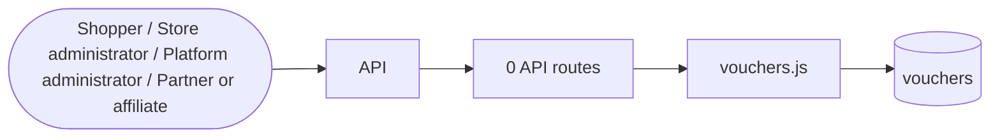

# Vouchers

> Generated from `_registry/business-domains.json`, the code and `docs/source/voucher.md` — edit those, then run `node scripts/domain-docs.js`.

## Overview

An instrument of value that is not the shop's own discount and not a gift card: a bank voucher, a benefits note, an organisation's credit. Who stands behind it, whether it may be spent in part and how long it lives are its kind's rows; the code it travels on belongs to the Coupon domain.

**Foundation domain:** Commerce · **Used by:** Shopper, Store administrator, Platform administrator, Partner or affiliate

## Architecture

| Module | What it is |
|---|---|
| `lib/vouchers.js` | vouchers (the Voucher domain): an instrument of value that is not money and not a gift card. |

**Registry lists** (editable in Data Studio): `voucherKinds`

## Data model

### `vouchers`

| Column | Type |
|---|---|
| `id` | INTEGER PRIMARY KEY AUTOINCREMENT |
| `tenant_id` | INTEGER NOT NULL DEFAULT 0 |
| `code` | TEXT NOT NULL |
| `kind` | TEXT NOT NULL DEFAULT 'bank_voucher' |
| `issued_by` | TEXT DEFAULT '' |
| `offer_id` | INTEGER |
| `value` | REAL DEFAULT 0 |
| `currency` | TEXT DEFAULT 'USD' |
| `issued_to` | TEXT DEFAULT '' |
| `batch` | TEXT DEFAULT '' |
| `starts` | TEXT |
| `ends` | TEXT |
| `status` | TEXT DEFAULT 'active' |
| `note` | TEXT DEFAULT '' |
| `created_at` | TEXT NOT NULL DEFAULT (datetime('now')) |

## Data flow

## User interface

## User flows

**What a voucher is.** A voucher is value someone other than the shop has set aside for the shopper —
a bank voucher, a store credit note, a government or corporate benefit note. Its kind (a row of
`voucherKinds`) says what it is called, who stands behind it, whether it may be spent in part, how
long it lives and which coupon kind its code travels as.

**Issuing.** A voucher is issued when an offer of type `voucher_issue` applies (the cart reaches the
offer's minimum) or when the incentive engine grants one. The Voucher domain asks the Coupon domain to
write the code — with the kind's funder, the value, the unit, the uses allowed and the end date — and
then records the voucher itself: its kind, who issued it, its value and to whom it was issued. When no
voucher kind is declared, nothing is issued.

**Spending.** The voucher's code is applied at the cart like any code and follows the Coupon domain's
rules for validity, limits and redemption. Who bears its value is the funder the voucher kind names.

## Manuals

### Shopper

1. A voucher reaches you as a code — from your bank, your employer or a benefits programme, or from an
   offer you qualified for.
2. Type the code into the code box in your bag, as for any code. You are told if it cannot be used
   here or has run out.

### Store administrator

1. Vouchers are issued by offers of type `voucher_issue`: create the offer in **Offers → 🎟️ Offers**
   with its value, its minimum and the voucher kind.
2. Each voucher's code appears in **Offers → 🎟️ Coupons** with its funder, so its redemptions and
   what each funder bore show in the redemption performance there.
3. The voucher kinds are rows you can edit in **Data Studio** (`voucherKinds`). A screen of its own for
   issued vouchers is not built yet.

### Platform administrator

1. The voucher kinds are a platform registry (`voucherKinds`): for each, who issues it, whether it may
   be partly spent, how long it lives and the coupon kind its code travels as.
2. A voucher kind backed by a bank, an organisation or a benefits programme names that funder, so the
   value it carries is attributed to them in every store's redemption ledger.

### Partner or affiliate

1. A partner — a bank or an organisation — stands behind vouchers of the kinds that name it. Their
   value is recorded against you as the funder in each store's redemption ledger.
2. A screen of its own for partners is not built yet; ask the store for the redemption performance by
   funder, or the platform for the voucher kinds that name you.

