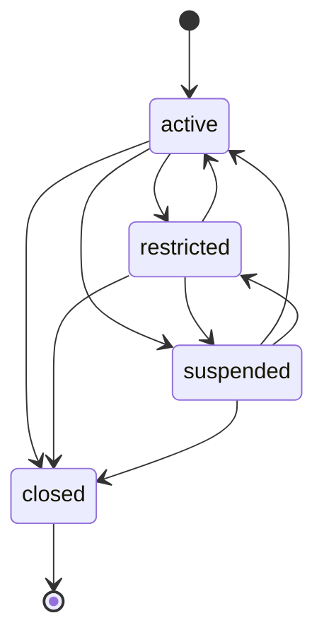
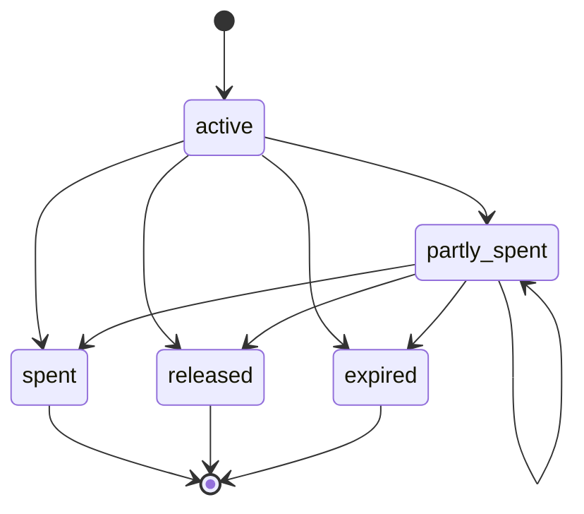
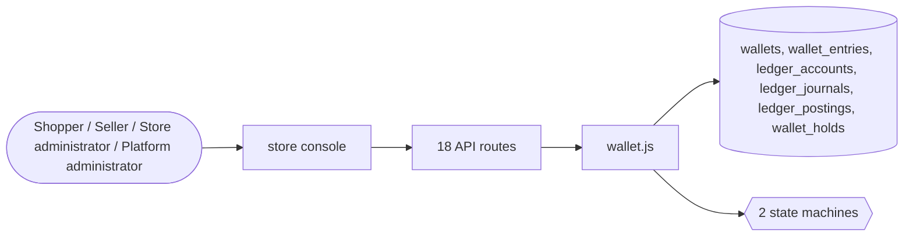

# Wallets

> Generated from `_registry/business-domains.json`, the code and `docs/source/wallet.md` — edit those, then run `node scripts/domain-docs.js`.

## Overview

Value a party holds: wallets of any definition, the ledger every movement is posted to, holds, transfers between wallets and between people.

**Foundation domain:** Value · **Used by:** Shopper, Seller, Store administrator, Platform administrator

## Switches and settings

Each is switched on per store under ⚙️ Capabilities; its parameters are that store's settings.

### P2P wallet transfer (`p2p_transfer`)

Wallet-to-wallet transfer between two owners. Self-transfer and overdraft are refused.

| Setting | Meaning | Default |
|---|---|---|
| `ledger_unit` | Unit the transfer row is written in | `"USD"` |

## Architecture

| Module | What it is |
|---|---|
| `lib/wallet.js` | the Universal Wallet, on the kernel. |

**Registry lists** (editable in Data Studio): `walletStatuses`, `walletHoldStatuses`

## Data model

### `wallets`

| Column | Type |
|---|---|
| `tenant_id` | INTEGER NOT NULL |
| `owner` | TEXT NOT NULL |
| `balance` | REAL NOT NULL DEFAULT 0 |
| `updated_at` | TEXT NOT NULL DEFAULT (datetime('now')) |
| `uid` | TEXT |

### `wallet_entries`

| Column | Type |
|---|---|
| `id` | INTEGER PRIMARY KEY AUTOINCREMENT |
| `tenant_id` | INTEGER NOT NULL DEFAULT 0 |
| `owner` | TEXT NOT NULL |
| `currency` | TEXT DEFAULT 'USD' |
| `kind` | TEXT NOT NULL |
| `amount` | REAL NOT NULL |
| `balance_after` | REAL DEFAULT 0 |
| `ref` | TEXT DEFAULT '' |
| `note` | TEXT DEFAULT '' |
| `channel` | TEXT DEFAULT 'commerce' |
| `actor` | TEXT DEFAULT 'system' |
| `created_at` | TEXT NOT NULL DEFAULT (datetime('now')) |
| `uid` | TEXT |

### `ledger_accounts`

| Column | Type |
|---|---|
| `id` | INTEGER PRIMARY KEY AUTOINCREMENT |
| `tenant_id` | INTEGER NOT NULL |
| `wallet_id` | TEXT |
| `system_key` | TEXT |
| `unit` | TEXT NOT NULL |
| `created_at` | TEXT NOT NULL DEFAULT (datetime('now')) |

### `ledger_journals`

| Column | Type |
|---|---|
| `id` | INTEGER PRIMARY KEY AUTOINCREMENT |
| `tenant_id` | INTEGER NOT NULL |
| `op` | TEXT NOT NULL |
| `ref` | TEXT NOT NULL DEFAULT '' |
| `idem_key` | TEXT |
| `request_hash` | TEXT NOT NULL DEFAULT '' |
| `actor` | TEXT NOT NULL DEFAULT '' |
| `reason` | TEXT NOT NULL DEFAULT '' |
| `reverses` | INTEGER |
| `event_seq` | INTEGER |
| `created_at` | TEXT NOT NULL DEFAULT (datetime('now')) |

### `ledger_postings`

| Column | Type |
|---|---|
| `id` | INTEGER PRIMARY KEY AUTOINCREMENT |
| `journal_id` | INTEGER NOT NULL |
| `account_id` | INTEGER NOT NULL |
| `unit` | TEXT NOT NULL |
| `amount` | INTEGER NOT NULL |

### `wallet_holds`

| Column | Type |
|---|---|
| `id` | INTEGER PRIMARY KEY AUTOINCREMENT |
| `wallet_id` | TEXT NOT NULL |
| `amount` | INTEGER NOT NULL |
| `captured` | INTEGER NOT NULL DEFAULT 0 |
| `purpose` | TEXT NOT NULL DEFAULT '' |
| `ref` | TEXT NOT NULL DEFAULT '' |
| `idem_key` | TEXT |
| `expires_at` | TEXT |
| `status` | TEXT NOT NULL |
| `decided_at` | TEXT |
| `created_at` | TEXT NOT NULL DEFAULT (datetime('now')) |

## API reference

Every call is JSON over HTTPS; store calls carry the store (`?store=`) and the session; mutating calls accept an `Idempotency-Key` header where noted.

| Method and path | Handler | What it does |
|---|---|---|
| `POST /api/fintech/transfer` | `apiFinTransfer` | one person sends value to another, wallet to wallet, as one transfer journal |
| `GET /api/wallet/ledger` | `apiWalletLedger` | staff read an owner's statement lines and balance (the older single-balance view of the default wallet) |
| `GET /api/wallets` | `apiWalletsMine` | a signed-in shopper's wallets with their balances, and the definitions they may open |
| `POST /api/wallets` | `apiWalletOpen` | a shopper opens a wallet of a definition, in a unit, named as they like |
| `POST /api/wallets/transfer` | `apiWalletTransfer` | the shopper moves value between two of their own wallets of one unit (Idempotency-Key) |
| `GET /api/wallets/:id` | `apiWalletGet` | one of the shopper's wallets: its balances, its holds and every name it has had |
| `GET /api/wallets/:id/statement` | `apiWalletStatement` | the movements of one of the shopper's wallets, newest first |
| `POST /api/wallets/:id/name` | `apiWalletRename` | the shopper renames a wallet, or adds an alias, in a language |
| `GET /api/wallet-definitions` | `apiWalletDefinitions` | every wallet definition, resolved for this store, with the operations, accounts and settings declared |
| `GET /api/admin/wallets` | `apiAdminWallets` | staff list an owner's wallets, with the wallet and hold actions |
| `GET /api/admin/wallets/:id` | `apiAdminWalletStatement` | staff read any wallet of the store: balances, movements, holds and names |
| `POST /api/admin/wallets/:id/move` | `apiAdminWalletMove` | staff restrict, suspend, reactivate or close a wallet, with a reason |
| `POST /api/admin/wallets/:id/adjust` | `apiAdminWalletAdjust` | staff adjust a wallet up or down, with a reason (Idempotency-Key) |
| `POST /api/admin/journals/:id/reverse` | `apiAdminJournalReverse` | staff reverse a journal with a reason — a linked mirror, once |
| `GET /api/admin/ledger/verify` | `apiAdminLedgerVerify` | the ledger check: unbalanced journals, drift between the log and the ledger, and the event chain |
| `POST /api/platform/wallet-definitions` | `apiPlatformWalletDefine` | the platform declares a wallet definition, or changes one — only what it states is assigned, the rest inherited |
| `POST /api/admin/wallet-definitions/:key` | `apiAdminWalletDefinitionSettings` | a store sets its own values for a definition's settings, over the platform's |
| `POST /api/admin/wallet-default` | `apiAdminWalletDefault` | a store chooses the definition its owners' money lands in |

## Process flows

Each record's life is a declared state machine (`lib/seed/states.json`): the moves it may make, and the actions that make them.

### A wallet's life (`wallet`)

Actions: `reactivate` → active · `restrict` → restricted · `suspend` → suspended · `close` → closed

### Value a wallet keeps for a purpose (`wallet_hold`)

Actions: `capture` → spent · `capture_part` → partly_spent · `release` → released · `expire` → expired

## Data flow

## User interface

**Store console:** 👛 Wallets & Ledger

## User flows

**Money in.** A refund, cashback, reward, top-up or a payment that settles to someone is posted to that
owner's wallet as one journal: the wallet's account goes up and a system account (issuance, clearing,
migration or suspense — whichever the operation declares) goes down by the same amount. The owner's
first such movement opens their default wallet for that unit automatically.

**Money out.** Spending from a wallet is a journal the other way. It is refused — never cut down to
zero — when the wallet's available balance (what it holds, less what its holds keep, plus any
overdraft its definition allows) is not enough.

**Checkout with a balance.** When a shopper's order uses their balance, checkout first places a hold
for that amount; the order is written; then the hold is captured, which posts the spend. If the
order never completes, the hold lapses after the definition's hold time and the value is available
again. If the payment later fails, the amount is given back as a refund linked to the order.

**Moving between wallets.** An owner moves value between two of their wallets of the same unit; one
person sends value to another the same way. Both wallets must allow transfers, the sender must have
enough available and the receiver must not go over its maximum. Different units are a conversion,
not a transfer.

**Corrections.** Nothing posted is ever edited or deleted. Staff correct a mistake by reversing the
journal — a mirror of it, linked to it, allowed once — or by an adjustment that states its reason.

**Definitions.** A definition says what its wallets may hold and do. Definitions sit in a tree: each
refines the one above it and states only what differs; a wallet takes every setting from the
nearest definition that states it. The platform declares definitions; each store may set its own
values for any setting and choose its own default, without changing other stores.

**Checking the ledger.** The ledger check confirms every journal balances, that the ledger matches
the tamper-evident event log entry for entry, and that the log's chain is unbroken.

## Manuals

### Shopper

1. Sign in and open **Your Orders**; your wallets are under **Your activity → 👛 Your wallets**.
2. Each wallet shows its name, what kind of wallet it is, what is available now and anything held
   for an order in progress.
3. **Rename** gives a wallet any name you like; earlier names are kept in its history.
4. **Open a …** opens another wallet of that kind (a purpose wallet for a trip, for example) — give
   it a name.
5. **Move value** sends an amount to another of your wallets in the same currency. If you do not
   have enough available, nothing moves and you are told why.
6. Your balance is used at checkout automatically where the store allows it; the amount is held
   while you pay and taken once the order is placed.

### Seller

1. What you earn on the store is paid into your seller proceeds wallet as settlements are made.
2. You can move proceeds to your own wallet in the same currency, where the store allows transfers.
3. A screen of its own for seller proceeds is not built yet; until it is, ask the store to show you
   your wallet under **👛 Wallets & Ledger**, or use the wallet API (`GET /api/wallets`).

### Store administrator

1. Wallets need the **Customer Wallets** module (⚙️ Modules). Without it, wallet pages and calls
   say so instead of working.
2. Open **💳 Payments & Finance → 👛 Wallets & Ledger**.
3. **Ledger check** at the top must read "every one balances" and "event chain intact". Anything
   else is shown with the journal or event it concerns — report it; do not try to edit data.
4. **Definitions** lists every kind of wallet with the value it holds, what it allows and its policy,
   as resolved for your store. **Configure** sets your store's own value for one setting (for
   example a lower maximum balance for trip wallets); **Make default** chooses where your
   customers' money lands.
5. **An owner's wallets**: enter the owner (for example `t1:u:42`) and **Show**. For each wallet you
   can open its **Statement** (every movement, its holds and every name it has had), move it to
   another state (**Restrict**, **Suspend**, **Reactivate**, **Close** — each asks why; a wallet
   closes only when empty) or **Adjust** it up or down with a reason.
6. To undo a movement, open the statement and **Reverse** that journal, giving the reason. A journal
   is reversed once; a reversal is not reversed — post a new movement instead.

### Platform administrator

1. Wallet definitions are the platform's. Declare or change one with
   `POST /api/platform/wallet-definitions` — `{ key, parent, name: { <language>: text }, aliases,
   settings: { openable, classes, operations, overdraft, max_balance, max_per_owner, hold_minutes } }`.
   Only the settings you state are set; the rest are inherited from the parent definition.
   A platform-console screen for definitions is not built yet.
2. The value classes a definition may hold are Value's classes; the operations are the wallet's
   declared operations — anything else is refused.
3. Every store's ledger check is available to its administrators; the event log it verifies is the
   platform's single tamper-evident record.
4. Holders are stored encrypted and found by a keyed index; rotating the encryption key keeps that
   index usable (it is derived from the keyring's first key).

