# Volume V01 · Constitution

**Part of** [the master document](../UCOS-MASTER.md) · **Category** C01 · **Projected from** `_registry/` — never edit this file: change the registry and run `npm run registry`.

> The laws, amendments and certification law that govern every other category.

## Contents

- [D-CON Constitutional Authority](#d-con)
  - [UCOS-CON-000001 Constitutional Foundation](#ucos-con-000001)
  - [UCOS-CON-000002 Canonical Terminology Constitution](#ucos-con-000002)
  - [UCOS-CON-000003 Domain Ownership Constitution](#ucos-con-000003)
  - [UCOS-CON-000004 Dependency Constitution](#ucos-con-000004)
  - [UCOS-CON-000005 Governance Constitution](#ucos-con-000005)
  - [UCOS-CON-000006 Security Constitution](#ucos-con-000006)
  - [UCOS-CON-000007 Privacy Constitution](#ucos-con-000007)
  - [UCOS-CON-000008 Trust Constitution](#ucos-con-000008)
  - [UCOS-CON-000009 Evolution Constitution](#ucos-con-000009)
  - [UCOS-CON-000010 Certification Constitution](#ucos-con-000010)

---

<a id="d-con"></a>
### D-CON · Constitutional Authority

| | |
|---|---|
| **Category** | C01 Constitution |
| **Owns** | [Capability](../UCOS-MASTER.md#t-capability), [Constitution](../UCOS-MASTER.md#t-constitution), [Amendment](../UCOS-MASTER.md#t-amendment) |
| **Responsible for** | Constitutional Law, Amendment Process, Certification Law, Capability Declaration |
| **Not responsible for** | Runtime Execution, Registry Storage |
| **Contract** | [UCOS-CON-000001 Constitutional Foundation](#ucos-con-000001) |
| **Artifacts** | [UCOS-CON-000001](#ucos-con-000001), [UCOS-CON-000002](#ucos-con-000002), [UCOS-CON-000003](#ucos-con-000003), [UCOS-CON-000004](#ucos-con-000004), [UCOS-CON-000005](#ucos-con-000005), [UCOS-CON-000006](#ucos-con-000006), [UCOS-CON-000007](#ucos-con-000007), [UCOS-CON-000008](#ucos-con-000008), [UCOS-CON-000009](#ucos-con-000009), [UCOS-CON-000010](#ucos-con-000010) |
| **Code** | — |
| **Managed in** | `_registry/domains.json` → `D-CON` |

<a id="ucos-con-000001"></a>
#### UCOS-CON-000001 · Constitutional Foundation

Owner [Constitutional Authority](#d-con) · managed in `_registry/manifest.json` → `UCOS-CON-000001`, content `_registry/content-core.json` → `IDN` · inherits the [standard contract](../UCOS-MASTER.md#standard-contract)

<a id="ucos-con-000001-concepts"></a>
##### Concepts

Identity is the constitutionally verifiable handle for any existence. It is namespace-partitioned, versioned, and lineage-carrying. External schemes (GTIN, EAN, UPC, ISBN, ISSN, IMEI, VIN, CUSIP, ISIN, HSN, SAC) and future schemes are represented WITHOUT schema change, as registry-driven fingerprints.

<a id="ucos-con-000001-ontology"></a>
##### Ontology

Identity ⊂ Existence. Identity has exactly one Namespace. Identity ≥ 1 Fingerprint. Identity has 0..n Aliases. Identity has 1 Lineage chain. Identity is referenced by every other primitive as its anchor.

<a id="ucos-con-000001-taxonomy"></a>
##### Taxonomy

By namespace: Platform / Tenant / External / Future. By strength: Provisional / Verified / Certified. By scope: Universal / Scoped / Ephemeral.

<a id="ucos-con-000001-data-model"></a>
##### Data Model

```yaml
Identity:
  identityId: <uuid v7, sort-friendly>
  namespace: <registry-driven, never hardcoded>
  version: <monotonic integer>
  lineage:
    parentId: <Identity|null>
    forkOf: <Identity|null>
  aliases: [<Alias>]
  fingerprints:
    - scheme: <registry scheme id>   # GTIN|EAN|VIN|...|future
      value: <normalized string>
      checksum: <registry-validated>
  signatures: [<Signature>]
  temporal: {validFrom, validTo, observedAt}
  metadata: {provenance, trustRef}
```

<a id="ucos-con-000001-graph-model"></a>
##### Graph Model

(:Identity)-[:LINEAGE_OF]->(:Identity); (:Identity)-[:ALIAS_OF]->(:Identity); (:Identity)-[:FINGERPRINT_IN]->(:Registry); (:Identity)<-[:ANCHORS]-(:Knowledge|:Relationship|:Policy)

<a id="ucos-con-000001-apis"></a>
##### APIs

- POST /identity.v1.create
- POST /identity.v1.resolve
- GET  /identity.v1/{id}
- GET  /identity.v1/{id}/lineage
- POST /identity.v1/{id}/alias
- POST /identity.v1/{id}/verify

<a id="ucos-con-000001-events"></a>
##### Events

- IdentityCreated
- IdentityResolved
- IdentityVerified
- IdentityAliased
- IdentityDeprecated
- IdentityMerged
- IdentityConflictDetected

<a id="ucos-con-000001-commands"></a>
##### Commands

- identity.create
- identity.resolve
- identity.alias.add
- identity.verify
- identity.deprecate
- identity.fork
- identity.merge

<a id="ucos-con-000001-queries"></a>
##### Queries

- identity.byId
- identity.byFingerprint
- identity.byAlias
- identity.lineage
- identity.resolveBatch
- identity.conflicts

<a id="ucos-con-000001-state-machines"></a>
##### State Machines

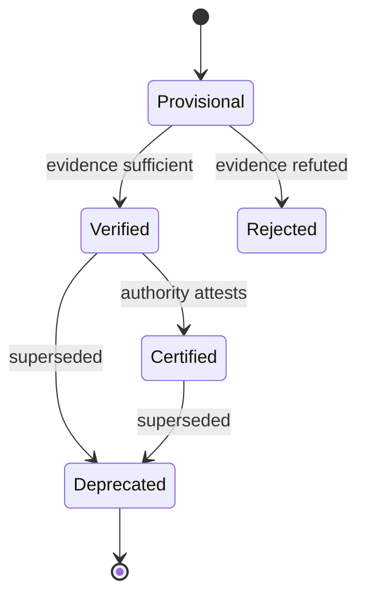

<a id="ucos-con-000001-workflows"></a>
##### Workflows

- resolve external scheme → registry lookup → fingerprint match → evidence capture → authority attestation → publish IdentityVerified

<a id="ucos-con-000001-authorities"></a>
##### Authorities

- Platform Authority (namespace creation)
- Tenant Authority (scoped identity)
- External Authority (attestation of external schemes)

<a id="ucos-con-000001-permissions"></a>
##### Permissions

- identity.create (tenant admin)
- identity.verify (trusted attestor)
- identity.merge (platform authority)
- identity.read (any authenticated)

<a id="ucos-con-000001-privacy-model"></a>
##### Privacy Model

Aliases and fingerprints are pseudonymous. Direct identifiers require consent scope `identity:read`. Resolution logs are minimized and retention-governed by the Consent Architecture.

<a id="ucos-con-000001-audit-model"></a>
##### Audit Model

Every resolution records: who resolved, which fingerprint matched, under which authority, with what evidence, at what confidence. Immutable, append-only, cryptographically chained.

<a id="ucos-con-000001-digital-twin-model"></a>
##### Digital Twin Model

Identity Twin mirrors the real-world identifier state across registries (e.g., a GS1 GTIN changing ownership), continuously synchronized via the Twin Federation.

<a id="ucos-con-000001-agent-model"></a>
##### Agent Model

Identity Agent monitors fingerprint collisions, lineage forks, and stale aliases, raising IdentityConflictDetected under governance.

<a id="ucos-con-000001-runtime-model"></a>
##### Runtime Model

Stateless resolution service with a versioned cache keyed by (namespace, normalized fingerprint). Cache invalidation on IdentityDeprecated/IdentityMerged events.

<a id="ucos-con-000001-scaling-model"></a>
##### Scaling Model

Read-heavy (>99%). Partition by namespace; replicate globally; resolve via content-addressable fingerprint index. Write path is authority-sharded.

<a id="ucos-con-000001-multi-tenant-model"></a>
##### Multi-Tenant Model

Namespace isolation is mandatory: a tenant can never read another tenant's scoped identities unless an explicit cross-tenant Relationship + Policy permits it.

<a id="ucos-con-000001-geo-distribution-model"></a>
##### Geo-Distribution Model

Resolution is locally served per region with fingerprint-index replicas; authoritative write quorum remains in the tenant's home jurisdiction per Data Sovereignty.

<a id="ucos-con-000001-failure-model"></a>
##### Failure Model

Fingerprint collision, alias loop, lineage cycle, authority unavailability, checksum drift on external scheme change.

<a id="ucos-con-000001-recovery-model"></a>
##### Recovery Model

Lineage is an immutable append-only log; recovery = replay. Deleted aliases are reconstructable from the chain. IdentityMerged is reversible via compensating event.

<a id="ucos-con-000001-certification-model"></a>
##### Certification Model

Identity must pass checksum validity, lineage acyclicity, namespace ownership, and fingerprint uniqueness before it may anchor any Knowledge or Relationship.

<a id="ucos-con-000001-migration-model"></a>
##### Migration Model

External scheme migration (e.g., UPC→GTIN-13) is a registry-driven re-fingerprint, never a schema migration. Old fingerprints remain valid aliases.

<a id="ucos-con-000001-implementation-blueprint"></a>
##### Implementation Blueprint

Build order for IDN: (1) define registry entries — this domain owns by namespace: platform / tenant / external / future as registry truth, not code; (2) implement the contract surface first (identity.create, identity.resolve, identity.alias.add) and validate against IDN boundaries; (3) event-source all state so history is reconstructable; (4) wire the enforcement points — authority check, policy guard, evidence binding, trace — in-line, with no bypass path; (5) add tests per the Testing Architecture, citing evidence per gate; (6) obtain Verification and Certification before activation. Acceptance: the Zero Partial and Law 001 audits pass, every action answers the seven explainability questions, and this domain mutates no other domain internals.

<a id="ucos-con-000001-sequence-diagrams"></a>
##### Sequence Diagrams

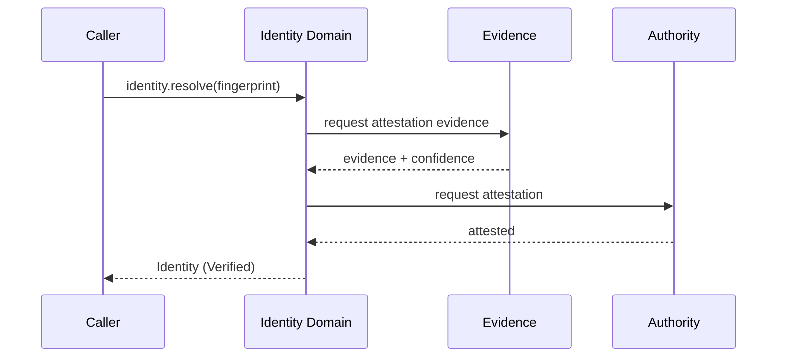

<a id="ucos-con-000001-state-diagrams"></a>
##### State Diagrams

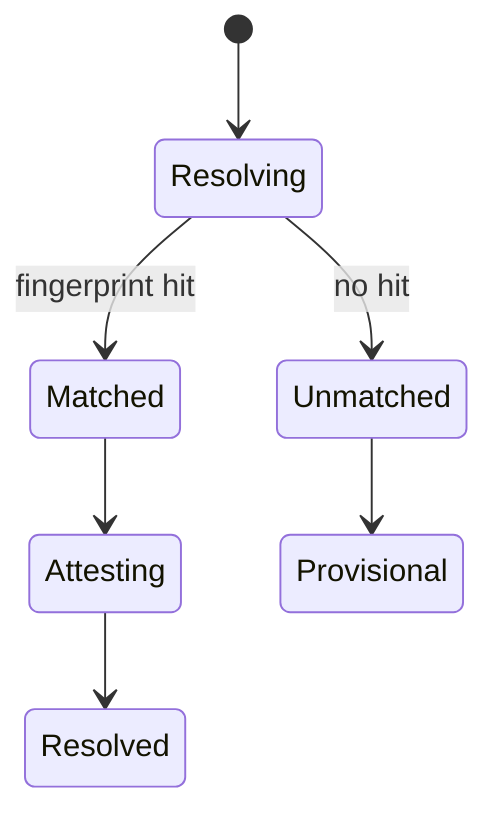

<a id="ucos-con-000002"></a>
#### UCOS-CON-000002 · Canonical Terminology Constitution

Owner [Constitutional Authority](#d-con) · managed in `_registry/manifest.json` → `UCOS-CON-000002`, content `_registry/content-core.json` → `KNW` · inherits the [standard contract](../UCOS-MASTER.md#standard-contract)

<a id="ucos-con-000002-concepts"></a>
##### Concepts

Knowledge is validated understanding of reality — interpreted information with evidence and meaning. It is NOT data, NOT information, NOT evidence. It is derived from them. Every Knowledge element answers who asserted it, when, why, under which authority, based on what evidence, with what confidence.

<a id="ucos-con-000002-ontology"></a>
##### Ontology

Knowledge ⊂ Existence. Knowledge requires ≥1 Evidence. Knowledge has 1 Authority. Knowledge has Confidence ∈ [0,1]. Knowledge Types: Fact / Assertion / Hypothesis / Model / Belief / PolicyAsKnowledge / Regulation / Learned / Derived / Future.

<a id="ucos-con-000002-taxonomy"></a>
##### Taxonomy

By epistemic status: Proven / Supported / Contested / Refuted / Hypothetical. By source: Observed / Inferred / Asserted / Simulated. By volatility: Stable / Drifting / Volatile.

<a id="ucos-con-000002-data-model"></a>
##### Data Model

```yaml
Knowledge:
  knowledgeId: <Identity>
  type: <registry-driven type>
  assertion: <semantic statement>
  evidence: [<Evidence>]
  confidence: <0..1>
  provenance:
    assertedBy: <Authority>
    assertedAt: <Time>
    intent: <Intent>
  trust: <Trust>
  status: <Proven|Supported|Contested|Refuted|Hypothetical>
  supersededBy: <Knowledge|null>
```

<a id="ucos-con-000002-graph-model"></a>
##### Graph Model

(:Knowledge)-[:SUPPORTED_BY]->(:Evidence); (:Knowledge)-[:ASSERTED_BY]->(:Authority); (:Knowledge)-[:SUPERSEDES]->(:Knowledge); (:Knowledge)-[:ABOUT]->(:Identity); (:Knowledge)-[:DERIVED_FROM]->(:Observation)

<a id="ucos-con-000002-apis"></a>
##### APIs

- POST /knowledge.v1.assert
- GET  /knowledge.v1/{id}
- POST /knowledge.v1/{id}/contest
- GET  /knowledge.v1.query
- POST /knowledge.v1/{id}/supersede

<a id="ucos-con-000002-events"></a>
##### Events

- KnowledgeAsserted
- KnowledgeContested
- KnowledgeSuperseded
- KnowledgeRefuted
- KnowledgeConfidenceDrifted
- KnowledgeRevalidated

<a id="ucos-con-000002-commands"></a>
##### Commands

- knowledge.assert
- knowledge.contest
- knowledge.supersede
- knowledge.refute
- knowledge.revalidate
- knowledge.purge

<a id="ucos-con-000002-queries"></a>
##### Queries

- knowledge.byId
- knowledge.about
- knowledge.byEvidence
- knowledge.contested
- knowledge.lineage
- knowledge.confidenceHistogram

<a id="ucos-con-000002-state-machines"></a>
##### State Machines

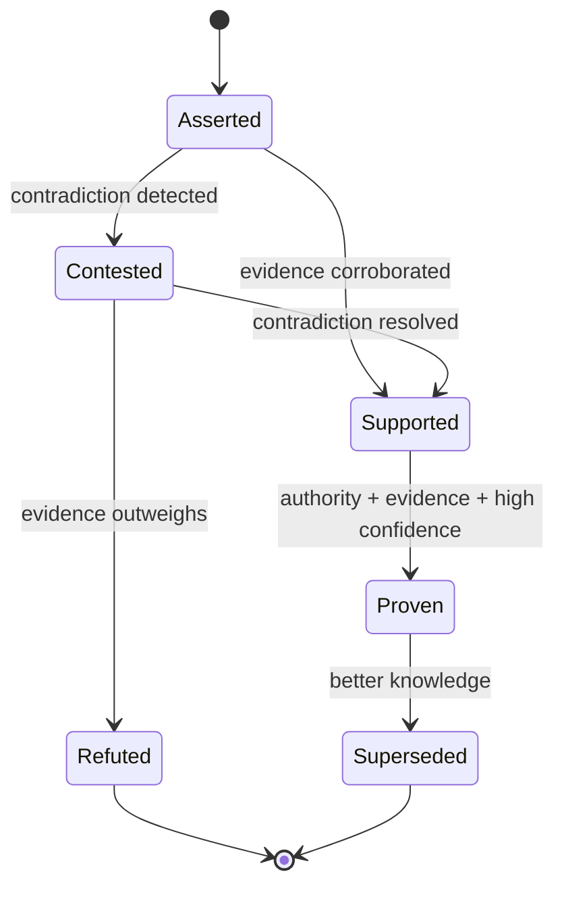

<a id="ucos-con-000002-workflows"></a>
##### Workflows

- assert → evidence binding → trust computation → contradiction check → (contest | promote) → publish event

<a id="ucos-con-000002-authorities"></a>
##### Authorities

- Domain Authority (asserts within jurisdiction)
- Peer Authority (contests)
- Platform Authority (purge)

<a id="ucos-con-000002-permissions"></a>
##### Permissions

- knowledge.assert (authenticated + scoped)
- knowledge.contest (peer authority)
- knowledge.purge (platform authority only)

<a id="ucos-con-000002-privacy-model"></a>
##### Privacy Model

Assertions about persons require consent scope `knowledge:assert:pii`. Evidence retention follows the Consent Architecture; purge is a first-class command, not an afterthought.

<a id="ucos-con-000002-audit-model"></a>
##### Audit Model

The seven explainability questions are mandatory fields. Knowledge chain is append-only; refutation never deletes — it supersedes, preserving history.

<a id="ucos-con-000002-digital-twin-model"></a>
##### Digital Twin Model

Knowledge Twin tracks the real-world truth state of the subject (e.g., a regulation's enactment status) and flags drift between asserted and observed reality.

<a id="ucos-con-000002-agent-model"></a>
##### Agent Model

Knowledge Agent continuously revalidates drifting knowledge, detects contradictions, and proposes supersessions under governance.

<a id="ucos-con-000002-runtime-model"></a>
##### Runtime Model

Write path is evidence-verified before commit; read path serves the current non-superseded head per query context.

<a id="ucos-con-000002-scaling-model"></a>
##### Scaling Model

Partition by subject Identity. Confidence computation is a read-side projection cached per (Knowledge, Context). Contradiction detection is a stream job.

<a id="ucos-con-000002-multi-tenant-model"></a>
##### Multi-Tenant Model

Knowledge is tenant-scoped unless explicitly published to a shared ontology. Cross-tenant assertion requires a Relationship + Policy.

<a id="ucos-con-000002-geo-distribution-model"></a>
##### Geo-Distribution Model

Regulatory knowledge is jurisdiction-scoped; the same assertion may be Proven in one jurisdiction and Contested in another — both remain valid within Context.

<a id="ucos-con-000002-failure-model"></a>
##### Failure Model

Evidence detachment, confidence drift beyond threshold, authority revocation mid-attestation, contradiction avalanche.

<a id="ucos-con-000002-recovery-model"></a>
##### Recovery Model

Never delete: supersede. Recovery = rebuild current-head projection from the append-only chain. Purge is governance-gated and leaves a tombstone.

<a id="ucos-con-000002-certification-model"></a>
##### Certification Model

Knowledge must carry ≥1 evidence, an active authority, and a computed trust score above domain threshold to be read as Proven.

<a id="ucos-con-000002-migration-model"></a>
##### Migration Model

Knowledge schema evolves by adding types to the registry; existing assertions are re-projected, never rewritten.

<a id="ucos-con-000002-implementation-blueprint"></a>
##### Implementation Blueprint

Build order for KNW: (1) define registry entries — this domain owns by epistemic status: proven / supported / contested / refuted / hypothetical as registry truth, not code; (2) implement the contract surface first (knowledge.assert, knowledge.contest, knowledge.supersede) and validate against KNW boundaries; (3) event-source all state so history is reconstructable; (4) wire the enforcement points — authority check, policy guard, evidence binding, trace — in-line, with no bypass path; (5) add tests per the Testing Architecture, citing evidence per gate; (6) obtain Verification and Certification before activation. Acceptance: the Zero Partial and Law 001 audits pass, every action answers the seven explainability questions, and this domain mutates no other domain internals.

<a id="ucos-con-000002-sequence-diagrams"></a>
##### Sequence Diagrams

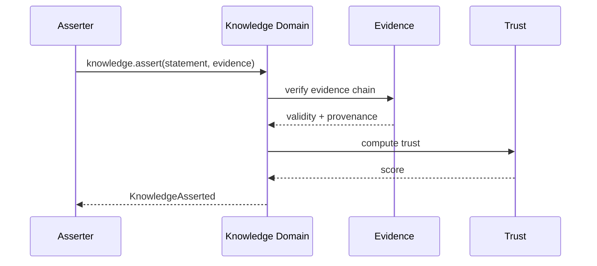

<a id="ucos-con-000002-state-diagrams"></a>
##### State Diagrams

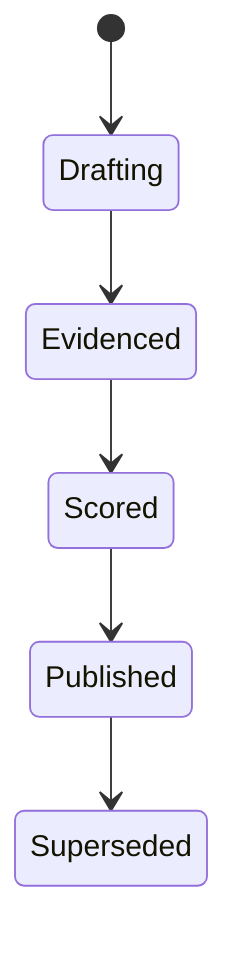

<a id="ucos-con-000003"></a>
#### UCOS-CON-000003 · Domain Ownership Constitution

Owner [Constitutional Authority](#d-con) · managed in `_registry/manifest.json` → `UCOS-CON-000003`, content `_registry/content-core.json` → `REL` · inherits the [standard contract](../UCOS-MASTER.md#standard-contract)

<a id="ucos-con-000003-concepts"></a>
##### Concepts

Relationship is a typed, contextualized, time-bounded connection between existences. Reality emerges through relationships, not through objects. Relationship ≠ Causality: a link is not a reason.

<a id="ucos-con-000003-ontology"></a>
##### Ontology

Relationship has 1 source Identity, 1 target Identity, 1 RelationshipType (registry-driven), 0..n Context, temporal validity, and an Authority. Relationship types are open: Owns, Consumes, Produces, Requires, Provides, Contains, DependsOn, CompatibleWith, Replaces, Supersedes, Associates, Influences, Causes — plus unlimited future types from the registry.

<a id="ucos-con-000003-taxonomy"></a>
##### Taxonomy

By direction: Directed / Undirected / Bidirectional. By strength: Structural / Behavioral / Ephemeral. By derivation: Declared / Inferred / Simulated.

<a id="ucos-con-000003-data-model"></a>
##### Data Model

```yaml
Relationship:
  relationshipId: <Identity>
  relationshipType: <registry id>
  source: <Identity>
  target: <Identity>
  context: [<Context>]
  authority: <Authority>
  temporal: {validFrom, validTo}
  provenance: {declaredBy | inferredBy}
  trust: <Trust>
  metadata: <Metadata>
```

<a id="ucos-con-000003-graph-model"></a>
##### Graph Model

This IS the graph. (:Identity)-[:RELATIONSHIP_TYPE {context, temporal, trust}]->(:Identity). Traversal is context-filtered at query time.

<a id="ucos-con-000003-apis"></a>
##### APIs

- POST /relationship.v1.create
- POST /relationship.v1.query
- GET  /relationship.v1/{id}
- POST /relationship.v1/{id}/temporal
- GET  /relationship.v1.path

<a id="ucos-con-000003-events"></a>
##### Events

- RelationshipCreated
- RelationshipRetracted
- RelationshipExpired
- RelationshipReinforced
- RelationshipInferred
- RelationshipIntegrityViolation

<a id="ucos-con-000003-commands"></a>
##### Commands

- relationship.create
- relationship.retype
- relationship.expire
- relationship.reinforce
- relationship.retract

<a id="ucos-con-000003-queries"></a>
##### Queries

- relationship.neighbors
- relationship.path
- relationship.byType
- relationship.byContext
- relationship.temporalAt
- relationship.density

<a id="ucos-con-000003-state-machines"></a>
##### State Machines

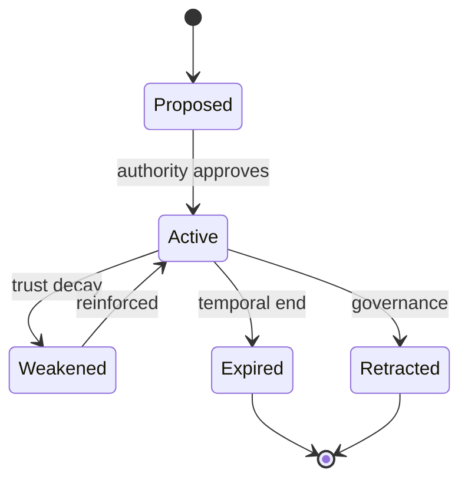

<a id="ucos-con-000003-workflows"></a>
##### Workflows

- validate endpoints exist → resolve type from registry → check authority → enforce context policy → commit → publish → integrity verify

<a id="ucos-con-000003-authorities"></a>
##### Authorities

- Source-side Authority (declares)
- Platform Authority (retracts)
- Inference Authority (infers, lower trust by default)

<a id="ucos-con-000003-permissions"></a>
##### Permissions

- relationship.create (endpoint owner or delegated)
- relationship.retract (platform authority)
- relationship.read (context-scoped)

<a id="ucos-con-000003-privacy-model"></a>
##### Privacy Model

Relationships between persons are sensitive by default; traversal requires `relationship:read` scope plus a Context policy. Hidden-edge protection enforced.

<a id="ucos-con-000003-audit-model"></a>
##### Audit Model

Every traversal of a sensitive edge is logged with the seven explainability fields. Inferred relationships are always marked as such, never presented as declared.

<a id="ucos-con-000003-digital-twin-model"></a>
##### Digital Twin Model

Relationship Twin mirrors real-world connections (e.g., supplier links) and flags when observed reality diverges from declared relationships.

<a id="ucos-con-000003-agent-model"></a>
##### Agent Model

Relationship Agent discovers latent edges via the Inference Domain and proposes them with reduced trust pending corroboration.

<a id="ucos-con-000003-runtime-model"></a>
##### Runtime Model

Graph-native store. Context filtering at traversal time — no pre-materialized per-context graphs, which would duplicate truth.

<a id="ucos-con-000003-scaling-model"></a>
##### Scaling Model

Shard by source Identity hash. Multi-hop traversal is bounded by policy hop-limit. Hot vertices are cached as projections, never as truth.

<a id="ucos-con-000003-multi-tenant-model"></a>
##### Multi-Tenant Model

Cross-tenant edges require an explicit published RelationshipType + Policy. Default deny.

<a id="ucos-con-000003-geo-distribution-model"></a>
##### Geo-Distribution Model

Edge locality follows Data Sovereignty: a vertex's authoritative edges live in its jurisdiction; replicas are read-only.

<a id="ucos-con-000003-failure-model"></a>
##### Failure Model

Dangling endpoint, type registry drift, temporal inversion (validFrom > validTo), orphaned inferred edges after retraction.

<a id="ucos-con-000003-recovery-model"></a>
##### Recovery Model

Edges are immutable + temporal; recovery is replay. Retraction is a tombstone, not a delete. Integrity job rebuilds dangling detection.

<a id="ucos-con-000003-certification-model"></a>
##### Certification Model

Relationship must pass endpoint existence, type registry validity, authority jurisdiction, and temporal sanity.

<a id="ucos-con-000003-migration-model"></a>
##### Migration Model

New relationship types are registry additions — zero schema migration. Retired types become non-creatable but remain queryable historically.

<a id="ucos-con-000003-implementation-blueprint"></a>
##### Implementation Blueprint

Build order for REL: (1) define registry entries — this domain owns by direction: directed / undirected / bidirectional as registry truth, not code; (2) implement the contract surface first (relationship.create, relationship.retype, relationship.expire) and validate against REL boundaries; (3) event-source all state so history is reconstructable; (4) wire the enforcement points — authority check, policy guard, evidence binding, trace — in-line, with no bypass path; (5) add tests per the Testing Architecture, citing evidence per gate; (6) obtain Verification and Certification before activation. Acceptance: the Zero Partial and Law 001 audits pass, every action answers the seven explainability questions, and this domain mutates no other domain internals.

<a id="ucos-con-000003-sequence-diagrams"></a>
##### Sequence Diagrams

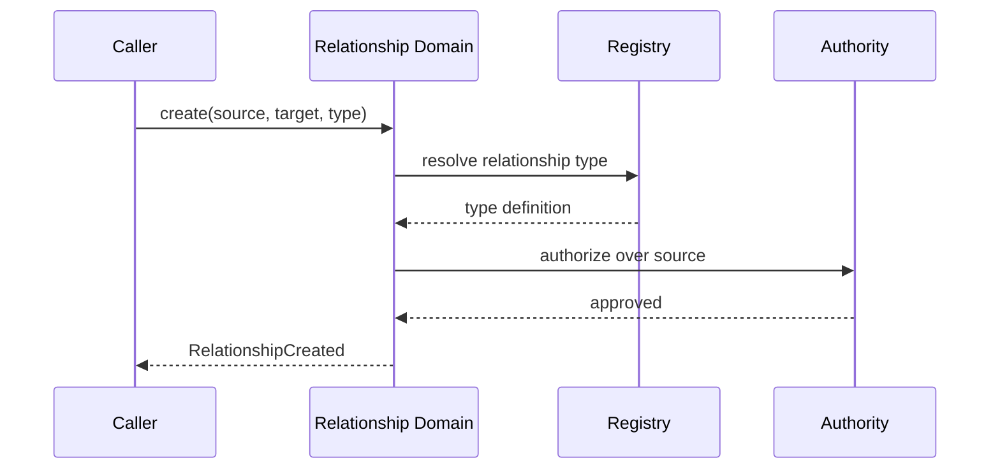

<a id="ucos-con-000003-state-diagrams"></a>
##### State Diagrams

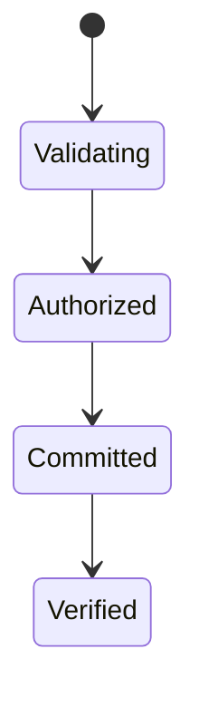

<a id="ucos-con-000004"></a>
#### UCOS-CON-000004 · Dependency Constitution

Owner [Constitutional Authority](#d-con) · managed in `_registry/manifest.json` → `UCOS-CON-000004`, content `_registry/content-core.json` → `CTX` · inherits the [standard contract](../UCOS-MASTER.md#standard-contract)

<a id="ucos-con-000004-concepts"></a>
##### Concepts

Context is the applicability boundary that changes how reality is projected. Context ≠ Perspective: a context is a scope; a perspective is an observer's interpretation. The same primitives project differently per context.

<a id="ucos-con-000004-ontology"></a>
##### Ontology

Context is hierarchical and compositional. Context types are registry-driven: Geographical, Organizational, Commercial, Customer, Contractual, Marketplace, Legal, Regulatory, Operational, Behavioral, Temporal, Digital, Physical, Future. A context constrains which Policies and Authorities are in force.

<a id="ucos-con-000004-taxonomy"></a>
##### Taxonomy

By breadth: Universal / Regional / Local / Instance. By nature: Structural (geo, org) / Temporal (time window) / Situational (session, intent).

<a id="ucos-con-000004-data-model"></a>
##### Data Model

```yaml
Context:
  contextId: <Identity>
  contextType: <registry id>
  hierarchy:
    parentId: <Context|null>
  constraints: [<constraint expressions>]
  policies: [<Policy>]
  authorities: [<Authority>]
  temporal: {effectiveFrom, effectiveTo}
  metadata: <Metadata>
```

<a id="ucos-con-000004-graph-model"></a>
##### Graph Model

(:Context)-[:CHILD_OF*]->(:Context); (:Context)-[:IN_FORCE]->(:Policy); (:Context)-[:JURISDICTION]->(:Authority); (:Identity)-[:PROJECTED_IN]->(:Context)

<a id="ucos-con-000004-apis"></a>
##### APIs

- POST /context.v1.create
- GET  /context.v1/{id}
- POST /context.v1.resolve
- GET  /context.v1/{id}/policies
- GET  /context.v1/{id}/ancestors

<a id="ucos-con-000004-events"></a>
##### Events

- ContextCreated
- ContextPolicyAttached
- ContextMerged
- ContextExpired
- ContextConflictDetected

<a id="ucos-con-000004-commands"></a>
##### Commands

- context.create
- context.attachPolicy
- context.delegate
- context.merge
- context.expire

<a id="ucos-con-000004-queries"></a>
##### Queries

- context.resolve
- context.effectivePolicies
- context.lineage
- context.overlaps
- context.byType

<a id="ucos-con-000004-state-machines"></a>
##### State Machines

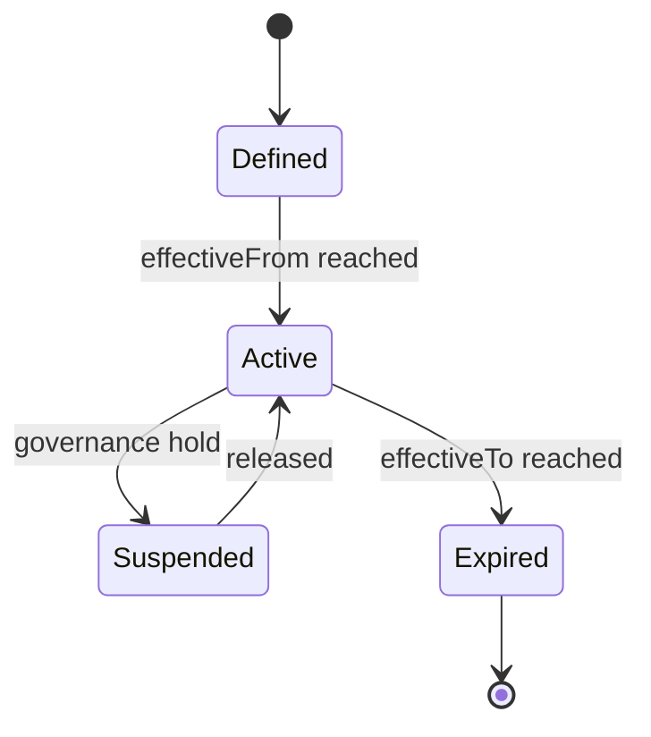

<a id="ucos-con-000004-workflows"></a>
##### Workflows

- define → attach policies → resolve hierarchy → detect overlap conflicts → activate → publish effective policy set

<a id="ucos-con-000004-authorities"></a>
##### Authorities

- Jurisdiction Authority (creates contexts in its scope)
- Platform Authority (universal context)

<a id="ucos-con-000004-permissions"></a>
##### Permissions

- context.create (jurisdiction authority)
- context.attachPolicy (context owner)
- context.resolve (any authenticated)

<a id="ucos-con-000004-privacy-model"></a>
##### Privacy Model

Context may implicitly narrow data access; privacy impact is asserted on creation and re-audited on policy attachment.

<a id="ucos-con-000004-audit-model"></a>
##### Audit Model

Context resolution is logged: which contexts applied, in what precedence, and which policy won on conflict. Precedence is deterministic, never incidental.

<a id="ucos-con-000004-digital-twin-model"></a>
##### Digital Twin Model

Context Twin mirrors real-world scope changes (e.g., a new regulatory regime activating) and projects the change through affected artifacts.

<a id="ucos-con-000004-agent-model"></a>
##### Agent Model

Context Agent detects overlapping contexts with contradictory policies and escalates per the Contradiction Architecture.

<a id="ucos-con-000004-runtime-model"></a>
##### Runtime Model

Resolution is a memoized hierarchy walk. Effective policy set = union of ancestor policies with deterministic conflict precedence (child > parent; specific > general).

<a id="ucos-con-000004-scaling-model"></a>
##### Scaling Model

Hierarchy is shallow and cache-friendly; resolution results cached per (Identity, Context) with invalidation on ContextPolicyAttached.

<a id="ucos-con-000004-multi-tenant-model"></a>
##### Multi-Tenant Model

A tenant's contexts are isolated. Cross-context projection requires explicit delegation.

<a id="ucos-con-000004-geo-distribution-model"></a>
##### Geo-Distribution Model

Geographical contexts are the primary sovereignty mechanism — data residency policy attaches here, not in application code.

<a id="ucos-con-000004-failure-model"></a>
##### Failure Model

Cycle in hierarchy, contradictory policies at same precedence, orphaned policy attachment, temporal overlap ambiguity.

<a id="ucos-con-000004-recovery-model"></a>
##### Recovery Model

Contexts are immutable versions; recovery = repoint to prior version. Policy attachments are event-sourced and reversible.

<a id="ucos-con-000004-certification-model"></a>
##### Certification Model

Context must pass acyclicity, jurisdiction ownership, policy compatibility, and deterministic precedence before activation.

<a id="ucos-con-000004-migration-model"></a>
##### Migration Model

New context types are registry additions. Existing contexts re-project on type definition change.

<a id="ucos-con-000004-implementation-blueprint"></a>
##### Implementation Blueprint

Build order for CTX: (1) define registry entries — this domain owns by breadth: universal / regional / local / instance as registry truth, not code; (2) implement the contract surface first (context.create, context.attachPolicy, context.delegate) and validate against CTX boundaries; (3) event-source all state so history is reconstructable; (4) wire the enforcement points — authority check, policy guard, evidence binding, trace — in-line, with no bypass path; (5) add tests per the Testing Architecture, citing evidence per gate; (6) obtain Verification and Certification before activation. Acceptance: the Zero Partial and Law 001 audits pass, every action answers the seven explainability questions, and this domain mutates no other domain internals.

<a id="ucos-con-000004-sequence-diagrams"></a>
##### Sequence Diagrams

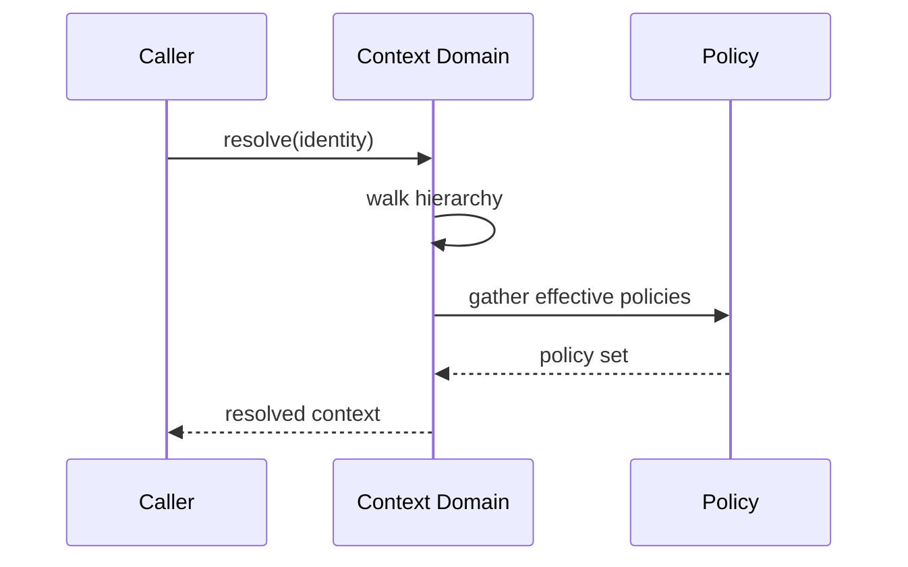

<a id="ucos-con-000004-state-diagrams"></a>
##### State Diagrams

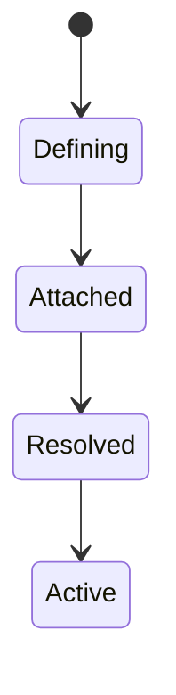

<a id="ucos-con-000005"></a>
#### UCOS-CON-000005 · Governance Constitution

Owner [Constitutional Authority](#d-con) · managed in `_registry/manifest.json` → `UCOS-CON-000005`, content `_registry/content-core.json` → `POL` · inherits the [standard contract](../UCOS-MASTER.md#standard-contract)

<a id="ucos-con-000005-concepts"></a>
##### Concepts

Policy is behavioral governance — the statement of what must, may, or must not happen. Policy ≠ Rule: policy is intent; the rule is its executable projection. All behavior derives from policy. Nothing executes that policy does not permit.

<a id="ucos-con-000005-ontology"></a>
##### Ontology

Policy has Conditions, Actions, Priorities, Exceptions, and an Authority. Policy is resolved within a Context. Policy projects into Rules. Policy never executes directly — that is the Rule Domain's role.

<a id="ucos-con-000005-taxonomy"></a>
##### Taxonomy

By force: Mandatory / Permissive / Prohibitive. By scope: Universal / Jurisdictional / Contextual / Instance. By origin: Constitutional / Regulatory / Organizational / Learned.

<a id="ucos-con-000005-data-model"></a>
##### Data Model

```yaml
Policy:
  policyId: <Identity>
  intent: <Intent>
  conditions: [<registry expression>]
  actions: [<registry action>]
  priorities: [<int>]
  exceptions: [<Policy exception>]
  authority: <Authority>
  context: [<Context>]
  temporal: {effectiveFrom, effectiveTo}
  status: <Draft|Active|Retired>
```

<a id="ucos-con-000005-graph-model"></a>
##### Graph Model

(:Policy)-[:PROJECTS_TO]->(:Rule); (:Policy)-[:ENFORCED_IN]->(:Context); (:Policy)-[:GRANTED_BY]->(:Authority); (:Policy)-[:EXCEPTIONS]->(:Policy)

<a id="ucos-con-000005-apis"></a>
##### APIs

- POST /policy.v1.create
- POST /policy.v1.activate
- POST /policy.v1.evaluate
- GET  /policy.v1/{id}
- POST /policy.v1/{id}/retire

<a id="ucos-con-000005-events"></a>
##### Events

- PolicyCreated
- PolicyActivated
- PolicyRetired
- PolicyEvaluated
- PolicyConflictDetected
- PolicyProjectionUpdated

<a id="ucos-con-000005-commands"></a>
##### Commands

- policy.create
- policy.activate
- policy.retire
- policy.evaluate
- policy.exception.add
- policy.conflict.resolve

<a id="ucos-con-000005-queries"></a>
##### Queries

- policy.byId
- policy.effectiveIn
- policy.applicableTo
- policy.conflicts
- policy.projectionStatus

<a id="ucos-con-000005-state-machines"></a>
##### State Machines

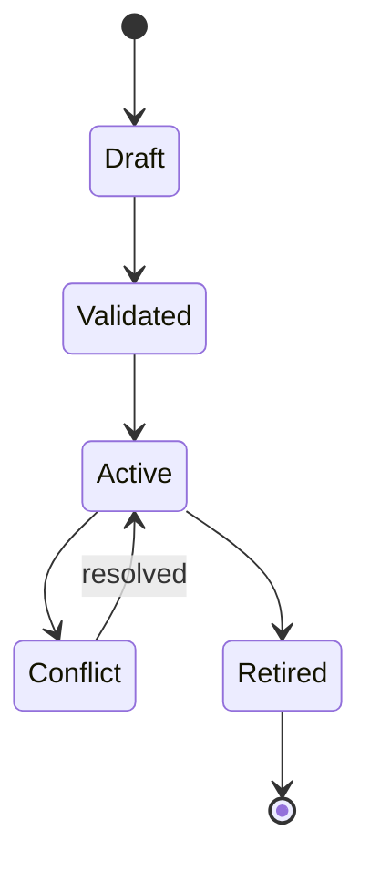

<a id="ucos-con-000005-workflows"></a>
##### Workflows

- author intent → validate against constitution → detect conflicts → project to Rules → activate → publish → re-project on change

<a id="ucos-con-000005-authorities"></a>
##### Authorities

- Constitutional Authority (supreme)
- Jurisdiction Authority (regional)
- Context Authority (scoped)

<a id="ucos-con-000005-permissions"></a>
##### Permissions

- policy.create (authority in scope)
- policy.activate (same or higher authority)
- policy.evaluate (any authenticated, result scoped)

<a id="ucos-con-000005-privacy-model"></a>
##### Privacy Model

Policies governing personal data must reference a lawful basis via the Consent Architecture; purpose limitation is a first-class condition.

<a id="ucos-con-000005-audit-model"></a>
##### Audit Model

Every PolicyEvaluated records the input facts, matched conditions, chosen action, and precedence rationale. Denials carry appeal references.

<a id="ucos-con-000005-digital-twin-model"></a>
##### Digital Twin Model

Policy Twin mirrors real-world regulatory text and flags when observed regulation drifts from enacted policy.

<a id="ucos-con-000005-agent-model"></a>
##### Agent Model

Policy Agent detects conflicts between overlapping policies and proposes precedence resolutions under governance.

<a id="ucos-con-000005-runtime-model"></a>
##### Runtime Model

Evaluation is a forward-chaining pass over the effective policy set for a Context; result is cached per (subject, context, fact-hash).

<a id="ucos-con-000005-scaling-model"></a>
##### Scaling Model

Policy resolution is read-heavy and cacheable; invalidation is event-driven on PolicyActivated/PolicyRetired in the affected Context.

<a id="ucos-con-000005-multi-tenant-model"></a>
##### Multi-Tenant Model

Tenant policies cannot override constitutional policy; precedence is Constitutional > Jurisdictional > Tenant > Contextual.

<a id="ucos-con-000005-geo-distribution-model"></a>
##### Geo-Distribution Model

Jurisdictional policy is geo-scoped; where two jurisdictions conflict, Data Sovereignty policy decides the applicable set — both are recorded, neither is silently dropped.

<a id="ucos-con-000005-failure-model"></a>
##### Failure Model

Conflict at equal precedence, unsatisfiable condition set, projection failure to Rules, policy storm (mass activation).

<a id="ucos-con-000005-recovery-model"></a>
##### Recovery Model

Policies are versioned and event-sourced; retirement is reversible. Projection failures roll back to the last validated projection.

<a id="ucos-con-000005-certification-model"></a>
##### Certification Model

Policy must pass constitutional conformance, conflict precedence determinism, and successful rule projection before activation.

<a id="ucos-con-000005-migration-model"></a>
##### Migration Model

Policy language evolves by registry expression extension — never by changing the policy schema.

<a id="ucos-con-000005-implementation-blueprint"></a>
##### Implementation Blueprint

Build order for POL: (1) define registry entries — this domain owns by force: mandatory / permissive / prohibitive as registry truth, not code; (2) implement the contract surface first (policy.create, policy.activate, policy.retire) and validate against POL boundaries; (3) event-source all state so history is reconstructable; (4) wire the enforcement points — authority check, policy guard, evidence binding, trace — in-line, with no bypass path; (5) add tests per the Testing Architecture, citing evidence per gate; (6) obtain Verification and Certification before activation. Acceptance: the Zero Partial and Law 001 audits pass, every action answers the seven explainability questions, and this domain mutates no other domain internals.

<a id="ucos-con-000005-sequence-diagrams"></a>
##### Sequence Diagrams

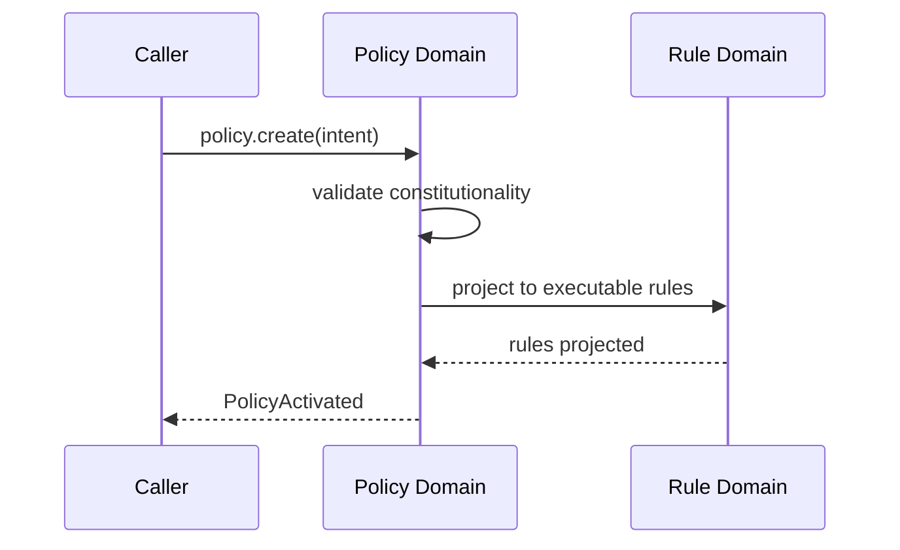

<a id="ucos-con-000005-state-diagrams"></a>
##### State Diagrams

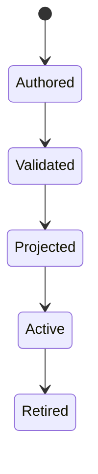

<a id="ucos-con-000006"></a>
#### UCOS-CON-000006 · Security Constitution

Owner [Constitutional Authority](#d-con) · managed in `_registry/manifest.json` → `UCOS-CON-000006`, content `_registry/content-core.json` → `RUL` · inherits the [standard contract](../UCOS-MASTER.md#standard-contract)

<a id="ucos-con-000006-concepts"></a>
##### Concepts

Rule is the executable constraint derived from Policy. Rule ≠ Policy and Rule ≠ Decision. Rules are the machine-runnable projection of governance intent. A rule never contradicts its parent policy.

<a id="ucos-con-000006-ontology"></a>
##### Ontology

Rule has exactly 1 parent Policy, an executable expression, an evaluation order, and an effect. Rules are composable but never self-referential.

<a id="ucos-con-000006-taxonomy"></a>
##### Taxonomy

By effect: Permit / Deny / Require / Transform / Notify / Defer. By evaluation: Boolean / Threshold / Set-membership / Registry-lookup / Composite.

<a id="ucos-con-000006-data-model"></a>
##### Data Model

```yaml
Rule:
  ruleId: <Identity>
  derivedFrom: <Policy>
  expression: <registry expression id>
  effect: <Permit|Deny|Require|Transform|Notify|Defer>
  priority: <int>
  evalOrder: <int>
  onConflict: <registry strategy>
  temporal: {effectiveFrom, effectiveTo}
```

<a id="ucos-con-000006-graph-model"></a>
##### Graph Model

(:Rule)-[:DERIVED_FROM]->(:Policy); (:Rule)-[:EVALUATED_IN]->(:Evaluation); (:Rule)-[:CONFLICTS_WITH]->(:Rule)

<a id="ucos-con-000006-apis"></a>
##### APIs

- POST /rule.v1.evaluate
- GET  /rule.v1/{id}
- GET  /rule.v1/byPolicy/{policyId}
- POST /rule.v1.validate

<a id="ucos-con-000006-events"></a>
##### Events

- RuleEvaluated
- RuleProjectionUpdated
- RuleConflictDetected
- RuleDisabled
- RuleReconciled

<a id="ucos-con-000006-commands"></a>
##### Commands

- rule.evaluate
- rule.validate
- rule.reorder
- rule.disable
- rule.reconcile

<a id="ucos-con-000006-queries"></a>
##### Queries

- rule.byId
- rule.byPolicy
- rule.applicable
- rule.conflicts
- rule.coverage

<a id="ucos-con-000006-state-machines"></a>
##### State Machines

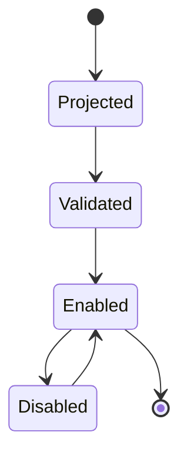

<a id="ucos-con-000006-workflows"></a>
##### Workflows

- policy projects rule → static validation → conflict reconciliation → enable → evaluate at runtime

<a id="ucos-con-000006-authorities"></a>
##### Authorities

- Inherits parent policy's authority; no independent authority.

<a id="ucos-con-000006-permissions"></a>
##### Permissions

- rule.evaluate (runtime, scoped)
- rule.disable (parent policy authority)
- rule.reorder (parent policy authority)

<a id="ucos-con-000006-privacy-model"></a>
##### Privacy Model

Rule expressions over personal data must carry the consent scope of their parent policy; evaluation logs minimize captured facts.

<a id="ucos-con-000006-audit-model"></a>
##### Audit Model

Every RuleEvaluated records input facts, matched rule, effect, and evaluation time. Deterministic replay must reproduce identical outcomes.

<a id="ucos-con-000006-digital-twin-model"></a>
##### Digital Twin Model

Rule Twin tracks real-world enforcement outcomes and flags divergence between rule effect and observed behavior.

<a id="ucos-con-000006-agent-model"></a>
##### Agent Model

Rule Agent detects unreachable or redundant rules and proposes pruning under governance.

<a id="ucos-con-000006-runtime-model"></a>
##### Runtime Model

Rules compile to a decision DAG per Context; evaluation is fact-driven with short-circuit on Deny for mandatory policies.

<a id="ucos-con-000006-scaling-model"></a>
##### Scaling Model

DAG compilation cached per policy version; runtime evaluation is sub-millisecond. Hot paths are precompiled.

<a id="ucos-con-000006-multi-tenant-model"></a>
##### Multi-Tenant Model

Rules are tenant-scoped through their parent policy; cross-tenant evaluation is constitutionally forbidden.

<a id="ucos-con-000006-geo-distribution-model"></a>
##### Geo-Distribution Model

Rule evaluation is local per region; the compiled DAG is replicated, authoritative projection stays in jurisdiction.

<a id="ucos-con-000006-failure-model"></a>
##### Failure Model

Non-deterministic expression, projection drift from policy, evaluation timeout, conflicting effects at equal priority.

<a id="ucos-con-000006-recovery-model"></a>
##### Recovery Model

Rules are derived, so recovery is re-projection from the parent policy. No rule is ever hand-restored.

<a id="ucos-con-000006-certification-model"></a>
##### Certification Model

Rule must pass determinism (same facts → same effect), policy conformance, and termination guarantees.

<a id="ucos-con-000006-migration-model"></a>
##### Migration Model

Expression language evolves by registry; existing rules re-project on language version change.

<a id="ucos-con-000006-implementation-blueprint"></a>
##### Implementation Blueprint

Build order for RUL: (1) define registry entries — this domain owns by effect: permit / deny / require / transform / notify / defer as registry truth, not code; (2) implement the contract surface first (rule.evaluate, rule.validate, rule.reorder) and validate against RUL boundaries; (3) event-source all state so history is reconstructable; (4) wire the enforcement points — authority check, policy guard, evidence binding, trace — in-line, with no bypass path; (5) add tests per the Testing Architecture, citing evidence per gate; (6) obtain Verification and Certification before activation. Acceptance: the Zero Partial and Law 001 audits pass, every action answers the seven explainability questions, and this domain mutates no other domain internals.

<a id="ucos-con-000006-sequence-diagrams"></a>
##### Sequence Diagrams

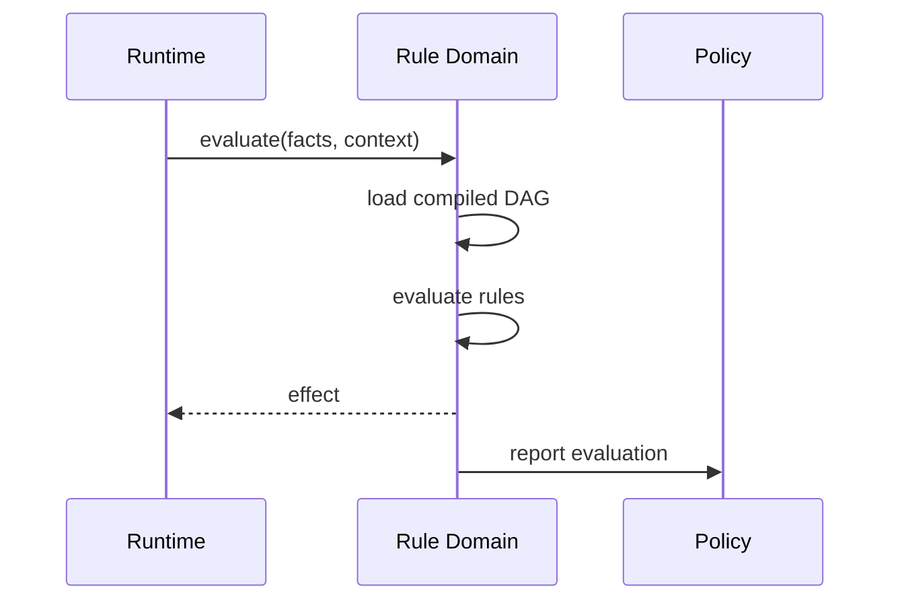

<a id="ucos-con-000006-state-diagrams"></a>
##### State Diagrams

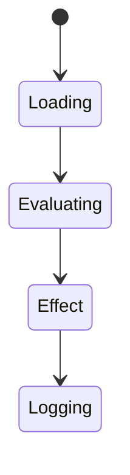

<a id="ucos-con-000007"></a>
#### UCOS-CON-000007 · Privacy Constitution

Owner [Constitutional Authority](#d-con) · managed in `_registry/manifest.json` → `UCOS-CON-000007`, content `_registry/content-core.json` → `AUT` · inherits the [standard contract](../UCOS-MASTER.md#standard-contract)

<a id="ucos-con-000007-concepts"></a>
##### Concepts

Authority is the right to govern within a jurisdiction. Authority ≠ Ownership: authority is the right; ownership is the responsibility. Authority is delegable, revocable, and always bounded.

<a id="ucos-con-000007-ontology"></a>
##### Ontology

Authority has a Jurisdiction, Rights, Responsibilities, and a delegating parent Authority. Types: Platform / Tenant / Country / Regulatory / Corporate / Future — all registry-driven.

<a id="ucos-con-000007-taxonomy"></a>
##### Taxonomy

By scope: Universal / Jurisdictional / Organizational / Contextual. By source: Constitutional / Delegated / Assumed (weakest) / Attested.

<a id="ucos-con-000007-data-model"></a>
##### Data Model

```yaml
Authority:
  authorityId: <Identity>
  type: <registry id>
  jurisdiction: <Context>
  rights: [<registry capability>]
  responsibilities: [<registry obligation>]
  delegatedFrom: <Authority|null>
  temporal: {grantedAt, revokedAt}
  status: <Active|Revoked|Expired>
```

<a id="ucos-con-000007-graph-model"></a>
##### Graph Model

(:Authority)-[:DELEGATED_FROM*]->(:Authority); (:Authority)-[:JURISDICTION]->(:Context); (:Authority)-[:GRANTS]->(:Policy|:Permission); (:Authority)<-[:ASSERTED_BY]-(:Knowledge)

<a id="ucos-con-000007-apis"></a>
##### APIs

- POST /authority.v1.grant
- POST /authority.v1.delegate
- POST /authority.v1.revoke
- GET  /authority.v1/{id}
- GET  /authority.v1.resolve

<a id="ucos-con-000007-events"></a>
##### Events

- AuthorityGranted
- AuthorityDelegated
- AuthorityRevoked
- AuthorityChallenged
- AuthorityExpired
- AuthorityChainViolation

<a id="ucos-con-000007-commands"></a>
##### Commands

- authority.grant
- authority.delegate
- authority.revoke
- authority.attest
- authority.challenge

<a id="ucos-con-000007-queries"></a>
##### Queries

- authority.byId
- authority.resolve
- authority.chain
- authority.jurisdiction
- authority.conflicts

<a id="ucos-con-000007-state-machines"></a>
##### State Machines

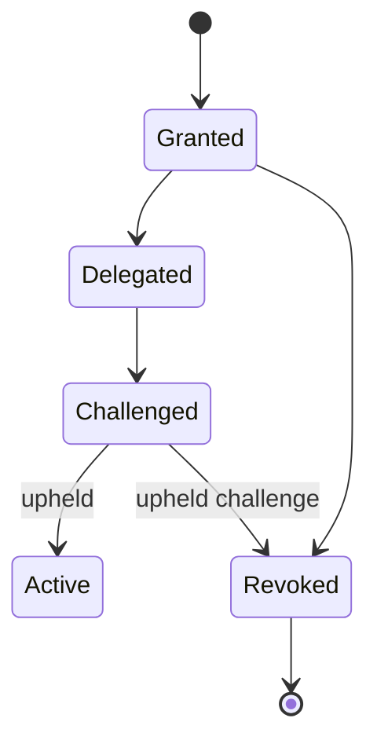

<a id="ucos-con-000007-workflows"></a>
##### Workflows

- grant → scope to jurisdiction → delegate with reduced rights → challenge on suspicion → revoke with cascade to derived authorities

<a id="ucos-con-000007-authorities"></a>
##### Authorities

- Constitutional Authority is self-sovereign; all others derive from it.

<a id="ucos-con-000007-permissions"></a>
##### Permissions

- authority.grant (holder of the right being granted)
- authority.delegate (holder, with rights subset)
- authority.revoke (granter or higher)

<a id="ucos-con-000007-privacy-model"></a>
##### Privacy Model

Authority chains over personal jurisdictions are auditable but access-restricted; revocation of consent cascades to derived grants.

<a id="ucos-con-000007-audit-model"></a>
##### Audit Model

Every governed action records its full authority chain back to the Constitutional Authority. Untraceable chains are denied by default.

<a id="ucos-con-000007-digital-twin-model"></a>
##### Digital Twin Model

Authority Twin mirrors real-world governance changes (e.g., regulatory body restructure) and cascades them through delegations.

<a id="ucos-con-000007-agent-model"></a>
##### Agent Model

Authority Agent detects over-broad delegations and authority chain anomalies, challenging them under governance.

<a id="ucos-con-000007-runtime-model"></a>
##### Runtime Model

Resolution walks the delegation chain with memoization; revocation invalidates the entire derived subtree.

<a id="ucos-con-000007-scaling-model"></a>
##### Scaling Model

Chain depth is bounded by constitution. Resolution cached per (Authority, right); invalidation on AuthorityRevoked.

<a id="ucos-con-000007-multi-tenant-model"></a>
##### Multi-Tenant Model

Tenant authority is bounded by constitutional authority — delegation cannot exceed the granter's rights (monotone decreasing).

<a id="ucos-con-000007-geo-distribution-model"></a>
##### Geo-Distribution Model

Jurisdictional authority is geo-scoped; cross-jurisdiction action requires authority recognized in both — or is denied.

<a id="ucos-con-000007-failure-model"></a>
##### Failure Model

Delegation cycle, rights inflation (child > parent), orphaned chain after revocation, jurisdiction gap.

<a id="ucos-con-000007-recovery-model"></a>
##### Recovery Model

Chains are append-only; revocation is a terminal event. Recovery rebuilds the effective-authority projection from the chain.

<a id="ucos-con-000007-certification-model"></a>
##### Certification Model

Authority must pass chain traceability, rights monotonicity, jurisdiction validity, and non-expiration.

<a id="ucos-con-000007-migration-model"></a>
##### Migration Model

New authority types are registry additions; existing chains re-resolve on type change.

<a id="ucos-con-000007-implementation-blueprint"></a>
##### Implementation Blueprint

Build order for AUT: (1) define registry entries — this domain owns by scope: universal / jurisdictional / organizational / contextual as registry truth, not code; (2) implement the contract surface first (authority.grant, authority.delegate, authority.revoke) and validate against AUT boundaries; (3) event-source all state so history is reconstructable; (4) wire the enforcement points — authority check, policy guard, evidence binding, trace — in-line, with no bypass path; (5) add tests per the Testing Architecture, citing evidence per gate; (6) obtain Verification and Certification before activation. Acceptance: the Zero Partial and Law 001 audits pass, every action answers the seven explainability questions, and this domain mutates no other domain internals.

<a id="ucos-con-000007-sequence-diagrams"></a>
##### Sequence Diagrams

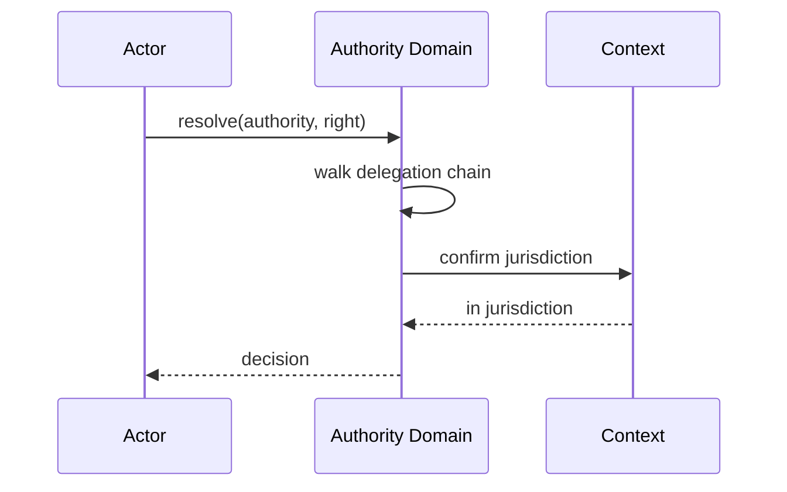

<a id="ucos-con-000007-state-diagrams"></a>
##### State Diagrams

```mermaid
stateDiagram-v2
    [*] --> Resolving
    Resolving --> Tracing
    Tracing --> Scoping
    Scoping --> Decided
```

<a id="ucos-con-000008"></a>
#### UCOS-CON-000008 · Trust Constitution

Owner [Constitutional Authority](#d-con) · managed in `_registry/manifest.json` → `UCOS-CON-000008`, content `_registry/content-core.json` → `TRS` · inherits the [standard contract](../UCOS-MASTER.md#standard-contract)

<a id="ucos-con-000008-concepts"></a>
##### Concepts

Trust is computed confidence in an assertion, derived from evidence. Trust ≠ Evidence and Trust ≠ Faith: it is a score, recomputable, always current, never asserted. Trust degrades without corroboration.

<a id="ucos-con-000008-ontology"></a>
##### Ontology

Trust is a function over (Evidence, Authority, Consistency, Provenance, Confidence). Trust has a timestamp — stale trust decays. Trust is per-Context.

<a id="ucos-con-000008-taxonomy"></a>
##### Taxonomy

By subject: Identity / Knowledge / Relationship / Authority / Agent. By method: Evidence-weighted / Authority-weighted / Consistency-weighted / Consensus / Decay-based.

<a id="ucos-con-000008-data-model"></a>
##### Data Model

```yaml
Trust:
  trustId: <Identity>
  subject: <Identity>
  evidenceScore: <0..1>
  authorityScore: <0..1>
  consistencyScore: <0..1>
  provenanceScore: <0..1>
  confidenceScore: <0..1>
  composite: <0..1, registry formula>
  computedAt: <Time>
  context: <Context>
  decayPolicy: <Policy>
```

<a id="ucos-con-000008-graph-model"></a>
##### Graph Model

(:Trust)-[:SCORES]->(:Identity|:Knowledge|:Relationship|:Authority); (:Trust)-[:DERIVED_FROM]->(:Evidence); (:Trust)-[:DECAYS_PER]->(:Policy)

<a id="ucos-con-000008-apis"></a>
##### APIs

- GET  /trust.v1/{subjectId}
- POST /trust.v1/recompute
- GET  /trust.v1.history/{subjectId}
- GET  /trust.v1.compare

<a id="ucos-con-000008-events"></a>
##### Events

- TrustComputed
- TrustDecayed
- TrustDisputed
- TrustThresholdCrossed
- TrustRecomputed

<a id="ucos-con-000008-commands"></a>
##### Commands

- trust.recompute
- trust.decay
- trust.cite
- trust.dispute

<a id="ucos-con-000008-queries"></a>
##### Queries

- trust.bySubject
- trust.history
- trust.distribution
- trust.belowThreshold
- trust.byContext

<a id="ucos-con-000008-state-machines"></a>
##### State Machines

```mermaid
stateDiagram-v2
    [*] --> Stale
    Stale --> Computing
    Computing --> Current
    Current --> Stale: decay interval
    Current --> Disputed
    Disputed --> Computing
```

<a id="ucos-con-000008-workflows"></a>
##### Workflows

- gather evidence → weight by authority → measure consistency → score provenance → apply confidence → composite → publish → schedule decay

<a id="ucos-con-000008-authorities"></a>
##### Authorities

- Trust Domain computes; it does not assert. Authority Domain supplies the authority weight; Trust never overrides it.

<a id="ucos-con-000008-permissions"></a>
##### Permissions

- trust.read (subject owner or scoped)
- trust.recompute (system)
- trust.dispute (peer authority)

<a id="ucos-con-000008-privacy-model"></a>
##### Privacy Model

Trust over personal subjects is derived from minimized evidence; raw evidence is not exposed, only the score and its factor breakdown.

<a id="ucos-con-000008-audit-model"></a>
##### Audit Model

Every score is reproducible: inputs, weights, formula version, and timestamp are recorded. A score that cannot be reproduced is void.

<a id="ucos-con-000008-digital-twin-model"></a>
##### Digital Twin Model

Trust Twin tracks real-world reputation drift and flags divergence between computed trust and observed outcomes.

<a id="ucos-con-000008-agent-model"></a>
##### Agent Model

Trust Agent continuously recomputes decaying scores and raises TrustThresholdCrossed for governance attention.

<a id="ucos-con-000008-runtime-model"></a>
##### Runtime Model

Scores are read-optimized projections recomputed on evidence change or decay tick; never stored as primary truth.

<a id="ucos-con-000008-scaling-model"></a>
##### Scaling Model

Recomputation is a stream job over evidence events; composite scores cached per (subject, context) with decay-aware TTL.

<a id="ucos-con-000008-multi-tenant-model"></a>
##### Multi-Tenant Model

Trust is tenant-scoped; a subject's trust in one tenant says nothing about another unless a shared Context exists.

<a id="ucos-con-000008-geo-distribution-model"></a>
##### Geo-Distribution Model

Trust factors are jurisdiction-weighted: an authority's weight is Context-dependent, so the same evidence yields different scores per jurisdiction — by design.

<a id="ucos-con-000008-failure-model"></a>
##### Failure Model

Evidence starvation, formula drift across versions, authority score corruption, decay cascade.

<a id="ucos-con-000008-recovery-model"></a>
##### Recovery Model

Scores are recomputable from evidence history; a corrupted score is regenerated, never restored from backup.

<a id="ucos-con-000008-certification-model"></a>
##### Certification Model

Trust score must be reproducible, timestamped, formula-versioned, and within threshold for its subject's certifications.

<a id="ucos-con-000008-migration-model"></a>
##### Migration Model

Formula evolves by registry version; recomputation triggers on version change with full history replay.

<a id="ucos-con-000008-implementation-blueprint"></a>
##### Implementation Blueprint

Build order for TRS: (1) define registry entries — this domain owns by subject: identity / knowledge / relationship / authority / agent as registry truth, not code; (2) implement the contract surface first (trust.recompute, trust.decay, trust.cite) and validate against TRS boundaries; (3) event-source all state so history is reconstructable; (4) wire the enforcement points — authority check, policy guard, evidence binding, trace — in-line, with no bypass path; (5) add tests per the Testing Architecture, citing evidence per gate; (6) obtain Verification and Certification before activation. Acceptance: the Zero Partial and Law 001 audits pass, every action answers the seven explainability questions, and this domain mutates no other domain internals.

<a id="ucos-con-000008-sequence-diagrams"></a>
##### Sequence Diagrams

```mermaid
sequenceDiagram
    participant E as Evidence Event
    participant TR as Trust Domain
    participant AU as Authority
    E->>TR: new evidence
    TR->>AU: authority weight
    AU-->>TR: weight
    TR->>TR: compute composite
    TR-->>E: TrustComputed
```

<a id="ucos-con-000008-state-diagrams"></a>
##### State Diagrams

```mermaid
stateDiagram-v2
    [*] --> Evidenced
    Evidenced --> Weighted
    Weighted --> Composed
    Composed --> Published
```

<a id="ucos-con-000009"></a>
#### UCOS-CON-000009 · Evolution Constitution

Owner [Constitutional Authority](#d-con) · managed in `_registry/manifest.json` → `UCOS-CON-000009`, content `_registry/content-core.json` → `EVO` · inherits the [standard contract](../UCOS-MASTER.md#standard-contract)

<a id="ucos-con-000009-concepts"></a>
##### Concepts

Evolution is governed change over time that preserves history. Nothing evolves without governance; nothing that evolved is forgotten. Evolution covers Ontology, Schema, Policy, Capability, Workflow, API, Agent, and Knowledge evolution.

<a id="ucos-con-000009-ontology"></a>
##### Ontology

Evolution has a Subject, a Change, a Rationale, an Authority, and a preserved History. Emergence is evolution's un-planned cousin: properties arising from interaction that were not present in the parts.

<a id="ucos-con-000009-taxonomy"></a>
##### Taxonomy

By intent: Planned / Emergent. By impact: Additive / Breaking / Deprecated-path. By scope: Primitive-level (constitution only) / Registry-level / Projection-level.

<a id="ucos-con-000009-data-model"></a>
##### Data Model

```yaml
Evolution:
  evolutionId: <Identity>
  subject: <Identity>
  changeType: <registry id>
  from: <prior version ref>
  to: <new version ref>
  rationale: <Knowledge>
  authority: <Authority>
  temporal: {effectiveAt}
  supersession: {priorVersions: [...], historyPreserved: true}
```

<a id="ucos-con-000009-graph-model"></a>
##### Graph Model

(:Evolution)-[:EVOLVES]->(:Identity); (:Evolution)-[:SUPERSEDES_VERSION]->(:Evolution); (:Evolution)-[:DRIVES]->(:Emergence); (:Evolution)-[:APPROVED_BY]->(:Authority)

<a id="ucos-con-000009-apis"></a>
##### APIs

- POST /evolution.v1.propose
- POST /evolution.v1.approve
- GET  /evolution.v1/{id}
- GET  /evolution.v1.history/{subjectId}

<a id="ucos-con-000009-events"></a>
##### Events

- EvolutionProposed
- EvolutionApproved
- EvolutionActivated
- EvolutionRolledBack
- EmergenceDetected
- EmergenceRecorded

<a id="ucos-con-000009-commands"></a>
##### Commands

- evolution.propose
- evolution.approve
- evolution.activate
- evolution.rollback
- emergence.record

<a id="ucos-con-000009-queries"></a>
##### Queries

- evolution.history
- evolution.pending
- evolution.bySubject
- emergence.detected
- evolution.impact

<a id="ucos-con-000009-state-machines"></a>
##### State Machines

```mermaid
stateDiagram-v2
    [*] --> Proposed
    Proposed --> Approved
    Approved --> Activated
    Activated --> RolledBack
    Activated --> [*]
    RolledBack --> [*]
```

<a id="ucos-con-000009-workflows"></a>
##### Workflows

- propose with rationale → impact analysis → approve by authority → activate with prior version preserved → publish → monitor emergence

<a id="ucos-con-000009-authorities"></a>
##### Authorities

- Evolution Authority (registry-level); Constitutional Assembly (primitive-level only)

<a id="ucos-con-000009-permissions"></a>
##### Permissions

- evolution.propose (any authority)
- evolution.approve (subject's owning authority)
- evolution.rollback (approving authority)

<a id="ucos-con-000009-privacy-model"></a>
##### Privacy Model

Evolution of privacy-relevant subjects triggers consent re-evaluation; changes cannot silently widen data use.

<a id="ucos-con-000009-audit-model"></a>
##### Audit Model

Every change records rationale, authority, impact, and prior state. History is never rewritten — only superseded.

<a id="ucos-con-000009-digital-twin-model"></a>
##### Digital Twin Model

Evolution drives twin model versioning; a twin's history is as valuable as its current state.

<a id="ucos-con-000009-agent-model"></a>
##### Agent Model

Evolution Agent proposes changes from observed drift; Emergence Agent detects system-level properties for governance review.

<a id="ucos-con-000009-runtime-model"></a>
##### Runtime Model

Version resolution prefers latest activated; historical queries time-travel via the version chain.

<a id="ucos-con-000009-scaling-model"></a>
##### Scaling Model

Version chains are append-only and shard by subject; time-travel queries are bounded by retention policy.

<a id="ucos-con-000009-multi-tenant-model"></a>
##### Multi-Tenant Model

Tenant-level evolution cannot alter shared ontology; shared changes go through the Evolution Authority.

<a id="ucos-con-000009-geo-distribution-model"></a>
##### Geo-Distribution Model

Evolution activation is jurisdiction-aware; a change legal in one region rolls out per regional policy.

<a id="ucos-con-000009-failure-model"></a>
##### Failure Model

Breaking change without deprecation, orphaned version chain, emergence runaway, rollback failure.

<a id="ucos-con-000009-recovery-model"></a>
##### Recovery Model

Rollback is a first-class command that activates the prior version — never a data restore. History remains intact either way.

<a id="ucos-con-000009-certification-model"></a>
##### Certification Model

Evolution must pass impact analysis, deprecation path (for breaking changes), authority jurisdiction, and history preservation.

<a id="ucos-con-000009-migration-model"></a>
##### Migration Model

Migration IS evolution — there is no separate migration path. All changes flow through this domain.

<a id="ucos-con-000009-implementation-blueprint"></a>
##### Implementation Blueprint

Build order for EVO: (1) define registry entries — this domain owns by intent: planned / emergent as registry truth, not code; (2) implement the contract surface first (evolution.propose, evolution.approve, evolution.activate) and validate against EVO boundaries; (3) event-source all state so history is reconstructable; (4) wire the enforcement points — authority check, policy guard, evidence binding, trace — in-line, with no bypass path; (5) add tests per the Testing Architecture, citing evidence per gate; (6) obtain Verification and Certification before activation. Acceptance: the Zero Partial and Law 001 audits pass, every action answers the seven explainability questions, and this domain mutates no other domain internals.

<a id="ucos-con-000009-sequence-diagrams"></a>
##### Sequence Diagrams

```mermaid
sequenceDiagram
    participant P as Proposer
    participant EV as Evolution Domain
    participant AU as Authority
    P->>EV: propose(change, rationale)
    EV->>EV: impact analysis
    EV->>AU: approve
    AU-->>EV: approved
    EV->>EV: activate (history preserved)
    EV-->>P: EvolutionActivated
```

<a id="ucos-con-000009-state-diagrams"></a>
##### State Diagrams

```mermaid
stateDiagram-v2
    [*] --> Impacting
    Impacting --> Approving
    Approving --> Activating
    Activating --> Monitoring
```

<a id="ucos-con-000010"></a>
#### UCOS-CON-000010 · Certification Constitution

Owner [Constitutional Authority](#d-con) · managed in `_registry/manifest.json` → `UCOS-CON-000010`, content `_registry/content-core.json` → `EVD` · inherits the [standard contract](../UCOS-MASTER.md#standard-contract)

<a id="ucos-con-000010-concepts"></a>
##### Concepts

Evidence is proof supporting an assertion. Evidence ≠ Knowledge and Evidence ≠ Trust: it supports knowledge and feeds trust; it is not itself understanding. Nothing exists without evidence.

<a id="ucos-con-000010-ontology"></a>
##### Ontology

Evidence has a Source, a Proof payload, Validity, and Confidence. Evidence types: Document / Signature / Timestamp / Attestation / Observation / Receipt / Hash-witness / Future type — all registry-driven.

<a id="ucos-con-000010-taxonomy"></a>
##### Taxonomy

By strength: Cryptographic / Attested / Observed / Claimed (weakest). By permanence: Immutable / Temporal / Revocable.

<a id="ucos-con-000010-data-model"></a>
##### Data Model

```yaml
Evidence:
  evidenceId: <Identity>
  type: <registry id>
  source: <Identity|Authority>
  proof: <content-addressed payload reference>
  validity: {verifiedAt, method, expiresAt}
  confidence: <0..1>
  chain: [parent evidence]
  metadata: <Metadata>
```

<a id="ucos-con-000010-graph-model"></a>
##### Graph Model

(:Evidence)-[:SUPPORTS]->(:Knowledge); (:Evidence)-[:SIGNED_BY]->(:Authority); (:Evidence)-[:DERIVED_FROM]->(:Evidence); (:Evidence)-[:REVOKED_BY]->(:Authority)

<a id="ucos-con-000010-apis"></a>
##### APIs

- POST /evidence.v1.submit
- GET  /evidence.v1/{id}
- POST /evidence.v1.verify
- POST /evidence.v1.revoke
- GET  /evidence.v1.chain/{id}

<a id="ucos-con-000010-events"></a>
##### Events

- EvidenceSubmitted
- EvidenceVerified
- EvidenceRevoked
- EvidenceChained
- EvidenceExpired

<a id="ucos-con-000010-commands"></a>
##### Commands

- evidence.submit
- evidence.verify
- evidence.revoke
- evidence.chain
- evidence.archive

<a id="ucos-con-000010-queries"></a>
##### Queries

- evidence.byId
- evidence.supporting
- evidence.bySource
- evidence.revoked
- evidence.chain

<a id="ucos-con-000010-state-machines"></a>
##### State Machines

```mermaid
stateDiagram-v2
    [*] --> Submitted
    Submitted --> Verified: method passes
    Submitted --> Rejected: method fails
    Verified --> Revoked: authority revokes
    Verified --> Expired: temporal end
    Revoked --> [*]
    Expired --> [*]
```

<a id="ucos-con-000010-workflows"></a>
##### Workflows

- submit → select verification method from registry → verify → chain to parent evidence → publish → schedule expiry

<a id="ucos-con-000010-authorities"></a>
##### Authorities

- Source Authority (submits)
- Verification Authority (attests method)
- Revocation Authority (original signer or higher)

<a id="ucos-con-000010-permissions"></a>
##### Permissions

- evidence.submit (authenticated)
- evidence.verify (verification authority)
- evidence.revoke (revocation authority)

<a id="ucos-con-000010-privacy-model"></a>
##### Privacy Model

Proof payloads are content-addressed and access-scoped; personal evidence follows the Consent Architecture's retention and erasure policy.

<a id="ucos-con-000010-audit-model"></a>
##### Audit Model

Every verification records method, verifier, timestamp, and result. Revocation never deletes — it invalidates downstream support and is logged.

<a id="ucos-con-000010-digital-twin-model"></a>
##### Digital Twin Model

Evidence Twin mirrors real-world proof status (e.g., a license expiring) and propagates expiry to dependent Knowledge.

<a id="ucos-con-000010-agent-model"></a>
##### Agent Model

Evidence Agent detects expiring and weak-chain evidence, triggering re-verification before downstream trust degrades.

<a id="ucos-con-000010-runtime-model"></a>
##### Runtime Model

Verification is method-dispatched from the registry; hot path caches verification results keyed by content hash.

<a id="ucos-con-000010-scaling-model"></a>
##### Scaling Model

Payloads are stored once, content-addressed; verification results are cached and invalidated on EvidenceRevoked.

<a id="ucos-con-000010-multi-tenant-model"></a>
##### Multi-Tenant Model

Evidence is tenant-scoped; cross-tenant citation requires explicit published relationship.

<a id="ucos-con-000010-geo-distribution-model"></a>
##### Geo-Distribution Model

Proof payloads follow Data Sovereignty residency; verification method availability varies by jurisdiction (e.g., eIDAS vs. eID).

<a id="ucos-con-000010-failure-model"></a>
##### Failure Model

Method unavailability, chain breakage, hash collision (mitigated by algorithm agility), revocation storm.

<a id="ucos-con-000010-recovery-model"></a>
##### Recovery Model

Content-addressed storage is self-verifying; recovery re-verifies hashes. Revoked evidence stays invalid — integrity over recoverability.

<a id="ucos-con-000010-certification-model"></a>
##### Certification Model

Evidence must pass method verification, chain integrity, non-expiration, and source authority validity.

<a id="ucos-con-000010-migration-model"></a>
##### Migration Model

New verification methods are registry additions; existing evidence re-verifies on method activation.

<a id="ucos-con-000010-implementation-blueprint"></a>
##### Implementation Blueprint

Build order for EVD: (1) define registry entries — this domain owns by strength: cryptographic / attested / observed / claimed (weakest) as registry truth, not code; (2) implement the contract surface first (evidence.submit, evidence.verify, evidence.revoke) and validate against EVD boundaries; (3) event-source all state so history is reconstructable; (4) wire the enforcement points — authority check, policy guard, evidence binding, trace — in-line, with no bypass path; (5) add tests per the Testing Architecture, citing evidence per gate; (6) obtain Verification and Certification before activation. Acceptance: the Zero Partial and Law 001 audits pass, every action answers the seven explainability questions, and this domain mutates no other domain internals.

<a id="ucos-con-000010-sequence-diagrams"></a>
##### Sequence Diagrams

```mermaid
sequenceDiagram
    participant S as Submitter
    participant EV as Evidence Domain
    participant VA as Verification Authority
    S->>EV: submit(proof, type)
    EV->>EV: resolve method
    EV->>VA: verify
    VA-->>EV: verified
    EV-->>S: EvidenceVerified
```

<a id="ucos-con-000010-state-diagrams"></a>
##### State Diagrams

```mermaid
stateDiagram-v2
    [*] --> Received
    Received --> MethodResolved
    MethodResolved --> Verified
    Verified --> Chained
```

