# Volume V02 · Meaning

**Part of** [the master document](../UCOS-MASTER.md) · **Category** C02 · **Projected from** `_registry/` — never edit this file: change the registry and run `npm run registry`.

> What exists, what it is called, and what is known about it.

## Contents

- [D-IDN Identity](#d-idn)
  - [UCOS-IDN-000001 Identity Architecture](#ucos-idn-000001)
- [D-SEM Semantic](#d-sem)
  - [UCOS-SEM-000001 Universal Semantic Architecture](#ucos-sem-000001)
  - [UCOS-ONT-000001 Universal Ontology](#ucos-ont-000001)
  - [UCOS-TAX-000001 Universal Taxonomy](#ucos-tax-000001)
  - [UCOS-CLS-000001 Universal Classification Architecture](#ucos-cls-000001)
- [D-KNW Knowledge](#d-knw)
  - [UCOS-KNW-000001 Knowledge Architecture](#ucos-knw-000001)
- [D-GDN Guidance](#d-gdn)
  - [UCOS-IMP-000001 Master Implementation Blueprint](#ucos-imp-000001)
  - [UCOS-IMP-000002 Reference Platform Architecture](#ucos-imp-000002)
  - [UCOS-IMP-000003 Engineering Playbook](#ucos-imp-000003)
  - [UCOS-IMP-000004 Migration Blueprint](#ucos-imp-000004)
  - [UCOS-IMP-000005 Delivery Roadmap](#ucos-imp-000005)
  - [UCOS-GDN-000001 Guidance Architecture](#ucos-gdn-000001)
- [D-PTY Party](#d-pty)
  - [UCOS-PTY-000001 Party Architecture](#ucos-pty-000001)

---

<a id="d-idn"></a>
### D-IDN · Identity

| | |
|---|---|
| **Category** | C02 Meaning |
| **Build status** | partial |
| **Owns** | [Identity](../UCOS-MASTER.md#t-identity), [Intent](../UCOS-MASTER.md#t-intent), [Existence](../UCOS-MASTER.md#t-existence), [Entity](../UCOS-MASTER.md#t-entity), [Identifier Scheme](../UCOS-MASTER.md#t-identifier-scheme) |
| **Responsible for** | Identity Creation, Identity Resolution, Identity Versioning, Identity Lineage |
| **Not responsible for** | Knowledge, Meaning, Policy, Trust |
| **Contract** | [UCOS-IDN-000001 Identity Architecture](#ucos-idn-000001) |
| **Artifacts** | [UCOS-IDN-000001](#ucos-idn-000001) |
| **Concepts** | 1349 — `node _registry/compile.js --search <words> --kind concept --owner "Identity"` |
| **Code** | `lib/uid.js`, `lib/kernel.js`, `lib/platform-master.js` |
| **Managed in** | `_registry/domains.json` → `D-IDN` |

**Live routes:** none yet.

<a id="ucos-idn-000001"></a>
#### UCOS-IDN-000001 · Identity Architecture

Owner [Identity](#d-idn) · managed in `_registry/manifest.json` → `UCOS-IDN-000001`, content `_registry/content-core.json` → `IDN` · inherits the [standard contract](../UCOS-MASTER.md#standard-contract)

<a id="ucos-idn-000001-concepts"></a>
##### Concepts

Identity is the constitutionally verifiable handle for any existence. It is namespace-partitioned, versioned, and lineage-carrying. External schemes (GTIN, EAN, UPC, ISBN, ISSN, IMEI, VIN, CUSIP, ISIN, HSN, SAC) and future schemes are represented WITHOUT schema change, as registry-driven fingerprints.

<a id="ucos-idn-000001-ontology"></a>
##### Ontology

Identity ⊂ Existence. Identity has exactly one Namespace. Identity ≥ 1 Fingerprint. Identity has 0..n Aliases. Identity has 1 Lineage chain. Identity is referenced by every other primitive as its anchor.

<a id="ucos-idn-000001-taxonomy"></a>
##### Taxonomy

By namespace: Platform / Tenant / External / Future. By strength: Provisional / Verified / Certified. By scope: Universal / Scoped / Ephemeral.

<a id="ucos-idn-000001-data-model"></a>
##### Data Model

```yaml
Identity:
  identityId: <uuid v7, sort-friendly>
  namespace: <registry-driven, never hardcoded>
  version: <monotonic integer>
  lineage:
    parentId: <Identity|null>
    forkOf: <Identity|null>
  aliases: [<Alias>]
  fingerprints:
    - scheme: <registry scheme id>   # GTIN|EAN|VIN|...|future
      value: <normalized string>
      checksum: <registry-validated>
  signatures: [<Signature>]
  temporal: {validFrom, validTo, observedAt}
  metadata: {provenance, trustRef}
```

<a id="ucos-idn-000001-graph-model"></a>
##### Graph Model

(:Identity)-[:LINEAGE_OF]->(:Identity); (:Identity)-[:ALIAS_OF]->(:Identity); (:Identity)-[:FINGERPRINT_IN]->(:Registry); (:Identity)<-[:ANCHORS]-(:Knowledge|:Relationship|:Policy)

<a id="ucos-idn-000001-apis"></a>
##### APIs

*Designed interface: the contract the domain is built towards. The routes it serves today are on its card.*

- POST /identity.v1.create
- POST /identity.v1.resolve
- GET  /identity.v1/{id}
- GET  /identity.v1/{id}/lineage
- POST /identity.v1/{id}/alias
- POST /identity.v1/{id}/verify

<a id="ucos-idn-000001-events"></a>
##### Events

- IdentityCreated
- IdentityResolved
- IdentityVerified
- IdentityAliased
- IdentityDeprecated
- IdentityMerged
- IdentityConflictDetected

<a id="ucos-idn-000001-commands"></a>
##### Commands

- identity.create
- identity.resolve
- identity.alias.add
- identity.verify
- identity.deprecate
- identity.fork
- identity.merge

<a id="ucos-idn-000001-queries"></a>
##### Queries

- identity.byId
- identity.byFingerprint
- identity.byAlias
- identity.lineage
- identity.resolveBatch
- identity.conflicts

<a id="ucos-idn-000001-state-machines"></a>
##### State Machines

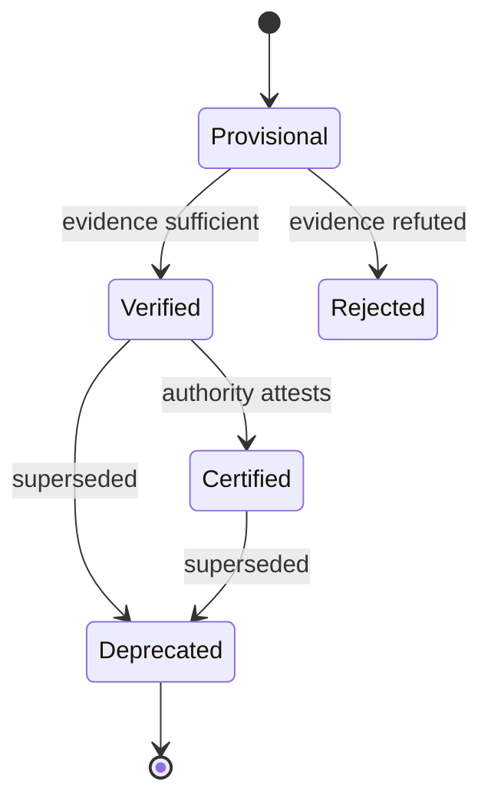

<a id="ucos-idn-000001-workflows"></a>
##### Workflows

- resolve external scheme → registry lookup → fingerprint match → evidence capture → authority attestation → publish IdentityVerified

<a id="ucos-idn-000001-authorities"></a>
##### Authorities

- Platform Authority (namespace creation)
- Tenant Authority (scoped identity)
- External Authority (attestation of external schemes)

<a id="ucos-idn-000001-permissions"></a>
##### Permissions

- identity.create (tenant admin)
- identity.verify (trusted attestor)
- identity.merge (platform authority)
- identity.read (any authenticated)

<a id="ucos-idn-000001-privacy-model"></a>
##### Privacy Model

Aliases and fingerprints are pseudonymous. Direct identifiers require consent scope `identity:read`. Resolution logs are minimized and retention-governed by the Consent Architecture.

<a id="ucos-idn-000001-audit-model"></a>
##### Audit Model

Every resolution records: who resolved, which fingerprint matched, under which authority, with what evidence, at what confidence. Immutable, append-only, cryptographically chained.

<a id="ucos-idn-000001-digital-twin-model"></a>
##### Digital Twin Model

Identity Twin mirrors the real-world identifier state across registries (e.g., a GS1 GTIN changing ownership), continuously synchronized via the Twin Federation.

<a id="ucos-idn-000001-agent-model"></a>
##### Agent Model

Identity Agent monitors fingerprint collisions, lineage forks, and stale aliases, raising IdentityConflictDetected under governance.

<a id="ucos-idn-000001-runtime-model"></a>
##### Runtime Model

Stateless resolution service with a versioned cache keyed by (namespace, normalized fingerprint). Cache invalidation on IdentityDeprecated/IdentityMerged events.

<a id="ucos-idn-000001-scaling-model"></a>
##### Scaling Model

Read-heavy (>99%). Partition by namespace; replicate globally; resolve via content-addressable fingerprint index. Write path is authority-sharded.

<a id="ucos-idn-000001-multi-tenant-model"></a>
##### Multi-Tenant Model

Namespace isolation is mandatory: a tenant can never read another tenant's scoped identities unless an explicit cross-tenant Relationship + Policy permits it.

<a id="ucos-idn-000001-geo-distribution-model"></a>
##### Geo-Distribution Model

Resolution is locally served per region with fingerprint-index replicas; authoritative write quorum remains in the tenant's home jurisdiction per Data Sovereignty.

<a id="ucos-idn-000001-failure-model"></a>
##### Failure Model

Fingerprint collision, alias loop, lineage cycle, authority unavailability, checksum drift on external scheme change.

<a id="ucos-idn-000001-recovery-model"></a>
##### Recovery Model

Lineage is an immutable append-only log; recovery = replay. Deleted aliases are reconstructable from the chain. IdentityMerged is reversible via compensating event.

<a id="ucos-idn-000001-certification-model"></a>
##### Certification Model

Identity must pass checksum validity, lineage acyclicity, namespace ownership, and fingerprint uniqueness before it may anchor any Knowledge or Relationship.

<a id="ucos-idn-000001-migration-model"></a>
##### Migration Model

External scheme migration (e.g., UPC→GTIN-13) is a registry-driven re-fingerprint, never a schema migration. Old fingerprints remain valid aliases.

<a id="ucos-idn-000001-implementation-blueprint"></a>
##### Implementation Blueprint

Build order for IDN: (1) define registry entries — this domain owns by namespace: platform / tenant / external / future as registry truth, not code; (2) implement the contract surface first (identity.create, identity.resolve, identity.alias.add) and validate against IDN boundaries; (3) event-source all state so history is reconstructable; (4) wire the enforcement points — authority check, policy guard, evidence binding, trace — in-line, with no bypass path; (5) add tests per the Testing Architecture, citing evidence per gate; (6) obtain Verification and Certification before activation. Acceptance: the Zero Partial and Law 001 audits pass, every action answers the seven explainability questions, and this domain mutates no other domain internals.

<a id="ucos-idn-000001-sequence-diagrams"></a>
##### Sequence Diagrams

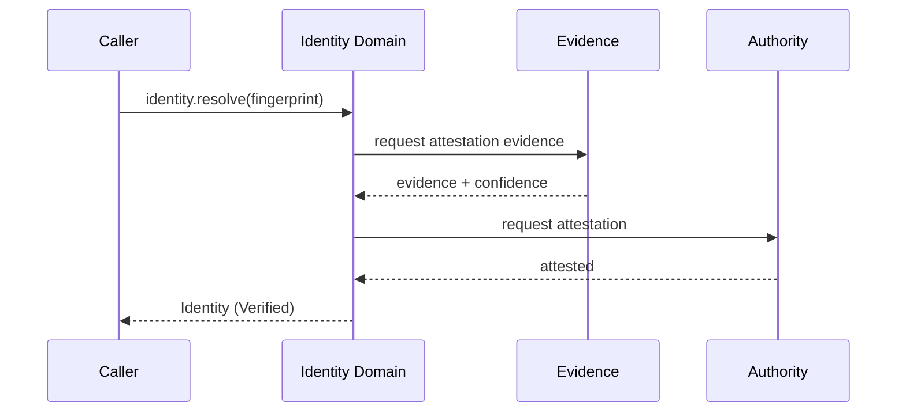

<a id="ucos-idn-000001-state-diagrams"></a>
##### State Diagrams

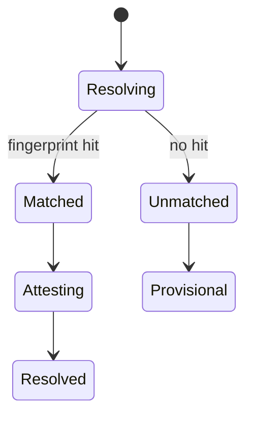

---

<a id="d-sem"></a>
### D-SEM · Semantic

| | |
|---|---|
| **Category** | C02 Meaning |
| **Build status** | partial |
| **Owns** | [Meaning](../UCOS-MASTER.md#t-meaning), [Ontology](../UCOS-MASTER.md#t-ontology), [Taxonomy](../UCOS-MASTER.md#t-taxonomy), [Classification](../UCOS-MASTER.md#t-classification) |
| **Responsible for** | Meaning, Ontology, Taxonomy, Classification |
| **Not responsible for** | Knowledge Validation, Identity, Policy |
| **Contract** | [UCOS-SEM-000001 Universal Semantic Architecture](#ucos-sem-000001) |
| **Artifacts** | [UCOS-SEM-000001](#ucos-sem-000001), [UCOS-ONT-000001](#ucos-ont-000001), [UCOS-TAX-000001](#ucos-tax-000001), [UCOS-CLS-000001](#ucos-cls-000001) |
| **Concepts** | 314 — `node _registry/compile.js --search <words> --kind concept --owner "Semantic"` |
| **Code** | `lib/store-taxonomy.js`, `lib/platform-master.js`, `lib/seed/master.json` |
| **Managed in** | `_registry/domains.json` → `D-SEM` |

**Live routes (12)** — what the platform serves today for this domain:

- `GET /api/platform/master/tree`
- `GET /api/platform/master/vocabulary/:key`
- `GET /api/taxonomy`
- `GET /api/admin/taxonomy`
- `POST /api/admin/taxonomy`
- `PUT /api/admin/taxonomy/:id`
- `DELETE /api/admin/taxonomy/:id`
- `GET /api/admin/departments`
- `POST /api/admin/departments`
- `DELETE /api/admin/departments/:key`
- `POST /api/admin/segments/members`
- `DELETE /api/admin/segments/members/:id`

<a id="ucos-sem-000001"></a>
#### UCOS-SEM-000001 · Universal Semantic Architecture

Owner [Semantic](#d-sem) · managed in `_registry/manifest.json` → `UCOS-SEM-000001`, content `_registry/content-ext.json` → `SEM` · inherits the [standard contract](../UCOS-MASTER.md#standard-contract)

<a id="ucos-sem-000001-concepts"></a>
##### Concepts

The Semantic System understands meaning. Phone, Mobile, Cellphone, Smartphone, and Handset are one semantic concept with many lexical surfaces. Meaning is higher-level understanding — it is not classification, not taxonomy, not ontology.

<a id="ucos-sem-000001-ontology"></a>
##### Ontology

Meaning ⊂ Existence. A Concept has 1 canonical Meaning, 0..n LexicalSurfaces, 0..n Equivalencies, and language-neutral intent. Ontology says what exists; taxonomy says how it is classified; meaning says what it signifies.

<a id="ucos-sem-000001-taxonomy"></a>
##### Taxonomy

By depth: Concept / Property / Relation. By status: Canonical / Equivalent / Candidate / Deprecated. By language coverage: Universal / Locale-specific.

<a id="ucos-sem-000001-data-model"></a>
##### Data Model

```yaml
SemanticModel:
  conceptId: <Identity>
  canonicalName: <string>
  meaning: <semantic statement>
  lexicalSurfaces: [{locale, surface, register}]
  equivalencies: [<conceptId>]
  synonyms: [<surface>]
  translations: [{locale, equivalent}]
  ontologyRef: <Ontology node>
  status: <Canonical|Equivalent|Candidate|Deprecated>
```

<a id="ucos-sem-000001-graph-model"></a>
##### Graph Model

(:Concept)-[:EQUIVALENT_TO]->(:Concept); (:Concept)-[:SURFACE_IN]->(:Language); (:Concept)-[:MEMBER_OF]->(:Ontology); (:Concept)-[:CLASSIFIED_AS]->(:Taxonomy)

<a id="ucos-sem-000001-apis"></a>
##### APIs

*Designed interface: the contract the domain is built towards. The routes it serves today are on its card.*

- POST /semantic.v1.concept.create
- POST /semantic.v1.resolve
- GET  /semantic.v1/{id}
- POST /semantic.v1.translate
- GET  /semantic.v1.equivalents/{id}

<a id="ucos-sem-000001-events"></a>
##### Events

- ConceptCreated
- ConceptEquivalencyAdded
- ConceptDeprecated
- MeaningDisambiguated

<a id="ucos-sem-000001-commands"></a>
##### Commands

- semantic.concept.create
- semantic.resolve
- semantic.equivalency.add
- semantic.translate
- semantic.deprecate

<a id="ucos-sem-000001-queries"></a>
##### Queries

- semantic.bySurface
- semantic.equivalents
- semantic.byLocale
- semantic.disambiguate

<a id="ucos-sem-000001-state-machines"></a>
##### State Machines

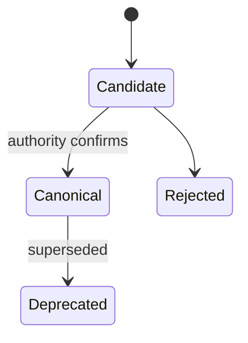

<a id="ucos-sem-000001-workflows"></a>
##### Workflows

- surface detected → disambiguate against existing concepts → propose or merge → authority confirms → publish canonical

<a id="ucos-sem-000001-authorities"></a>
##### Authorities

- Semantic Authority (canonical confirmation)
- Locale Authority (translation validity)

<a id="ucos-sem-000001-permissions"></a>
##### Permissions

- semantic.concept.create (semantic authority)
- semantic.resolve (any authenticated)
- semantic.deprecate (semantic authority)

<a id="ucos-sem-000001-privacy-model"></a>
##### Privacy Model

Semantic resolution does not retain query content; disambiguation logs store hashes, not surfaces.

<a id="ucos-sem-000001-audit-model"></a>
##### Audit Model

Every equivalency records who asserted it, under which authority, with which evidence. Ambiguity is preserved, never silently resolved.

<a id="ucos-sem-000001-digital-twin-model"></a>
##### Digital Twin Model

Semantic Twin tracks real-world language drift — neologisms, shifted meanings — and proposes concept updates.

<a id="ucos-sem-000001-agent-model"></a>
##### Agent Model

Semantic Agent discovers new surfaces from observations and proposes equivalencies under governance.

<a id="ucos-sem-000001-runtime-model"></a>
##### Runtime Model

Resolution is a locale-aware disambiguation lookup; ambiguity returns candidate sets, not guesses.

<a id="ucos-sem-000001-scaling-model"></a>
##### Scaling Model

Concept index is globally replicated; locale surfaces are partitioned by locale with lazy loading.

<a id="ucos-sem-000001-multi-tenant-model"></a>
##### Multi-Tenant Model

Tenants may extend semantics but cannot redefine canonical concepts — those are shared truth.

<a id="ucos-sem-000001-geo-distribution-model"></a>
##### Geo-Distribution Model

Locale resolution is region-served; canonical truth is global.

<a id="ucos-sem-000001-failure-model"></a>
##### Failure Model

Ambiguity collapse, equivalency cycle, locale coverage gap, meaning drift undetected.

<a id="ucos-sem-000001-recovery-model"></a>
##### Recovery Model

Concepts are versioned; deprecation supersedes. Equivalency cycles are detected and rejected at write time.

<a id="ucos-sem-000001-certification-model"></a>
##### Certification Model

Concept must pass uniqueness of canonical name, acyclicity of equivalency, and locale coverage.

<a id="ucos-sem-000001-migration-model"></a>
##### Migration Model

New locales and registers are registry additions; no schema change.

<a id="ucos-sem-000001-implementation-blueprint"></a>
##### Implementation Blueprint

Build order for SEM: (1) define registry entries — this domain owns by depth: concept / property / relation as registry truth, not code; (2) implement the contract surface first (semantic.concept.create, semantic.resolve, semantic.equivalency.add) and validate against SEM boundaries; (3) event-source all state so history is reconstructable; (4) wire the enforcement points — authority check, policy guard, evidence binding, trace — in-line, with no bypass path; (5) add tests per the Testing Architecture, citing evidence per gate; (6) obtain Verification and Certification before activation. Acceptance: the Zero Partial and Law 001 audits pass, every action answers the seven explainability questions, and this domain mutates no other domain internals.

<a id="ucos-sem-000001-sequence-diagrams"></a>
##### Sequence Diagrams

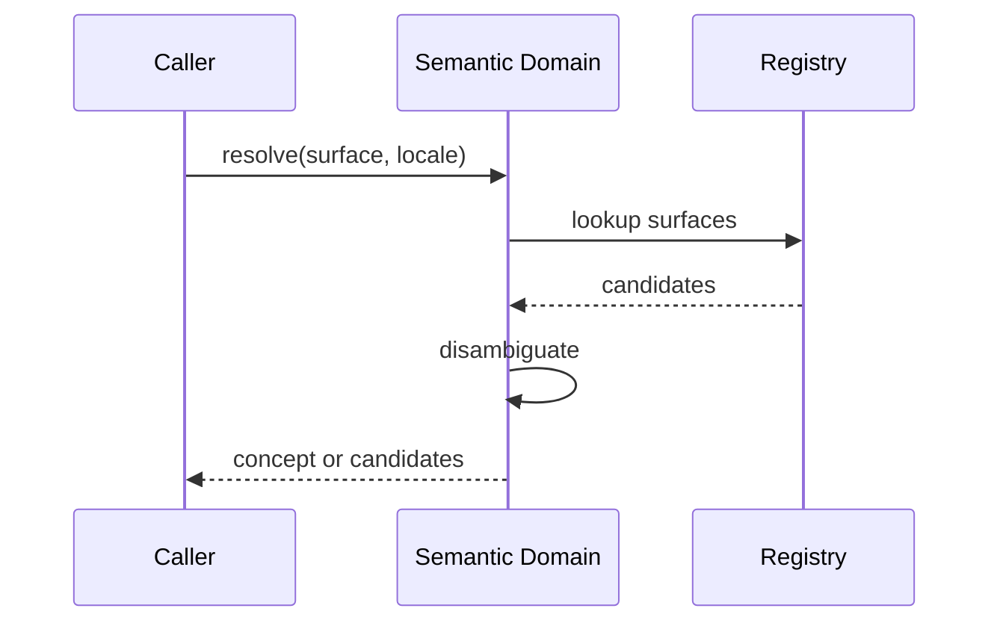

<a id="ucos-sem-000001-state-diagrams"></a>
##### State Diagrams

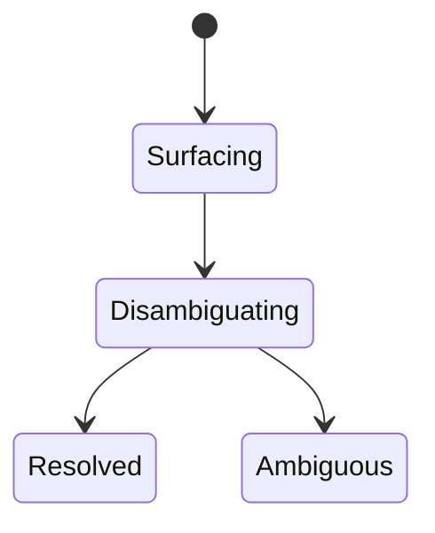

<a id="ucos-ont-000001"></a>
#### UCOS-ONT-000001 · Universal Ontology

Owner [Semantic](#d-sem) · managed in `_registry/manifest.json` → `UCOS-ONT-000001`, content `_registry/content-ext.json` → `ONT` · inherits the [standard contract](../UCOS-MASTER.md#standard-contract)

<a id="ucos-ont-000001-concepts"></a>
##### Concepts

Ontology is what exists. It is the constitutional inventory of being — not how things are sorted (taxonomy), not what they mean (meaning). Ontology is the ground floor; everything else stands on it.

<a id="ucos-ont-000001-ontology"></a>
##### Ontology

Ontology is a directed acyclic graph of Existence kinds. Root: Existence. Each kind is a RegistryEntry. Extension is by registry, never by primitive expansion.

<a id="ucos-ont-000001-taxonomy"></a>
##### Taxonomy

By abstraction: Kind / Subkind / Instance-kind. By stability: Foundational / Core / Domain / Ephemeral.

<a id="ucos-ont-000001-data-model"></a>
##### Data Model

```yaml
Ontology:
  node: <Identity>
  kind: <registry kind id>
  parentKinds: [<Identity>]
  properties: [<registry property>]
  relationships: [<registry relation kind>]
  source: <Primitive|Projection>
```

<a id="ucos-ont-000001-graph-model"></a>
##### Graph Model

(:Kind)-[:SUBKIND_OF*]->(:Kind); (:Kind)-[:HAS_PROPERTY]->(:Property); (:Kind)-[:HAS_RELATION]->(:RelationKind); (:Kind)-[:ROOTS_AT]->(:Existence)

<a id="ucos-ont-000001-apis"></a>
##### APIs

*Designed interface: the contract the domain is built towards. The routes it serves today are on its card.*

- GET  /ontology.v1/{node}
- GET  /ontology.v1.ancestors/{node}
- GET  /ontology.v1.descendants/{node}
- POST /ontology.v1.kind.propose

<a id="ucos-ont-000001-events"></a>
##### Events

- OntologyKindProposed
- OntologyKindApproved
- OntologyKindDeprecated

<a id="ucos-ont-000001-commands"></a>
##### Commands

- ontology.kind.propose
- ontology.kind.approve
- ontology.kind.deprecate

<a id="ucos-ont-000001-queries"></a>
##### Queries

- ontology.ancestors
- ontology.descendants
- ontology.kinds
- ontology.paths

<a id="ucos-ont-000001-state-machines"></a>
##### State Machines

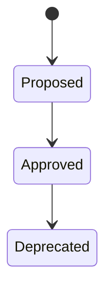

<a id="ucos-ont-000001-workflows"></a>
##### Workflows

- propose kind with parent → acyclicity check → approve → publish → existing instances re-project

<a id="ucos-ont-000001-authorities"></a>
##### Authorities

- Semantic Authority (kind approval); primitive-level changes require Constitutional Assembly.

<a id="ucos-ont-000001-permissions"></a>
##### Permissions

- ontology.kind.propose (semantic authority)
- ontology.kind.approve (semantic authority)
- ontology.read (any authenticated)

<a id="ucos-ont-000001-privacy-model"></a>
##### Privacy Model

Ontology carries no personal data by design — it is structure, not content.

<a id="ucos-ont-000001-audit-model"></a>
##### Audit Model

Every kind addition/deprecation is logged with rationale and authority; the full history of 'what existed when' is queryable.

<a id="ucos-ont-000001-digital-twin-model"></a>
##### Digital Twin Model

Ontology versions the structure twins are built on; a twin's schema is an ontology projection.

<a id="ucos-ont-000001-agent-model"></a>
##### Agent Model

Ontology Agent proposes new kinds from observed patterns and detects orphaned subkinds.

<a id="ucos-ont-000001-runtime-model"></a>
##### Runtime Model

Traversal is cached per node; invalidation on kind approval/deprecation.

<a id="ucos-ont-000001-scaling-model"></a>
##### Scaling Model

Small, globally replicated, read-heavy graph. Write path is authority-gated and low-frequency.

<a id="ucos-ont-000001-multi-tenant-model"></a>
##### Multi-Tenant Model

Ontology is shared constitutional truth; tenants extend via projections, never by mutating the core.

<a id="ucos-ont-000001-geo-distribution-model"></a>
##### Geo-Distribution Model

Globally consistent; ontology is not jurisdiction-scoped — applications apply jurisdiction via Context.

<a id="ucos-ont-000001-failure-model"></a>
##### Failure Model

Cycle introduction, orphaned kind, conflicting parents, primitive-level drift.

<a id="ucos-ont-000001-recovery-model"></a>
##### Recovery Model

Kinds are versioned; deprecation is reversible while no dependents remain.

<a id="ucos-ont-000001-certification-model"></a>
##### Certification Model

Kind must pass acyclicity, parent existence, property compatibility, and naming uniqueness.

<a id="ucos-ont-000001-migration-model"></a>
##### Migration Model

Ontology evolves only through this domain — schema migration and ontology evolution are the same act.

<a id="ucos-ont-000001-implementation-blueprint"></a>
##### Implementation Blueprint

Build order for ONT: (1) define registry entries — this domain owns by abstraction: kind / subkind / instance-kind as registry truth, not code; (2) implement the contract surface first (ontology.kind.propose, ontology.kind.approve, ontology.kind.deprecate) and validate against ONT boundaries; (3) event-source all state so history is reconstructable; (4) wire the enforcement points — authority check, policy guard, evidence binding, trace — in-line, with no bypass path; (5) add tests per the Testing Architecture, citing evidence per gate; (6) obtain Verification and Certification before activation. Acceptance: the Zero Partial and Law 001 audits pass, every action answers the seven explainability questions, and this domain mutates no other domain internals.

<a id="ucos-ont-000001-sequence-diagrams"></a>
##### Sequence Diagrams

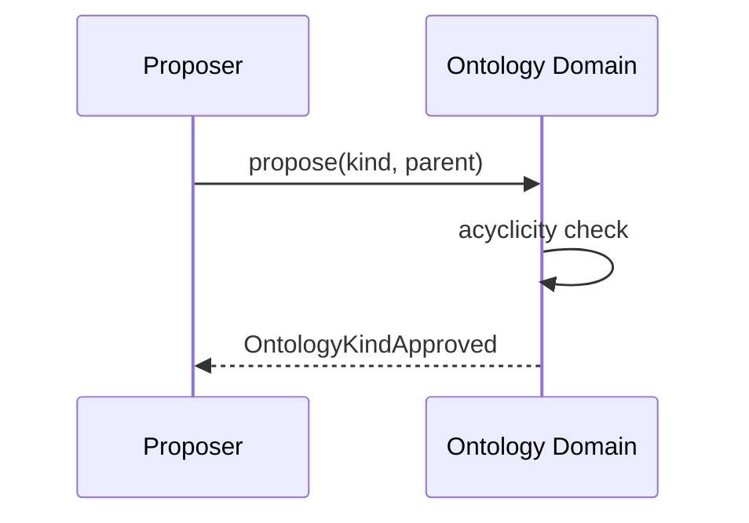

<a id="ucos-ont-000001-state-diagrams"></a>
##### State Diagrams

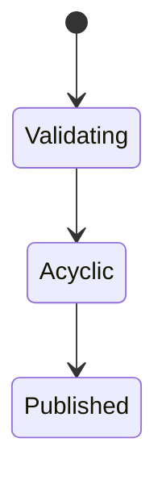

<a id="ucos-tax-000001"></a>
#### UCOS-TAX-000001 · Universal Taxonomy

Owner [Semantic](#d-sem) · managed in `_registry/manifest.json` → `UCOS-TAX-000001`, content `_registry/content-ext.json` → `TAX` · inherits the [standard contract](../UCOS-MASTER.md#standard-contract)

<a id="ucos-tax-000001-concepts"></a>
##### Concepts

Taxonomy is how things are classified. Taxonomy ≠ Ontology (what exists) and ≠ Classification (the act of assigning). Taxonomy is the structure of classification.

<a id="ucos-tax-000001-ontology"></a>
##### Ontology

Taxonomy is a tree/DAG of Categories. Each Category has one canonical parent (tree) or defined parents (DAG), membership rules, and a governing Context.

<a id="ucos-tax-000001-taxonomy"></a>
##### Taxonomy

By structure: Tree / DAG / Facet. By mutability: Frozen / Governed / Open. By scope: Universal / Domain / Tenant.

<a id="ucos-tax-000001-data-model"></a>
##### Data Model

```yaml
Taxonomy:
  categoryRef: <Identity>
  parentCategories: [<Identity>]
  membershipRule: <registry expression>
  governingContext: <Context>
  temporal: {effectiveFrom, effectiveTo}
```

<a id="ucos-tax-000001-graph-model"></a>
##### Graph Model

(:Category)-[:SUBCATEGORY_OF*]->(:Category); (:Category)-[:CLASSIFIES]->(:Existence); (:Category)-[:GOVERNED_IN]->(:Context)

<a id="ucos-tax-000001-apis"></a>
##### APIs

*Designed interface: the contract the domain is built towards. The routes it serves today are on its card.*

- POST /taxonomy.v1.category.create
- GET  /taxonomy.v1/{category}
- GET  /taxonomy.v1.tree
- POST /taxonomy.v1.assign

<a id="ucos-tax-000001-events"></a>
##### Events

- TaxonomyCategoryCreated
- TaxonomyAssigned
- TaxonomyReclassified
- TaxonomyMerged

<a id="ucos-tax-000001-commands"></a>
##### Commands

- taxonomy.category.create
- taxonomy.assign
- taxonomy.reclassify
- taxonomy.merge

<a id="ucos-tax-000001-queries"></a>
##### Queries

- taxonomy.tree
- taxonomy.path
- taxonomy.members
- taxonomy.byContext

<a id="ucos-tax-000001-state-machines"></a>
##### State Machines

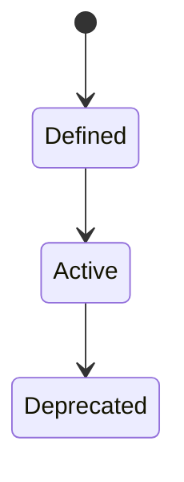

<a id="ucos-tax-000001-workflows"></a>
##### Workflows

- create category with rule → assign under governance → reclassify on rule change → preserve history

<a id="ucos-tax-000001-authorities"></a>
##### Authorities

- Semantic Authority (structure); Context Authority may add domain categories in scope.

<a id="ucos-tax-000001-permissions"></a>
##### Permissions

- taxonomy.category.create (semantic or context authority)
- taxonomy.assign (context-scoped writer)
- taxonomy.read (any authenticated)

<a id="ucos-tax-000001-privacy-model"></a>
##### Privacy Model

Classifications of persons are sensitive; category membership over personal data requires consent scope.

<a id="ucos-tax-000001-audit-model"></a>
##### Audit Model

Every assignment and reclassification records who, under which rule, in which context, and when. Prior classifications remain queryable.

<a id="ucos-tax-000001-digital-twin-model"></a>
##### Digital Twin Model

Taxonomy versions structure that classification twins mirror.

<a id="ucos-tax-000001-agent-model"></a>
##### Agent Model

Taxonomy Agent proposes new categories from clustering observations and detects stale classifications.

<a id="ucos-tax-000001-runtime-model"></a>
##### Runtime Model

Tree traversal cached; assignment is validated against membership rule at write time.

<a id="ucos-tax-000001-scaling-model"></a>
##### Scaling Model

Read-heavy; cache per context. Write path validates full ancestor chain.

<a id="ucos-tax-000001-multi-tenant-model"></a>
##### Multi-Tenant Model

Universal taxonomy is shared; tenant taxonomies are projections layered on top, never mutations of the core.

<a id="ucos-tax-000001-geo-distribution-model"></a>
##### Geo-Distribution Model

Category names are locale-resolved via the Semantic Domain; structure is global.

<a id="ucos-tax-000001-failure-model"></a>
##### Failure Model

Cycle, orphaned category, ambiguous membership, merge conflict.

<a id="ucos-tax-000001-recovery-model"></a>
##### Recovery Model

Reclassification is versioned; merges preserve both lineages. No classification is ever lost.

<a id="ucos-tax-000001-certification-model"></a>
##### Certification Model

Category must pass acyclicity, rule validity, context jurisdiction, and naming uniqueness.

<a id="ucos-tax-000001-migration-model"></a>
##### Migration Model

New categories are registry additions; reclassification is governed, never bulk-rewritten.

<a id="ucos-tax-000001-implementation-blueprint"></a>
##### Implementation Blueprint

Build order for TAX: (1) define registry entries — this domain owns by structure: tree / dag / facet as registry truth, not code; (2) implement the contract surface first (taxonomy.category.create, taxonomy.assign, taxonomy.reclassify) and validate against TAX boundaries; (3) event-source all state so history is reconstructable; (4) wire the enforcement points — authority check, policy guard, evidence binding, trace — in-line, with no bypass path; (5) add tests per the Testing Architecture, citing evidence per gate; (6) obtain Verification and Certification before activation. Acceptance: the Zero Partial and Law 001 audits pass, every action answers the seven explainability questions, and this domain mutates no other domain internals.

<a id="ucos-tax-000001-sequence-diagrams"></a>
##### Sequence Diagrams

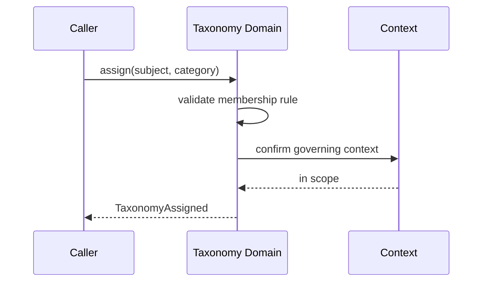

<a id="ucos-tax-000001-state-diagrams"></a>
##### State Diagrams

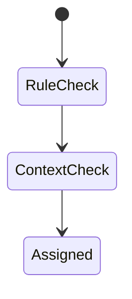

<a id="ucos-cls-000001"></a>
#### UCOS-CLS-000001 · Universal Classification Architecture

Owner [Semantic](#d-sem) · managed in `_registry/manifest.json` → `UCOS-CLS-000001`, content `_registry/content-ext.json` → `SEM` · inherits the [standard contract](../UCOS-MASTER.md#standard-contract)

<a id="ucos-cls-000001-concepts"></a>
##### Concepts

The Semantic System understands meaning. Phone, Mobile, Cellphone, Smartphone, and Handset are one semantic concept with many lexical surfaces. Meaning is higher-level understanding — it is not classification, not taxonomy, not ontology.

<a id="ucos-cls-000001-ontology"></a>
##### Ontology

Meaning ⊂ Existence. A Concept has 1 canonical Meaning, 0..n LexicalSurfaces, 0..n Equivalencies, and language-neutral intent. Ontology says what exists; taxonomy says how it is classified; meaning says what it signifies.

<a id="ucos-cls-000001-taxonomy"></a>
##### Taxonomy

By depth: Concept / Property / Relation. By status: Canonical / Equivalent / Candidate / Deprecated. By language coverage: Universal / Locale-specific.

<a id="ucos-cls-000001-data-model"></a>
##### Data Model

```yaml
SemanticModel:
  conceptId: <Identity>
  canonicalName: <string>
  meaning: <semantic statement>
  lexicalSurfaces: [{locale, surface, register}]
  equivalencies: [<conceptId>]
  synonyms: [<surface>]
  translations: [{locale, equivalent}]
  ontologyRef: <Ontology node>
  status: <Canonical|Equivalent|Candidate|Deprecated>
```

<a id="ucos-cls-000001-graph-model"></a>
##### Graph Model

(:Concept)-[:EQUIVALENT_TO]->(:Concept); (:Concept)-[:SURFACE_IN]->(:Language); (:Concept)-[:MEMBER_OF]->(:Ontology); (:Concept)-[:CLASSIFIED_AS]->(:Taxonomy)

<a id="ucos-cls-000001-apis"></a>
##### APIs

*Designed interface: the contract the domain is built towards. The routes it serves today are on its card.*

- POST /semantic.v1.concept.create
- POST /semantic.v1.resolve
- GET  /semantic.v1/{id}
- POST /semantic.v1.translate
- GET  /semantic.v1.equivalents/{id}

<a id="ucos-cls-000001-events"></a>
##### Events

- ConceptCreated
- ConceptEquivalencyAdded
- ConceptDeprecated
- MeaningDisambiguated

<a id="ucos-cls-000001-commands"></a>
##### Commands

- semantic.concept.create
- semantic.resolve
- semantic.equivalency.add
- semantic.translate
- semantic.deprecate

<a id="ucos-cls-000001-queries"></a>
##### Queries

- semantic.bySurface
- semantic.equivalents
- semantic.byLocale
- semantic.disambiguate

<a id="ucos-cls-000001-state-machines"></a>
##### State Machines


<a id="ucos-cls-000001-workflows"></a>
##### Workflows

- surface detected → disambiguate against existing concepts → propose or merge → authority confirms → publish canonical

<a id="ucos-cls-000001-authorities"></a>
##### Authorities

- Semantic Authority (canonical confirmation)
- Locale Authority (translation validity)

<a id="ucos-cls-000001-permissions"></a>
##### Permissions

- semantic.concept.create (semantic authority)
- semantic.resolve (any authenticated)
- semantic.deprecate (semantic authority)

<a id="ucos-cls-000001-privacy-model"></a>
##### Privacy Model

Semantic resolution does not retain query content; disambiguation logs store hashes, not surfaces.

<a id="ucos-cls-000001-audit-model"></a>
##### Audit Model

Every equivalency records who asserted it, under which authority, with which evidence. Ambiguity is preserved, never silently resolved.

<a id="ucos-cls-000001-digital-twin-model"></a>
##### Digital Twin Model

Semantic Twin tracks real-world language drift — neologisms, shifted meanings — and proposes concept updates.

<a id="ucos-cls-000001-agent-model"></a>
##### Agent Model

Semantic Agent discovers new surfaces from observations and proposes equivalencies under governance.

<a id="ucos-cls-000001-runtime-model"></a>
##### Runtime Model

Resolution is a locale-aware disambiguation lookup; ambiguity returns candidate sets, not guesses.

<a id="ucos-cls-000001-scaling-model"></a>
##### Scaling Model

Concept index is globally replicated; locale surfaces are partitioned by locale with lazy loading.

<a id="ucos-cls-000001-multi-tenant-model"></a>
##### Multi-Tenant Model

Tenants may extend semantics but cannot redefine canonical concepts — those are shared truth.

<a id="ucos-cls-000001-geo-distribution-model"></a>
##### Geo-Distribution Model

Locale resolution is region-served; canonical truth is global.

<a id="ucos-cls-000001-failure-model"></a>
##### Failure Model

Ambiguity collapse, equivalency cycle, locale coverage gap, meaning drift undetected.

<a id="ucos-cls-000001-recovery-model"></a>
##### Recovery Model

Concepts are versioned; deprecation supersedes. Equivalency cycles are detected and rejected at write time.

<a id="ucos-cls-000001-certification-model"></a>
##### Certification Model

Concept must pass uniqueness of canonical name, acyclicity of equivalency, and locale coverage.

<a id="ucos-cls-000001-migration-model"></a>
##### Migration Model

New locales and registers are registry additions; no schema change.

<a id="ucos-cls-000001-implementation-blueprint"></a>
##### Implementation Blueprint

Build order for SEM: (1) define registry entries — this domain owns by depth: concept / property / relation as registry truth, not code; (2) implement the contract surface first (semantic.concept.create, semantic.resolve, semantic.equivalency.add) and validate against SEM boundaries; (3) event-source all state so history is reconstructable; (4) wire the enforcement points — authority check, policy guard, evidence binding, trace — in-line, with no bypass path; (5) add tests per the Testing Architecture, citing evidence per gate; (6) obtain Verification and Certification before activation. Acceptance: the Zero Partial and Law 001 audits pass, every action answers the seven explainability questions, and this domain mutates no other domain internals.

<a id="ucos-cls-000001-sequence-diagrams"></a>
##### Sequence Diagrams


<a id="ucos-cls-000001-state-diagrams"></a>
##### State Diagrams


---

<a id="d-knw"></a>
### D-KNW · Knowledge

| | |
|---|---|
| **Category** | C02 Meaning |
| **Build status** | designed — declared and contracted; no code or live route yet |
| **Owns** | [Knowledge](../UCOS-MASTER.md#t-knowledge) |
| **Responsible for** | Knowledge Creation, Knowledge Validation, Knowledge Provenance, Knowledge Evolution |
| **Not responsible for** | Identity, Policy, Authority |
| **Contract** | [UCOS-KNW-000001 Knowledge Architecture](#ucos-knw-000001) |
| **Artifacts** | [UCOS-KNW-000001](#ucos-knw-000001) |
| **Concepts** | 2774 — `node _registry/compile.js --search <words> --kind concept --owner "Knowledge"` |
| **Code** | — |
| **Managed in** | `_registry/domains.json` → `D-KNW` |

**Live routes:** none yet.

<a id="ucos-knw-000001"></a>
#### UCOS-KNW-000001 · Knowledge Architecture

Owner [Knowledge](#d-knw) · managed in `_registry/manifest.json` → `UCOS-KNW-000001`, content `_registry/content-core.json` → `KNW` · inherits the [standard contract](../UCOS-MASTER.md#standard-contract)

<a id="ucos-knw-000001-concepts"></a>
##### Concepts

Knowledge is validated understanding of reality — interpreted information with evidence and meaning. It is NOT data, NOT information, NOT evidence. It is derived from them. Every Knowledge element answers who asserted it, when, why, under which authority, based on what evidence, with what confidence.

<a id="ucos-knw-000001-ontology"></a>
##### Ontology

Knowledge ⊂ Existence. Knowledge requires ≥1 Evidence. Knowledge has 1 Authority. Knowledge has Confidence ∈ [0,1]. Knowledge Types: Fact / Assertion / Hypothesis / Model / Belief / PolicyAsKnowledge / Regulation / Learned / Derived / Future.

<a id="ucos-knw-000001-taxonomy"></a>
##### Taxonomy

By epistemic status: Proven / Supported / Contested / Refuted / Hypothetical. By source: Observed / Inferred / Asserted / Simulated. By volatility: Stable / Drifting / Volatile.

<a id="ucos-knw-000001-data-model"></a>
##### Data Model

```yaml
Knowledge:
  knowledgeId: <Identity>
  type: <registry-driven type>
  assertion: <semantic statement>
  evidence: [<Evidence>]
  confidence: <0..1>
  provenance:
    assertedBy: <Authority>
    assertedAt: <Time>
    intent: <Intent>
  trust: <Trust>
  status: <Proven|Supported|Contested|Refuted|Hypothetical>
  supersededBy: <Knowledge|null>
```

<a id="ucos-knw-000001-graph-model"></a>
##### Graph Model

(:Knowledge)-[:SUPPORTED_BY]->(:Evidence); (:Knowledge)-[:ASSERTED_BY]->(:Authority); (:Knowledge)-[:SUPERSEDES]->(:Knowledge); (:Knowledge)-[:ABOUT]->(:Identity); (:Knowledge)-[:DERIVED_FROM]->(:Observation)

<a id="ucos-knw-000001-apis"></a>
##### APIs

*Designed interface: the contract the domain is built towards. The routes it serves today are on its card.*

- POST /knowledge.v1.assert
- GET  /knowledge.v1/{id}
- POST /knowledge.v1/{id}/contest
- GET  /knowledge.v1.query
- POST /knowledge.v1/{id}/supersede

<a id="ucos-knw-000001-events"></a>
##### Events

- KnowledgeAsserted
- KnowledgeContested
- KnowledgeSuperseded
- KnowledgeRefuted
- KnowledgeConfidenceDrifted
- KnowledgeRevalidated

<a id="ucos-knw-000001-commands"></a>
##### Commands

- knowledge.assert
- knowledge.contest
- knowledge.supersede
- knowledge.refute
- knowledge.revalidate
- knowledge.purge

<a id="ucos-knw-000001-queries"></a>
##### Queries

- knowledge.byId
- knowledge.about
- knowledge.byEvidence
- knowledge.contested
- knowledge.lineage
- knowledge.confidenceHistogram

<a id="ucos-knw-000001-state-machines"></a>
##### State Machines

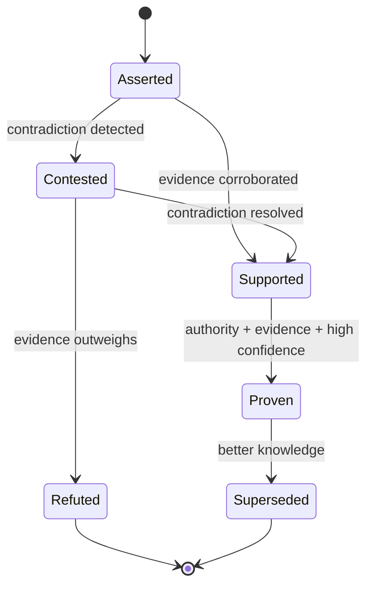

<a id="ucos-knw-000001-workflows"></a>
##### Workflows

- assert → evidence binding → trust computation → contradiction check → (contest | promote) → publish event

<a id="ucos-knw-000001-authorities"></a>
##### Authorities

- Domain Authority (asserts within jurisdiction)
- Peer Authority (contests)
- Platform Authority (purge)

<a id="ucos-knw-000001-permissions"></a>
##### Permissions

- knowledge.assert (authenticated + scoped)
- knowledge.contest (peer authority)
- knowledge.purge (platform authority only)

<a id="ucos-knw-000001-privacy-model"></a>
##### Privacy Model

Assertions about persons require consent scope `knowledge:assert:pii`. Evidence retention follows the Consent Architecture; purge is a first-class command, not an afterthought.

<a id="ucos-knw-000001-audit-model"></a>
##### Audit Model

The seven explainability questions are mandatory fields. Knowledge chain is append-only; refutation never deletes — it supersedes, preserving history.

<a id="ucos-knw-000001-digital-twin-model"></a>
##### Digital Twin Model

Knowledge Twin tracks the real-world truth state of the subject (e.g., a regulation's enactment status) and flags drift between asserted and observed reality.

<a id="ucos-knw-000001-agent-model"></a>
##### Agent Model

Knowledge Agent continuously revalidates drifting knowledge, detects contradictions, and proposes supersessions under governance.

<a id="ucos-knw-000001-runtime-model"></a>
##### Runtime Model

Write path is evidence-verified before commit; read path serves the current non-superseded head per query context.

<a id="ucos-knw-000001-scaling-model"></a>
##### Scaling Model

Partition by subject Identity. Confidence computation is a read-side projection cached per (Knowledge, Context). Contradiction detection is a stream job.

<a id="ucos-knw-000001-multi-tenant-model"></a>
##### Multi-Tenant Model

Knowledge is tenant-scoped unless explicitly published to a shared ontology. Cross-tenant assertion requires a Relationship + Policy.

<a id="ucos-knw-000001-geo-distribution-model"></a>
##### Geo-Distribution Model

Regulatory knowledge is jurisdiction-scoped; the same assertion may be Proven in one jurisdiction and Contested in another — both remain valid within Context.

<a id="ucos-knw-000001-failure-model"></a>
##### Failure Model

Evidence detachment, confidence drift beyond threshold, authority revocation mid-attestation, contradiction avalanche.

<a id="ucos-knw-000001-recovery-model"></a>
##### Recovery Model

Never delete: supersede. Recovery = rebuild current-head projection from the append-only chain. Purge is governance-gated and leaves a tombstone.

<a id="ucos-knw-000001-certification-model"></a>
##### Certification Model

Knowledge must carry ≥1 evidence, an active authority, and a computed trust score above domain threshold to be read as Proven.

<a id="ucos-knw-000001-migration-model"></a>
##### Migration Model

Knowledge schema evolves by adding types to the registry; existing assertions are re-projected, never rewritten.

<a id="ucos-knw-000001-implementation-blueprint"></a>
##### Implementation Blueprint

Build order for KNW: (1) define registry entries — this domain owns by epistemic status: proven / supported / contested / refuted / hypothetical as registry truth, not code; (2) implement the contract surface first (knowledge.assert, knowledge.contest, knowledge.supersede) and validate against KNW boundaries; (3) event-source all state so history is reconstructable; (4) wire the enforcement points — authority check, policy guard, evidence binding, trace — in-line, with no bypass path; (5) add tests per the Testing Architecture, citing evidence per gate; (6) obtain Verification and Certification before activation. Acceptance: the Zero Partial and Law 001 audits pass, every action answers the seven explainability questions, and this domain mutates no other domain internals.

<a id="ucos-knw-000001-sequence-diagrams"></a>
##### Sequence Diagrams

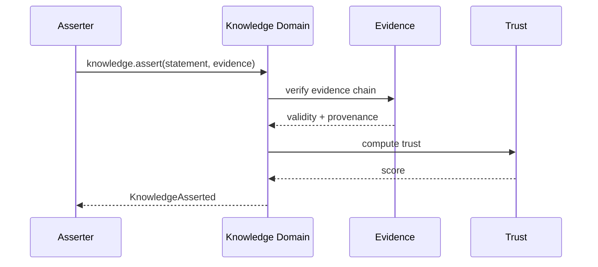

<a id="ucos-knw-000001-state-diagrams"></a>
##### State Diagrams

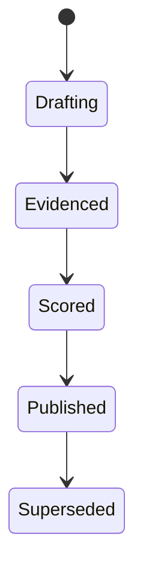

---

<a id="d-gdn"></a>
### D-GDN · Guidance

| | |
|---|---|
| **Category** | C02 Meaning |
| **Build status** | partial |
| **Owns** | [Guide](../UCOS-MASTER.md#t-guide) |
| **Responsible for** | User Manual, Help, Implementation Guides, Glossary |
| **Not responsible for** | Knowledge Validation, Meaning |
| **Contract** | [UCOS-GDN-000001 Guidance Architecture](#ucos-gdn-000001) |
| **Artifacts** | [UCOS-IMP-000001](#ucos-imp-000001), [UCOS-IMP-000002](#ucos-imp-000002), [UCOS-IMP-000003](#ucos-imp-000003), [UCOS-IMP-000004](#ucos-imp-000004), [UCOS-IMP-000005](#ucos-imp-000005), [UCOS-GDN-000001](#ucos-gdn-000001) |
| **Concepts** | 8 — `node _registry/compile.js --search <words> --kind concept --owner "Guidance"` |
| **Code** | `scripts/domain-map.js`, `scripts/domain-docs.js`, `public/docs/architecture.html`, `public/docs/e2e-flow.html`, `public/docs/platform-reference.html`, `public/docs/provisioning-guide.html`, `public/docs/user-manual.html`, `public/docs/user-manual.js` |
| **Managed in** | `_registry/domains.json` → `D-GDN` |

**Live routes:** none yet.

<a id="ucos-imp-000001"></a>
#### UCOS-IMP-000001 · Master Implementation Blueprint

Owner [Guidance](#d-gdn) · managed in `_registry/manifest.json` → `UCOS-IMP-000001`, content `_registry/content-sec-ops-dep-qlt.json` → `IMP` · inherits the [standard contract](../UCOS-MASTER.md#standard-contract)

<a id="ucos-imp-000001-concepts"></a>
##### Concepts

The Master Implementation Blueprint is the ordered path from constitution to running platform. It sequences domain delivery by dependency law — Identity first, Knowledge next, and so on to Projection — so nothing is built on a foundation that doesn't yet exist.

<a id="ucos-imp-000001-ontology"></a>
##### Ontology

The blueprint has Phases (ordered by dependency law), Milestones (gated by certification), Dependencies (relationships), and Exit criteria (verification + certification per phase). Each phase is independently shippable.

<a id="ucos-imp-000001-taxonomy"></a>
##### Taxonomy

By phase: Foundation / Core domains / Reality / Commerce / Twins+Agents / Runtime+Data / Security / Operations / Deployment / Quality / Certification. By gate: Architecture-review / Test-evidence / Formal-proof / Certification-issue.

<a id="ucos-imp-000001-data-model"></a>
##### Data Model

```yaml
ImplementationPhase:
  phaseId: <Identity>
  sequence: <int>
  deliverables: [<artifact ref>]
  dependencies: [<phaseId>]
  exitCriteria: [<Verification|Certificate>]
  status: <Planned|Active|Blocked|Complete>
  temporal: {startedAt, completedAt}
```

<a id="ucos-imp-000001-graph-model"></a>
##### Graph Model

(:Phase)-[:DELIVERS]->(:Artifact); (:Phase)-[:DEPENDS_ON]->(:Phase); (:Phase)-[:GATED_BY]->(:Verification|:Certificate)

<a id="ucos-imp-000001-apis"></a>
##### APIs

*Designed interface: the contract the domain is built towards. The routes it serves today are on its card.*

- GET  /imp.v1/phases
- POST /imp.v1.phase.start
- POST /imp.v1.phase.complete
- GET  /imp.v1.progress

<a id="ucos-imp-000001-events"></a>
##### Events

- PhaseStarted
- PhaseCompleted
- PhaseBlocked
- GatePassed
- SequenceAdjusted

<a id="ucos-imp-000001-commands"></a>
##### Commands

- imp.phase.start
- imp.phase.complete
- imp.phase.block
- imp.resequence

<a id="ucos-imp-000001-queries"></a>
##### Queries

- imp.phases
- imp.progress
- imp.blocked
- imp.next

<a id="ucos-imp-000001-state-machines"></a>
##### State Machines

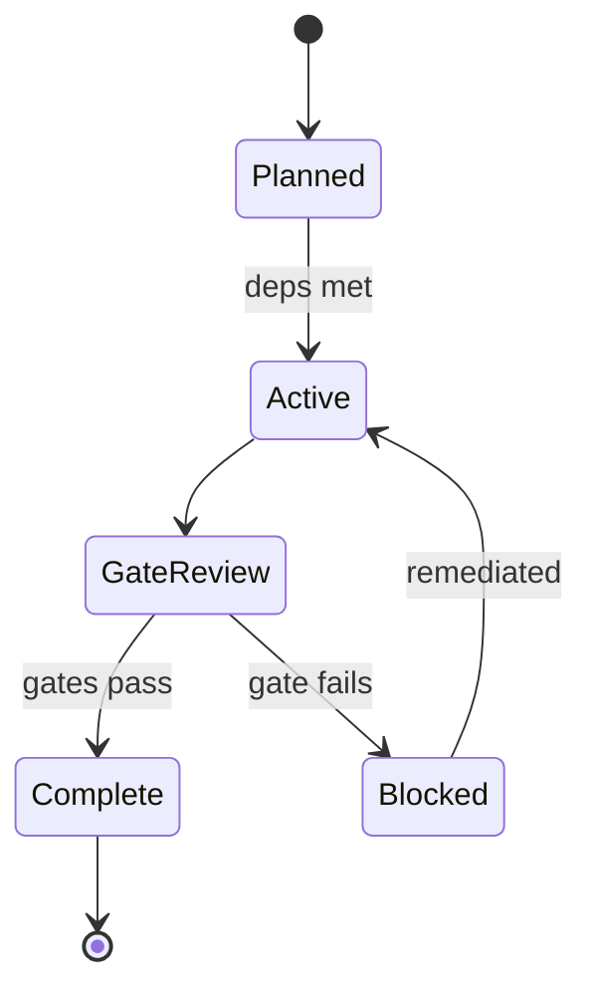

<a id="ucos-imp-000001-workflows"></a>
##### Workflows

- sequence by dependency law → build phase → run verification → pass gates → certify → proceed

<a id="ucos-imp-000001-authorities"></a>
##### Authorities

- Delivery Authority (sequencing); gates are owned by Quality and Certification authorities.

<a id="ucos-imp-000001-permissions"></a>
##### Permissions

- imp.phase.start (delivery authority)
- imp.phase.complete (only after gates pass)
- imp.read (any)

<a id="ucos-imp-000001-privacy-model"></a>
##### Privacy Model

Phases touching personal data require privacy-gate evidence — privacy is sequenced in, not bolted on.

<a id="ucos-imp-000001-audit-model"></a>
##### Audit Model

Every gate pass cites evidence; every resequence records rationale. The build history is itself an audit artifact.

<a id="ucos-imp-000001-digital-twin-model"></a>
##### Digital Twin Model

Delivery twin tracks phase health, gate failure rates, and dependency drift.

<a id="ucos-imp-000001-agent-model"></a>
##### Agent Model

Delivery agent detects dependency violations (building ahead of foundation) and blocks them.

<a id="ucos-imp-000001-runtime-model"></a>
##### Runtime Model

The blueprint is executed as registry state — progress is queryable, gates are machine-checkable.

<a id="ucos-imp-000001-scaling-model"></a>
##### Scaling Model

Phases parallelize within dependency constraints; cross-phase work requires explicit dependency declaration.

<a id="ucos-imp-000001-multi-tenant-model"></a>
##### Multi-Tenant Model

Platform phases deliver shared capability; tenant configuration is post-platform, not a phase.

<a id="ucos-imp-000001-geo-distribution-model"></a>
##### Geo-Distribution Model

Regional rollout is a deployment concern layered after platform phases.

<a id="ucos-imp-000001-failure-model"></a>
##### Failure Model

Dependency violation, gate bypass attempt, phase deadlock, foundation churn.

<a id="ucos-imp-000001-recovery-model"></a>
##### Recovery Model

A failed gate blocks the phase; remediation or resequencing are the only paths — gates never weaken to ship.

<a id="ucos-imp-000001-certification-model"></a>
##### Certification Model

No phase completes without its exit criteria met — the blueprint is the constitution's enforcement of build order.

<a id="ucos-imp-000001-migration-model"></a>
##### Migration Model

Resequencing is governance-gated and recorded.

<a id="ucos-imp-000001-implementation-blueprint"></a>
##### Implementation Blueprint

Build order for IMP: (1) define registry entries — this domain owns by phase: foundation / core domains / reality / commerce / twins+agents / runtime+data / security / operations / deployment / quality / certification as registry truth, not code; (2) implement the contract surface first (imp.phase.start, imp.phase.complete, imp.phase.block) and validate against IMP boundaries; (3) event-source all state so history is reconstructable; (4) wire the enforcement points — authority check, policy guard, evidence binding, trace — in-line, with no bypass path; (5) add tests per the Testing Architecture, citing evidence per gate; (6) obtain Verification and Certification before activation. Acceptance: the Zero Partial and Law 001 audits pass, every action answers the seven explainability questions, and this domain mutates no other domain internals.

<a id="ucos-imp-000001-sequence-diagrams"></a>
##### Sequence Diagrams

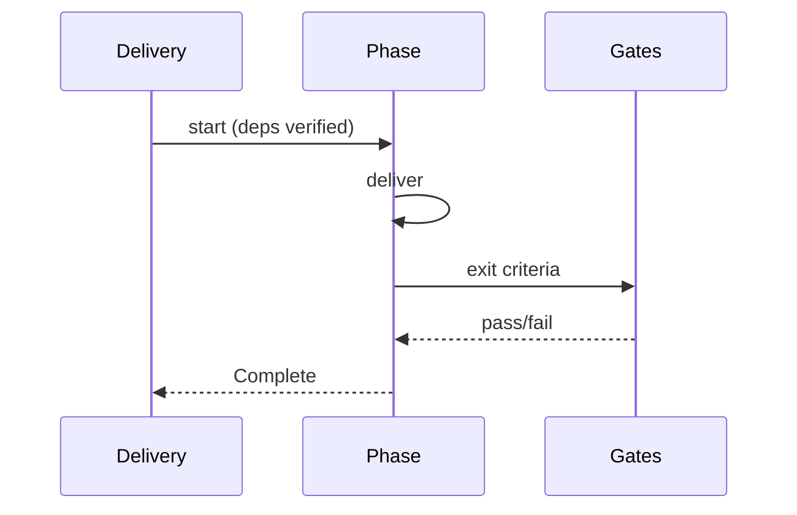

<a id="ucos-imp-000001-state-diagrams"></a>
##### State Diagrams

```mermaid
stateDiagram-v2
    [*] --> Sequencing
    Sequencing --> Building
    Building --> Verifying
    Verifying --> Certifying
```

<a id="ucos-imp-000002"></a>
#### UCOS-IMP-000002 · Reference Platform Architecture

Owner [Guidance](#d-gdn) · managed in `_registry/manifest.json` → `UCOS-IMP-000002`, content `_registry/content-sec-ops-dep-qlt.json` → `IMP2` · inherits the [standard contract](../UCOS-MASTER.md#standard-contract)

<a id="ucos-imp-000002-concepts"></a>
##### Concepts

The Reference Platform is the runnable proof that the constitution is implementable — a minimal, working substrate exercising every domain contract. It exists to validate the architecture, not to be the product.

<a id="ucos-imp-000002-ontology"></a>
##### Ontology

The Reference Platform has a Domain implementation per contract, a Registry deployment, a Projection generator, a Test suite per domain, and a Certificate per gate. It is the architecture's executable specification.

<a id="ucos-imp-000002-taxonomy"></a>
##### Taxonomy

By completeness: Skeleton / Contract-complete / Feature-complete / Production-hardened. By purpose: Validation / Onboarding / Benchmark / Demo. By deployment: Local / Single-region / Multi-region.

<a id="ucos-imp-000002-data-model"></a>
##### Data Model

```yaml
ReferencePlatform:
  platformVersion: <Identity>
  domainImplementations: [{domain, implementation ref}]
  registryDeployment: <ref>
  projectionGenerator: <ref>
  testSuite: <ref>
  certificates: [<Certificate>]
  temporal: {builtAt}
```

<a id="ucos-imp-000002-graph-model"></a>
##### Graph Model

(:Platform)-[:IMPLEMENTS]->(:DomainContract); (:Platform)-[:GENERATES_VIA]->(:Projector); (:Platform)-[:CERTIFIED_BY]->(:Certificate); (:Platform)-[:TESTED_BY]->(:TestSuite)

<a id="ucos-imp-000002-apis"></a>
##### APIs

*Designed interface: the contract the domain is built towards. The routes it serves today are on its card.*

- GET  /ref.v1/platform
- POST /ref.v1.validate
- GET  /ref.v1/coverage
- POST /ref.v1.provision

<a id="ucos-imp-000002-events"></a>
##### Events

- PlatformValidated
- PlatformCertified
- ConformanceGap
- BenchmarkCompleted

<a id="ucos-imp-000002-commands"></a>
##### Commands

- ref.validate
- ref.provision
- ref.certify
- ref.benchmark

<a id="ucos-imp-000002-queries"></a>
##### Queries

- ref.coverage
- ref.certificates
- ref.conformance
- ref.gaps

<a id="ucos-imp-000002-state-machines"></a>
##### State Machines

```mermaid
stateDiagram-v2
    [*] --> Provisioned
    Provisioned --> Validated
    Validated --> Certified
    Certified --> Benchmarked
    Benchmarkerd --> Maintained
```

<a id="ucos-imp-000002-workflows"></a>
##### Workflows

- provision → run conformance against every domain contract → certify → benchmark → maintain with the architecture

<a id="ucos-imp-000002-authorities"></a>
##### Authorities

- Architecture Authority (reference validity).

<a id="ucos-imp-000002-permissions"></a>
##### Permissions

- ref.provision (architect)
- ref.validate (system)
- ref.read (any)

<a id="ucos-imp-000002-privacy-model"></a>
##### Privacy Model

The reference platform ships with synthetic data only — no production personal data ever.

<a id="ucos-imp-000002-audit-model"></a>
##### Audit Model

Conformance results are evidence-backed and citable by the implementation blueprint.

<a id="ucos-imp-000002-digital-twin-model"></a>
##### Digital Twin Model

Reference platform twin tracks conformance drift as the architecture evolves.

<a id="ucos-imp-000002-agent-model"></a>
##### Agent Model

Reference agent regenerates contract tests as domains evolve, keeping the platform honest.

<a id="ucos-imp-000002-runtime-model"></a>
##### Runtime Model

The reference platform is deployable from the registry — 'opencode run' equivalent, no manual steps.

<a id="ucos-imp-000002-scaling-model"></a>
##### Scaling Model

It is intentionally minimal — scale properties are proven, not demonstrated by scale of the reference.

<a id="ucos-imp-000002-multi-tenant-model"></a>
##### Multi-Tenant Model

The reference implements tenant isolation as a first-class, tested property.

<a id="ucos-imp-000002-geo-distribution-model"></a>
##### Geo-Distribution Model

Multi-region deployment of the reference validates geo and sovereignty contracts.

<a id="ucos-imp-000002-failure-model"></a>
##### Failure Model

Conformance gap, contract drift, certificate expiry, benchmark regression.

<a id="ucos-imp-000002-recovery-model"></a>
##### Recovery Model

A conformance gap blocks certification of the phase depending on it.

<a id="ucos-imp-000002-certification-model"></a>
##### Certification Model

The reference platform must certify against every domain contract — a gap is an architecture defect, not a late task.

<a id="ucos-imp-000002-migration-model"></a>
##### Migration Model

The reference evolves with the registry; conformance re-runs on every architecture change.

<a id="ucos-imp-000002-implementation-blueprint"></a>
##### Implementation Blueprint

Build order for IMP2: (1) define registry entries — this domain owns by completeness: skeleton / contract-complete / feature-complete / production-hardened as registry truth, not code; (2) implement the contract surface first (ref.validate, ref.provision, ref.certify) and validate against IMP2 boundaries; (3) event-source all state so history is reconstructable; (4) wire the enforcement points — authority check, policy guard, evidence binding, trace — in-line, with no bypass path; (5) add tests per the Testing Architecture, citing evidence per gate; (6) obtain Verification and Certification before activation. Acceptance: the Zero Partial and Law 001 audits pass, every action answers the seven explainability questions, and this domain mutates no other domain internals.

<a id="ucos-imp-000002-sequence-diagrams"></a>
##### Sequence Diagrams

```mermaid
sequenceDiagram
    participant A as Architect
    participant RP as Reference Platform
    participant C as Certification
    A->>RP: provision
    RP->>RP: conformance per contract
    RP->>C: evidence
    C-->>RP: certificates
    RP-->>A: PlatformCertified
```

<a id="ucos-imp-000002-state-diagrams"></a>
##### State Diagrams

```mermaid
stateDiagram-v2
    [*] --> Provisioning
    Provisioning --> Conforming
    Conforming --> Certifying
    Certifying --> Benchmarking
```

<a id="ucos-imp-000003"></a>
#### UCOS-IMP-000003 · Engineering Playbook

Owner [Guidance](#d-gdn) · managed in `_registry/manifest.json` → `UCOS-IMP-000003`, content `_registry/content-sec-ops-dep-qlt.json` → `IMP3` · inherits the [standard contract](../UCOS-MASTER.md#standard-contract)

<a id="ucos-imp-000003-concepts"></a>
##### Concepts

The Engineering Playbook is how engineers work within the constitution: registry-first thinking, projection discipline, contract boundaries, and the duty to escalate rather than work around. It converts law into habit.

<a id="ucos-imp-000003-ontology"></a>
##### Ontology

The Playbook has Practices (registry-driven patterns), Anti-patterns (violations with remedies), Escalation paths, and Review gates. Every practice cites the law it serves.

<a id="ucos-imp-000003-taxonomy"></a>
##### Taxonomy

By activity: Design / Implement / Review / Test / Deploy / Operate. By law served: Zero-hardcoding / Knowledge-once / Projection / Governance / Explainability. By audience: Individual / Team / Architect / Governance.

<a id="ucos-imp-000003-data-model"></a>
##### Data Model

```yaml
PlaybookPractice:
  practiceId: <Identity>
  activity: <registry id>
  law: <constitutional law id>
  pattern: <description>
  antiPattern: <description>
  remedy: <description>
  escalation: <path>
```

<a id="ucos-imp-000003-graph-model"></a>
##### Graph Model

(:Practice)-[:SERVES]->(:Law); (:Practice)-[:APPLIES_TO]->(:Activity); (:Practice)-[:ESCALATES_VIA]->(:Path)

<a id="ucos-imp-000003-apis"></a>
##### APIs

*Designed interface: the contract the domain is built towards. The routes it serves today are on its card.*

- GET  /play.v1/practices
- GET  /play.v1/{id}
- GET  /play.v1/byLaw/{lawId}
- POST /play.v1.escalate

<a id="ucos-imp-000003-events"></a>
##### Events

- PlaybookConsulted
- EscalationRaised
- PlaybookAmended

<a id="ucos-imp-000003-commands"></a>
##### Commands

- play.consult
- play.escalate
- play.amend

<a id="ucos-imp-000003-queries"></a>
##### Queries

- play.practices
- play.byActivity
- play.byLaw
- play.antipatterns

<a id="ucos-imp-000003-state-machines"></a>
##### State Machines

```mermaid
stateDiagram-v2
    [*] --> Consulted
    Consulted --> Applied
    Applied --> Reviewed
    Reviewed --> Adopted
    Adopted --> Amended: law evolves
```

<a id="ucos-imp-000003-workflows"></a>
##### Workflows

- consult by activity → apply pattern → review against law → escalate on conflict → amend with the law

<a id="ucos-imp-000003-authorities"></a>
##### Authorities

- Engineering Authority (practice); amendments follow constitutional process.

<a id="ucos-imp-000003-permissions"></a>
##### Permissions

- play.consult (any engineer)
- play.escalate (any engineer, protected)
- play.amend (engineering authority)

<a id="ucos-imp-000003-privacy-model"></a>
##### Privacy Model

Escalations involving personal data route to privacy authority with minimized context.

<a id="ucos-imp-000003-audit-model"></a>
##### Audit Model

Escalations are logged and reviewed — the playbook makes 'working around' harder than 'raising it'.

<a id="ucos-imp-000003-digital-twin-model"></a>
##### Digital Twin Model

Playbook twin tracks escalation themes, surfacing systemic friction for amendment.

<a id="ucos-imp-000003-agent-model"></a>
##### Agent Model

Playbook agent surfaces the relevant practice during design review, automatically.

<a id="ucos-imp-000003-runtime-model"></a>
##### Runtime Model

The playbook is registry content — consultable programmatically by tooling and agents.

<a id="ucos-imp-000003-scaling-model"></a>
##### Scaling Model

Practices scale by being consulted; no runtime cost.

<a id="ucos-imp-000003-multi-tenant-model"></a>
##### Multi-Tenant Model

The playbook is platform-wide; tenants may add practices but not weaken constitutional ones.

<a id="ucos-imp-000003-geo-distribution-model"></a>
##### Geo-Distribution Model

Practices cite jurisdiction-aware laws where relevant.

<a id="ucos-imp-000003-failure-model"></a>
##### Failure Model

Unreviewed practice, ignored escalation, unconstitutional workaround.

<a id="ucos-imp-000003-recovery-model"></a>
##### Recovery Model

An ignored escalation is a governance event with remediation — the system protects those who raise.

<a id="ucos-imp-000003-certification-model"></a>
##### Certification Model

Every practice must cite its law — uncited practices are advisory only.

<a id="ucos-imp-000003-migration-model"></a>
##### Migration Model

Amendments track constitutional evolution.

<a id="ucos-imp-000003-implementation-blueprint"></a>
##### Implementation Blueprint

Build order for IMP3: (1) define registry entries — this domain owns by activity: design / implement / review / test / deploy / operate as registry truth, not code; (2) implement the contract surface first (play.consult, play.escalate, play.amend) and validate against IMP3 boundaries; (3) event-source all state so history is reconstructable; (4) wire the enforcement points — authority check, policy guard, evidence binding, trace — in-line, with no bypass path; (5) add tests per the Testing Architecture, citing evidence per gate; (6) obtain Verification and Certification before activation. Acceptance: the Zero Partial and Law 001 audits pass, every action answers the seven explainability questions, and this domain mutates no other domain internals.

<a id="ucos-imp-000003-sequence-diagrams"></a>
##### Sequence Diagrams

```mermaid
sequenceDiagram
    participant E as Engineer
    participant PL as Playbook
    participant G as Governance
    E->>PL: consult(activity)
    PL-->>E: practice + law
    E->>PL: conflict found
    PL->>G: escalate
    G-->>PL: ruling
    PL-->>E: resolution
```

<a id="ucos-imp-000003-state-diagrams"></a>
##### State Diagrams

```mermaid
stateDiagram-v2
    [*] --> Consulting
    Consulting --> Applying
    Applying --> Reviewing
    Reviewing --> Escalating
```

<a id="ucos-imp-000004"></a>
#### UCOS-IMP-000004 · Migration Blueprint

Owner [Guidance](#d-gdn) · managed in `_registry/manifest.json` → `UCOS-IMP-000004`, content `_registry/content-sec-ops-dep-qlt.json` → `IMP4` · inherits the [standard contract](../UCOS-MASTER.md#standard-contract)

<a id="ucos-imp-000004-concepts"></a>
##### Concepts

The Migration Blueprint moves existing systems onto the constitutional substrate without freezing the business. Migration is evolutionary: existing truth is ingested as primitives, existing interfaces continue as projections, and cutover is per-context.

<a id="ucos-imp-000004-ontology"></a>
##### Ontology

Migration has a Source (legacy truth), an Ingestion mapping (source → primitives), a Coexistence period (both served), a Cutover (per context), and a Retirement (when the source is no longer truth).

<a id="ucos-imp-000004-taxonomy"></a>
##### Taxonomy

By strategy: Lift-and-project / Strangler / Parallel-run / Big-bang / Phased-per-context. By source: Database / API / Files / ERP / Legacy-platform. By risk: Low / Medium / High / Critical.

<a id="ucos-imp-000004-data-model"></a>
##### Data Model

```yaml
Migration:
  migrationId: <Identity>
  source: <system ref>
  ingestionMapping: <registry expression>
  coexistencePolicy: <Policy>
  cutoverPlan: [{context, sequence}]
  retirement: {eligibilityAt, retiredAt}
  risk: <registry level>
  evidence: [<Evidence>]
```

<a id="ucos-imp-000004-graph-model"></a>
##### Graph Model

(:Migration)-[:FROM]->(:Source); (:Migration)-[:INGESTS_AS]->(:Primitive); (:Migration)-[:COEXISTS_PER]->(:Policy); (:Migration)-[:CUTS_OVER]->(:Context)

<a id="ucos-imp-000004-apis"></a>
##### APIs

*Designed interface: the contract the domain is built towards. The routes it serves today are on its card.*

- POST /mig.v1.plan
- POST /mig.v1.ingest
- POST /mig.v1.cutover
- POST /mig.v1.retire
- GET  /mig.v1/{id}

<a id="ucos-imp-000004-events"></a>
##### Events

- MigrationPlanned
- DataIngested
- ContextCutOver
- MigrationRolledBack
- SourceRetired

<a id="ucos-imp-000004-commands"></a>
##### Commands

- mig.plan
- mig.ingest
- mig.cutover
- mig.rollback
- mig.retire

<a id="ucos-imp-000004-queries"></a>
##### Queries

- mig.status
- mig.byContext
- mig.pending
- mig.retirementEligible

<a id="ucos-imp-000004-state-machines"></a>
##### State Machines

```mermaid
stateDiagram-v2
    [*] --> Planned
    Planned --> Ingesting
    Ingesting --> Coexisting
    Coexisting --> CuttingOver: per context
    CuttingOver --> Coexisting: more contexts
    CuttingOver --> RetiredEligible: all contexts
    RetiredEligible --> Retired
    Retired --> [*]
```

<a id="ucos-imp-000004-workflows"></a>
##### Workflows

- map source to primitives → ingest as knowledge-with-evidence → serve legacy as projections over primitives → cut over per context → retire source

<a id="ucos-imp-000004-authorities"></a>
##### Authorities

- Migration Authority (plan); context cutover requires the context owner's authority.

<a id="ucos-imp-000004-permissions"></a>
##### Permissions

- mig.plan (migration authority)
- mig.cutover (context owner)
- mig.retire (governance)

<a id="ucos-imp-000004-privacy-model"></a>
##### Privacy Model

Personal-data migration re-binds consent — ingestion without consent mapping is prohibited.

<a id="ucos-imp-000004-audit-model"></a>
##### Audit Model

Every ingested record carries provenance evidence; cutover and rollback are fully traced events.

<a id="ucos-imp-000004-digital-twin-model"></a>
##### Digital Twin Model

Migration twin tracks reconciliation between source and primitives, flagging drift during coexistence.

<a id="ucos-imp-000004-agent-model"></a>
##### Agent Model

Migration agent reconciles source vs projection continuously and blocks cutover on unresolved divergence.

<a id="ucos-imp-000004-runtime-model"></a>
##### Runtime Model

Coexistence serves legacy interfaces as projections — the legacy system reads the new truth, transparently.

<a id="ucos-imp-000004-scaling-model"></a>
##### Scaling Model

Ingestion is batched per source; cutover is throttled per context to bound risk.

<a id="ucos-imp-000004-multi-tenant-model"></a>
##### Multi-Tenant Model

Tenant migrations are independent; shared sources migrate under platform authority.

<a id="ucos-imp-000004-geo-distribution-model"></a>
##### Geo-Distribution Model

Cross-border migration respects sovereignty — data moves only where bindings permit.

<a id="ucos-imp-000004-failure-model"></a>
##### Failure Model

Mapping drift, reconciliation gap, premature cutover, retirement of still-referenced source.

<a id="ucos-imp-000004-recovery-model"></a>
##### Recovery Model

Rollback per context restores the source as truth — reversible until retirement, irreversible after.

<a id="ucos-imp-000004-certification-model"></a>
##### Certification Model

Cutover requires reconciliation evidence — divergence blocks it, no exceptions for schedule.

<a id="ucos-imp-000004-migration-model"></a>
##### Migration Model

Migration IS evolution — this blueprint is an application of the Evolution Domain, not a separate mechanism.

<a id="ucos-imp-000004-implementation-blueprint"></a>
##### Implementation Blueprint

Build order for IMP4: (1) define registry entries — this domain owns by strategy: lift-and-project / strangler / parallel-run / big-bang / phased-per-context as registry truth, not code; (2) implement the contract surface first (mig.plan, mig.ingest, mig.cutover) and validate against IMP4 boundaries; (3) event-source all state so history is reconstructable; (4) wire the enforcement points — authority check, policy guard, evidence binding, trace — in-line, with no bypass path; (5) add tests per the Testing Architecture, citing evidence per gate; (6) obtain Verification and Certification before activation. Acceptance: the Zero Partial and Law 001 audits pass, every action answers the seven explainability questions, and this domain mutates no other domain internals.

<a id="ucos-imp-000004-sequence-diagrams"></a>
##### Sequence Diagrams

```mermaid
sequenceDiagram
    participant L as Legacy
    participant MG as Migration
    participant P as Platform
    L->>MG: source truth
    MG->>MG: map to primitives
    MG->>P: ingest with evidence
    MG->>MG: reconcile
    MG->>L: legacy now reads projections
    MG->>MG: cut over per context
```

<a id="ucos-imp-000004-state-diagrams"></a>
##### State Diagrams

```mermaid
stateDiagram-v2
    [*] --> Mapping
    Mapping --> Ingesting
    Ingesting --> Reconciling
    Reconciling --> Coexisting
    Coexisting --> CuttingOver
```

<a id="ucos-imp-000005"></a>
#### UCOS-IMP-000005 · Delivery Roadmap

Owner [Guidance](#d-gdn) · managed in `_registry/manifest.json` → `UCOS-IMP-000005`, content `_registry/content-sec-ops-dep-qlt.json` → `IMP5` · inherits the [standard contract](../UCOS-MASTER.md#standard-contract)

<a id="ucos-imp-000005-concepts"></a>
##### Concepts

The Delivery Roadmap converts the blueprint into time — phases to horizons, gates to milestones, dependencies to critical path. It is the artifact leadership reads and engineers trust.

<a id="ucos-imp-000005-ontology"></a>
##### Ontology

The Roadmap has Horizons (time bands), Milestones (gated completions), Critical path (dependency-ordered), Risks (with mitigations), and Capacity (what's actually possible). It is derived from the blueprint, not independent of it.

<a id="ucos-imp-000005-taxonomy"></a>
##### Taxonomy

By horizon: Now / Next / Later / Future. By milestone: Alpha / Beta / GA / Certified / Sovereign-ready. By risk: Schedule / Dependency / Technical / Regulatory / Resource.

<a id="ucos-imp-000005-data-model"></a>
##### Data Model

```yaml
Roadmap:
  roadmapId: <Identity>
  horizons: [{name, window, phases: [<phaseId>]}]
  milestones: [{name, gate, target, status}]
  criticalPath: [<phaseId>]
  risks: [{description, mitigation, owner}]
  temporal: {asOf}
```

<a id="ucos-imp-000005-graph-model"></a>
##### Graph Model

(:Roadmap)-[:SEQUENCES]->(:Phase); (:Roadmap)-[:GATES_AT]->(:Milestone); (:Milestone)-[:REQUIRES]->(:Verification|:Certificate); (:Roadmap)-[:RISKS]->(:Risk)

<a id="ucos-imp-000005-apis"></a>
##### APIs

*Designed interface: the contract the domain is built towards. The routes it serves today are on its card.*

- GET  /road.v1
- POST /road.v1.update
- GET  /road.v1.critical-path
- GET  /road.v1.risks

<a id="ucos-imp-000005-events"></a>
##### Events

- RoadmapUpdated
- MilestoneReached
- MilestoneSlipped
- RiskRaised
- RoadmapRebaselined

<a id="ucos-imp-000005-commands"></a>
##### Commands

- road.update
- road.milestone.set
- road.risk.raise
- road.rebaseline

<a id="ucos-imp-000005-queries"></a>
##### Queries

- road.horizons
- road.milestones
- road.criticalPath
- road.risks
- road.progress

<a id="ucos-imp-000005-state-machines"></a>
##### State Machines

```mermaid
stateDiagram-v2
    [*] --> Baseline
    Baseline --> Tracking
    Tracking --> MilestoneReached
    Tracking --> MilestoneSlipped
    MilestoneSlipped --> Rebaselined
    MilestoneReached --> Tracking
    Rebaselined --> Tracking
```

<a id="ucos-imp-000005-workflows"></a>
##### Workflows

- derive from blueprint → sequence by dependency → set gated milestones → track → raise risks → rebaseline honestly

<a id="ucos-imp-000005-authorities"></a>
##### Authorities

- Delivery Authority (roadmap); milestone status is evidence-bound — slips are reported, not hidden.

<a id="ucos-imp-000005-permissions"></a>
##### Permissions

- road.update (delivery authority)
- road.risk.raise (any, protected)
- road.read (any)

<a id="ucos-imp-000005-privacy-model"></a>
##### Privacy Model

Roadmap items touching personal data cite privacy gates as milestones in their own right.

<a id="ucos-imp-000005-audit-model"></a>
##### Audit Model

Every milestone and slip is recorded with cause; rebaselines preserve history — the roadmap never forgets a promise.

<a id="ucos-imp-000005-digital-twin-model"></a>
##### Digital Twin Model

Roadmap twin predicts slips from velocity and dependency drift, early.

<a id="ucos-imp-000005-agent-model"></a>
##### Agent Model

Roadmap agent tracks critical-path health and raises risks before they become slips.

<a id="ucos-imp-000005-runtime-model"></a>
##### Runtime Model

The roadmap is derived from blueprint state — updates propagate from phase progress automatically.

<a id="ucos-imp-000005-scaling-model"></a>
##### Scaling Model

Horizons scale by team structure; the critical path is the irreducible sequence.

<a id="ucos-imp-000005-multi-tenant-model"></a>
##### Multi-Tenant Model

The roadmap is platform delivery; tenant onboarding is a consequence, not a phase.

<a id="ucos-imp-000005-geo-distribution-model"></a>
##### Geo-Distribution Model

Sovereign-ready milestones are first-class gates, not afterthoughts.

<a id="ucos-imp-000005-failure-model"></a>
##### Failure Model

Hidden slip, dependency surprise, unraised risk, fantasy capacity.

<a id="ucos-imp-000005-recovery-model"></a>
##### Recovery Model

A slip is rebaselined with evidence and cause — the honest roadmap is the recoverable one.

<a id="ucos-imp-000005-certification-model"></a>
##### Certification Model

GA milestones require certification evidence — a date without certificates is a target, not a milestone.

<a id="ucos-imp-000005-migration-model"></a>
##### Migration Model

Rebaseline is the roadmap's migration mechanism.

<a id="ucos-imp-000005-implementation-blueprint"></a>
##### Implementation Blueprint

Build order for IMP5: (1) define registry entries — this domain owns by horizon: now / next / later / future as registry truth, not code; (2) implement the contract surface first (road.update, road.milestone.set, road.risk.raise) and validate against IMP5 boundaries; (3) event-source all state so history is reconstructable; (4) wire the enforcement points — authority check, policy guard, evidence binding, trace — in-line, with no bypass path; (5) add tests per the Testing Architecture, citing evidence per gate; (6) obtain Verification and Certification before activation. Acceptance: the Zero Partial and Law 001 audits pass, every action answers the seven explainability questions, and this domain mutates no other domain internals.

<a id="ucos-imp-000005-sequence-diagrams"></a>
##### Sequence Diagrams

```mermaid
sequenceDiagram
    participant BP as Blueprint
    participant RD as Roadmap
    participant L as Leadership
    BP->>RD: phase progress
    RD->>RD: recompute critical path
    RD->>L: milestone at risk
    L->>RD: decision
    RD->>RD: rebaseline (history kept)
```

<a id="ucos-imp-000005-state-diagrams"></a>
##### State Diagrams

```mermaid
stateDiagram-v2
    [*] --> Deriving
    Deriving --> Sequencing
    Sequencing --> Tracking
    Tracking --> Reporting
```

<a id="ucos-gdn-000001"></a>
#### UCOS-GDN-000001 · Guidance Architecture

Owner [Guidance](#d-gdn) · managed in `_registry/manifest.json` → `UCOS-GDN-000001`, content `_registry/content-platform.json` → `GDN` · inherits the [standard contract](../UCOS-MASTER.md#standard-contract)

<a id="ucos-gdn-000001-concepts"></a>
##### Concepts

Guidance Architecture owns the user manual and all help, generated from declarations: domains, kinds, blueprints, packages, workflows and API contracts produce their own guides in every language, kept current by events. People and agents follow the same guides.

<a id="ucos-gdn-000001-ontology"></a>
##### Ontology

A Guide is generated from a Declaration or authored; it has Steps, references to the declarations it explains, and expressions per language tag.

<a id="ucos-gdn-000001-taxonomy"></a>
##### Taxonomy

By audience: operator / developer / shopper / agent. By origin: generated / authored. By form: guide, tutorial, reference, glossary.

<a id="ucos-gdn-000001-data-model"></a>
##### Data Model

```yaml
Guide:
  guideId: <Identity>
  source: <Declaration> | authored
  audience: <declared audience>
  steps: [<step>]
  expressions: [<Expression>]
```

<a id="ucos-gdn-000001-graph-model"></a>
##### Graph Model

(:Guide)-[:EXPLAINS]->(:Declaration); (:Guide)-[:EXPRESSED_IN]->(:Expression)

<a id="ucos-gdn-000001-apis"></a>
##### APIs

*Designed interface: the contract the domain is built towards. The routes it serves today are on its card.*

- GET  /gdn.v1/guide/{id}
- GET  /gdn.v1/for/{declaration}
- POST /gdn.v1.guide

<a id="ucos-gdn-000001-events"></a>
##### Events

- GuideRegenerated
- GuideAuthored

<a id="ucos-gdn-000001-commands"></a>
##### Commands

- guide.author
- guide.regenerate

<a id="ucos-gdn-000001-queries"></a>
##### Queries

- guide.forDeclaration
- guide.search

<a id="ucos-gdn-000001-state-machines"></a>
##### State Machines

```mermaid
stateDiagram-v2
    [*] --> Generated
    Generated --> Reviewed
    Reviewed --> Published
    Published --> [*]
```

<a id="ucos-gdn-000001-workflows"></a>
##### Workflows

- declaration changes → guide regenerated → reviewed → published in every tag

<a id="ucos-gdn-000001-authorities"></a>
##### Authorities

- The platform owner governs generated guides; authors govern their own.

<a id="ucos-gdn-000001-permissions"></a>
##### Permissions

- guide.author (author role)
- guide.read (any principal)

<a id="ucos-gdn-000001-privacy-model"></a>
##### Privacy Model

Guides carry no personal data.

<a id="ucos-gdn-000001-audit-model"></a>
##### Audit Model

Guide publishes are recorded.

<a id="ucos-gdn-000001-digital-twin-model"></a>
##### Digital Twin Model

A guidance twin tracks which guides people open before raising support requests.

<a id="ucos-gdn-000001-agent-model"></a>
##### Agent Model

Agents read the same guides to carry out an operator's request.

<a id="ucos-gdn-000001-runtime-model"></a>
##### Runtime Model

Guides regenerate from events, so they never drift from the declarations.

<a id="ucos-gdn-000001-scaling-model"></a>
##### Scaling Model

Guides are static bundles per version and tag.

<a id="ucos-gdn-000001-multi-tenant-model"></a>
##### Multi-Tenant Model

Guides are master data with tenant-authored additions.

<a id="ucos-gdn-000001-geo-distribution-model"></a>
##### Geo-Distribution Model

Guides render in the viewer's language tag.

<a id="ucos-gdn-000001-failure-model"></a>
##### Failure Model

A guide describing a declaration that changed, a missing translation.

<a id="ucos-gdn-000001-recovery-model"></a>
##### Recovery Model

Regeneration rebuilds every generated guide.

<a id="ucos-gdn-000001-certification-model"></a>
##### Certification Model

Every blueprint, package and public API operation has a guide.

<a id="ucos-gdn-000001-migration-model"></a>
##### Migration Model

Today's user manual, references and the implementation artifacts move here.

<a id="ucos-gdn-000001-implementation-blueprint"></a>
##### Implementation Blueprint

Build order for GDN: (1) guide generation from declarations; (2) authoring; (3) translation through Expression; (4) migrate the manual; (5) coverage test. Every build step also inherits Kernel parts K1–K11 (kinds, nodes, hierarchies, identifiers, shape, attributes, versions, events, change lifecycle, views and scope, resolution).

<a id="ucos-gdn-000001-sequence-diagrams"></a>
##### Sequence Diagrams

```mermaid
sequenceDiagram
    participant R as Registry
    participant G as Guidance
    R->>G: declaration changed
    G->>G: regenerate guide
    G-->>R: guide published
```

<a id="ucos-gdn-000001-state-diagrams"></a>
##### State Diagrams

```mermaid
stateDiagram-v2
    [*] --> Generating
    Generating --> Reviewing
    Reviewing --> Publishing
    Publishing --> [*]
```

---

<a id="d-pty"></a>
### D-PTY · Party

| | |
|---|---|
| **Category** | C02 Meaning |
| **Build status** | partial |
| **Owns** | [Party](../UCOS-MASTER.md#t-party), [Role](../UCOS-MASTER.md#t-role) |
| **Responsible for** | Platforms And Tenants, Organisations, People, Agents As Actors, Providers, Roles |
| **Not responsible for** | Identity, Permissions, Credentials |
| **Contract** | [UCOS-PTY-000001 Party Architecture](#ucos-pty-000001) |
| **Artifacts** | [UCOS-PTY-000001](#ucos-pty-000001) |
| **Concepts** | 267 — `node _registry/compile.js --search <words> --kind concept --owner "Party"` |
| **Code** | `lib/stores.js`, `lib/tenancy.js`, `lib/seed/stores.json` |
| **Managed in** | `_registry/domains.json` → `D-PTY` |

**Live routes (49)** — what the platform serves today for this domain:

- `GET /api/admin/staff`
- `POST /api/admin/staff`
- `PUT /api/admin/staff/:id`
- `DELETE /api/admin/staff/:id`
- `GET /api/tenant/entity-def`
- `GET /api/tenant/master/permissions`
- `GET /api/tenant/master/contributions`
- `POST /api/tenant/master/contributions`
- `POST /api/tenant/master/contributions/:id/withdraw`
- `GET /api/tenant/master/items/:ref`
- `GET /api/tenant/products`
- `GET /api/tenant/catalog/importable`
- `POST /api/tenant/catalog/import`
- `GET /api/platform/global/tenant`
- `GET /api/addresses`
- `POST /api/addresses`
- `PUT /api/addresses/:id`
- `DELETE /api/addresses/:id`
- `PUT /api/admin/mode`
- `GET /api/admin/users`
- `DELETE /api/admin/users/:id`
- `GET /api/tenancy/tree`
- `GET /api/tenancy/nodes`
- `POST /api/tenancy/node`
- `PUT /api/tenancy/node/:id`
- `DELETE /api/tenancy/node/:id`
- `GET /api/tenancy/resolve/:id`
- `POST /api/tenancy/config/:id/:key`
- `PUT /api/admin/account`
- `GET /api/user/identity-methods`
- `POST /api/user/identity-methods`
- `DELETE /api/user/identity-methods/:id`
- `PUT /api/user/identity-methods/:id/primary`
- `GET /api/platform/tenants`
- `GET /api/platform/tenants/:id/setup`
- `POST /api/platform/tenants`
- `GET /api/platform/tenants/:id/blueprint`
- `POST /api/platform/tenants/:id/blueprint`
- `POST /api/platform/tenants/:id/requests`
- `PUT /api/platform/tenants/:id`
- `DELETE /api/platform/tenants/:id`
- `POST /api/platform/tenants/:id/impersonate`
- `POST /api/platform/tenants/:id/subscribe`
- `POST /api/platform/tenants/:id/invoice`
- `GET /api/platform/admins`
- `POST /api/platform/admins`
- `PUT /api/platform/admins/:id`
- `DELETE /api/platform/admins/:id`
- `POST /api/platform/users`

<a id="ucos-pty-000001"></a>
#### UCOS-PTY-000001 · Party Architecture

Owner [Party](#d-pty) · managed in `_registry/manifest.json` → `UCOS-PTY-000001`, content `_registry/content-platform.json` → `PTY` · inherits the [standard contract](../UCOS-MASTER.md#standard-contract)

<a id="ucos-pty-000001-concepts"></a>
##### Concepts

Party Architecture owns everyone and everything that acts: platforms, tenants and their hierarchy (organisation, business unit, brand, store, channel), organisations, people, agents and providers, and the roles they play. A customer or a seller is a party in a role, never a separate copy.

<a id="ucos-pty-000001-ontology"></a>
##### Ontology

A Party has an Identity, a kind, a place in the tenancy hierarchy and any number of Roles, each held in a Context (a store, a channel, a place) for a validity window.

<a id="ucos-pty-000001-taxonomy"></a>
##### Taxonomy

Kinds: platform, tenant, organisation, business unit, brand, store, channel, person, agent, provider, any declared. Roles: customer, seller, staff, carrier, partner, any declared.

<a id="ucos-pty-000001-data-model"></a>
##### Data Model

```yaml
Party:
  partyId: <Identity>
  kind: <declared kind>
  parent: <Party> | null
  roles: [{role, context, validFrom, validTo}]
  temporal: {validFrom, validTo, recordedAt}
```

<a id="ucos-pty-000001-graph-model"></a>
##### Graph Model

(:Party)-[:WITHIN]->(:Party); (:Party)-[:PLAYS {context}]->(:Role); (:Party)-[:IDENTIFIED_BY]->(:Identity)

<a id="ucos-pty-000001-apis"></a>
##### APIs

*Designed interface: the contract the domain is built towards. The routes it serves today are on its card.*

- POST /pty.v1.party
- GET  /pty.v1/{id}
- POST /pty.v1.role
- GET  /pty.v1/{id}/roles

<a id="ucos-pty-000001-events"></a>
##### Events

- PartyRegistered
- RoleAssigned
- RoleEnded
- PartyMoved

<a id="ucos-pty-000001-commands"></a>
##### Commands

- party.register
- party.move
- role.assign
- role.end

<a id="ucos-pty-000001-queries"></a>
##### Queries

- party.ancestors
- party.roles
- parties.inRole

<a id="ucos-pty-000001-state-machines"></a>
##### State Machines

```mermaid
stateDiagram-v2
    [*] --> Registered
    Registered --> Active
    Active --> Suspended
    Suspended --> Closed
    Closed --> [*]
```

<a id="ucos-pty-000001-workflows"></a>
##### Workflows

- register party → place in the hierarchy → assign roles in contexts → act through its roles

<a id="ucos-pty-000001-authorities"></a>
##### Authorities

- The platform owner governs platforms and tenants; a tenant governs its own hierarchy and roles.

<a id="ucos-pty-000001-permissions"></a>
##### Permissions

- party.register (scope owner)
- role.assign (role administrator)
- party.read (by view)

<a id="ucos-pty-000001-privacy-model"></a>
##### Privacy Model

People are parties with personal data; it is declared sensitive and handled under Compliance.

<a id="ucos-pty-000001-audit-model"></a>
##### Audit Model

Registrations, moves and role changes are recorded.

<a id="ucos-pty-000001-digital-twin-model"></a>
##### Digital Twin Model

A party twin shows a party's roles and activity across contexts.

<a id="ucos-pty-000001-agent-model"></a>
##### Agent Model

An agent is a party with its own roles; it acts only within them.

<a id="ucos-pty-000001-runtime-model"></a>
##### Runtime Model

Role checks resolve the party's roles in the current context through the resolver.

<a id="ucos-pty-000001-scaling-model"></a>
##### Scaling Model

The hierarchy is read by ancestor path; roles are indexed by context.

<a id="ucos-pty-000001-multi-tenant-model"></a>
##### Multi-Tenant Model

Each tenant's parties are isolated; platform parties bound tenant parties.

<a id="ucos-pty-000001-geo-distribution-model"></a>
##### Geo-Distribution Model

A party relates to the places it serves; its place-dependent settings are inherited.

<a id="ucos-pty-000001-failure-model"></a>
##### Failure Model

A customer copied per store, a role without a context, a cycle in the hierarchy.

<a id="ucos-pty-000001-recovery-model"></a>
##### Recovery Model

Parties are never deleted outright; they close and keep their history.

<a id="ucos-pty-000001-certification-model"></a>
##### Certification Model

One party per real actor; roles carry their context and validity.

<a id="ucos-pty-000001-migration-model"></a>
##### Migration Model

Today's tenancy hierarchy, users and staff move here.

<a id="ucos-pty-000001-implementation-blueprint"></a>
##### Implementation Blueprint

Build order for PTY: (1) party kinds and the hierarchy; (2) roles in contexts; (3) migrate the tenancy hierarchy, users and staff; (4) tests that a customer is one party across stores. Every build step also inherits Kernel parts K1–K11 (kinds, nodes, hierarchies, identifiers, shape, attributes, versions, events, change lifecycle, views and scope, resolution).

<a id="ucos-pty-000001-sequence-diagrams"></a>
##### Sequence Diagrams

```mermaid
sequenceDiagram
    participant O as Operator
    participant P as Party
    O->>P: register(party, parent)
    O->>P: assign(role, context)
    P-->>O: party with roles
```

<a id="ucos-pty-000001-state-diagrams"></a>
##### State Diagrams

```mermaid
stateDiagram-v2
    [*] --> Registering
    Registering --> Assigning
    Assigning --> Acting
    Acting --> [*]
```

